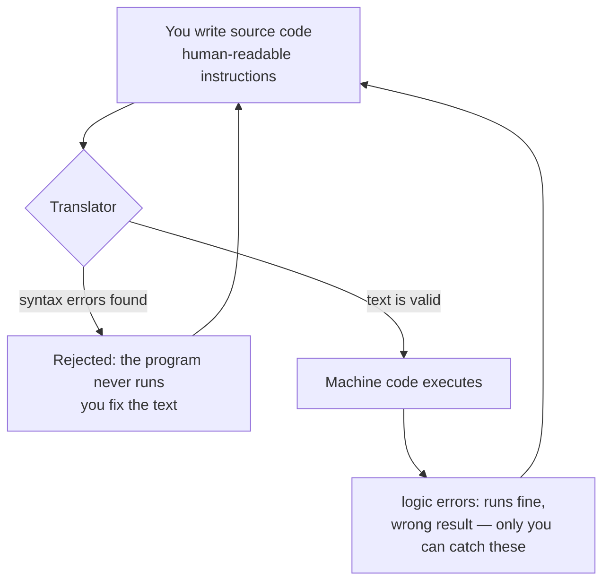

# How Programming Works

## 1. Learning Objectives

After this lesson you will be able to:

- [ ] Explain what a program is, in your own words, to someone with no technical background
- [ ] Describe the path from a human-written instruction to a machine executing it
- [ ] Predict the category of failure when a program misbehaves (your bug vs the machine's fault)
- [ ] Explain why "the computer is fast but literal" accounts for most beginner frustration

## 2. Prerequisites

- [How to use this repository](how-to-use-this-repository.md) — you need to know how lessons,
  exercises, and completion criteria work. No other prerequisite exists: this lesson assumes
  nothing about computers.

## 3. Introduction

A computer program is a **list of unambiguous instructions, written in a language a machine can
execute, that transforms inputs into outputs.** That sentence contains the four ideas this lesson
unpacks: instructions, language, execution, and input/output.

Everything else in this curriculum — every language, framework, database, and server — is elaboration
on this definition. If you can hold it clearly, nothing later will feel arbitrary.

## 4. The Problem It Solves

Machines are extraordinary at one thing: carrying out arithmetic and moving data at enormous speed.
They understand nothing. They have no common sense, no intention, and no ability to guess what you
meant.

Before programming, "automating" a task meant describing it to a human clerk, who could fill gaps
with judgment. Programming is the opposite trade: you get inhuman speed and perfect consistency, and
in exchange you must supply **every** detail yourself, with zero ambiguity. The whole discipline is
that exchange.

## 5. Core Concepts

### 5.1 Instructions

An instruction tells the machine to do exactly one thing: add two numbers, compare two values,
copy a value into memory, display something, wait for a keypress. Programs are instructions
*composed* into sequences, decisions, and repetitions — a idea you will meet properly in
[02-PROGRAMMING-FUNDAMENTALS](../02-PROGRAMMING-FUNDAMENTALS/README.md).

Two properties matter now:

- **Unambiguity.** "Sort the list reasonably" is not an instruction. "Compare each pair of
  neighbouring items and swap them if the left one is larger" is.
- **Determinism.** The same instructions with the same inputs produce the same result, every time.
  Surprise in a program always comes from an input or state you did not account for.

### 5.2 Language: humans, programmers, machines

Three languages are involved, and confusing them causes real confusion later:

| Audience | Language | Example |
|---|---|---|
| Everyone | Natural language (English, Swahili, …) | "Send a receipt to the customer" |
| Programmers | A programming language (Java, JavaScript, Python, …) | `if (order.isPaid()) sendReceipt(order);` |
| The machine | Machine code — numbers that are electrical commands | `10110000 01100001` |

Programming languages exist because **writing machine code by hand is unusable at human scale**.
A programming language is therefore a *translation target*: something humans can read that a tool
then converts into machine code.

### 5.3 Translation: how your text becomes machine behaviour

The tool that performs that conversion is called a **translator**, and there are two main kinds:

- A **compiler** reads your entire program up front, checks it for errors, and produces machine
  code (or an intermediate form) as a separate step. Java uses this model.
- An **interpreter** reads your program and carries out each instruction as it goes. The classic
  model for early JavaScript; modern engines use a mix of both, which is a detail for later.

Either way, the crucial consequence: **there is a checkpoint between what you wrote and what runs.**
Errors found there never execute at all — the tool refuses to run a program containing them. This is
why a typo in Java stops the program from running, while a misunderstanding of your own logic runs
happily and produces wrong answers. Two bug categories, forever:



The diagram's story in words: your text enters a translator; if the text violates the language's
rules, execution is blocked and you fix the text; if it passes, the machine runs it — and from that
point, a wrong answer means a wrong *idea* in your head, not a typo. Learning to program is mostly
learning to hunt the second kind.

### 5.4 Input → Processing → Output

Every program, of any size, can be seen as:

**Input** (keyboard, file, network, sensor) → **Processing** (instructions transforming data) →
**Output** (screen, file, network, another system).

When a program misbehaves, ask which of the three stages holds the fault. Most early bugs are
"garbage in, garbage out": the processing was correct, the input was not what you assumed.

### 5.5 "Fast but literal"

This phrase is the mental model to keep. The machine will execute a wrong instruction a billion
times without complaint. It will never pause to say "surely you meant…". Every error message you
will ever see comes not from the machine being confused, but from tools *built around* the machine
checking your text against the language's rules — or from your own tests comparing behaviour to
intent.

## 6. How It Works — one instruction's journey

Take a line a learner will write in week four: *add 2 to the counter and display it.*

1. You type the instruction in a source file, in a programming language.
2. A translator checks the text against the language's grammar. If valid, it produces machine code;
   if not, it prints an error naming the line and stops.
3. The operating system loads that machine code into memory and hands the processor to it.
4. The processor fetches an instruction, decodes what it means, executes it, and repeats — millions
   of times per second ([01-COMPUTER-FOUNDATIONS/how-programs-execute.md](../01-COMPUTER-FOUNDATIONS/how-programs-execute.md)
   covers this properly).
5. The instruction that displays the value asks the operating system to put text on your screen.
6. You see the number. Total elapsed time: a fraction of a millisecond. Total human effort: the
   entire point of the curriculum.

## 7. Practical Examples

### Example 1 — a program in three languages

The same task — "display Hello" — at three levels. No need to read the code yet; notice only the
shape.

```text
Natural language:   "Please display the words Hello."

Programming code:   System.out.println("Hello");
                    (this is Java; you will read it fluently in subject 04)

Machine code:       10110000 01001000 11000101 00000101
                    (illustration of the idea — exact bytes depend on the processor)
```

**What to notice:** the middle line is written for a person; the bottom line is written for a
processor. The translator bridges them. The machine-code line is *illustrative*, not executed here.

### Example 2 — two kinds of failure, side by side

```java
System.out.println("Hello)   // (1) a typo: the quotation mark is missing
```

```java
int price = 10;
int total = price - 1;   // (2) valid text, wrong idea: should be price + 1
System.out.println(total);
```

- Snippet (1) will be **rejected by the translator** before running, because it violates the
  language's grammar. You fix the text and move on.
- Snippet (2) **runs perfectly** and prints `9`. Nothing in the machine will ever object. Only your
  understanding of what the program was supposed to do can catch it.

**How to run these:** you do not need to yet — Java setup is
[04-JAVA-PROGRAMMING/java-environment-setup.md](../04-JAVA-PROGRAMMING/java-environment-setup.md).
The point of the examples is the contrast, not the execution.

## 8. Real-World Applications

Every piece of software you have ever used is this pipeline at scale: a bank app is input
(your taps) → processing (validation, rules, arithmetic) → output (a screen, a receipt, a message to
another system). When such systems fail publicly — a payment charged twice, a form accepting garbage
— the cause is always findable in one of these four ideas: unclear instructions, unvalidated input,
a wrong idea in the logic, or a translator/runtime behaving differently than assumed. Professionals
diagnose in that order.

## 9. Common Mistakes

| Mistake | Why it happens | How to prevent it |
|---|---|---|
| Believing the computer "doesn't like you" | Errors feel personal when you are new | Errors are rule-checking, not judgment; read them as sentences |
| Blaming the machine for a logic bug | The program "did something weird" | Ask first: did the tool *block* execution (text problem) or *run* and give a wrong answer (idea problem)? |
| Trying to learn machine code first | Intuition says start at the bottom | Languages are the productive level; the machine details that matter are taught in subject 01, at the right depth |
| Expecting to memorize syntax | School habits | Professionals look syntax up constantly; understand mechanisms, not keystrokes |

## 10. Best Practices

- **Say it in plain language first.** Before writing any instruction anywhere, describe the task in
  one unambiguous sentence. If you cannot, no language will save you.
- **Treat every error message as a clue, and read it completely.** The last line names the problem;
  the lines above name where.
- **Separate the two bug categories in your head.** "It won't run" is a text problem. "It runs and
  is wrong" is a thinking problem — and it is 90% of real work.

## 11. Limitations and Trade-Offs

This lesson's model is deliberately simplified: real systems are layers of programs talking to
other programs, and modern interpreters blur the compiler/interpreter line. The simplification is
faithful — every detail added later refines these four ideas rather than replacing them. When a
detail seems to contradict this lesson, the detail is more precise, not the lesson wrong.

## 12. Practical Exercises

### Introductory

1. **Explain it to a ten-year-old.** In three sentences, explain what a program is and why it can be
   wrong. **Completion criteria:** no technical jargon; mentions that the machine does exactly what
   is written.
2. **Classify three failures.** For each: "app refused to open" / "form accepted an empty phone
   number" / "calculator gave 9 instead of 11" — name which category it is (text problem, idea
   problem, or input problem). **Completion criteria:** each classified with a one-line reason.

### Intermediate

3. **Find the ambiguity.** Take the instruction "sort the customers by name" and list three
   questions it fails to answer. **Completion criteria:** at least three genuine ambiguities
   (case? accents? ties?).
4. **Trace input → processing → output** for a system you use daily (a lift, a traffic light, a
   messaging app). **Completion criteria:** all three stages named, with one example each.

### Independent problem-solving

5. **Write the instruction set.** Choose a trivial task (making tea, deciding whether to take an
   umbrella). Write the complete instruction list for a machine that knows nothing, including every
   decision and loop. Then answer in one paragraph: which step was hardest to make unambiguous, and
   what does that predict about programming?
   **Completion criteria:** every step has no "obvious" gaps — a machine could follow it — and the
   reflection is written.

## 13. Knowledge Check

1. In your own words, what is the difference between a compiler and an interpreter?
2. A program runs and prints the wrong total. Which of the four core ideas is at fault, and why is
   no error message shown?
3. Why can no computer program ever "understand" what you meant?
4. Name the three stages every program can be seen as, and one example of a fault in each.

## 14. Completion Criteria

- [ ] You can define "program" without jargon and give a non-computer example of one
- [ ] You can explain the two bug categories and which one tools catch for you
- [ ] You traced one real system through input → processing → output
- [ ] You wrote an unambiguous instruction set for a simple task

## 15. Summary

- A program is a list of unambiguous instructions transforming input into output.
- Machines are fast and literal; they never infer intent, so every gap in your instructions is a bug.
- Programming languages exist so humans can write for translation into machine code.
- Translation creates a checkpoint: text errors are blocked before running; logic errors run happily
  and are caught only by your understanding and your tests.

## 16. Next Steps

- [learning-method.md](learning-method.md) — how to study so this knowledge compounds.
- Then [study-planning.md](study-planning.md),
  [prerequisite-map.md](prerequisite-map.md), and on to
  [01-COMPUTER-FOUNDATIONS](../01-COMPUTER-FOUNDATIONS/README.md).