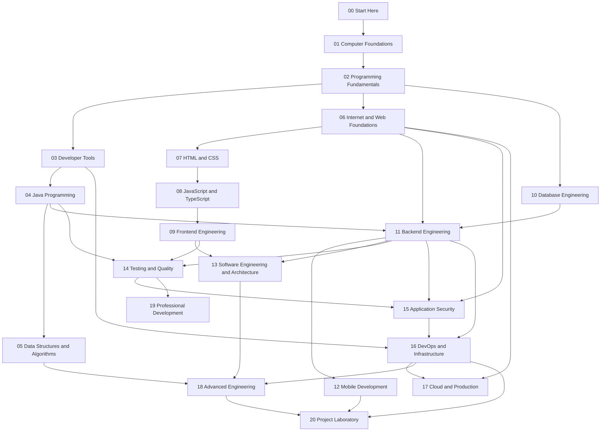

# The Prerequisite Map

## 1. Learning Objectives

After this lesson you will be able to:

- [ ] Name what each of the 22 subjects depends on, and what depends on it
- [ ] Choose your starting subject based on evidence rather than ambition
- [ ] Explain why a particular shortcut (e.g. "skip databases, learn microservices") fails

## 2. Prerequisites

- [How to use this repository](how-to-use-this-repository.md) — subject and lesson navigation.
- [Study planning](study-planning.md) — this map is what your plan's sequence follows.

## 3. Introduction

The curriculum is a **directed graph**: every subject has prerequisites, and every shortcut through
it is a future stall. This lesson is the map itself, plus the skill of reading it — where to enter,
what may be parallelized, and what can never be skipped.

## 4. The Problem It Solves

Self-learners fail in a characteristic pattern: they start five subjects, finish none, and stall at
the first thing that does not immediately click — usually because the missing prerequisite is two
subjects back and they do not know it. The map turns "I am stuck" into a diagnosis: *which
prerequisite am I missing?* — and that question always has a specific answer.

## 5. Core Concepts

### 5.1 The whole graph

Read it as: an arrow from A to B means "B assumes A". Three properties are worth noticing.

- **There is one entrance.** Everything passes through 00 → 01 → 02. There is no side door into the
  advanced material, because everything advanced is *built from* the foundations.
- **It widens, then narrows.** After subject 03 the path splits (web track, data track) and can be
  partially parallelized; it converges again at 13–18, which assume both tracks.
- **The dangerous edges are long.** The most tempting skips are the longest arrows: 05 → 18, 10 →
  11, 08 → 09. Each skip produces the specific failures described below.

### 5.2 Why each edge exists (the failure each prerequisite prevents)

| Skipping… | Produces this failure |
|---|---|
| 01 Computer Foundations | "Why is my program slow?" and "what is a file anyway" become unanswerable; debugging is guesswork |
| 02 Programming Fundamentals | You can copy syntax but cannot decompose a problem; every later subject becomes vocabulary without sentences |
| 03 Developer Tools | Git fear, environment chaos, and an inability to reproduce your own work |
| 04 Java | Subject 11's Spring Boot is unreadable — layers, interfaces, and generics all appear as magic |
| 05 DSA | You pick data structures by habit; performance problems are unfixable and interviews go badly |
| 06 Internet | HTTP, REST, TLS, and cookies are incantations; APIs cannot be debugged or secured |
| 07 HTML/CSS | React emits markup you cannot read; accessibility and layout are permanent mysteries |
| 08 JS/TS | Framework abstractions hide the language; async bugs are untouchable |
| 09 Frontend | The mobile/full-stack projects have no client to integrate with |
| 10 Databases | Your backend stores data however it landed; integrity and performance are accidents |
| 11 Backend | Nothing to deploy, secure, test at the API level, or build a client against |
| 14 Testing | Security fixes cannot be proven; CI is decoration; regressions rule your life |

The pattern: **each edge prevents a specific, nameable failure** — not a formality.

### 5.3 Where you may enter (honestly)

The default entry is subject 00 for everyone — it is two hours of orientation. After that, evidence
decides:

| Your evidence | Enter at | Verify by |
|---|---|---|
| Truly new to programming | 01 | Just start |
| Can write small programs (coursework, self-taught) | 02 | Cold-pass its exercises 1–5, then mark your real level |
| Comfortable in the terminal and Git | 03 | Complete its knowledge checks cold; skip what you demonstrably know |
| Professional backend developer | 04 | Cold-pass 04's OOP exercises; if you pass, mark level 3–4 and continue to 05/10 |
| Knows HTML/CSS/JS well | 07–08 | Cold-pass exercise sets; continue to 09 |
| Works with databases | 10 | Pass the SQL exercise sets with expected results |

"Test out" means: closed-book knowledge check plus one exercise set, both passed. Wishing you could
skip is not evidence; the tracker's levels exist so your self-assessment is inspectable by the only
person it matters to — you, in three months.

### 5.4 Legitimate parallelization

Two pairings are safe once subject 03 is done, because their prerequisites do not overlap
dangerously:

- **10 Databases ∥ 06–08 Web track** — they share only subject 02; many learners alternate between
  them well.
- **Review tracks** — while doing 11 Backend, revisiting 14 Testing material as it becomes relevant
  is expected, not a violation.

Everything else in the graph is load-bearing: parallelizing 05 with 11, or 13 with 09, reliably
produces the "too much at once, nothing retained" outcome.

## 6. How It Works — diagnosing yourself with the map

When you stall, run this three-question procedure:

1. **Which subject does this lesson belong to?** (Find the directory.)
2. **Which arrow points into it?** (Look at the map above.)
3. **Can I pass that prerequisite's knowledge check cold, right now?** If not, that is your next
   hour — not the lesson that broke you.

This converts the vague feeling "I'm not smart enough for this" into a concrete, fixable gap. In
practice, roughly nine out of ten stalls resolve in the prerequisite immediately before the
blocking lesson.

## 7. Real-World Applications

Teams use exactly this reasoning when onboarding: "she needs two weeks in our data model before she
can touch the payment service." The map is why the curriculum's ROADMAP gates promotions on
demonstrated competence rather than dates — a gate you cannot pass without the underlying edge.

## 8. Common Mistakes

| Mistake | Why it happens | How to prevent it |
|---|---|---|
| "I already know some of 02, so start at 04" | Motivation to move fast | Test out with evidence (§5.3); the test decides, not the feeling |
| Running three tracks at once | Excitement about all of them | Parallelize only the two pairings in §5.4 |
| Feeling that 01 is "beneath me" | Credentials, ego | The knowledge checks settle it in 30 minutes either way |
| Reaching 18 via tutorials before 05 | The topics are marketed as senior | 18 assumes the failure experience of 05, 13, and 16 |

## 9. Best Practices

- **Print the map** (or keep it open in a tab) and mark your position with the tracker's level per
  subject; the picture keeps "what next" from ever being a question.
- **Re-test out periodically.** Six months into the curriculum, a subject you once skipped may now
  be passable — revisit it then rather than pretending it vanished.
- **When stuck, move backward one edge, not forward three.**

## 10. Limitations and Trade-Offs

Real expertise does not always grow in the order drawn: some professionals learned 10 before 04, or
16 before 11, and adapted. The map is a *risk-reduction* tool, not a law of nature — it encodes the
path with the fewest stalls for the most people. If your prior experience genuinely covers an edge,
the map says: prove it, mark the level, move on. It never says: believe it and move on.

## 11. Practical Exercises

### Introductory

1. **Draw the graph from memory** after studying §5.1 — boxes and arrows, no labels required.
   **Completion criteria:** all 22 subjects present with at least the eight critical edges
   (02→04, 04→11, 06→11, 10→11, 08→09, 05→18, 13→18, 16→17).
2. **Name your position.** Which subject are you in, and what does its incoming arrow assume?
   **Completion criteria:** written, with the prerequisite you will verify next.

### Intermediate

3. **Plan a test-out.** Pick one subject you believe you could skip. Write the exact evidence you
   would need: which knowledge checks, which exercise set, what score.
   **Completion criteria:** a written, falsifiable test with a pass mark.
4. **Diagnose a past stall.** Recall something you gave up learning (any technology). Using §5.2's
   logic, identify the prerequisite you were probably missing. **Completion criteria:** a named
   candidate gap and the lesson you would study to close it.

### Independent problem-solving

5. **Teach the map.** Write 150 words explaining to a peer why "learn microservices before you can
   deploy a monolith" fails, using only the map's logic — no appeal to authority.
   **Completion criteria:** the explanation names the specific missing edges and the specific
   failures they prevent.

## 12. Knowledge Check

1. Without looking: what does subject 11 assume, and why does it need all three of its arrows?
2. A learner can write Python scripts confidently but has never used Git. Where do they enter, and
   what do they verify?
3. Why are the longest arrows in the map the most tempting to skip?
4. What is the difference between "test out of a subject" and "skip a subject"?

## 13. Completion Criteria

- [ ] You can reproduce the graph's shape and its three key properties
- [ ] You have named your entry subject with written evidence for it
- [ ] You have a written diagnosis procedure for future stalls
- [ ] You can name the failure each of four different edges prevents

## 14. Summary

- The curriculum is one graph with one entrance; arrows are specific failure-prevention edges.
- It widens after subject 03 and converges at 13–18; only two pairings parallelize safely.
- Entry beyond subject 00 requires evidence: cold knowledge checks plus an exercise set.
- Stalls are diagnosed backward one edge — almost never pushed through forward.

## 15. Next Steps

- [frequently-asked-questions.md](frequently-asked-questions.md) — the questions everyone asks in
  week one.
- Then begin [01-COMPUTER-FOUNDATIONS](../01-COMPUTER-FOUNDATIONS/README.md).