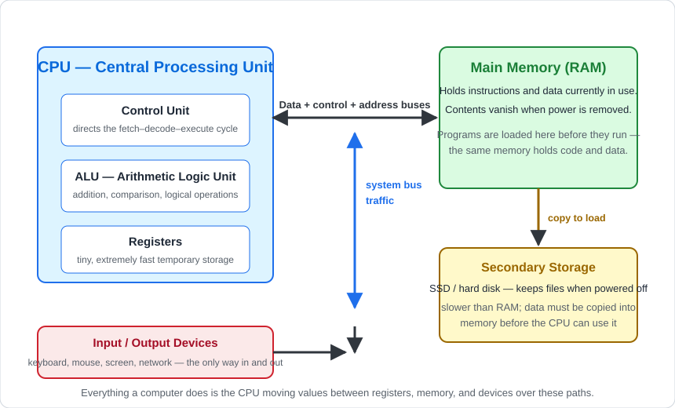
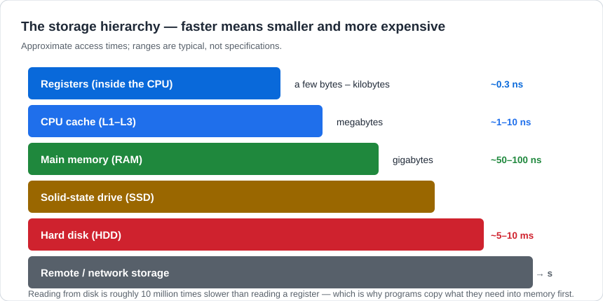

# Computer Hardware

## 1. Learning Objectives

After this lesson you will be able to:

- [ ] Name the role of the CPU, memory, storage, and input/output devices, and explain what each
  contributes when a program runs
- [ ] Explain why speed and capacity trade off along the storage hierarchy, with concrete orders of
  magnitude
- [ ] Read a machine's basic specifications and say what will and will not feel fast
- [ ] Predict how a hardware limitation would show up as a user-visible symptom

## 2. Prerequisites

None — this is the first technical lesson of the curriculum. It assumes only
[how programming works](../00-START-HERE/how-programming-works.md) from the orientation subject.

## 3. Introduction

Every program you will ever write runs on a machine with four kinds of parts: something that
**computes** (the CPU), something that **holds data while it is in use** (memory), something that
**keeps data when the power is off** (storage), and things that **connect it to the world**
(input/output). That is the whole cast.

This lesson teaches what each part does, why they are separate, and — most usefully for a future
engineer — why the speed differences between them are enormous, not incremental.

## 4. The Problem It Solves

If one component did everything, computers would be either ruinously expensive or unbearably slow.
The design problem is that fast technology is small and costly per byte, while cheap technology is
slow. The engineering answer is **layering**: keep a tiny amount of very fast storage close to the
processor, a moderate amount of medium-speed storage nearby, and nearly unlimited slow storage
behind it — then move data between layers automatically.

This compromise is so fundamental that it leaks into every bug you will ever debug: "my app is slow"
is very often "my app keeps waiting for the layer below".

## 5. Core Concepts

### 5.1 The CPU: the thing that executes

The **Central Processing Unit** does exactly one job — carry out instructions — and does it
astronomically fast (billions per second). It contains:

- The **Control Unit**, which orchestrates the fetch–decode–execute cycle (subject of
  [how-programs-execute.md](how-programs-execute.md)).
- The **ALU** (Arithmetic Logic Unit), which performs arithmetic and comparisons — every `if`,
  every total, every loop condition ends up here.
- **Registers**: the CPU's own private scratch space, the fastest storage that exists, holding a
  handful of values at a time.

A CPU does not "know" about files, screens, or networks. It reads values, operates on them, and
writes values back. Everything else is arrangement.

### 5.2 Memory (RAM): the working set

**Main memory** holds the program currently running and the data it is using. Two properties matter:

1. **It is volatile** — power off, contents gone. (Why your unsaved work vanishes.)
2. **It is shared by everything running** — programs compete for it. When memory runs out, the
   operating system borrows slow disk space as emergency memory, and everything becomes miserable.

Crucially, memory holds **both instructions and data**, and the CPU treats them identically —
the same bytes are an instruction one moment and a number the next, depending only on where they
are used.

### 5.3 Storage: memory that survives

**Secondary storage** (SSD, hard disk) keeps files when the machine is off. It is non-volatile and
capacious and slow. Programs do not execute from storage: the operating system **copies** what is
needed into RAM first. That single fact explains both startup delays and why closing a large
application and reopening it is not instantaneous.

### 5.4 Input and output

Keyboards, mice, screens, network cards — the only ways data enters or leaves. From the CPU's
perspective, a network packet and a keystroke are both "data that arrived"; handling them is a
matter of the operating system delivering bytes to the right place.

### 5.5 The hierarchy, in numbers

The diagram shows the standard arrangement (the "von Neumann" model): one memory holds instructions
and data, and the CPU reaches everything over shared pathways called **buses**. Two takeaways from
the picture — programs must be *copied* from storage into memory before running, and every value
the CPU touches travels over a bus, which costs time.

Read the second diagram slowly; it is the most useful single image in this subject. The gaps are not
percent — they are *orders of magnitude*. A register read takes under a nanosecond; a disk seek takes
milliseconds; **roughly ten million times longer**. As a working engineer you will never optimize
the CPU as fast as you can avoid a disk wait. Keep the bands memorized; every performance lesson
from here to [18-ADVANCED-ENGINEERING](../18-ADVANCED-ENGINEERING/README.md) is a variation on this
picture.

## 6. How It Works — one second inside your machine

1. The operating system has loaded your program from **storage** into **memory**.
2. The CPU's control unit fetches the next instruction from **memory** (a copy — not from disk).
3. The ALU executes it using values held in **registers**.
4. If the instruction needs data you typed, the operating system moved it from the **input device**
   into memory, and the CPU reads it.
5. Results are written back to registers, then memory; when you save, they are copied to **storage**.
6. Repeat billions of times. Nothing in this list happens "instantly" — each step has a price from
   the hierarchy diagram.

## 7. Practical Examples

No code in this lesson — you do not need a programming language yet to do this subject's work.

### Example 1 — reading a machine honestly (executed on the author's machine)

Windows: open **Task Manager → Performance**. On the writing machine it reported, for example,
8 GB of memory in use with programs consuming most of it, and a CPU running at low utilization
while a large page loaded. *(Your numbers will differ; the transcript is an observation, not a
requirement.)* Linux equivalents: `free -h` and `top`.

**What to notice:** memory is finite and visibly consumed; a program that "needs more RAM" is
literally competing with everything else on that list.

### Example 2 — predicting a symptom from a cause (worked reasoning)

| Symptom a user reports | Hardware cause | Layer from the diagram |
|---|---|---|
| "Everything got slow when I opened 30 tabs" | RAM exhausted; system borrowing disk | Memory → storage fallback |
| "My files are still here after reboot, but my open program lost its work" | Storage is non-volatile; RAM is volatile | Storage vs memory |
| "Game stutters even though CPU is idle" | Waiting on storage or another device | I/O bound, not compute |

**Expected reasoning:** identify which *band* is waiting. You cannot see hardware, but you can
reason about which layer must be responsible — this is the beginning of performance diagnosis.

## 8. Real-World Applications

Server sizing interviews in this industry are mostly conversations about these bands: how much RAM,
what kind of disk, how many cores. When a website "goes viral and crashes", the failure is almost
never "not enough processor" — it is exhausted memory or saturated storage/network. When you later
read that a database uses an index, you are reading a technique for avoiding a slow band.

## 9. Common Mistakes

| Mistake | Why it happens | How to prevent it |
|---|---|---|
| Treating the hierarchy as trivia | It looks like a memorization list | Convert every fact into a symptom: name what breaks when each band is missing |
| Believing more RAM makes a program compute faster | Marketing language blurs roles | RAM only helps when the program was *waiting* on the band below |
| Thinking the CPU reads programs from disk | Intuition says "files run" | The OS copies them to memory first — draw the arrows in the diagram from memory |
| Ignoring storage when diagnosing slowness | The CPU is the visible "brain" | Ask "what is it waiting for?" before "how fast is it?" |

## 10. Best Practices

- **Reason about waiting, not just speed.** "Is it CPU-bound or waiting on something else?" is the
  question that industry tools (later lessons) answer directly.
- **Know your machine's numbers** — how much RAM, what kind of storage. Two minutes in Task Manager
  or `lsblk` grounds every later performance claim.
- **Prefer observable symptoms** to theories when something is slow: measure first, explain second
  (a discipline formalized in
  [18-ADVANCED-ENGINEERING/performance-profiling.md](../18-ADVANCED-ENGINEERING/performance-profiling.md)).

## 11. Limitations and Trade-Offs

This lesson's model is deliberately simplified. Real CPUs have multiple cores and deep cache
hierarchies, memory and storage boundaries blur (NVMe drives, swap, zram), and modern systems add
GPU and network tiers. The simplified model survives all of that: it adds bands and parallelism,
never contradicts them. When you meet a new term later, place it on the diagram first — you will
usually be right about its behaviour.

## 12. Practical Exercises

### Introductory

1. **Label the diagram from memory.** Redraw the architecture diagram with all boxes and arrows,
   no peeking. **Completion criteria:** CPU's three parts, memory, storage, I/O, and the
   copy-to-load relationship all present.
2. **Match symptom to band.** For each symptom — "save took 10 seconds", "reboot lost my work",
   "video playback stutters" — name the responsible band and justify it in one sentence.
   **Completion criteria:** correct band + justification for each.

### Intermediate

3. **Measure your machine.** Record RAM total/used and storage type (SSD or HDD) using Task
   Manager, `free -h`, or equivalent. **Completion criteria:** four numbers recorded with the tool
   name used, plus one sentence on what currently competes for memory.
4. **Explain the nanosecond→millisecond gap** to someone else using the storage diagram, including
   why the CPU never reads a program directly from disk. **Completion criteria:** the listener can
   restate the reason without help — or, solo, your written explanation includes the copy step and
   an order-of-magnitude comparison.

### Independent problem-solving

5. **Diagnose an unknown machine.** A colleague reports: video export takes 40 minutes, the disk
   light is constantly active, CPU utilization stays at 15%, and RAM has 6 GB free. Using only this
   lesson, write: (a) which band is the bottleneck, (b) two changes that would help and one that
   would not, (c) what you would measure to confirm. **Completion criteria:** all three parts
   present, the "would not help" answer is justified with the hierarchy rather than guessed.

## 13. Knowledge Check

1. Why can a program run only after being copied from storage into memory?
2. A register read is ~0.3 ns and a disk seek is ~5 ms — what is the rough ratio, and what
   practical rule of thumb follows from it?
3. You open 40 browser tabs and the whole system slows to a crawl with the CPU mostly idle.
   Which band is involved, and why is the CPU not to blame?
4. What does volatile mean, and which two kinds of storage differ by it?

## 14. Completion Criteria

- [ ] You can redraw the architecture diagram from memory and narrate one instruction's path
- [ ] You can name the four component roles and one user-visible symptom of each being insufficient
- [ ] You can order the storage bands and give approximate access times without notes
- [ ] You passed exercises 1, 2, and 5 (exercise 5's answer written before checking solutions)

## 15. Summary

- Four part types: CPU (computes), memory (working set), storage (survives), I/O (connects).
- Programs must be copied from storage to memory before execution.
- The storage hierarchy trades speed for capacity in **orders of magnitude**, not percentages.
- Most performance problems are a component *waiting* on a slower band, not a slow CPU.

## 16. Next Steps

- [software-and-operating-systems.md](software-and-operating-systems.md) — the layer that makes this
  hardware usable: what an OS actually does for a program.