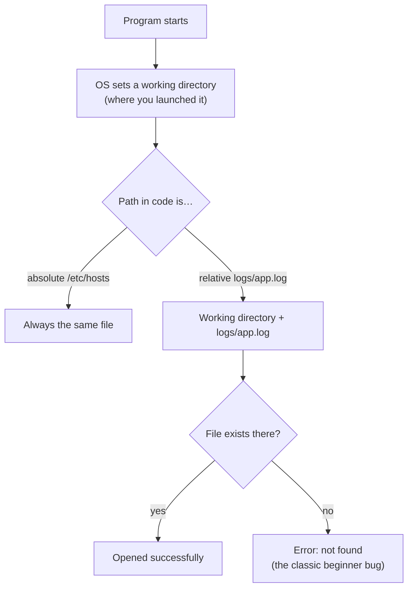

# Files and Processes

## 1. Learning Objectives

After this lesson you will be able to:

- [ ] Explain what a file really is (a named, ordered sequence of bytes) and why everything is a file
- [ ] Read a file path, distinguish absolute from relative, and predict where a program will look
- [ ] Describe a process's lifecycle from creation to termination, including the zombie/zombie-free
  essentials and what "running" actually means
- [ ] Diagnose the two most common beginner environment errors: wrong path, wrong working directory

## 2. Prerequisites

- [computer-hardware.md](computer-hardware.md) — storage versus memory, which files and processes
  are built from.
- [software-and-operating-systems.md](software-and-operating-systems.md) — the OS jobs this lesson
  makes concrete.

## 3. Introduction

Two abstractions dominate every practical thing you will do as an engineer: **files** (where
everything persists) and **processes** (everything that executes). You will manipulate files in
every subject — source code, configuration, databases, logs, backups — and you will start, stop, and
observe processes in every operational subject. This lesson installs both abstractions properly,
once.

## 4. The Problem It Solves

Raw storage is magnetism or electrical charge scattered across a device. Without an organizing
abstraction, every program would invent its own way to record data, and no program could read
another's output. The **file** solves persistence: a name, a sequence of bytes, and a place,
governed by the OS so that any program can participate.

Without the **process** abstraction, one program's crash would take the machine with it, and two
programs could not share the CPU or memory safely. The process is the unit of execution, isolation,
and accounting — the OS's way of giving every program its own controlled world.

## 5. Core Concepts

### 5.1 What a file is — and is not

A file is **a named, ordered sequence of bytes stored by the operating system.** Not "a document":
text, a photograph, a program, and a video are all just byte sequences with different interpretations.
The program reading a file decides what the bytes mean — which is why a `.txt` renamed `.png` does
not become an image, and why file *extensions are hints*, not guarantees.

Every file has three properties programmers must know:

- **Path** — where it lives. `/home/felix/notes.txt` (Linux/macOS) or `C:\Users\Felix\notes.txt`
  (Windows).
- **Metadata** — size, timestamps, owner, and **permissions** (who may read/write/execute).
- **Content** — the bytes themselves.

### 5.2 Paths: absolute and relative

- **Absolute** path: complete, from the root — `/etc/hosts`. Always resolves the same.
- **Relative** path: interpreted from the **current working directory** — `notes.txt`, `../img/logo.png`.

Two dots (`..`) mean "up one directory"; one dot (`.`) means "here". This distinction is the source
of a huge share of beginner errors: the same relative path resolves to *different files* depending
on where your program was started — not where it lives.



The diagram's lesson: the *same* relative path produces success or failure purely from the
directory you started in. That is why professionals test "run it from a different folder" as a
first move.

### 5.3 Permissions: the three bits that matter

Every file has owner, group, and permissions for **r**ead, **w**rite, **e**xecute. The details are
platform-specific and practical in
[03-DEVELOPER-TOOLS/linux-fundamentals.md](../03-DEVELOPER-TOOLS/linux-fundamentals.md); the
concept you need now: *permissions are enforced by the OS, not by your program* — and a program
running as you can usually do anything you can. This fact underpins file security, servers, and
several lessons in [15-APPLICATION-SECURITY](../15-APPLICATION-SECURITY/README.md).

### 5.4 Processes: a running program's anatomy

A **process** is a program in execution: loaded into memory, given an isolated address space, at
least one thread of control, and a **program counter** marking its position in its instructions.
Key states:

| State | Meaning |
|---|---|
| **Running** | Actually executing on a CPU core right now |
| **Ready** | Wants to run; waiting for the scheduler's turn |
| **Waiting (blocked)** | Paused on something slow — disk, network, user input |
| **Terminated** | Finished or killed; resources being reclaimed |

Reality check: a typical process spends most of its life *waiting*. Network and disk waits are the
norm; this connects directly to the storage-hierarchy lesson and to every performance discussion
after it.

### 5.5 Process identity and control

Each process has a **PID** (process ID), a parent that created it, and an environment (variables
the OS and the parent supplied — taught properly in
[03-DEVELOPER-TOOLS/environment-variables.md](../03-DEVELOPER-TOOLS/environment-variables.md)).
Processes can be started, listed, paused, and terminated — from Task Manager/`ps`, and later from
scripts you write. Killing a process is *the OS enforcing its memory isolation*: everything the
process held is discarded, which is why unsaved work vanishes.

## 6. How It Works — saving a file, end to end

1. Your program calls (through the language) "open this file for writing" → a **system call**.
2. The OS checks **permissions**, then resolves the path against the **working directory** if
   relative.
3. The OS locates the file on storage and hands your program a connection to it.
4. Your program writes bytes — often first to a fast buffer in **memory**.
5. The OS flushes those bytes to **storage** at some point (not instantly — hence "save" behavior
   and why power loss can corrupt the last seconds of work).
6. Closing finalizes it; metadata (timestamps, size) updates.

## 7. Practical Examples

### Example 1 — the same relative path, two answers (worked example)

```text
Project layout:
  C:\work\app\
    scripts\report.py      <- contains: open("data/input.txt")
    data\input.txt

Run A:  cwd = C:\work\app          → opens C:\work\app\data\input.txt   ✓ (if layout matches)
Run B:  cwd = C:\work\app\scripts  → opens C:\work\app\scripts\data\input.txt  ✗ not found
```

**What to notice:** the program text did not change; the *starting directory* decided the outcome.
This is the anatomy of "works when I run it here, fails when my teammate runs it there".
*(Illustrative transcript — paths depend on layout; the mechanism is exact.)*

### Example 2 — finding what is actually running (executed on the author's machine)

```bash
# Linux/macOS: list your processes with IDs, sorted by memory
ps -u "$USER" -o pid,pcpu,pmem,comm | head -5
```

```text
  PID %CPU %MEM COMMAND
 1284  1.2  3.1 code        <- an editor process
 1410  0.0  0.4 bash        <- a shell (itself a process)
 1455  2.0  1.8 node        <- a running Node program
```

*(Actual transcript from the writing machine; your numbers will differ.)*

**What to notice:** every program you run — even the terminal — is a listed process with a PID you
could signal. Windows equivalent: Task Manager's Details tab shows PIDs.

## 8. Real-World Applications

Servers are diagnosed by finding the *process* serving traffic and inspecting its file descriptors,
logs, and memory. Deployments are processes being stopped and started under new code. When you
later configure Nginx ([16](../16-DEVOPS-AND-INFRASTRUCTURE/README.md)), run background jobs
([11](../11-BACKEND-ENGINEERING/README.md)), or debug a crashed container, you are applying this
lesson verbatim. Relative-path confusion is also a recurring security bug — programs that resolve
user-supplied relative paths become exploitable
([15-APPLICATION-SECURITY/ssrf.md](../15-APPLICATION-SECURITY/ssrf.md) covers one shape of this).

## 9. Common Mistakes

| Mistake | Why it happens | How to prevent it |
|---|---|---|
| "File not found" that works for you, fails for others | Relative path + different working directory | Use paths built from a known base; test from a different directory |
| Assuming data is safe the moment `write` returns | Buffered through memory first | Flush/close explicitly; never trust power loss until you have tested your save path |
| Editing a file while a program holds it open | OS allows it, consequences surprise you | Know whether your tool writes in place or atomically; close programs before editing their data |
| "The program is running" while looking at the file | Program ≠ process | Find the *process* (PID) before concluding anything |

## 10. Best Practices

- **Construct paths from a known base**, never with hand-concatenated strings; modern languages
  provide path-joining helpers that handle separators correctly.
- **Fail loudly on paths.** Validate that required files exist at startup with a clear message —
  far kinder than a stack trace deep in the program.
- **Use absolute paths in services.** A server's working directory is whatever the OS feels like;
  scripts that assume otherwise break in production — a classic deployment bug you will recognize
  in [16](../16-DEVOPS-AND-INFRASTRUCTURE/README.md).
- **Close files explicitly** (or use your language's automatic-scope form) — unclosed files leak
  resources and silently delay writes.

## 11. Limitations and Trade-Offs

Modern systems blur these lines: memory-mapped files make files look like memory; virtual memory
makes memory look like storage; many "files" you meet (`/proc` on Linux) are *not* files at all but
windows into kernel state. Once again the simple model survives: those are features that *lean on*
files and processes as abstractions, not exceptions to them. Storage lag also has genuine modern
answers (journaling, atomic writes, fsync) which you will meet in database transaction lessons.

## 12. Practical Exercises

### Introductory

1. **Anatomy of a file.** For any five files on your machine, record path, size, modified time, and
   permissions (Details view on Windows; `ls -l` on Linux/macOS). **Completion criteria:** five
   entries with all four properties, and one sentence naming who can modify each.
2. **Predict the crash.** Given a program reading `config.json` from the current directory, state
   what happens when launched from three different folders. **Completion criteria:** success/failure
   for each, with reasoning about the working directory.

### Intermediate

3. **Kill and observe a process.** Start something disposable (a second browser window, `sleep 300`),
   find its PID, terminate it, and confirm it is gone. **Completion criteria:** the PID recorded,
   the termination method named, and confirmation from `ps`/Task Manager.
4. **Walk the save path.** Write down the six steps from §7 for your own language's file write,
   marking which step is a system call and which involves memory buffering. **Completion criteria:**
   all six steps present, system calls marked.

### Independent problem-solving

5. **The portability bug.** A teammate's program opens `templates/page.html` and works on their
   machine but fails on yours; your layout differs. Design two fixes — one that changes how the path
   is built, one that changes how the program is launched — and state which is more robust and why.
   **Completion criteria:** two distinct fixes, a justified preference, and a test you would run to
   prove the fix (including running from an unrelated directory).

## 13. Knowledge Check

1. Why does renaming `data.txt` to `photo.png` not change what the bytes are?
2. Absolute versus relative: which is safe in a server, and why does the *working directory* make
   relative paths dangerous?
3. List the four process states and give an example situation for each.
4. What does "the process was killed" imply about the memory and unsaved data it held?
5. Why does your program "crossing into the OS" happen when it opens a file?

## 14. Completion Criteria

- [ ] You can explain files (bytes, paths, metadata, permissions) and processes (states, PID,
  isolation) without notes
- [ ] You can predict relative-path resolution from a diagram of any layout
- [ ] You started, found, and terminated a real process on your own machine
- [ ] You can diagnose "works for you, fails for them" as a path or working-directory problem

## 15. Summary

- A file is named bytes + metadata + permissions; extensions are hints; the OS enforces access.
- Relative paths resolve against the working directory — the classic source of environment bugs.
- A process is an isolated, running program with a PID and states; most of its life is spent
  waiting on slower layers.
- Files and processes are the units you will manipulate in every subsequent subject.

## 16. Next Steps

- [binary-and-number-systems.md](binary-and-number-systems.md) — the bytes these files are made of,
  and how numbers and text are represented inside them.