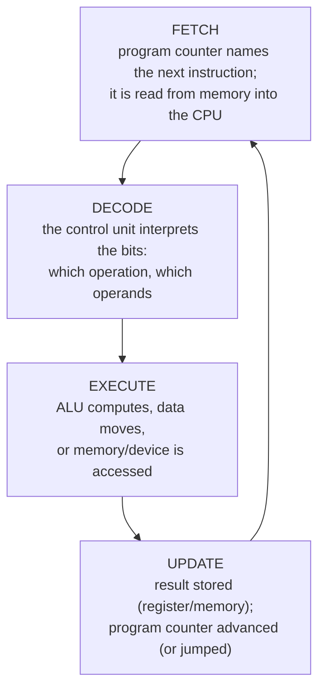

# How Programs Execute

## 1. Learning Objectives

After this lesson you will be able to:

- [ ] Describe the fetch–decode–execute cycle step by step, naming what each step touches
- [ ] Explain what compilation and interpretation each do — and what both share — using the
  vocabulary from [how programming works](../00-START-HERE/how-programming-works.md)
- [ ] Trace a tiny sequence of machine instructions and predict the resulting state
- [ ] Classify a runtime failure as one of the distinct kinds (syntax, runtime, logic) and name the
  stage that catches it

## 2. Prerequisites

- [computer-hardware.md](computer-hardware.md) — CPU, registers, memory, buses.
- [memory-and-storage.md](memory-and-storage.md) — where instructions live and how they are read.
- [logic-and-boolean-algebra.md](logic-and-boolean-algebra.md) — how comparisons become decisions.
- Orientation: [how programming works](../00-START-HERE/how-programming-works.md) — the two bug
  categories this lesson formalizes.

## 3. Introduction

You have met the pieces: instructions, memory, the CPU, and logic. This lesson assembles them into
the machine's one repeating act — **fetch, decode, execute** — and connects it to the two ways
programs get from source text to executed behavior (compiling and interpreting). It is the last
foundations lesson: everything after it is a language, a tool, or a system built *on* this cycle.

## 4. The Problem It Solves

Electrical circuits do not understand Java, Python, or "sort this list". There is a vast distance
between a human-readable instruction and a control signal moving a value between registers. The
solved problem is **translation plus a universal cycle**: one small instruction set the hardware
repeats mechanically forever, plus translators that turn every language ever invented into that
instruction set. All software diversity sits on exactly one execution loop — which is why
understanding that loop makes every later technology less mysterious.

## 5. Core Concepts

### 5.1 The cycle itself



Reading the loop: the **program counter** (a register) holds the address of the next instruction;
fetching reads it; decoding determines what it means; executing does it; the update stores the
result and sets the next address — either "the following one" or a jump target when a branch was
taken. Then it starts again, billions of times per second.

Two details worth locking in now:

- **Jumps are how `if` and loops physically happen.** A condition (logic lesson!) decides whether
  the program counter advances sequentially or lands elsewhere. Your `if` statement's entire
  purpose is to influence this one decision each pass.
- **Everything is instructions and data in memory.** The cycle makes no philosophical distinction;
  context does (memory lesson's byte-reinterpretation point, now with motion).

### 5.2 From source text to those instructions

Two translation philosophies, one destination:

| Approach | When translation happens | Typical members | Payoff |
|---|---|---|---|
| **Compiled** | Up front, producing an artifact (bytecode or machine code) | Java (→ bytecode), C/C++ (→ machine code), Go | Errors caught before running; execution speed |
| **Interpreted / hybrid** | As the program runs (often with a JIT layer) | Python (interpreted), modern JavaScript (JIT-compiled) | Fast iteration; dynamic behavior |

The important truth for a beginner: **the distinction is about *when*, not *whether***. Both produce
exactly the same kind of execution — the cycle above. Java's story concretely: source → `javac` →
**bytecode** → the JVM interprets/JIT-compiles while running (this pipeline returns with real
detail in [04-JAVA-PROGRAMMING/jvm-and-memory.md](../04-JAVA-PROGRAMMING/jvm-and-memory.md)).

### 5.3 The three failure kinds, pinned to their stage

| Kind | Caught by | Catches it | Executes? | Example |
|---|---|---|---|---|
| **Syntax** | The translator | compile/parse time | never | missing quotation mark |
| **Runtime** | The system *while running* | execution (or its checks) | yes, until it fails | dividing by zero, null reference, missing file |
| **Logic** | nobody — your tests and review | — | yes, wrongly | `price - 1` instead of `price + 1` |

Each has a different remedy: fix the text; handle the invalid state (or validate input earlier);
find the wrong *idea*. Confusing runtime and logic failures sends beginners hunting for typos when
their reasoning is wrong — the classic multi-hour misdiagnosis.

### 5.4 Interrupts: the machine is not a hypnotized slave to your loop

Devices need attention (a keystroke, a packet arriving, a timer). Instead of wasting cycles
polling, hardware raises an **interrupt**; the CPU pauses what it was doing, runs the operating
system's handler, then resumes — which is how one CPU serves many processes "simultaneously"
(scheduling from [software-and-operating-systems.md](software-and-operating-systems.md), now
mechanized). Context switches are the visible cost: saving and restoring state has a price, a
recurring theme from performance lessons to containers.

## 6. How It Works — five instructions, fully narrated

Suppose memory holds this toy program (illustrative pseudo-machine language — real ISA syntax
varies by processor):

```text
100: LOAD  7      ; put the value 7 into accumulator register A
101: ADD   5      ; A = A + memory[5]      (suppose memory[5] holds 3 → A = 10)
102: CMP   0      ; compare A against 0; sets a condition flag
103: JEQ   106    ; if flag says "equal", jump program counter to 106 (it does not)
104: STORE 9      ; write A into memory[9] (the result is saved)
105: HALT         ; stop
```

Walk the cycle:

```text
  PC=100 → FETCH 100 → DECODE "LOAD 7" → EXECUTE: A=7      → PC=101
  PC=101 → FETCH 101 → DECODE "ADD 5"  → EXECUTE: A=10     → PC=102
  PC=102 → FETCH 102 → DECODE "CMP 0"  → EXECUTE: flag=false→ PC=103
  PC=103 → FETCH 103 → DECODE "JEQ 106"→ not taken         → PC=104
  PC=104 → FETCH 104 → DECODE "STORE 9"→ memory[9]=10      → PC=105
  PC=105 → HALT
```

**Expected result:** memory location 9 holds 10; the jump did *not* fire because 10 ≠ 0. Reverse
one decision — make `CMP` compare against 10 — and `JEQ` would jump, skipping the STORE: a
different outcome from one changed flag. That is an `if`, reduced to mechanics.

## 7. Practical Examples

### Example 1 — a logic error surviving the whole cycle (worked)

```text
Source:  int total = price - 1;        // intent: price + 1
Syntax?  valid.        → translator passes
Runtime? no failure.   → executes cleanly
Result:  total = 9 when price = 10 → WRONG
```

**What to notice:** every stage in §5.3 behaved correctly. Only a *test asserting
"total equals price plus one"* would catch it — which is precisely why testing
([14-TESTING-AND-QUALITY](../14-TESTING-AND-QUALITY/README.md)) exists as a discipline.

### Example 2 — compile once, then the cycle runs (transcript, executed)

```bash
javac --release 21 -d out Hello.java    # translation stage: any error stops here
java -cp out Hello                      # JVM loads bytecode; the cycle runs
```

```text
Hello                                  # expected output of the example program
```

*(Exact output shown is the example's stated expectation; setup is covered in
[04-JAVA-PROGRAMMING/java-environment-setup.md](../04-JAVA-PROGRAMMING/java-environment-setup.md).)*

**What to notice:** two separate stages with two separate failure domains — the first prints
*compiler* errors, the second can print *runtime* errors, and neither catches wrong logic.

## 8. Real-World Applications

Every debugging tool you will use maps onto this lesson: debuggers step through *executed*
instructions; profilers report *which* instructions consumed cycles; crash logs distinguish
compile-time from runtime failures; JIT behavior explains why warm-up times exist in large
services; interrupts explain latency spikes. When a senior engineer says a system is "CPU-bound"
or "waiting on I/O", they are classifying where the cycle stalls — the same reasoning you did with
the storage-hierarchy diagram.

## 9. Common Mistakes

| Mistake | Why it happens | How to prevent it |
|---|---|---|
| Treating compilation as "making it run" | Stages blur when new | Two stages, two failure kinds — name them separately |
| Assuming a compiler verifies correctness | It verifies *grammar* | State what passes each gate before assuming "it compiles, therefore it works" |
| Debugging by editing randomly until an error moves | Symptom chasing | Form the hypothesis first (runtime vs logic), then test it |
| Believing interpreted languages "skip" translation | Terminology confusion | Everything becomes instructions somehow; when differs, whether does not |
| Ignoring interrupts/context switches when reasoning about timing | The cycle feels exclusive | One CPU, many processes: turns are taken, state is saved |

## 10. Best Practices

- **Read errors by stage.** A message from the compiler is grammar; a stack trace is a runtime
  state; silence after a wrong answer is logic. Match your response to the stage.
- **Use the debugger's stepping deliberately once per new language** — watching the cycle move
  (frame by frame, line by line) collapses the abstraction distance faster than any reading.
- **Compile with warnings enabled and treat them as errors** in your own projects: warnings are the
  translator seeing a likely logic problem early — the closest thing to catching category three at
  category one's price.
- **When performance matters, ask where the cycle stalls** — computing, memory waits, or device
  waits — before touching anything.

## 11. Limitations and Trade-Offs

The cycle taught here is the classic single-core model. Real CPUs run **multiple execution
pipelines**, reorder instructions, and speculate on branches (with flush penalties when wrong) —
details that matter deeply to systems engineers and mostly *not* to application logic. RISC versus
CISC instruction sets differ in instruction granularity. All of these decorate the same loop:
fetch, decode, execute, update. The model's test is predictive value — and it predicts correctly
through [18-ADVANCED-ENGINEERING/concurrency-and-parallelism.md](../18-ADVANCED-ENGINEERING/concurrency-and-parallelism.md).

## 12. Practical Exercises

### Introductory

1. **Label the diagram from memory.** Redraw the fetch–decode–execute loop with the program
   counter's role included. **Completion criteria:** four stages plus the PC's update path, drawn
   without notes.
2. **Classify five failures.** For each — missing bracket, null pointer while saving, invoice total
   10× too high, file not found on load, typo in variable name caught by compiler — name the failure
   kind and the stage that reports it. **Completion criteria:** correct kind + stage for all five.

### Intermediate

3. **Run the trace with a jump taken.** Modify Example 6 so `CMP` compares against 10, then trace
   all cycles to HALT, stating the final contents of A and memory[9]. **Completion criteria:** full
   PC-by-PC trace; correct outcome (jump fires, location 9 unwritten).
4. **Explain `if` in one paragraph using only cycle vocabulary** (program counter, flags, jump).
   **Completion criteria:** the paragraph contains no UI-level words ("the computer decides") and
   correctly describes the branch decision.

### Independent problem-solving

5. **Design the diagnosis protocol.** You receive a report: "The build passed, the program starts,
   then it produces wrong totals for some inputs but not others." Write a protocol that (a)
   classifies the failure kind *before* investigating, (b) gives the first three concrete actions,
   and (c) explains why the passing build tells you something specific — and nothing about the bug.
   **Completion criteria:** classification with reasoning, three ordered actions, and an explicit
   statement of what the build result rules in and out.

## 13. Knowledge Check

1. What does the program counter hold, and what happens to it on a taken jump?
2. Compilation versus interpretation: what is the same, and what genuinely differs?
3. A `NullPointerException` at runtime — which kind of failure, and which stage reports it?
4. Why can no compiler catch your program computing the wrong total?
5. What problem do interrupts solve, and what do they cost?

## 14. Completion Criteria

- [ ] You can narrate fetch–decode–execute including the program counter, unaided
- [ ] You can trace a short instruction sequence and predict final memory/register state
- [ ] You can classify any reported failure into syntax/runtime/logic with the reporting stage
- [ ] You can explain how `if` and loops are jumps, in cycle terms

## 15. Summary

- Execution is one loop: fetch, decode, execute, update — with the program counter steering it.
- Branches and jumps are the physical form of every condition and loop.
- Compiling and interpreting differ in timing, not in destination: the same cycle.
- Three failure kinds map to three stages: translator, runtime, tests.
- Interrupts let one cycle serve many processes — the machinery behind sharing.

## 16. Next Steps

**Subject 01 complete.** Move to
[02-PROGRAMMING-FUNDAMENTALS](../02-PROGRAMMING-FUNDAMENTALS/README.md) — where you start writing
the instructions this machine executes, beginning with computational thinking and pseudocode.
Practice first: the exercise sets in [exercises/](exercises/README.md).