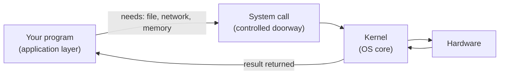

# Software and Operating Systems

## 1. Learning Objectives

After this lesson you will be able to:

- [ ] Distinguish application software, system software, and the operating system, and state what
  each is responsible for
- [ ] Explain the four core jobs of an OS (abstraction, scheduling, memory management, protection)
  in plain language
- [ ] Describe what happens between double-clicking an icon and seeing a running program
- [ ] Diagnose whether a problem belongs to your program, the OS, or the hardware

## 2. Prerequisites

- [computer-hardware.md](computer-hardware.md) — the four component types this lesson's software
  manages.
- [How programming works](../00-START-HERE/how-programming-works.md) — what a program is.

## 3. Introduction

Hardware alone is unusable: every program written directly against a keyboard, a screen, and RAM
would need to know the exact model of each, and would fight every other program for the processor.
An **operating system (OS)** is the permanent middle layer that ends that chaos. It runs from the
moment a computer turns on until it powers off, and everything you do happens on top of it.

## 4. The Problem It Solves

Before operating systems, programs *were* the machine: each one had to drive the hardware itself
and could not coexist with others. Two consequences made that untenable:

- **Incompatibility.** Writing for every device combination was impossible; programs were tied to
  one machine.
- **Conflict.** Two programs both writing to the printer or both using memory produced nonsense.

The OS solves both by being the only program allowed to touch hardware directly, and by offering
everyone else a stable, shared interface. It is the computer's most important piece of software,
and it is invisible precisely because it works.

## 5. Core Concepts

### 5.1 The three layers

| Layer | Examples | Talks to |
|---|---|---|
| **Application software** | browser, editor, the app you are building | the OS, via system interfaces |
| **Operating system** | Windows, macOS, Linux, Android, iOS | hardware, on behalf of everyone |
| **Hardware** | CPU, memory, storage, devices | electricity |

Your programs sit in the top layer forever. Even Docker containers and cloud servers — topics you
will meet in [16-DEVOPS-AND-INFRASTRUCTURE](../16-DEVOPS-AND-INFRASTRUCTURE/README.md) — run on an
OS somewhere underneath.

### 5.2 The OS's four core jobs

1. **Abstraction — one interface for every device.** Programs do not talk to an SSD controller or a
   GPU directly; they ask for "a file" or "draw this". The OS translates. This is why the same
   program can run on machines with completely different hardware.
2. **Scheduling — fair sharing of the CPU.** A modern machine has more work than processor time. The
   OS slices milliseconds between processes so everything *appears* simultaneous. Your single
   program never owns the CPU; it borrows it thousands of times a second.
3. **Memory management — isolation.** Each process gets its own memory space. The OS enforces that
   your program cannot read or write another's memory — the mechanism that keeps a crashing app
   from taking the machine down with it (and, later, the mechanism behind many security lessons).
4. **Protection and files — controlled access.** Users, permissions, and the rules about who may
   read, change, or execute each file. [03-DEVELOPER-TOOLS/linux-fundamentals.md](../03-DEVELOPER-TOOLS/linux-fundamentals.md)
   makes this hands-on.

### 5.3 Process and kernel — the vocabulary you will reuse

- A **process** is a *running* program: one loaded into memory with its own space, its own state,
  and at least one thread of execution. A program is the recipe; a process is cooking.
- The **kernel** is the OS's core — the part that actually performs scheduling, memory management,
  and hardware access. Everything else (shells, desktops, background services) is built around it.

These two words appear in every later subject: [files-and-processes.md](files-and-processes.md)
goes deeper, and [04-JAVA-PROGRAMMING/concurrency.md](../04-JAVA-PROGRAMMING/concurrency.md) builds
threads on top of them.

### 5.4 The system-call boundary

When your program needs anything the OS owns — read a file, send data, allocate memory — it must
cross a controlled doorway called a **system call**. This crossing has a real cost (it interrupts
the program's flow), which is why, decades later, "this code does too many tiny file reads"
remains a genuine performance bug pattern.

Read the arrows as a round trip: your program *requests*, the kernel *checks and performs*, the
result comes back. Your program never touches hardware directly — by design.

### 5.5 Common operating systems, and where they differ

Windows, macOS, and Linux dominate desktops and servers; Android (Linux-based) and iOS (Unix-based)
dominate phones. They differ in interface and conventions, but this lesson's four jobs are common
to all of them — which is why a Linux server, an Android phone, and a Windows laptop feel
fundamentally alike to a program. What *does* differ — paths, permissions syntax, shells — is
exactly what subjects 03 and 16 teach concretely.

## 6. How It Works — double-clicking an icon

1. The OS loads the program's bytes from **storage** into **memory**.
2. It creates a **process**: assigns memory space, prepares an entry point, sets permissions.
3. The **scheduler** gives the process CPU slices; the CPU fetches its first instruction
   ([how-programs-execute.md](how-programs-execute.md)).
4. When the program needs the disk, the clock, or the network, it makes a **system call**; the
   kernel services it and returns.
5. If memory runs short, the OS decides what to move, pause, or reclaim.
6. When the process ends, the OS reclaims its memory and closes its resources — this cleanup is why
   "force quitting" works at all.

## 7. Practical Examples

### Example 1 — two processes sharing one CPU (executed observation)

Open Task Manager (Windows) or `top` (Linux) and watch two programs run simultaneously. The CPU
percentages move; no process holds 100% indefinitely. On the author's machine, an idle desktop
showed dozens of processes and a CPU total far below 100% while everything felt simultaneous.

**What to notice:** simultaneity is *scheduling*, not parallel magic — the OS is handing out turns.
(Nuance for later: with multiple cores, several processes genuinely run at once — the principle
becomes "scheduling per core".)

### Example 2 — the same file, three views (worked reasoning)

| Actor | Sees | Why |
|---|---|---|
| Your program | `open()` returns a stream of bytes | OS abstraction — no hardware detail needed |
| The OS | a file record with permissions and a location on a device | bookkeeping and protection |
| The disk | sectors/blocks of magnetic or flash cells | hardware reality |

**What to notice:** each layer's *truth* is different and appropriate. A bug in your program is
almost never about sectors — but a bug in understanding permission errors might cross all three.

## 8. Real-World Applications

Every "it works on my machine" dispute is an OS-abstraction dispute: differences in paths,
line endings, or installed runtimes. Every server you later deploy runs a Linux OS whose services
and permissions you will administer directly. Container technology works by *narrowing* what a
program can ask the OS for — which is only intelligible once you know the OS is the arbiter.

## 9. Common Mistakes

| Mistake | Why it happens | How to prevent it |
|---|---|---|
| Treating the OS as "the screen and icons" | The visible part is not the important part | Define it by its four jobs, not its desktop |
| Believing processes really run simultaneously on one core | Human intuition about time | Scheduling gives *turns*; watch `top` to see them |
| Assuming your program controls memory | Languages hide the OS's role | Memory is requested from the OS; allocation can fail — expect it |
| Blaming "the computer" for a problem in one program | Layers blur when frustrated | Ask: does it affect other programs? If no, it is your layer |

## 10. Best Practices

- **Program to the interface, not the machine.** Use standard libraries and file paths from the OS
  abstraction; portability is free if you never reach past it.
- **Cross the system-call boundary deliberately.** Batch file and network work; each crossing has
  real cost.
- **Learn one non-Windows OS early.** Servers are Linux; ten minutes with
  [03-DEVELOPER-TOOLS/linux-fundamentals.md](../03-DEVELOPER-TOOLS/linux-fundamentals.md) now saves
  months of superstition later.

## 11. Limitations and Trade-Offs

The four-jobs model abstracts away real complexity: modern OSes add virtual memory, file systems,
network stacks, drivers, and power management. Also, abstraction costs performance — system calls,
context switches, and indirection are all real overhead — which is exactly why systems programming
exists (and why [18-ADVANCED-ENGINEERING](../18-ADVANCED-ENGINEERING/README.md) revisits these
boundaries). The model is the map you navigate by; the territory adds layers to it.

## 12. Practical Exercises

### Introductory

1. **Classify five programs** (browser, calculator, driver, disk formatter, compiler) as
   application or system software, with a one-line reason each. **Completion criteria:** correct
   classification and a reason that references *what it does for whom*, not what it looks like.
2. **Match the job.** For each scenario — "two apps print at once", "one app crashes without
   affecting others", "the same program runs on two different laptops" — name which of the four OS
   jobs is at work. **Completion criteria:** correct mapping for all three.

### Intermediate

3. **Trace one action across layers.** Pick "save a file" and write what each layer (your program,
   kernel, hardware) does and knows at each step. **Completion criteria:** all three layers
   represented, with the system call visible as the crossing point.
4. **Observe scheduling live.** Run `top`/Task Manager while opening a heavy page; record CPU
   percentages before and during. **Completion criteria:** numbers recorded with the tool, plus one
   sentence explaining them with the scheduling concept.

### Independent problem-solving

5. **The support ticket.** A user reports: "After installing App X, my whole computer freezes; even
   the mouse lags." Another user reports the same app being slow but everything else fine.
   Diagnose each: which layer is implicated, what evidence would you request, and which hypothesis
   would you test first? **Completion criteria:** both cases classified (OS-level resource
   contention vs application-level slowness), a concrete evidence request for each, and a stated
   first test — with reasoning from the four jobs.

## 13. Knowledge Check

1. Name the OS's four core jobs and give a one-sentence example of each.
2. Why can two programs both believe they have the computer to themselves?
3. What is the difference between a program and a process?
4. Your program needs 100 MB of memory. Who actually provides it, and through what mechanism?
5. Why does the OS being "invisible" count as success rather than neglect?

## 14. Completion Criteria

- [ ] You can explain the four jobs without notes, each with an original example
- [ ] You can narrate what happens from double-click to running process
- [ ] You observed and explained live CPU scheduling on your own machine
- [ ] You can decide, for a reported symptom, whether it is application, OS, or hardware — and name
  the evidence you would gather

## 15. Summary

- Three layers: applications → operating system → hardware; your programs live in the top layer.
- The OS does four jobs: abstraction, scheduling, memory management, protection.
- Processes are running programs in isolated memory spaces, serviced through system calls.
- Diagnosing layer-by-layer ("what else is affected?") is the root of all technical support and
  debugging discipline.

## 16. Next Steps

- [files-and-processes.md](files-and-processes.md) — the two abstractions you will use in every
  command-line and server lesson: files (paths, permissions) and processes (states, lifecycle).