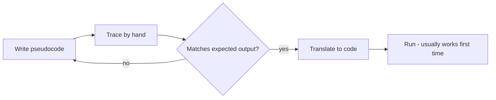

# Algorithms and Pseudocode

## 1. Learning Objectives

After this lesson you will be able to:

- [ ] Write an algorithm in pseudocode that is finite, definite, and traceable by hand
- [ ] Trace an algorithm step by step with a table, predicting its exact output before running it
- [ ] Compare two algorithms on the same problem by counting their steps
- [ ] State why the same problem can have a fast algorithm and a slow one, and name the difference

## 2. Prerequisites

- [computational-thinking.md](computational-thinking.md) — decomposition, patterns, abstraction,
  and the four properties of an algorithm; this lesson writes them down and checks them.
- [../01-COMPUTER-FOUNDATIONS/how-programs-execute.md](../01-COMPUTER-FOUNDATIONS/how-programs-execute.md)
  — the machine executes steps in order, which is why an algorithm's order is its meaning.

## 3. Introduction

**Pseudocode** is a half-way writing: the logic of a program in the vocabulary of a human
language, using the *shape* of code — indentation, assignment arrows, loops, conditions — without
committing to any language's punctuation rules. It is not a language to install; it is a language
to think in. "An **algorithm** is what you write; pseudocode is how you write it down; Python is
how you finally say it to the machine."

This lesson is about precision. The gap between "I know how to solve it" and "I have written
something a stranger could execute without asking a single question" is where most beginner bugs
are born — and where they can be killed for free, before a single line of code exists.

## 4. The Problem It Solves

Say "find a name in an alphabetical list" to two people. One starts at the beginning and checks
each name. The other jumps to the middle, decides which half the name can be in, and repeats. Both
are correct algorithms. But on a phone book of 1,000,000 names the first needs up to a million
checks and the second about twenty.

Without pseudocode you cannot tell these two plans apart until both are coded. With pseudocode the
difference is visible on one page — and visible *early enough to change your mind*. Pseudocode is
also the artifact code review happens on in many teams: cheaper to argue about seven lines of
pseudocode than a finished module.

## 5. Core Concepts

### 5.1 What pseudocode keeps and drops

**Keeps:** structure (indentation shows what is inside what), operations (assignment, comparison,
loop, condition), and names you choose for your parts.

**Drops:** language ceremony — semicolons, brackets, import statements, exact function-call syntax.
A pseudocode line reads `READ prices` or `total ← 0`; it never reads `ArrayList<Double> prices =
new ArrayList<>()`, because that is Java's ceremony, not your plan.

### 5.2 The conventions used in this repository

| Construct | Written as | Meaning |
|---|---|---|
| Input | `READ name` | Obtain a value and bind it to the name |
| Assignment | `total ← total + price` | Update the named value |
| Output | `PRINT message` | Show a result to the user |
| Condition | `IF condition THEN ... ELSE ...` | Branch, indent the two arms |
| Loop (known count) | `FOR each item IN prices DO ...` | Repeat per element |
| Loop (condition) | `WHILE condition DO ...` | Repeat while the condition holds |
| Stop | `RETURN value` | Give a value back to the caller and stop |

Any consistent set works — the point is consistency, so a reader never wonders whether two
spellings mean two things.

### 5.3 Tracing: the algorithm's dry run

A **trace** is a table where each row is one step: the variables' values after that step. Tracing
by hand is the cheapest verification tool in this entire curriculum: if your plan's trace does not
produce the expected output you wrote down earlier, the plan is wrong — and it cost you a pencil,
not an afternoon.

### 5.4 Counting steps: two algorithms, one problem

The number of steps an algorithm takes, as the input grows, is its **growth** — the idea behind
big-O notation, which
[05](../05-DATA-STRUCTURES-AND-ALGORITHMS/README.md) develops fully. Here you need only the
instinct: *linear search* checks up to all n items; *binary search* halves the remaining range
each step, so 1,000,000 items take ~20 steps. Same problem, same correctness — a millionfold
difference in work, visible in the pseudocode before either is coded.

### 5.5 Correctness by cases

An algorithm is correct when it produces the right output for **every** input in scope — including
the edges: empty list, one element, duplicates, already-sorted, not-a-number. Pseudocode makes
edge cases cheap to spot, because a step that assumes "there is at least one item" is visible on
the page. The habit this lesson installs: after writing the main path, ask "what happens if the
list is empty?" and write that case down too.

## 6. How It Works — pseudocode, trace, and the two searches

The workflow is plan → trace → (only then) code:



The loop back to pseudocode is the point: the cheap medium catches the expensive mistakes.

## 7. Practical Examples

Transcripts were **executed on the authoring machine** (Python 3.13.5, Windows 11, Git Bash); the
Python versions implement exactly the pseudocode shown above them.

**Example 1 — linear search, planned and traced**

Pseudocode:

```text
LINEAR_SEARCH(items, target):
    comparisons ← 0
    FOR each value IN items DO
        comparisons ← comparisons + 1
        IF value = target THEN
            RETURN index, comparisons
    RETURN -1, comparisons
```

Hand trace for `items = [7, 2, 9, 4, 9]`, `target = 9`:

| Step | index | value | comparisons | found? |
|---|---|---|---|---|
| 1 | 0 | 7 | 1 | no |
| 2 | 1 | 2 | 2 | no |
| 3 | 2 | 9 | 3 | **yes → return (2, 3)** |

The Python implementation, with the trace built in:

```python
def linear_search(items, target):
    comparisons = 0
    for index, value in enumerate(items):
        comparisons += 1
        print(f"  compare {target} with {value} at index {index} -> {'match' if value == target else 'no match'}")
        if value == target:
            return index, comparisons
    return -1, comparisons


numbers = [7, 2, 9, 4, 9]
index, steps = linear_search(numbers, 9)
print(f"found 9 at index {index} after {steps} comparisons")
index, steps = linear_search(numbers, 5)
print(f"searching for 5 -> result {index} after {steps} comparisons")
```

- The second search shows the *not found* case returning `-1` after checking every item — the
  "what if the answer is not there" case written down in the plan, not discovered at runtime.
- **Expected output** (real, from the execution):

  ```text
    compare 9 with 7 at index 0 -> no match
    compare 9 with 2 at index 1 -> no match
    compare 9 with 9 at index 2 -> match
  found 9 at index 2 after 3 comparisons
    compare 5 with 7 at index 0 -> no match
    compare 5 with 2 at index 1 -> no match
    compare 5 with 9 at index 2 -> no match
    compare 5 with 4 at index 3 -> no match
    compare 5 with 9 at index 4 -> no match
  searching for 5 -> result -1 after 5 comparisons
  ```

- **How to run it:** save as `linear.py`, run `python linear.py`.
- **Assumptions:** Python 3.13.5 on the authoring machine; works unchanged on Python 3.10+.

**Example 2 — binary search: the same problem, halving instead of walking**

Pseudocode:

```text
BINARY_SEARCH(items, target):     # requires: items sorted ascending
    low ← 0 ; high ← LENGTH(items) - 1
    steps ← 0
    WHILE low <= high DO
        steps ← steps + 1
        mid ← (low + high) DIV 2
        IF items[mid] = target THEN
            RETURN mid, steps
        IF items[mid] < target THEN
            low ← mid + 1
        ELSE
            high ← mid - 1
    RETURN -1, steps
```

Python implementing it exactly:

```python
def binary_search(items, target):
    low, high = 0, len(items) - 1
    steps = 0
    while low <= high:
        steps += 1
        mid = (low + high) // 2
        guess = items[mid]
        print(f"  step {steps}: low={low} high={high} mid={mid} value={guess}")
        if guess == target:
            return mid, steps
        if guess < target:
            low = mid + 1
        else:
            high = mid - 1
    return -1, steps


sorted_numbers = [2, 4, 7, 9, 12, 15, 18]
index, steps = binary_search(sorted_numbers, 15)
print(f"found 15 at index {index} after {steps} steps")
```

- Note the precondition in the pseudocode's first comment — "requires: items sorted". That is
  algorithm *contract*, and violating it silently produces wrong answers. A precondition belongs
  in the plan.
- **Expected output** (real):

  ```text
    step 1: low=0 high=6 mid=3 value=9
    step 2: low=4 high=6 mid=5 value=15
  found 15 at index 5 after 2 steps
  ```

- **How to run it:** save as `binary.py`, run `python binary.py`.
- **Assumptions:** as Example 1.

**The comparison, made explicit:** 7 items — linear took up to 7 comparisons, binary took 2. At
1,000,000 items linear needs up to 1,000,000 comparisons; binary needs about 20. The pseudocode
made that visible before either was coded; the growth-rate treatment arrives in
[05](../05-DATA-STRUCTURES-AND-ALGORITHMS/README.md).

## 8. Real-World Applications

Pseudocode is how engineers size work before committing to it ("the merge step is O(n log n), that
will dominate"), how interviewers distinguish candidates who can think from candidates who can
type ([19](../19-PROFESSIONAL-DEVELOPMENT/README.md)), and how specifications are written when the
implementation language is not yet chosen. Anywhere correctness matters more than convenience —
payments, medical dosing, access control — the algorithm is reviewed on paper first.

## 9. Common Mistakes

| Mistake | Why it happens | How to recognize it | How to prevent it |
|---|---|---|---|
| Pseudocode that hides a decision | Vague verbs ("process", "handle") carry vagueness in | A step you cannot trace without asking the author a question | Require every step to name its input, its action, its result |
| Never tracing | Running feels faster than writing | First run produces a surprise | Trace at least the tricky algorithms by hand; pencil first |
| Forgetting the not-found / empty case | The happy path is the "real" problem in your head | Code breaks on `[]` or absent targets | After the main path, write the edge case as its own trace row |
| Ignoring the precondition | Sorting "probably" already happened | Binary search misses items in unsorted input | Write `requires:` at the top; assert it when coding |
| Optimising the plan too early | The 20-step version feels more clever | Simple case now needs a paragraph of explanation | Write the clear version first; optimise only with a measured reason |

## 10. Best Practices

- **Write the expected output first, then the algorithm, then trace.** The trace then has a target
  to hit instead of a feeling to match.
- **Trace on paper or a table, not in your head.** Working memory holds about four items; traces
  have more.
- **Name every intermediate value.** `mid`, `low`, `high`, `steps` make the trace readable;
  "the value" makes it a puzzle.
- **State preconditions next to the algorithm** (`requires: sorted`). Future you — and any
  reviewer — needs to know what the algorithm assumes.
- **Count steps when input size is uncertain.** If the list might be a million rows tomorrow, the
  growth rate is not an academic detail; it is whether the program runs at all.

## 11. Limitations and Trade-Offs

Pseudocode cannot express timing, concurrency, or a language's real costs — "call the API" is one
line on paper and a page of error handling in production. It also cannot *verify* itself: a traced
algorithm is consistent with your expectations, but if the expectation was wrong, the trace
comfortingly confirms a wrong answer. That is why later subjects add tests written from the
*requirement*, not from the algorithm
([14](../14-TESTING-AND-QUALITY/README.md)). And for tiny problems the discipline is overhead —
tracing a two-line script takes longer than writing it.

## 12. Practical Exercises

### Introductory

1. **Trace by hand.** For `items = [3, 8, 15, 22, 40]`, `target = 15`, produce the linear-search
   trace table (index, value, comparisons, found?) up to the return. **Completion criteria:** the
   table's final row matches what the Python version prints — then run it to confirm.
2. **Count the steps.** How many comparisons does binary search need for 1,000,000 items, worst
   case? (Each step halves the range; start from 2^20.) **Completion criteria:** a number with the
   halving arithmetic shown, and one sentence explaining why linear search needs up to 1,000,000.

### Intermediate

3. **Write the edge cases.** Take your pseudocode from exercise 1 and add the behaviour for an
   empty list and for a target smaller than every item. **Completion criteria:** each case
   produces a defined return value, with a trace row proving it.
4. **Rewrite for definiteness.** A colleague's pseudocode says: `FOR each user: check them and
   add if fine.` Rewrite it with explicit condition and action names. **Completion criteria:** no
   step contains an undefined verb; a stranger could implement it without questions.

### Independent problem-solving

5. **Plan, trace, then implement a text-report generator** (the same requirement as
   [computational-thinking.md](computational-thinking.md) exercise 5): pseudocode for count,
   total, average, smallest, largest over a file of numbers, including the empty-file and
   non-number cases; trace it by hand for the input `4 8 15 16 23 42`; then implement it in Python
   and compare the real output to your trace. **Completion criteria:** hand-trace and real output
   agree line for line, and both edge cases behave as the pseudocode says.

*Solutions: attempt first. They live in `solutions/` of this subject.*

## 13. Knowledge Check

1. What makes a pseudocode step "definite"? Give one vague step and one definite rewrite.
2. Why does binary search's pseudocode carry a `requires: sorted` line, and what happens when the
   requirement is violated?
3. In the trace for `target = 5` in linear search, which row proves the *not found* case works?
4. Your algorithm passes its trace but the program is still wrong. What is the most likely
   explanation?
5. When is linear search the *better* algorithm despite being slower in growth? (Hint: think about
   unsorted data and implementation cost.)

## 14. Completion Criteria

- [ ] You can write pseudocode for a small problem using the conventions table, unaided
- [ ] You can produce a correct trace table and match it against real program output
- [ ] You can count and compare the steps of a linear and a halving algorithm
- [ ] You can name the precondition that makes binary search valid, and its failure mode

## 15. Summary

- Pseudocode is structured human language: the plan, minus the syntax.
- Tracing by hand is free verification; the trace either hits your expected output or exposes the
  plan's flaw.
- The same problem admits fast and slow algorithms; growth rate is visible in the plan.
- Binary search halves the range each step (~20 steps for a million items) but *requires sorted
  input* — preconditions belong in the algorithm.
- Edge cases (empty, absent, single element) are written down, not discovered at runtime.

## 16. Next Steps

- Next lesson: [flowcharts.md](flowcharts.md) — the same algorithms, drawn, for when a picture
  communicates the branches better than a list of lines.
- Practice: [exercise set](exercises/README.md) for this subject's lessons.
- Where it is applied: algorithm comparison and step counting return formally in
  [05](../05-DATA-STRUCTURES-AND-ALGORITHMS/README.md).
