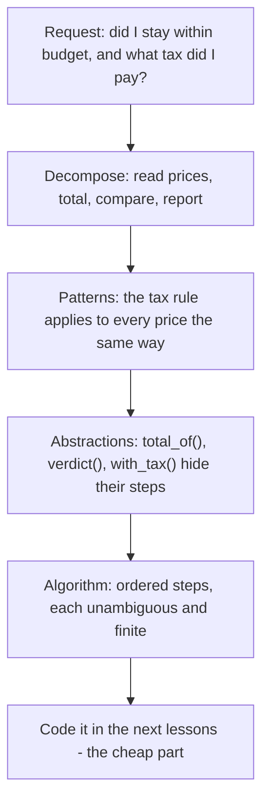

# Computational Thinking

## 1. Learning Objectives

After this lesson you will be able to:

- [ ] Decompose a written problem into small, independently solvable parts
- [ ] Recognise repeated structure in examples of a problem and state the pattern exactly once
- [ ] Choose abstractions that hide detail without hiding decisions
- [ ] Describe a complete solution as an ordered list of unambiguous steps (an algorithm)

## 2. Prerequisites

- [../01-COMPUTER-FOUNDATIONS/how-programs-execute.md](../01-COMPUTER-FOUNDATIONS/how-programs-execute.md)
  — a program is a list of steps a machine executes in order; this lesson is about *inventing*
  those steps before writing any code.
- [../00-START-HERE/learning-method.md](../00-START-HERE/learning-method.md) — how to study from
  this repository (attempt exercises before reading solutions).

## 3. Introduction

**Computational thinking** is the skill of taking a messy, real-world request and turning it into a
precise description of work that a machine could perform. It precedes programming: no syntax, no
installations, no errors — only your reasoning about a problem. Programs are merely how we record
computational thinking in a form a machine can execute; the thinking itself is done by you.

This matters because most beginners start in the wrong place. They open an editor, type something,
see it fail, and change it until the error message disappears. That loop works for toy problems and
collapses on real ones. The alternative this subject teaches: understand the problem, plan the
steps, then translate the plan into code. When the code misbehaves, you compare it against the
plan — which is far easier to debug than a screen full of syntax.

## 4. The Problem It Solves

Consider a real request: *"When I buy groceries, tell me if I stayed within my weekly budget, and
how much tax I paid."* A beginner facing this writes code immediately and discovers requirements
mid-way: What counts as tax? What if the list is empty? What does "tell me" mean — a sentence or a
number?

Before computational thinking, the only method was trial and error. The trouble: a program can be
*syntactically perfect and still answer the wrong question*. Fixing that after the code is written
means rewriting; fixing it before means adjusting a line of a plan. Computation thinking moves the
expensive part — being wrong — to where it is cheapest to correct.

## 5. Core Concepts

The discipline has four moves, usually presented as a pipeline. They are habits, not a formula;
you will cycle through them repeatedly.

### 5.1 Decomposition

**Decomposition** is splitting a problem into parts small enough that each part can be solved — or
at least examined — on its own. "Tell me if I stayed within budget" decomposes into: read the
prices, total them, compare the total with the budget, report the verdict. Each part has a clear
input and output, and any part can be wrong independently of the others.

Decomposition is also your debugging map: when the whole program misbehaves, you test the parts one
at a time — a technique this subject returns to in
[debugging-fundamentals.md](debugging-fundamentals.md).

### 5.2 Pattern recognition

**Pattern recognition** is noticing that several parts of a problem are the same problem repeated
with different data. Applying tax to price 1, then to price 2, then to price 3 is one pattern —
"apply the tax rule to each price" — not three tasks. The pattern is what loops express; you will
meet the mechanism in [loops.md](loops.md).

The counterpart matters just as much: **recognise a pattern only when it truly repeats**. Two
things that merely look similar but change for different reasons should stay separate; merging them
"because they look alike" is a classic source of tangled code, revisited in
[functions-and-methods.md](functions-and-methods.md).

### 5.3 Abstraction

**Abstraction** is keeping only the details a given part of the problem needs, and hiding the rest
behind a name. When you say "compute the total," you do not re-derive what a price is each time.
In code, an abstraction is a *function*: a name standing for steps you have already understood.
The tax rule becomes one line you can change in one place.

The test of a good abstraction: the part of the program that *uses* it needs no knowledge of how it
works, but nothing important is hidden from the part that must *change* it. Too much abstraction
hides decisions you will need to revisit; too little repeats the detail everywhere.

### 5.4 Algorithm

An **algorithm** is the final artifact: an ordered, unambiguous, finite sequence of steps that
turns input into output. The four properties are worth memorising, because each one excludes a
real failure mode:

| Property | Means | Failure mode it excludes |
|---|---|---|
| **Finite** | It terminates after a bounded number of steps | Infinite loops |
| **Definite** | Each step has exactly one meaning | "Then do the sensible thing" |
| **Inputs** | Zero or more starting values | A plan that assumes hidden state |
| **Outputs** | At least one result | Work that produces nothing observable |

"Sort the list somehow" is not definite; "compare each pair of adjacent items and swap them if
they are out of order, repeating until a full pass makes no swaps" is.

## 6. How It Works — the pipeline on one problem

The four moves compose into a pipeline, applied here to the grocery problem:



Read the diagram top-down: each stage narrows the problem, and nothing about Python appears until
the last box. That ordering is the whole point — the plan survives the choice of language, and it
is what you will compare against when the code misbehaves.

## 7. Practical Examples

All transcripts in this lesson were **executed on the authoring machine** (Python 3.13.5, Windows 11,
Git Bash) and are the real output, not illustrations.

**Example 1 — decomposition: the problem as named parts**

```python
def total_of(prices):
    running = 0.0
    for price in prices:
        running = running + price
    return running


def verdict(total, budget):
    if total > budget:
        return "OVER budget"
    return "within budget"


basket = [12.50, 3.20, 7.75]
budget = 25.00
grand_total = total_of(basket)
print(f"total  = {grand_total:.2f}")
print(f"status = {verdict(grand_total, budget)}")
```

- `total_of()` is the "total them" part; `verdict()` is the "compare with budget" part; the last
  three lines are the "report" part. Each part does exactly one job.
- **Expected output:**

  ```text
  total  = 23.45
  status = within budget
  ```

- **How to run it:** save as `grocery.py`, run `python grocery.py`.
- **Assumptions:** Python 3.13.5 on the authoring machine; the same file runs unchanged on any
  Python 3.10+.

**Example 2 — pattern recognition: one rule, not three**

```python
prices = [12.50, 3.20, 7.75]

# Without pattern recognition: one line per item, repeated by copy-paste
line1 = prices[0] * 1.16
line2 = prices[1] * 1.16
line3 = prices[2] * 1.16
print(f"copy-paste version: {line1:.2f} {line2:.2f} {line3:.2f}")

# With pattern recognition: the repeated shape becomes a loop
with_tax = []
for price in prices:
    with_tax.append(price * 1.16)
print("loop version:       " + " ".join(f"{p:.2f}" for p in with_tax))
```

- Both versions produce the same numbers, proving they express the same pattern — but the second
  handles any number of prices, because the *pattern* is written once.
- **Expected output:**

  ```text
  copy-paste version: 14.50 3.71 8.99
  loop version:       14.50 3.71 8.99
  ```

- **How to run it:** save as `pattern.py`, run `python pattern.py`.
- **Assumptions:** as Example 1. (The 1.16 factor stands in for a 16% tax — the plan does not care
  whether the number is realistic; that is a *requirement* question, answered before coding.)

**Example 3 — abstraction: the rule behind a name**

```python
def with_tax(price):
    """Hide the tax rule behind one name."""
    return price * 1.16


def fmt(price):
    """Hide the display rule behind one name."""
    return f"{price:.2f}"


print(fmt(with_tax(3.20)))
print(fmt(with_tax(12.50)))
```

- `with_tax()` and `fmt()` are abstractions: the callers use them without knowing the tax rate or
  the two-decimal rule. Change the rate and every caller follows, in one edit.
- **Expected output:**

  ```text
  3.71
  14.50
  ```

- **How to run it:** save as `abstract.py`, run `python abstract.py`.
- **Assumptions:** as Example 1.

## 8. Real-World Applications

Professionals use these four moves long before design meetings produce code. A support ticket
("exports are slow") is decomposed into *which export, how slow, compared to when* before anyone
opens an editor. A payment flow is specified as an algorithm on a whiteboard — finite steps, each
definite — because an ambiguous money flow is a liability, not a puzzle. Requirements engineering,
use cases ([13](../13-SOFTWARE-ENGINEERING-AND-ARCHITECTURE/README.md)), and code review are all
downstream of this skill; the vocabulary (decompose, abstract, algorithm) is the same in meetings
as in code.

## 9. Common Mistakes

| Mistake | Why it happens | How to recognize it | How to prevent it |
|---|---|---|---|
| Opening the editor before planning | Immediate feedback feels productive | You are changing code to see "what happens" | Write the four-step plan first; it takes minutes |
| Over-decomposition | Eager application of "split it up" | Parts so small they each need a comment to explain | Stop splitting when each part fits one sentence |
| Accidental patterns | Two similar-looking cases merged early | One part has two modes, or a flag switches behaviour | Merge only after the *rule*, not the shape, is identical |
| Algorithms that are not definite | English vagueness carried into steps | A step like "handle the errors" with no criteria | Rewrite every step until a machine could do exactly it |
| Forgetting the output | Focus on processing, not the result | The plan ends at "calculate" with no reporting step | End every plan with what the user will see |

## 10. Best Practices

- **Plan in plain English or pseudocode, not syntax.** If your plan needs braces or imports, it is
  already a translation — do the thinking first, in the language you think in.
- **Write the expected output before the code.** "For prices 12.50, 3.20, 7.75 and budget 25, the
  answer is 23.45, within budget" is a test you can run later, for free.
- **Name parts by role, not by content.** `total_of(prices)` survives a change of data; `list1()`
  does not.
- **When stuck, decompose further.** Most "I don't know how to start" moments mean one part is
  still too big — find it and solve that part alone.

## 11. Limitations and Trade-Offs

Computational thinking does not tell you *what* to build — it structures a problem someone else
(or you) has already framed. Requirements can be wrong; a perfectly executed algorithm answering
the wrong question wastes everything downstream, which is why
[requirements engineering](../13-SOFTWARE-ENGINEERING-AND-ARCHITECTURE/README.md) exists as a
discipline of its own. There is also real overhead: for a five-line script, the planning costs
more than the code. The skill is knowing when the problem justifies the method — and for anything
with money, data, or other people in it, it does.

## 12. Practical Exercises

### Introductory

1. **Decompose a request.** Split "find the longest word in a sentence" into 4–6 parts, each with
   a stated input and output, without writing any code. **Completion criteria:** every part fits
   one sentence, and the last part produces something observable.
2. **Spot the pattern.** Given these three tasks — apply a 10% discount to each purchase; find the
   largest of several numbers; count how many purchases exceed 100 — identify which two share a
   structural pattern and which does not. **Completion criteria:** a one-sentence reason for each
   classification.

### Intermediate

3. **Find the accidental abstraction.** Two requirements look alike: "email receipts to customers"
   and "email reminders to staff." Name one detail that would make a shared abstraction a
   mistake. **Completion criteria:** the shared detail and the differing detail, each with a
   one-line justification.
4. **Make it definite.** Rewrite the step "check the input and handle bad values" as three or four
   steps, each with an explicit condition and action. **Completion criteria:** no step contains
   "etc.", "somehow", or an unqualified "handle".

### Independent problem-solving

5. **Plan a text-report generator.** Requirement: *read a file of numbers (one per line), print the
   count, the total, the average, the smallest and the largest — or a clear message if the file is
   empty or contains a non-number.* Produce: the decomposition, the pattern(s) found, the
   abstractions you would create (with names), and the ordered algorithm ending in the exact
   output lines. No code yet. **Completion criteria:** every input case in the requirement
   (normal, empty, invalid) appears in the algorithm with a defined behaviour and defined output.

*Solutions: attempt first. They live in `solutions/` of this subject.*

## 13. Knowledge Check

1. Your plan's step 4 reads "then process the results." Which of the four algorithm properties
   does that violate, and why?
2. Two loops in your plan do the same thing to different lists. Is this a pattern worth
   recognising — and what evidence would say no?
3. You abstracted `apply_tax()` before knowing the tax rate. Good instinct or premature? Explain
   the trade-off.
4. A colleague says "I finished the code, but I think it solves the wrong problem." Which move
   from this lesson would have caught that before any code existed?
5. Name one situation where this lesson's method is overkill, and say why.

## 14. Completion Criteria

- [ ] You can decompose a written request into parts with stated inputs and outputs, unaided
- [ ] You can point to a repeated pattern and state it once, in one sentence
- [ ] You can name an abstraction you would create and defend what it hides
- [ ] You can state the four algorithm properties and detect a violation in a written plan

## 15. Summary

- Computational thinking precedes programming: understand, plan, then code.
- Decomposition splits a problem into parts small enough to solve and test alone.
- Pattern recognition replaces repetition — but only when the rule, not just the shape, repeats.
- Abstraction hides detail behind names, keeping decisions visible where they must change.
- An algorithm is finite, definite, with declared inputs and outputs; each property excludes a
  real failure mode.

## 16. Next Steps

- Next lesson: [algorithms-and-pseudocode.md](algorithms-and-pseudocode.md) — writing algorithms
  down precisely (pseudocode) and checking them by hand before running anything.
- Practice: [exercise set](exercises/README.md) for this subject's lessons.
- Where it is applied: the first project in
  [20-PROJECT-LABORATORY](../20-PROJECT-LABORATORY/README.md) expects a written plan before code.
