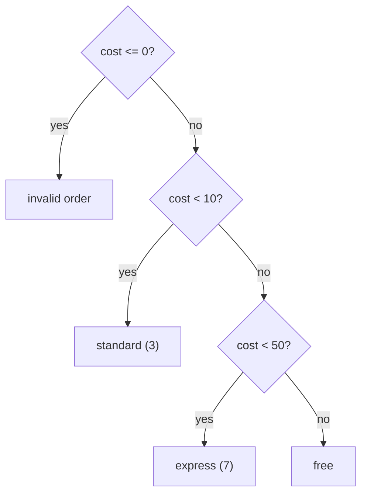

# Conditional Statements

## 1. Learning Objectives

After this lesson you will be able to:

- [ ] Write `if` / `elif` / `else` chains whose branches are exhaustive and mutually clear
- [ ] Predict which branch runs for any input, including boundary values, by tracing the chain
      top to bottom
- [ ] Use Python's truthiness rules deliberately — and state which values count as false
- [ ] Diagnose the two classic comparison traps: `=` vs `==`, and tests ordered so a broad
      condition shadows a narrow one

## 2. Prerequisites

- [operators.md](operators.md) — comparison and logical operators produce the `bool` values that
  conditions consume.
- [../01-COMPUTER-FOUNDATIONS/logic-and-boolean-algebra.md](../01-COMPUTER-FOUNDATIONS/logic-and-boolean-algebra.md)
  — truth tables and De Morgan's laws, the logic *inside* every condition.
- [input-and-output.md](input-and-output.md) — validated input gives the values you now branch
  on.

## 3. Introduction

A **conditional statement** chooses which of several paths to execute based on a condition —
`if` for the decision, `elif` for the alternatives, `else` for everything remaining. It is the
first control-flow construct that makes a program *respond* to data instead of running the same
sequence every time. The syntax is three keywords; the skill is in what the *chain* of them does
for every input, especially the ones you did not think about while writing it.

## 4. The Problem It Solves

Without conditionals a program can only run one path. "Apply different tax rules for different
countries", "reject expired tokens", "print F for a failing grade" — every real requirement has
the shape *if X, do A; otherwise B*. The naive alternative, writing ever-longer sequences of
unconditional computation, collapses immediately (computing all countries' taxes to use one).
Conditionals are how programs encode rules — and, as the Boolean lesson warned, a rule with a
hole in it is a security bug or a wrong invoice, not a typo.

## 5. Core Concepts

### 5.1 The three-part chain

```python
if condition_a:        # tested first
    ...
elif condition_b:      # tested only if a was false
    ...
else:                  # taken only if every condition was false
    ...
```

Python replaces most languages' braces with **indentation**: the indented block *is* the branch.
Execution enters the first branch whose condition is true and **skips the rest of the chain** —
`elif` conditions after a taken branch are never even evaluated. `elif` and `else` are optional;
`else` is the branch that makes the chain exhaustive, which is what prevents "no branch ran"
surprises.

### 5.2 Truthiness: values as conditions

A condition does not need a `bool`; any value is *truthy* or *falsy*. In Python the falsy values
are exactly: `False`, `None`, `0`, `0.0`, `""` (empty string), `[]`, `{}`, `()` — empty
containers and numeric zero. **Everything else is truthy**, including `-1`, `"0"`, and non-empty
lists. So `if name:` means "name is not empty", and `if items:` means "there is at least one
item" — idioms you will read in every Python codebase.

### 5.3 The comparison traps

- **`=` vs `==`.** Assignment is `=`; equality is `==`. Writing `if x = 5:` is not a silent bug
  in Python — the interpreter refuses to parse it, and its message even suggests the fix. (In
  C-family languages the same typo compiles and runs, which is why it is a career-long hazard;
  you will meet it again in [04](../04-JAVA-PROGRAMMING/README.md).)
- **Order matters.** Conditions are tested top to bottom. If a broad test (`score >= 60`) sits
  above a narrow one (`score >= 90`), the narrow one is dead code — 95 takes the broad branch.
  Order from most specific to least, or use thresholds that partition cleanly.

## 6. How It Works — tracing a chain

The chain from Example 2, with the trace for each input (which branches are *skipped* is as
important as which runs):



For `cost = 49.99`: `<= 0` false → `< 10` false → `< 50` true → `express (7)`. Two conditions
evaluated, the third decides, the rest are skipped. For `cost = 50` all three are false and the
final `else` catches it. The executed transcript in section 7 confirms every row of that
reasoning.

## 7. Practical Examples

All transcripts were **executed on the authoring machine** (Python 3.13.5, Windows 11, Git Bash).

**Example 1 — truthiness, measured**

```python
samples = [0, 1, -1, "", "text", [], [1, 2], None, 0.0]
for s in samples:
    print(f"{s!r:8} truthy={bool(s)}")
```

- `-1` is truthy (only zero is falsy), `"0"` would be truthy too, and every empty container is
  falsy — the table from 5.2, verified rather than memorised.
- **Expected output** (real):

  ```text
  0        truthy=False
  1        truthy=True
  -1       truthy=True
  ''       truthy=False
  'text'   truthy=True
  []       truthy=False
  [1, 2]   truthy=True
  None     truthy=False
  0.0      truthy=False
  ```

- **How to run it:** save as `truthy.py`, run `python truthy.py`.
- **Assumptions:** Python 3.13.5 on the authoring machine; runs unchanged on Python 3.10+.

**Example 2 — an ordered chain with an exhaustive else**

```python
def shipping(cost):
    if cost <= 0:
        return "invalid order"
    elif cost < 10:
        return "standard (3)"
    elif cost < 50:
        return "express (7)"
    else:
        return "free"


for c in [-5, 0, 9.99, 10, 49.99, 50]:
    print(f"cost {c:>6} -> {shipping(c)}")
```

- The test inputs deliberately sit *on* the boundaries (0, 10, 50) — the values where an
  off-by-one in a condition shows up. `10` fails `cost < 10` and lands in `express`, proving the
  chain's partition is `<`-strict on the left and inclusive on the right.
- **Expected output** (real):

  ```text
  cost     -5 -> invalid order
  cost      0 -> invalid order
  cost   9.99 -> standard (3)
  cost     10 -> express (7)
  cost  49.99 -> express (7)
  cost     50 -> free
  ```

- **How to run it:** save as `shipping.py`, run `python shipping.py`.
- **Assumptions:** as Example 1.

**Example 3 — the `=` trap, caught by the parser**

```python
try:
    compile("if x = 5:\n    pass", "<demo>", "exec")
except SyntaxError as err:
    print(f"SyntaxError: {err.msg}")

x = 5
print(f"chained: 0 < x < 10 -> {0 < x < 10}")
print(f"ternary: {'even' if x % 2 == 0 else 'odd'}")
```

- `compile()` parses without running, so the transcript shows Python's *actual* refusal message
  for the assignment-in-condition typo — including its suggestion. This is a real
  `SyntaxError`, not a paraphrase.
- The last line shows the **conditional expression** (`A if cond else B`) — the one-line form
  for selecting a value, as opposed to selecting an action.
- **Expected output** (real):

  ```text
  SyntaxError: invalid syntax. Maybe you meant '==' or ':=' instead of '='?
  chained: 0 < x < 10 -> True
  ternary: odd
  ```

- **How to run it:** save as `equals_trap.py`, run `python equals_trap.py`.
- **Assumptions:** as Example 1.

## 8. Real-World Applications

Access control is a conditional chain: "allow if admin, elif owner, else deny" — the exact
structure audited in [15](../15-APPLICATION-SECURITY/README.md). Pricing rules, discount tiers,
tax brackets, loan eligibility, content moderation thresholds — every business rule a program
encodes is an `if`/`elif` chain over validated input, and boundary tests (does 10 get the 9 or
the 10 tier?) are where the money bugs live. Validation loops from the previous lesson are
conditionals in a `while`; the two lessons are one mechanism at different scales.

## 9. Common Mistakes

| Mistake | Why it happens | How to recognize it | How to prevent it |
|---|---|---|---|
| `if x = 5:` | One equals sign from math or other languages | `SyntaxError` — Python refuses it at parse time | Trust the message; use `==` |
| Broad condition before narrow | Writing thresholds top-down by magnitude | Higher values take the lower tier's branch | Order specific → general; test the boundary value |
| Missing `else` | Every case seemed covered | Some input makes *no* branch run; output is empty/None | Ask "what if none match?" — add `else` with a defined fallback |
| Truthiness surprises | `if "0":` or `if -1:` assumed falsy | Checks that never trigger (or always do) | Run the value through `bool()`; remember only zero/empty/None are falsy |
| `elif` after a `return`/`break` | Not knowing branches are skipped | The later condition "never runs" | First-true-wins: nothing after a taken branch executes |

## 10. Best Practices

- **Make the chain exhaustive.** Either the `elif`s partition every case or an `else` catches
  the rest *with a defined behaviour* — silence is not a behaviour.
- **Test boundaries, not middles.** For thresholds at 10 and 50, test 9, 10, 49, 50 — the edges
  are where conditions lie.
- **Prefer early, flat checks over nesting.** Deeply nested `if`s hide logic; a chain of flat
  `elif`s shows it (this is the guard-clause style you will formalise with functions).
- **Name the condition.** `if is_eligible:` beats three `and`s inline — the Boolean lesson's
  advice, and the same reasoning as De Morgan: one meaning, one name.
- **Let Python's truthiness work for you** (`if items:`), but only where emptiness is truly the
  question.

## 11. Limitations and Trade-Offs

Chains of conditions scale linearly: a 20-tier pricing rule as `elif`s is unreadable, which is
why real systems move rules into tables or strategy objects (a theme in
[13](../13-SOFTWARE-ENGINEERING-AND-ARCHITECTURE/README.md)). Boolean conditions also hide
*order-dependence*: two conditions that read independently can interact through short-circuiting
(Boolean lesson §5.5), and truthiness collapses rich values to a bit — `if user:` says nothing
about *which* user. Finally, conditionals are where policy lives, and policy written as code is
policy someone must audit: an `if` protecting money or access deserves the truth table from the
Boolean lesson, not a glance.

## 12. Practical Exercises

### Introductory

1. **Predict the branch.** For the `shipping()` chain, predict results for `-1`, `9.999`,
   `10.0`, `49.999`, `100`; then run. **Completion criteria:** five predictions, five actuals,
   any mismatch explained by a boundary rule.
2. **Truthiness check.** Without `bool()`, predict for `"False"`, `{}`, `[0]`, `0j`, `""`,
   `" "`; then verify. **Completion criteria:** six predictions, explanation of the one that
   surprised you (hint: is the *string* `"False"` empty?).

### Intermediate

3. **Fix the shadowed chain.** Written: `if score >= 60: "pass" elif score >= 90: "honours"`.
   Diagnose why 95 never gets honours; rewrite ordered so all three outcomes (fail / pass /
   honours) are reachable. **Completion criteria:** the diagnosis names the skip rule; the
   rewrite produces `honours` for 95 in a real run.
4. **Add the missing case.** A validator reads `if value > 0: ... else: ...` but 0 is legal and
   must map to its own message. Restructure the chain so every input class (negative, zero,
   positive) has a defined branch. **Completion criteria:** three input classes, three defined
   outputs, boundary run shown.

### Independent problem-solving

5. **Build a ticket pricer.** Rules: off-peak weekday before 17:00 → base; peak evening or
   weekend → 1.5×; child (under 12) or senior (65+) → 50% off the time-based price; groups of
   10+ → extra 10% off. Ask for hour (0–23), day type, age, and group size with the retry-loop
   pattern from the previous lesson; print the category and final price. **Completion criteria:**
   at least six input combinations produce correct, rule-traceable prices; one combination per
   rule plus two combined; boundary ages 11/12 and 64/65 behave as specified.

*Solutions: attempt first. They live in `solutions/` of this subject.*

## 13. Knowledge Check

1. In one sentence: when does Python evaluate an `elif` condition?
2. Why does `if "0":` run its branch, and what would make it not run?
3. `if x = 5` fails at parse time in Python. Why is that *better* than C's silent behaviour?
4. For thresholds 18 and 65, what is wrong with ordering `if age >= 18 ... elif age >= 65`?
   Rewrite it.
5. When is the conditional expression (`A if c else B`) the right form, and when is a statement
   chain better?

## 14. Completion Criteria

- [ ] You can trace any `if`/`elif`/`else` chain to its taken branch, including boundaries
- [ ] You can state Python's falsy values from memory and verify with `bool()`
- [ ] You can diagnose a shadowed condition and an exhaustive-vs-missing `else`
- [ ] You can write a validated, exhaustive branch structure for a small rule set from a blank
      editor

## 15. Summary

- First-true-wins: branches are tested top to bottom; the rest are skipped once one is taken.
- Python's falsy set is exactly `False`, `None`, `0`, `0.0`, and empty containers; everything
  else is truthy.
- `=` assigns, `==` compares — Python refuses the typo at parse time and names the fix.
- Order matters: specific before general, boundaries tested, `else` always defined.
- For value selection use `A if c else B`; for actions use the chain.

## 16. Next Steps

- Next lesson: [loops.md](loops.md) — repeating the right work any number of times: `for`,
  `while`, and the off-by-one error that lives between them.
- Practice: [exercise set](exercises/README.md) for this subject's lessons.
- Where it is applied: access-control chains in
  [15](../15-APPLICATION-SECURITY/README.md); business-rule tables outgrow `elif` in
  [13](../13-SOFTWARE-ENGINEERING-AND-ARCHITECTURE/README.md).
