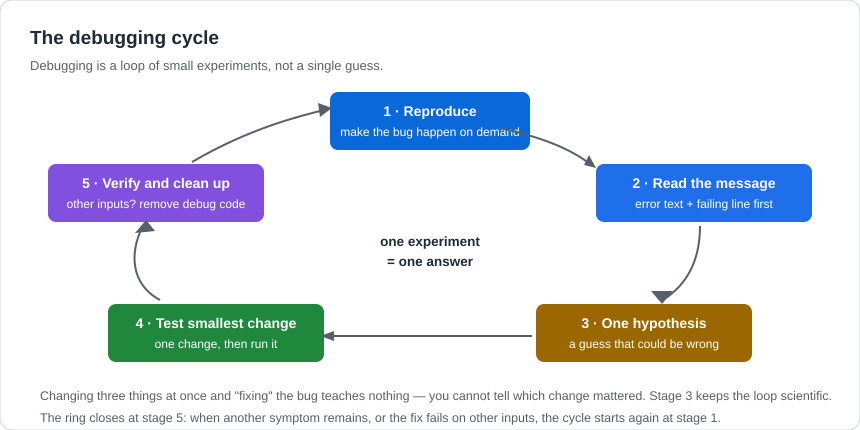

# Debugging Fundamentals

## 1. Learning Objectives

After this lesson you will be able to:

- [ ] Read a Python traceback from the bottom up and extract the three facts: what error, in
      which file and line, at which call level
- [ ] Classify a bug as syntax, runtime, or logic — and say which tool addresses each
- [ ] Run the debugging cycle: reproduce, read, hypothesise once, test the smallest change,
      verify and clean up
- [ ] Narrow a logic bug's location deliberately with prints or the debugger, instead of editing
      and hoping

## 2. Prerequisites

- [arrays-and-strings.md](arrays-and-strings.md) — the `TypeError` from that lesson's Example 2
  is your first real traceback.
- [functions-and-methods.md](functions-and-methods.md) — frames; tracebacks list them.
- [../01-COMPUTER-FOUNDATIONS/how-programs-execute.md](../01-COMPUTER-FOUNDATIONS/how-programs-execute.md)
  — syntax vs runtime vs logic errors, classified once; this lesson applies the taxonomy.

## 3. Introduction

**Debugging** is finding and fixing the cause of wrong behaviour — not the symptom, the cause.
It is a separate skill from writing code, and by volume it *is* the larger part of professional
programming: plans are wrong, inputs are surprising, and every assumption eventually meets data
that breaks it. This lesson teaches the two halves of the skill: **reading what the interpreter
tells you** (tracebacks, error messages) and **investigating what it cannot tell you** (logic
bugs, where the program runs happily and just computes the wrong answer).

## 4. The Problem It Solves

The naive debugging method — change something, run again, repeat until it works — has two
failure modes. It fixes *symptoms*: the crash disappears but the wrong total remains, discovered
next week by someone else. And it teaches nothing: with three changes in flight, you cannot know
which one helped, so the bug's cause survives to bite the next program. The alternative costs
minutes and pays for itself the first time: the disciplined cycle in section 5.3, which ends
when you can state *why* it broke, not merely that it stopped breaking.

## 5. Core Concepts

### 5.1 The three bug classes, with their tools

| Class | Symptom | Tool | Example from this subject |
|---|---|---|---|
| **Syntax** | Nothing runs; error before execution | The message + the line | `if x = 5:` — Python names the fix |
| **Runtime** | Runs, then crashes with a traceback | Read the traceback | `total += "thirty"` — `TypeError` mid-loop |
| **Logic** | Runs, exits 0, wrong answer | Hypothesis + evidence | Discount *added* instead of subtracted |

Syntax errors are the cheapest (the interpreter localises them exactly). Runtime errors are
usually cheap too — the traceback is a precise map. **Logic bugs are the expensive class**, and
the one this lesson spends its tooling on, because nothing crashes: the evidence must be
collected deliberately.

### 5.2 Anatomy of a traceback

A **traceback** is Python's crash report: error type and message on the *last* line, the call
chain above it, innermost frame last. Reading it bottom-up gives you, in order: **what** went
wrong (`TypeError: unsupported operand type(s) for +=: 'int' and 'str'` — `+` got a number and a
string), **where** (file, line number, and the actual source line), and **how deep** (the chain
of frames from `main` down — each frame's locals are gone by print time, which is why the
interpreter cannot tell you *which* element was the string; that is your job).

### 5.3 The debugging cycle



The discipline is in the constraints. **Reproduce first**: a bug you cannot trigger on demand
cannot be verified fixed — "works now" after one run is luck, not evidence. **One hypothesis**:
if you change three things and it works, you have learned nothing and possibly hidden the real
cause. **Smallest test**: a one-line print, or a temporary call with a literal — the fastest
experiment that could distinguish your hypothesis from its rival. **Verify**: rerun on the
original failing case *and* one more input, then delete the instrumentation — debug prints that
ship to production are the cycle failing at its last stage.

### 5.4 Bisection: halving the search space

For logic bugs, locate by **bisection** — the binary-search instinct from
[algorithms-and-pseudocode.md](algorithms-and-pseudocode.md), applied to your own code: print the
value at the midpoint of the data path; if it is already wrong, the cause is earlier, if right,
later. Halving turns a hundred-line hunt into seven questions. With functions in the way, the
same move works per-function: log each function's inputs and outputs and find the first function
whose output stops matching your expectation.

## 6. How It Works — one bug, whole cycle

A totals program crashes. The cycle, executed:

```text
1. REPRODUCE    Run it. Same crash every time? Yes - [10, 20, "thirty", 40] is in the file.
2. READ         Traceback, bottom line: TypeError: unsupported operand type(s) for +=:
                'int' and 'str'.  Location: line 4, total += p.
3. HYPOTHESISE  "One element of prices is a string."  (One hypothesis. Could also be
                'total is a string' - the traceback cannot distinguish; test both cheaply.)
4. TEST         print(type(p)) inside the loop.  -> <class 'str'> on the third pass.
5. VERIFY/FIX   The data is wrong, not the loop.  Fix the input (30, not "thirty"),
                rerun, confirm exit 0 and correct total - then remove the print.
```

Section 7 executes steps 1–4 for real, including the exact traceback and a real logic bug that
*doesn't* crash — the expensive class.

## 7. Practical Examples

All transcripts were **executed on the authoring machine** (Python 3.13.5, Windows 11, Git Bash).

**Example 1 — reading a real traceback**

```python
total = 0
prices = [10, 20, "thirty", 40]
for p in prices:
    total += p
print(total)
```

- The crash happens on the **third** pass — passes one and two succeeded, which is why the
  traceback's line number alone is not the whole story: the bug is *at* line 4, but its
  *cause* is in the data above it.
- **Actual output** (real; the program exits with status 1):

  ```text
  Traceback (most recent call last):
    File "dbg_traceback.py", line 4, in <module>
      total += p
      ^^^^^^^^^^
  TypeError: unsupported operand type(s) for +=: 'int' and 'str'
  ```

- Read bottom-up: **what** — `+=` received an `int` and a `str`; **where** — line 4,
  `total += p`; **context** — inside the loop over `prices`, the only data source.
- **How to run it:** save as `dbg1.py`, run `python dbg1.py`.
- **Assumptions:** Python 3.13.5 on the authoring machine; traceback layout is stable across
  3.10+.

**Example 2 — the bug that does not crash**

```python
def apply_discount(price, percent):
    discount = price * percent
    return price + discount


original = 100
final = apply_discount(original, 0.1)
print(f"final price: {final}")
```

- Exit status **0**, no error, and `110.0` — but a 10% *discount* of 100 must be `90.0`. This is
  the logic class: the sign in `price + discount` should be `-`. Everything else about the
  program is "correct", which is exactly why nothing crashes.
- The cycle for this class: the expectation (90.0) comes from the **requirement**, not the code;
  the one-hypothesis test would be printing `discount` (10.0 — the computation is fine) to
  isolate the sign at the return.
- **Expected output** (real):

  ```text
  final price: 110.0
  ```

- **How to run it:** save as `dbg2.py`, run `python dbg2.py`; run it *and fix the sign* — the
  fixed version prints `final price: 90.0`.
- **Assumptions:** as Example 1.

**Example 3 — instrumentation that stays**

For long programs, structured debug output beats scattered prints:

```python
def apply_discount(price, percent):
    discount = price * percent
    print(f"  [debug] price={price} percent={percent} discount={discount}")
    return price - discount


final = apply_discount(100, 0.1)
print(f"final price: {final}")
```

- The debug line prints the *inputs and the intermediate* — the two facts that distinguish "wrong
  inputs" from "wrong formula" in one glance. After the fix, such lines are removed or replaced
  by the logging taught in
  [11](../11-BACKEND-ENGINEERING/README.md); Python's `logging` module is the professional form
  of the same idea.
- **Expected output** (real):

  ```text
    [debug] price=100 percent=0.1 discount=10.0
  final price: 90.0
  ```

- **How to run it:** save as `dbg3.py`, run `python dbg3.py`.
- **Assumptions:** as Example 1.

## 8. Real-World Applications

The cycle is universal — the same reproduce/read/hypothesise/test loop runs in browser dev tools,
database query analysers, and production incident response (where "reproduce" means gathering
logs and metrics first, in
[17](../17-CLOUD-AND-PRODUCTION/README.md)'s observability). Reading tracebacks is a daily
professional act: every stack trace in every language has the same bottom-up structure you
learned here. Hypothesis discipline is what separates a senior engineer's debugging session
from a guessing spiral — and it is exactly what
[19](../19-PROFESSIONAL-DEVELOPMENT/debugging-methodology.md) expands into a full methodology.

## 9. Common Mistakes

| Mistake | Why it happens | How to recognize it | How to prevent it |
|---|---|---|---|
| Editing without reproducing | The crash is unpleasant; moving on is easier | "It stopped crashing" with no confirmed cause | Reproduce first, always; a fix without a repro is a guess |
| Changing three things at once | Impatience; all "look wrong" | Bug vanishes; you cannot say why | One hypothesis per run; keep a two-line log of what you tried |
| Reading tracebacks top-down | The first frame looks important | You debug the *caller*, not the failure | Last line first: error type and message, then innermost frame |
| Debugging the symptom | Patching where it crashed, not why | Same crash later, elsewhere | Ask "what made this value wrong?" one frame up |
| Shipping debug prints | Cleanup feels optional | `print` lines in a real run's output | Instrumentation is temporary; logging is the permanent form |

## 10. Best Practices

- **Read the last line of the traceback before anything else** — error type and message usually
  name both the problem and (in Python's style) the fix.
- **Write the expected output before debugging** (from the algorithms lesson): a logic bug needs
  a defined "correct" to compare against.
- **Reproduce with the smallest input you can** — one failing element, not a file of a thousand.
- **Say your hypothesis aloud or in a comment.** "I think price is a string" forces a falsifiable
  test; vague unease does not.
- **Delete instrumentation before committing.** The diff should contain the fix, not the
  search.

## 11. Limitations and Trade-Offs

Some bugs resist the cycle's simplicity: **intermittent** bugs (race conditions, network flakiness)
break "reproduce first" — you need statistical reproduction and logging instead, a major reason
production debugging looks different ([18](../18-ADVANCED-ENGINEERING/README.md)). **Bugs in code
you cannot run** (production-only data, third-party services) force reasoning from logs alone.
And debugging *fixes* the code but rarely fixes the *cause*: a wrong-sign formula that reached
commit suggests a test should have caught it — which is the bridge from this lesson into
[14](../14-TESTING-AND-QUALITY/README.md): the best debugging session is the one a test suite
prevents.

## 12. Practical Exercises

### Introductory

1. **Anatomy drill.** Run the Example 1 crash yourself; label the traceback's four parts (error
   type, message, location, frames). **Completion criteria:** all four identified on the real
   output, with the fix named.
2. **Classify five bugs.** Assign each to syntax/runtime/logic: missing colon; division by zero;
   wrong formula; typo'd variable name used immediately; off-by-one total. **Completion
   criteria:** five correct classifications, each with the tool that would address it.

### Intermediate

3. **Bisect a logic bug.** Given a program that should compute the average of a list but prints
   too low a value: add instrumentation at the midpoint of the data path, run, and state whether
   the cause is before or after your probe; then find it exactly. **Completion criteria:** your
   probe line, its output, your inference, and the confirmed root cause — with the final fix
   producing the right average on a hand-checked list.
4. **One-hypothesis practice.** Take the discount bug (Example 2): write your hypothesis,
   the single cheapest test, and the result — before looking at the fix. **Completion criteria:**
   the test distinguishes "wrong inputs" from "wrong sign" on its own.

### Independent problem-solving

5. **Debug a delivered program.** *`total = 0; count = 0; for p in [10, 20, 30]: if p > 15:
   total = p; count += 1; print(total / count)` — should average the values over 15 (25.0);
   runs fine, prints the wrong answer.* Apply the full cycle: reproduce, classify, hypothesise
   once, test, fix, verify on a second list. **Completion criteria:** the cycle's five steps
   written down as you went; correct result for the original list and for `[5, 25]` (25.0); a
   one-sentence statement of the bug's class and cause.

*Solutions: attempt first. They live in `solutions/` of this subject.*

## 13. Knowledge Check

1. A traceback's last line says `NameError: name 'totl' is not defined`. Read it bottom-up:
   what, where, and what is the likely cause?
2. Why is a logic bug more expensive than a runtime bug, given the runtime one "breaks the
   program"?
3. State the cycle's five stages from memory, and the purpose of stage 3's "one" constraint.
4. Your fix involved two changes and the bug vanished. What have you actually learned — and what
   have you not?
5. When would prints beat the debugger, and vice versa? One case each.

## 14. Completion Criteria

- [ ] You can extract what/where/context from any traceback without searching the web first
- [ ] You can classify any bug report into the three classes and name the matching tool
- [ ] You can run the cycle on a real bug and end with a stated cause, not just a fix
- [ ] You can bisect a logic bug to a single line with instrumentation

## 15. Summary

- Syntax errors never run; runtime errors crash with a map (read the traceback bottom-up); logic
  bugs are the expensive, silent class.
- The cycle: reproduce → read → one hypothesis → smallest test → verify and clean up.
- Reproduce before fixing; one change at a time; cause, not symptom.
- Bisect: halve the search space with probes, at the data level and the call level.
- The best debugging tool is upstream of all of these: a test that catches the class of bug
  before you do.

## 16. Next Steps

- Next lesson: [modular-programming.md](modular-programming.md) — the structural fix for the
  tangle: splitting one program into modules with clear responsibilities.
- Practice: [exercise set](exercises/README.md) for this subject's lessons.
- Where it is applied: the full debugging methodology in
  [19](../19-PROFESSIONAL-DEVELOPMENT/README.md); logging-based diagnosis in
  [11](../11-BACKEND-ENGINEERING/README.md); tests as bug-catchers in
  [14](../14-TESTING-AND-QUALITY/README.md).
