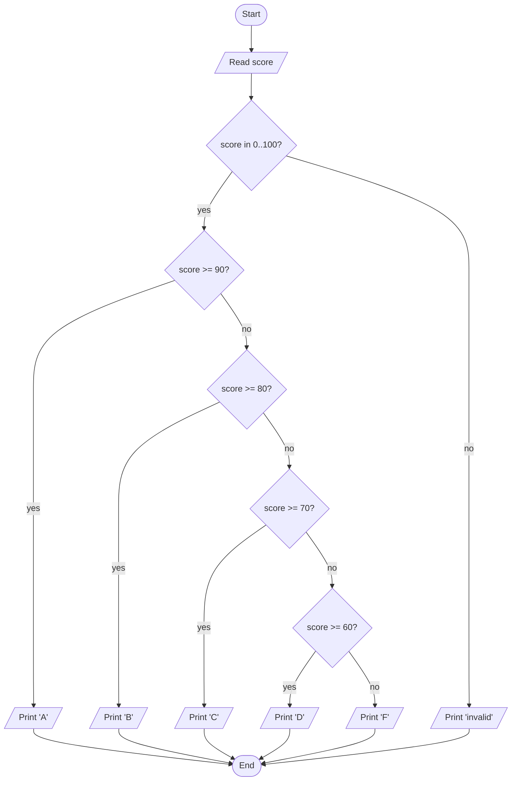
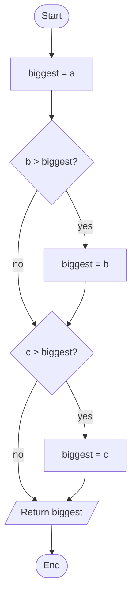

# Flowcharts

## 1. Learning Objectives

After this lesson you will be able to:

- [ ] Read and draw flowcharts using the standard symbols (terminator, process, decision, I/O,
      flowline) and state what each is for
- [ ] Translate a flowchart into pseudocode and working code, and translate code back into a
      flowchart
- [ ] Represent branching and looping correctly, including the loop-back edge that makes a loop a
      loop
- [ ] Explain when a drawn diagram beats a written list — and when it does not

## 2. Prerequisites

- [algorithms-and-pseudocode.md](algorithms-and-pseudocode.md) — writing algorithms as text;
  this lesson draws the same algorithms.
- [computational-thinking.md](computational-thinking.md) — decomposition and the pipeline that
  produces an algorithm in the first place.

## 3. Introduction

A **flowchart** is an algorithm drawn as boxes connected by arrows: each box is a step, each arrow
is "happens next". Where pseudocode expresses order through lines and indentation, a flowchart
expresses it through space — which makes *branching* (one step, several possible next steps) far
easier to see at a glance. Flowcharts are also universal: a flowchart drawn today can be
implemented in Python, Java, or a spreadsheet years later, because it describes the logic, not a
language.

## 4. The Problem It Solves

Branching and looping are hard to read as text. Pseudocode for a grade lookup is six `IF` lines
that a reader must assemble into a shape mentally; the same logic as a flowchart *is* the shape —
one decision diamond per threshold, each "yes" arrow landing on its answer. People misread text
branches ("which `ELSE` belongs to this `IF`?") far more often than misread arrows. The flowchart
moved into software engineering's standard toolkit (ISO 5807) for exactly this reason, and it is
how non-programmers — analysts, managers, domain experts — are usually shown a process. When your
audience includes anyone who does not read code, the diagram is not decoration; it is the
communication.

## 5. Core Concepts

### 5.1 The standard symbols

| Symbol | Shape | Means | Example |
|---|---|---|---|
| **Terminator** | Oval | Start or end | `Start`, `End` |
| **Process** | Rectangle | A computation or action | `total ← total + price` |
| **Decision** | Diamond | A question with yes/no (or multiple) exits | `score ≥ 90?` |
| **Input/Output** | Parallelogram | Reading or displaying data | `PRINT verdict` |
| **Flowline** | Arrow | The order of execution | `→` |
| **Connector** | Small circle | Jump to another part of the chart (avoids long crossing arrows) | `A` |

The diamond matters most: a decision has **at least two outgoing arrows**, usually labelled
`yes`/`no` (or `true`/`false`). A "decision" with one exit is a process wearing a costume — and a
very common beginner drawing error.

### 5.2 Flow from boxes to branches

Arrows leave each box at most once per exit and enter each box at most once. A process box has one
entry and one exit; a decision has one entry and two (or more) exits. Following any path from
Start, every box you pass was executed; boxes on the other branch were not. That is the entire
reading skill.

### 5.3 Loops are arrows that go back

A loop is drawn as a decision whose "not yet" exit points **backwards** to a step above it. The
chart gains a cycle, which is exactly what a `while` or `for` loop is. If every arrow points
downward, there is no loop — that is how you tell a flowchart of a one-pass algorithm from a
flowchart of an iterative one.

### 5.4 One chart, many languages

The same chart translates to any language's syntax. The grade chart below becomes `if`/`elif` in
Python, `if`/`else if` in Java, `switch` in C — the chart chooses none of them. This is the payoff
of writing the algorithm before the code (from [computational-thinking.md](computational-thinking.md)):
the plan survives the choice of implementation language.

## 6. How It Works — the grade chart, drawn and read

This lesson's running example: *given a numeric score, print its letter grade, or "invalid" if the
score is out of range.* Drawn as a flowchart (a Mermaid rendering of the standard symbols — the
diamond is Mermaid's decision shape):



Read it by picking a score and following the arrows: 82 fails `≥ 90`, fails `≥ 70`… no — 82
passes `≥ 80`, so it prints `B` and ends. Notice two properties the drawing makes obvious:

1. **Every path terminates at the same End.** Each branch merges back — the chart has one entry
   and one exit.
2. **The order of decisions is load-bearing.** Swap the `≥ 80` and `≥ 90` diamonds and 95 would
   print `B`. In text that swap is easy to miss; in the chart the arrows' order jumps out.

## 7. Practical Examples

Transcripts were **executed on the authoring machine** (Python 3.13.5, Windows 11, Git Bash).

**Example 1 — the grade chart as code**

The flowchart above, implemented exactly (decisions in the same order):

```python
def letter_grade(score):
    if score < 0 or score > 100:
        return "invalid"
    if score >= 90:
        return "A"
    if score >= 80:
        return "B"
    if score >= 70:
        return "C"
    if score >= 60:
        return "D"
    return "F"


for s in [95, 82, 70, 61, 44, -3]:
    print(f"score {s:>3} -> {letter_grade(s)}")
```

- The first `if` is the `score in 0..100?` diamond's "no" branch, taken before any threshold test
  — the chart's structure, preserved in code.
- **Expected output** (real, from the execution):

  ```text
  score  95 -> A
  score  82 -> B
  score  70 -> C
  score  61 -> D
  score  44 -> F
  score  -3 -> invalid
  ```

- **How to run it:** save as `grade.py`, run `python grade.py`.
- **Assumptions:** Python 3.13.5 on the authoring machine; runs unchanged on Python 3.10+.

**Example 2 — code back to a chart (reverse translation)**

Given this code, produce the flowchart:

```python
def max_of_three(a, b, c):
    biggest = a
    if b > biggest:
        biggest = b
    if c > biggest:
        biggest = c
    return biggest


print(max_of_three(8, 3, 11))
print(max_of_three(5, 5, 2))
print(max_of_three(-4, -1, -9))
```

Its flowchart, drawn from the code:



- **Expected output** of the code (real):

  ```text
  11
  5
  -1
  ```

- **How to run it:** save as `max3.py`, run `python max3.py`.
- **Assumptions:** as Example 1.
- The reverse exercise is not busywork: drawing your *own* code as a chart is a reliable way to
  spot a missing branch — the diamond with only one outgoing arrow.

## 8. Real-World Applications

Flowcharts document approval workflows ("is the invoice under 500?"), medical triage protocols,
manufacturing steps, and any process a non-engineer must audit — which is why they appear in
requirements documents ([13](../13-SOFTWARE-ENGINEERING-AND-ARCHITECTURE/README.md)) and in error-
handling specifications. In software teams they are most often used to explain a decision-heavy
piece of logic in a design review, and to teach a codebase's control flow to newcomers. Every
diagram in this repository's Markdown files uses the Mermaid syntax you saw above, so it stays
editable as text.

## 9. Common Mistakes

| Mistake | Why it happens | How to recognize it | How to prevent it |
|---|---|---|---|
| Decision with one exit | Drawing the question but only the "yes" path | Every diamond should have ≥ 2 outgoing arrows | Ask "what happens when the answer is no?" for each diamond |
| Unreachable box | A branch drawn but no arrow leading to it | The box cannot be reached from Start by any path | Trace every box backwards to Start once |
| Loop with no exit edge | Cycle drawn, termination condition forgotten | The loop-back arrow exists, the "done" arrow does not | Every loop decision needs both: back-edge *and* exit-edge |
| Wrong decision order | Thresholds tested in the wrong sequence | Later, stricter tests shadow earlier ones (95 → B) | Order tests from most specific to least, and test the boundary |
| Chart drifts from code | Chart drawn once, code changed since | Chart and program disagree on a branch | Redraw from the current code, or treat the code as the source of truth and the chart as a teaching aid |

## 10. Best Practices

- **One entry, one exit.** Paths merge at a single End; parallel spaghetti is unreadable and
  hides bugs.
- **Label every decision arrow** (`yes`/`no`), even when the shapes make it guessable — readers
  guess wrong.
- **Keep decisions in strict order** and test thresholds from one end, not scattered; it mirrors
  the `if`/`elif` chain the code will use.
- **Draw to communicate, not to decorate.** If the audience reads code fluently and the logic is
  three steps, skip the chart; a bad diagram costs more than the text it replaces.
- **Draw your buggy code.** When a branch-heavy function misbehaves, sketching it usually reveals
  the missing or wrong arrow before any debugging starts (the full method arrives in
  [debugging-fundamentals.md](debugging-fundamentals.md)).

## 11. Limitations and Trade-Offs

Flowcharts scale badly: a 50-step process becomes a wall of boxes nobody reads, which is why
complex systems are documented with layered diagrams and
[UML](../13-SOFTWARE-ENGINEERING-AND-ARCHITECTURE/README.md) instead. They also capture control
flow only — data shapes, timing, and side effects live elsewhere. And they can rot: a chart
drawn in month one and code changed in month three is worse than no chart, because it lies with
authority. The honest position: flowcharts are for communication at decision points, not for
archival specification.

## 12. Practical Exercises

### Introductory

1. **Read the chart.** For the grade flowchart in section 6, list the exact sequence of diamonds
   visited for scores 90, 80, 60, and 0. **Completion criteria:** each score traced to its printed
   letter, diamonds in visit order.
2. **Name the symbols.** Sketch five unlabeled shapes (oval, rectangle, diamond, parallelogram,
   arrow) and write what each means. **Completion criteria:** all five correct, decision's two
   exits drawn.

### Intermediate

3. **Fix the broken chart.** A flowchart for "print even numbers from 1 to 10" has its loop-back
   arrow but no exit — describe the symptom in code terms (what would the program do?) and add
   the missing edge. **Completion criteria:** the code-level symptom named, corrected chart drawn
   with both edges.
4. **Translate both ways.** Draw the flowchart for the `linear_search` pseudocode from
   [algorithms-and-pseudocode.md](algorithms-and-pseudocode.md), then write the flowchart for any
   6-line program of your choice. **Completion criteria:** both charts have a single entry/exit
   and every decision has labelled exits.

### Independent problem-solving

5. **Design a validator, chart first.** Requirement: *read a temperature reading; print "invalid"
   for non-numeric or out-of-range (-90..60) input; otherwise classify freezing (<0), cold
   (0..14), mild (15..29), hot (≥30).* Draw the complete flowchart, then implement it in Python,
   then run it on at least six inputs including two edge cases and one non-number. **Completion
   criteria:** chart and code agree on every branch; edge cases behave as the chart says; you can
   point to the diamond that each test input travelled through.

*Solutions: attempt first. They live in `solutions/` of this subject.*

## 13. Knowledge Check

1. How can you tell, from a flowchart alone, whether it describes a loop or a single pass?
2. A decision diamond has one outgoing arrow. What is wrong, in both chart terms and code terms?
3. Why does the grade chart test `score in 0..100?` *before* the letter thresholds?
4. Your chart and your code disagree about a branch. Which is the source of truth, and why?
5. Name one situation where a flowchart is the wrong tool and say why.

## 14. Completion Criteria

- [ ] You can read any flowchart in this repository and predict its output for given input
- [ ] You can draw a branching algorithm with labelled exits and a single entry/exit
- [ ] You can convert a flowchart to working code and code back to a chart
- [ ] You can name the two edges every loop needs, and what happens when one is missing

## 15. Summary

- Flowcharts draw algorithms: oval start/end, rectangle process, diamond decision, parallelogram
  I/O, arrows for order.
- Every decision has ≥ 2 labelled exits; every loop has a back-edge and an exit-edge; every chart
  has one entry and one exit.
- The order of decisions is load-bearing — draw thresholds consistently and test the boundary.
- Translate both directions: chart → code to implement, code → chart to inspect your own logic.
- Charts communicate at decision points; they rot when code changes, so keep them honest or drop
  them.

## 16. Next Steps

- Next lesson: [variables-and-data-types.md](variables-and-data-types.md) — from plans to the
  machine: where values live, what names mean, and why types exist.
- Practice: [exercise set](exercises/README.md) for this subject's lessons.
- Where it is applied: requirements and process documentation in
  [13](../13-SOFTWARE-ENGINEERING-AND-ARCHITECTURE/README.md) use charts exactly like these.
