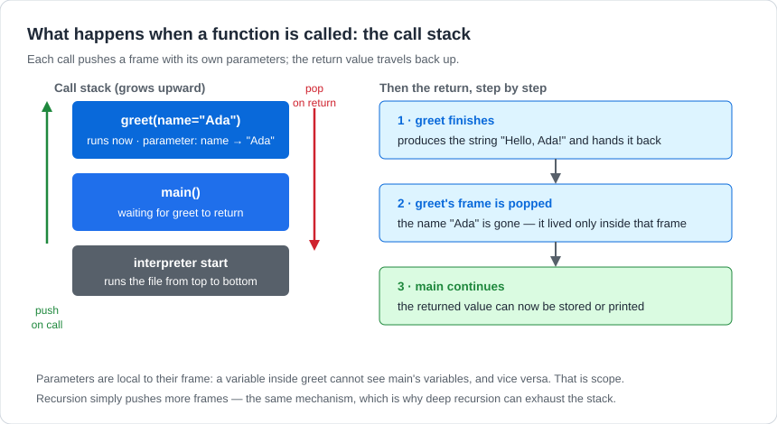
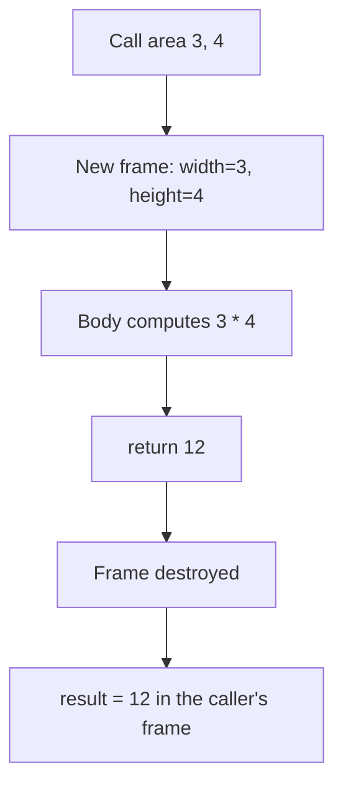

# Functions and Methods

## 1. Learning Objectives

After this lesson you will be able to:

- [ ] Define a function with parameters and return values, and trace what happens at a call —
      which frame is pushed, what is bound where, what comes back
- [ ] Explain scope: why a name inside a function cannot see (or accidentally change) a name
      outside it
- [ ] Distinguish returning a value from printing it, and use each deliberately
- [ ] Diagnose the mutable-default trap and read the `None`-default idiom that replaces it

## 2. Prerequisites

- [loops.md](loops.md) and [conditional-statements.md](conditional-statements.md) — the bodies
  that functions package up.
- [variables-and-data-types.md](variables-and-data-types.md) — binding and the object model,
  which is what scope and the default trap *are*.
- [../01-COMPUTER-FOUNDATIONS/memory-and-storage.md](../01-COMPUTER-FOUNDATIONS/memory-and-storage.md)
  — memory regions; a function frame is one.

## 3. Introduction

A **function** is a named block of code that takes inputs (**parameters**), does one job, and
gives back a **return value**. Calling the function runs its body with the parameters bound to
the arguments you passed; when it returns, the caller continues with the value. The vocabulary of
"methods" appears immediately after: a **method** is a function attached to a value — `upper()`
belongs to strings, `append()` to lists — called with the dot. Same mechanism, one extra
question: *which object does it work on?*

## 4. The Problem It Solves

Three problems, one solution. **Repetition:** copy-pasted logic must be fixed in every copy
(the computational-thinking lesson's rule, now with a mechanism). **Naming:** three lines that
compute an area become `area(w, h)` — a name readers understand at the call site. **Testing:**
a named unit with stated inputs and outputs can be run *in isolation*, on purpose, with chosen
values — the property that makes everything in [14](../14-TESTING-AND-QUALITY/README.md)
possible. Programs without functions are paragraphs without sentences: everything at one level,
nothing to refer to.

## 5. Core Concepts

### 5.1 Definition, parameters, arguments

```python
def area(width, height):      # 'width' and 'height' are parameters
    return width * height     # one job, stated result

result = area(3, 4)           # 3 and 4 are arguments, bound to the parameters
```

`def` introduces the function; the body does not run at definition time, only at call time. The
parameters are *local names* — fresh bindings per call (section 5.3), which is why the same
function works for every input.

### 5.2 Return vs print

`return` hands a value back to the caller and **ends the function immediately**. A function
without a `return` returns the special value `None` — a fact that produces a whole class of
mystery bugs when a function that *looks* like it produces a value only prints one. The rule of
thumb: **functions that compute return; programs that report print.** Keep the two jobs apart
and both stay testable.

### 5.3 Scope: frames and what they can see

Each call runs in its own **frame** — a private workspace of names, holding the parameters and
any local variables. Names inside a frame are invisible outside it, and a local assignment
creates or updates a *local* name, never an outer one. `global` (used in Example 2) can reach
out and rebind a top-level name, but it is a deliberate override, not the default — and the
default is what keeps functions predictable: same inputs, same behaviour, regardless of what
else the program is doing.



The diagram shows one call in motion: `main()` is suspended while `greet` runs in its own frame;
`greet`'s parameter `name` exists only there. When `greet` returns, the frame is destroyed — which
is why "what did greet's name variable equal?" is a well-defined question with a definitive
answer: it is gone.

### 5.4 The mutable-default trap

Default parameter values are created **once**, when the `def` line runs — not per call. With a
mutable default (`[]`, `{}`), every call shares the same object, and calls accumulate state from
previous calls. The idiom that fixes it: `bucket=None`, then create the fresh object inside the
body. Example 3 executes both versions side by side. (Immutables — `0`, `""`, `None` as the
*default value itself* — are safe, because nothing can mutate them.)

## 6. How It Works — a call, frame by frame



Nothing from the frame survives — not the parameter names, not intermediates. That destruction is
also why recursion works (each call has its own workspace, as the call-stack diagram's footnote
says) and why deep recursion eventually fails: frames accumulate until the stack limit is hit.

## 7. Practical Examples

All transcripts were **executed on the authoring machine** (Python 3.13.5, Windows 11, Git Bash).

**Example 1 — the call, including the invisible `None`**

```python
def area(width, height):
    return width * height


result = area(3, 4)
print(f"area(3, 4) returned: {result}")


def greet(name):
    print(f"  (greet says: Hello, {name})")


nothing = greet("Ada")
print(f"greet returned: {nothing!r}")
```

- `area` computes and returns; `greet` only prints. The second print exposes the difference:
  `greet` *did* return something — the default `None` — which `!r` reveals. Functions that
  report and functions that compute are different contracts.
- **Expected output** (real):

  ```text
  area(3, 4) returned: 12
    (greet says: Hello, Ada)
  greet returned: None
  ```

- **How to run it:** save as `calls.py`, run `python calls.py`.
- **Assumptions:** Python 3.13.5 on the authoring machine; runs unchanged on Python 3.10+.

**Example 2 — scope, demonstrated and overriden**

```python
counter = 0


def attempt():
    counter = 5
    return counter


def really_change():
    global counter
    counter = 99


print(f"after attempt(): returned {attempt()}, global counter is {counter}")
really_change()
print(f"after really_change(): counter is {counter}")
```

- Inside `attempt`, `counter = 5` creates a *local* name; the outer `counter` is untouched —
  the frame boundary holding. `really_change` uses `global` to deliberately break the default
  and rebind the top-level name.
- **Expected output** (real):

  ```text
  after attempt(): returned 5, global counter is 0
  after really_change(): counter is 99
  ```

- **How to run it:** save as `scope.py`, run `python scope.py`.
- **Assumptions:** as Example 1. (`global` exists for cases like this; real designs prefer
  returning new values over mutating outer ones — see the trade-offs in section 11.)

**Example 3 — the mutable-default trap, executed**

```python
def push(item, bucket=[]):
    bucket.append(item)
    return bucket


print(f"first call:  {push('a')}")
print(f"second call: {push('b')}  <- surprise: same list")


def push_fixed(item, bucket=None):
    if bucket is None:
        bucket = []
    bucket.append(item)
    return bucket


print(f"fixed first:  {push_fixed('a')}")
print(f"fixed second: {push_fixed('b')}")
```

- The trap is the shared list: the default `[]` was built once at `def` time, so the second call
  sees the first call's contents. The `None` idiom defers construction to call time — every call
  gets its own list.
- **Expected output** (real):

  ```text
  first call:  ['a']
  second call: ['a', 'b']  <- surprise: same list
  fixed first:  ['a']
  fixed second: ['b']
  ```

- **How to run it:** save as `defaults.py`, run `python defaults.py`.
- **Assumptions:** as Example 1. This trap is language-universal (JavaScript's equivalent bites
  identically) — the mental model, not the syntax, is what transfers.

## 8. Real-World Applications

Functions are the unit of reuse and review: shared validation, pricing rules, and formatting
live in modules of functions that services and scripts both call (the next lesson), and every
test suite in [14](../14-TESTING-AND-QUALITY/README.md) targets them by name. Methods —
functions on objects — carry the object style of [04](../04-JAVA-PROGRAMMING/README.md) and
every language after it; `requests.get`, `list.append`, `str.upper` are the same call-a-function
on a value shape. The `None`-default idiom and the frame model reappear verbatim in JavaScript's
closures ([08](../08-JAVASCRIPT-AND-TYPESCRIPT/README.md)) and Dart's callbacks
([12](../12-MOBILE-DEVELOPMENT/README.md)).

## 9. Common Mistakes

| Mistake | Why it happens | How to recognize it | How to prevent it |
|---|---|---|---|
| Printing instead of returning | Faster to watch | Caller receives `None`; logic downstream breaks | `return` in the function; `print` at the call site |
| Mutable default argument | Defaults evaluated at `def`, once | Later calls inherit earlier calls' state | `bucket=None` + construct inside; Example 3 |
| Assigning to an outer name, expecting mutation | Other languages' scoping | Outer value unchanged; `UnboundLocalError` in tricks | Return a new value; use `global`/`nonlocal` only knowingly |
| One function, four jobs | No decomposition discipline | Body needs paragraphs of comments | One job per function; if you cannot name it in one phrase, split it |
| Deep parameter lists | Function does too much | Calls with 5+ positional arguments | Bundle related values, or the function wants fewer jobs |

## 10. Best Practices

- **Name functions as verbs or verb phrases** (`total_of`, `is_eligible`, `format_report`) — the
  name is the API.
- **Return early for invalid input**, then do the one job: the guard-clause shape keeps the
  happy path un-nested.
- **Prefer pure functions** (same inputs → same output, no visible side effects) until the job
  genuinely *is* an effect; pure functions are the easiest things in the world to test.
- **Type-hint parameters** once your Python grows: `def area(width: float, height: float) ->
  float` — documentation the interpreter can eventually check
  ([08](../08-JAVASCRIPT-AND-TYPESCRIPT/README.md) generalises the idea).
- **Keep `global` rare and justified.** A function that rebinds outer state is a function whose
  callers must know more than its signature says.

## 11. Limitations and Trade-Offs

Functions are not free structure: over-splitting (a function per line) buries the logic in
navigation, and the right granularity is judgment, not a rule. Parameters by value-of-reference
(the binding model from lesson 4) mean functions *can* mutate what they are given — sometimes
convenient, often a trap for callers who did not expect their list to change; the discipline of
mutating only your own locals is a habit, not enforcement. And a function's frame is invisible to
the debugger's simplest tools unless you know to look — which is exactly what the next-lesson-
adjacent skill of [debugging-fundamentals.md](debugging-fundamentals.md) teaches, and why
stack traces list frames the way the call-stack diagram drew them.

## 12. Practical Exercises

### Introductory

1. **Write and call.** From blank editor: `celsius_to_f(c)` returning the converted value, then
   print results for 0, 37, 100. **Completion criteria:** three correct values (32.0, 98.6,
   212.0); the function computes, the printing happens at the call site.
2. **Return or print?** Classify five snippets as "should return", "should print", or "wrong as
   written", with one-line reasons. **Completion criteria:** each classification justified by
   the compute/report rule from 5.2.

### Intermediate

3. **Catch the trap live.** Reproduce Example 3's bug from memory, then fix it with the
   `None` idiom, then extend `push_fixed` to start from a caller-supplied list when one is
   passed. **Completion criteria:** transcript showing fresh lists per call *and* a supplied
   list being extended.
4. **Scope forensics.** Given the `attempt`/`really_change` code: predict the output *before*
   running; then remove `global` from `really_change` and predict again; verify both runs.
   **Completion criteria:** two predictions, two runs, and the exact error or value change
   explained by the frame model.

### Independent problem-solving

5. **Build a small stats module.** Functions: `mean(values)`, `median(values)`,
   `mode_of(values)` (smallest value in case of ties), each returning its result and raising a
   clear behaviour (return `None` or message — your design, stated) on empty input. Write them
   so they compose: `median_of(values)` may call `mean` on the middle pair. **Completion
   criteria:** each function correct on a hand-checked set; empty-input behaviour defined and
   demonstrated; composition visible (one function calls another); no printing inside any
   function.

*Solutions: attempt first. They live in `solutions/` of this subject.*

## 13. Knowledge Check

1. `def f(x): x = 0` called as `n = 5; f(n); print(n)` — what prints, and why?
2. Why does a function without `return` still "return" something? Name the value.
3. When is a mutable default argument *harmless*? (Hint: which types cannot be mutated?)
4. Your function works alone but breaks when called twice in a row. Which section of this lesson
   explains the most likely cause?
5. Give one argument for keeping `print` out of functions that compute, in terms of reuse.

## 14. Completion Criteria

- [ ] You can write a function with parameters, a return value, and a guard clause, unaided
- [ ] You can trace a call's frames and predict what the caller receives, including `None`
- [ ] You can explain why the local `counter = 5` did not change the global one
- [ ] You can state the mutable-default trap and write the `None` idiom from memory

## 15. Summary

- A function is one named job: parameters in, return value out; the body runs at call time.
- `return` hands a value back and ends the function; no `return` means `None`.
- Each call gets its own frame; locals are private, and the frame is destroyed on return.
- Mutable defaults are created once at `def` — use `bucket=None` and build inside.
- Prefer returning values over mutating outer state; `global` is an override, not a tool of
  first resort.

## 16. Next Steps

- Next lesson: [arrays-and-strings.md](arrays-and-strings.md) — the data that functions like
  these process: ordered sequences, and the operations that shape them.
- Practice: [exercise set](exercises/README.md) for this subject's lessons.
- Where it is applied: the tested-function discipline of
  [14](../14-TESTING-AND-QUALITY/README.md); object methods from
  [04](../04-JAVA-PROGRAMMING/README.md) onward.
