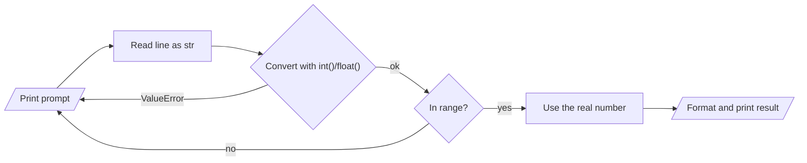

# Input and Output

## 1. Learning Objectives

After this lesson you will be able to:

- [ ] Read a value from the keyboard with `input()`, convert it deliberately, and say why every
      `input()` result is text
- [ ] Produce clear program output with `print()` and format values with f-strings (alignment,
      decimals, thousands separators, percentages)
- [ ] Validate input with a retry loop so a wrong value produces a question, not a crash
- [ ] Design the output *format* deliberately — aligned columns, honest rounding, named labels

## 2. Prerequisites

- [variables-and-data-types.md](variables-and-data-types.md) — `input()` returns `str`;
  `int()`/`float()` convert it; the two error kinds explain what happens when you skip the step.
- [operators.md](operators.md) — arithmetic on the converted values, and `%`-style formatting
  concepts behind number formatting.

## 3. Introduction

Every program that matters sits between a person and an answer: values go **in** from a human,
results come **out** to a human. **Input** is the program receiving values (keyboard, file, a
form on the web); **output** is the program presenting results. In Python this is `input()` and
`print()` — two functions, and nearly all beginner bugs at the boundary come from exactly one
misunderstanding: what type `input()` gives you back.

## 4. The Problem It Solves

A calculator that only works with values hardcoded in the file is a demonstration; a calculator
that asks for its operands is a tool. The moment a program accepts values from people, two
problems appear that hardcoded programs never face: people type what you did not expect
(`"twenty"` where `20` was wanted), and results must be *readable* — `4.499999999999999` is
technically an answer and practically a complaint ticket. This lesson solves both: conversion
and validation on the way in, deliberate formatting on the way out.

## 5. Core Concepts

### 5.1 `input()` always returns text

`input(prompt)` prints `prompt` (no newline), waits for a line, and returns what was typed as a
`str` — always, no exceptions. `"25"` is a two-character string, not a number. Arithmetic on it
raises the `TypeError` from lesson 4; the fix is the conversion you already know:

```python
age = int(input("How old are you? "))   # convert at the boundary, once
```

If the typed text is not numeric, `int()` raises `ValueError` — the *content* error from lesson
4. Section 5.3 turns that crash into a question.

### 5.2 `print()` and f-strings

`print()` joins its arguments with a space and adds a newline; `sep=` and `end=` change that.
Real output, though, is built with **f-strings**: `f"text {value}"` inserts values, and a
`:` after the expression applies a display format:

| Format spec | Means | Example output |
|---|---|---|
| `{x:.2f}` | two decimals | `4.50` |
| `{name:<10}` | left-aligned in 10 columns | `Neema     ` |
| `{n:>5}` | right-aligned in 5 columns | `   25` |
| `{n:,}` | thousands separators | `1,234,567` |
| `{r:.1%}` | percentage, one decimal | `85.3%` |

Formatting changes *presentation only* — the underlying value keeps its full precision, which is
why you format at the moment of display, not before computing.

### 5.3 Validation: a question, not a crash

The **retry loop** is the standard shape: ask, convert inside `try`/`except ValueError`, and on
failure print what was wrong and ask again. A second check handles values that convert but are
out of range (`1..10`). The user's error costs them one keystroke, not the program.

## 6. How It Works — the round trip



Every arrow that loops back to the prompt is a "question, not a crash" path. The validation
lesson's executed transcript in section 7 shows all three paths taken in one run.

## 7. Practical Examples

All transcripts were **executed on the authoring machine** (Python 3.13.5, Windows 11, Git Bash);
the interactive examples were run by piping text into the program, exactly as if typed.

**Example 1 — the basic round trip**

```python
name = input("What is your name? ")
print(f"Hello, {name}!")

age_text = input("How old are you? ")
age = int(age_text)
print(f"Next year you will be {age + 1}.")
```

- `name` is used directly (text for text — no conversion), but `age_text` must become a number
  before `+ 1` can mean arithmetic.
- **Expected output** for the typed inputs `Neema` and `25` (piped, real):

  ```text
  What is your name? Hello, Neema!
  How old are you? Next year you will be 26.
  ```

  The prompt and the reply share a line because `input()`'s prompt has no newline — exactly what
  a terminal session looks like.
- **How to run it:** save as `greet.py`, run `python greet.py` and type the answers; the
  transcript above was produced by `printf "Neema\n25\n" | python greet.py`.
- **Assumptions:** Python 3.13.5 on the authoring machine; runs unchanged on Python 3.10+.

**Example 2 — validating with a retry loop**

```python
while True:
    raw = input("Enter a whole number: ")
    try:
        value = int(raw)
    except ValueError:
        print(f"  '{raw}' is not a whole number - try again")
        continue
    if 1 <= value <= 10:
        print(f"  accepted: {value}")
        break
    print(f"  {value} is outside 1..10 - try again")
print("done")
```

- Two independent checks: the `try` catches *wrong content* (`abc`), the `if` catches *wrong
  range* (55) — the lesson 4 error kinds, handled on purpose.
- `continue` restarts the loop (re-ask); `break` exits it (accepted). Both paths shown in the
  real transcript below.
- **Expected output** for the typed inputs `abc`, `55`, `7` (piped, real):

  ```text
  Enter a whole number:   'abc' is not a whole number - try again
  Enter a whole number:   55 is outside 1..10 - try again
  Enter a whole number:   accepted: 7
  done
  ```

- **How to run it:** save as `ask.py`, run `python ask.py`; the transcript came from
  `printf "abc\n55\n7\n" | python ask.py`.
- **Assumptions:** as Example 1.

**Example 3 — formatted output**

```python
name = "Neema"
age = 25
price = 4.5
big_number = 1234567

print(f"Hello, {name}. You are {age} years old.")
print(f"Price: {price:.2f} TZS")
print(f"Aligned: {name:<10}|{age:>5}|")
print(f"Thousands: {big_number:,}")
print(f"Percentage: {0.853:.1%}")
```

- `{price:.2f}` renders `4.5` as `4.50` — money never shows one decimal by accident; the pipes
  `|` in the alignment line make the column edges visible.
- **Expected output** (real):

  ```text
  Hello, Neema. You are 25 years old.
  Price: 4.50 TZS
  Aligned: Neema     |   25|
  Thousands: 1,234,567
  Percentage: 85.3%
  ```

- **How to run it:** save as `format.py`, run `python format.py`.
- **Assumptions:** as Example 1.

## 8. Real-World Applications

Command-line tools are built on this pair — `git`, `docker`, and every installer prompt use
`input()`-equivalents with the same convert-and-validate shape. Form handling on the web is the
same loop with a different transport: the browser sends text, the server converts and validates,
and the retry is an error message beside the field. Formatted output is what makes reports,
invoices, and logs usable — a column of unaligned numbers is a support ticket waiting to happen.
The validation pattern you built here returns in Spring's bean validation
([11](../11-BACKEND-ENGINEERING/README.md)) and in Dart forms
([12](../12-MOBILE-DEVELOPMENT/README.md)).

## 9. Common Mistakes

| Mistake | Why it happens | How to recognize it | How to prevent it |
|---|---|---|---|
| Arithmetic on raw `input()` | Forgetting `input()` yields `str` | `TypeError: can only concatenate str...` | Convert at the boundary: `int(input(...))` |
| Crash on bad text | No `try` around the conversion | `ValueError` with the whole typed line quoted | Wrap conversion in `try`/`except ValueError`; re-ask |
| Converting before range-checking | One check instead of two | `int("999")` succeeds, then nonsense flows on | Convert first, range-check second; both, always |
| Formatting too early | Rounding before computing | Totals drift: 3 items × 4.45 shown as 13.34 instead of 13.35 | Compute in full precision; format only in `print` |
| Prompt without context | `input("?: ")` | Users type anything; you cannot debug their answer | State the expected shape in the prompt: "whole number 1..10" |

## 10. Best Practices

- **Convert once, at the boundary**, and let everything inside work with the real type. Passing
  raw strings deeper is how `TypeError`s get buried.
- **Distinguish the two failure kinds in your message**: "not a whole number" (content) vs
  "outside 1..10" (range). One vague "invalid input" makes users guess.
- **State the accepted shape in the prompt itself** — `Enter a whole number (1..10):` — so the
  first answer is already right most of the time.
- **Format at display time only.** `.2f` inside the final `print`, never on the stored value.
- **Right-align numbers, left-align text** in columns; the convention is what makes tables
  scannable.

## 11. Limitations and Trade-Offs

`input()` is synchronous and single-user: it cannot read while the program computes, and piping
is the only automation path — which is why real tools also read files and environment variables
(the lesson's pattern generalises, the function does not). The retry loop also stops at "valid
enough": it checks shape and range, not whether the *answer makes sense* — semantic validation
needs domain rules that arrive in [11](../11-BACKEND-ENGINEERING/README.md). And float input
inherits binary imprecision from
[01](../01-COMPUTER-FOUNDATIONS/binary-and-number-systems.md): `float("0.1")` is as approximate
as `0.1` — fine for measurements, wrong for money, which needs integer cents or a decimal type.

## 12. Practical Exercises

### Introductory

1. **Predict the crash, then fix it.** `text = input("n: ")` then `print(text * 2)` — predict
   for input `21`; run it; then make it print `42` with a conversion. **Completion criteria:**
   your prediction matches the run, and the fixed version handles input `21` correctly.
2. **Format four values.** Take `pi = 3.14159`, `n = 1234567`, `rate = 0.0725`, and
   `label = "TSH"`; print each with the spec that fits: two decimals, thousands, one-decimal
   percentage, left-aligned in 8 columns. **Completion criteria:** all four specs applied and the
   real output captured.

### Intermediate

3. **Build the retry loop.** Ask for an age 0..120; non-numeric and out-of-range inputs must each
   produce a *distinct* message and re-ask. **Completion criteria:** three typed inputs (`abc`,
   `200`, `30`) produce the message sequence you designed, with the program ending on the valid
   one.
4. **Align a receipt.** Given three items (name, quantity, unit price as literals), print a
   table with right-aligned numeric columns and a `Total:` line, prices to two decimals.
   **Completion criteria:** columns align at the decimal point; total equals the sum of line
   totals (computed unrounded, displayed rounded — verify `3 × 1.15` sums to `3.45`, not
   `3.44`).

### Independent problem-solving

5. **Write a mini calculator.** *Ask for two numbers and one operator (`+ - * /`); validate each
   input with the retry loop; invalid operator or division by zero produces a message and re-ask;
   result printed with the operator named, e.g. `17 / 5 = 3.4`.* **Completion criteria:** the
   program survives `abc` for a number, a bad operator, and `x / 0` — each producing your message
   and a fresh prompt; five operator/input combinations shown with correct results.

*Solutions: attempt first. They live in `solutions/` of this subject.*

## 13. Knowledge Check

1. Why does `input("n: ") * 2` for input `21` not print `42`? Name the type involved and the fix.
2. What are the *two* independent checks a good numeric input routine performs, and which error
   kind does each catch?
3. Why is `.2f` applied in `print(f"{total:.2f}")` and not when `total` is computed?
4. Your program asks `input("age: ")` and users keep typing letters. Improve the prompt text —
   write the replacement line.
5. When is `try`/`except` around conversion *not* enough validation? Give one case.

## 14. Completion Criteria

- [ ] You can read, convert, and use a typed number without a traceback, unaided
- [ ] You can produce aligned, correctly rounded output with f-string specs from memory
- [ ] You can write the two-check retry loop (content, then range) from a blank editor
- [ ] You can name the precision trap of float input and one situation where it matters

## 15. Summary

- `input()` always returns `str`; convert at the boundary with `int()`/`float()`.
- Bad content → `ValueError`; handle it with `try`/`except` and re-ask — a question, not a crash.
- Range checks are a second, separate gate after conversion.
- f-string specs (`:.2f`, `<10`, `>5`, `,`, `:.1%`) control presentation; compute in full
  precision and format only at display.
- Good prompts state the expected shape; good messages say what was wrong.

## 16. Next Steps

- Next lesson: [conditional-statements.md](conditional-statements.md) — the `if` behind the
  validation gate, in full: branches, truthiness, and the comparison traps.
- Practice: [exercise set](exercises/README.md) for this subject's lessons.
- Where it is applied: the same validate-then-use pattern appears in web forms
  ([11](../11-BACKEND-ENGINEERING/README.md)) and Flutter inputs
  ([12](../12-MOBILE-DEVELOPMENT/README.md)).
