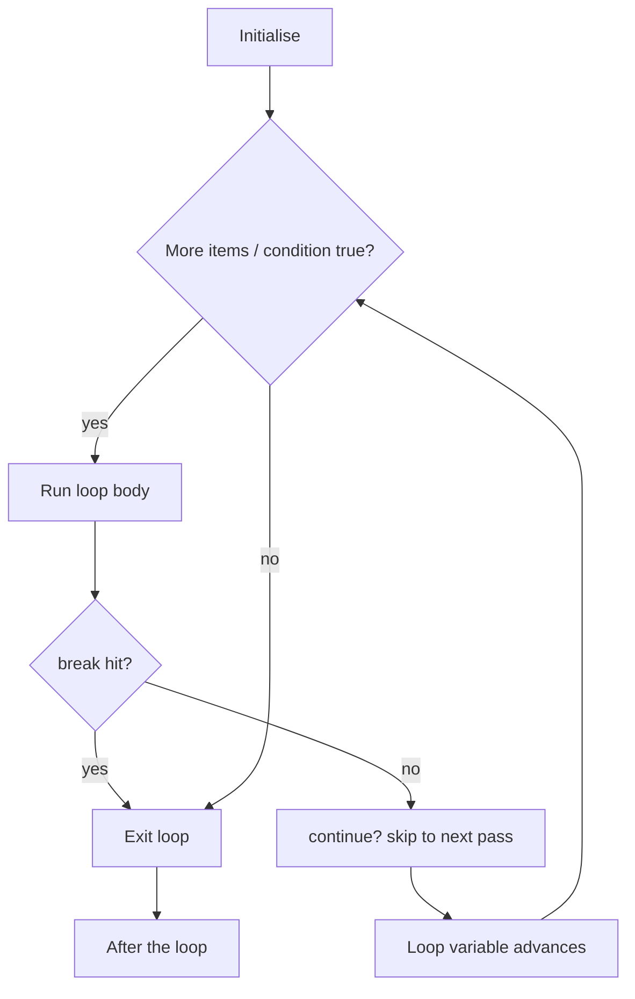

# Loops

## 1. Learning Objectives

After this lesson you will be able to:

- [ ] Choose between `for` and `while` for a task, and say what each is actually iterating over
- [ ] Use `range()` with start, stop, and step — and predict exactly which numbers it produces
- [ ] Control loops with `break` and `continue`, and state what each leaves untouched
- [ ] Find and fix the off-by-one error by reasoning about the stop boundary, and write the
      invariant that proves a loop correct

## 2. Prerequisites

- [conditional-statements.md](conditional-statements.md) — the condition that ends a `while`
  loop is the same condition that steers an `if`.
- [variables-and-data-types.md](variables-and-data-types.md) — accumulators are variables updated
  each pass; the binding model explains what `total = total + x` does.
- [../01-COMPUTER-FOUNDATIONS/how-programs-execute.md](../01-COMPUTER-FOUNDATIONS/how-programs-execute.md)
  — the jump instruction is what "looping back" physically means.

## 3. Introduction

A **loop** repeats a block of work, once per item or once per condition. Two kinds: `for`
repeats over a known sequence (each item in a list, each number from `range`), and `while`
repeats as long as a condition stays true — for when the count is not known in advance (keep
asking until the answer is valid). Loops multiply the value of every other construct: one line
of loop body executed a million times is what computers are actually for.

## 4. The Problem It Solves

"Print every name in the file." Without loops you copy-paste — and the copy-paste lesson from
[computational-thinking.md](computational-thinking.md) applies verbatim: the program only works
for the names you knew about when writing it. Loops are the mechanism that makes a program work
for *data it has not seen yet*, which is the entire definition of a useful program. They are also
where the most common beginner bug lives — the **off-by-one error**, working one item too few or
too many — because loop boundaries are a precise contract with a machine that does not round
sympathetically.

## 5. Core Concepts

### 5.1 `for` and the sequence it walks

`for item in sequence:` binds `item` to each element in order — a list, a string, anything that
produces items. The loop variable is *created fresh* each pass; when the sequence ends, the loop
stops. Python's counting form is `range()`:

| Form | Produces |
|---|---|
| `range(5)` | `0, 1, 2, 3, 4` — stop is **excluded** |
| `range(2, 7)` | `2, 3, 4, 5, 6` |
| `range(0, 10, 3)` | `0, 3, 6, 9` |
| `range(5, 0, -1)` | `5, 4, 3, 2, 1` |

The stop-excluded rule is deliberate: `range(len(items))` produces exactly the valid indexes of
a list of that length, with no `- 1` needed. That single design decision removes half of all
off-by-one bugs — when you remember it.

### 5.2 `while` and termination

`while condition:` repeats while the condition is true; when it turns false, the loop ends. The
responsibility is entirely yours: a `while` with a condition nothing changes will never end. The
**sentinel pattern** is the standard shape: loop forever (`while True`), and `break` when a
special input (a negative number, the word `quit`) signals the end — the condition that matters
is checked inside, where you can act on it.

### 5.3 `break` and `continue`

- `break` exits the **innermost** loop immediately; nothing after it in the loop runs.
- `continue` skips to the **next pass**; the rest of the current pass's body does not run.

Both only affect the loop they sit in — a `break` inside a nested loop stops only the inner one,
a fact that surprises everyone once.

### 5.4 The invariant, and where off-by-one hides

An **invariant** is a statement that is true before and after every pass: "after pass k, `total`
equals the sum of the first k elements". Writing it down turns a loop from plausible to provable —
and it is exactly the tool for boundary bugs. The classic symptom: summing `range(1, n)` when you
meant `1..n`, silently skipping the last element. Section 7 executes that bug beside its fix.

## 6. How It Works — one pass, then the next



Two edges make the loop: the body edge that comes back to the test, and the exit edge that
leaves it — the same two edges the [flowcharts lesson](flowcharts.md) drew on paper. A missing
exit edge is an infinite loop; a missing back-edge is not a loop at all.

## 7. Practical Examples

All transcripts were **executed on the authoring machine** (Python 3.13.5, Windows 11, Git Bash);
the interactive one via piped input.

**Example 1 — the four faces of `range()`**

```python
for i in range(5):
    print(i, end=" ")
print()
for i in range(2, 7):
    print(i, end=" ")
print()
for i in range(0, 10, 3):
    print(i, end=" ")
print()
print(list(range(5, 0, -1)))
```

- Four forms, four shapes of counting — note `range(5)` stops *before* 5 (0–4), the exclusion
  rule in action.
- **Expected output** (real):

  ```text
  0 1 2 3 4
  2 3 4 5 6
  0 3 6 9
  [5, 4, 3, 2, 1]
  ```

- **How to run it:** save as `ranges.py`, run `python ranges.py`.
- **Assumptions:** Python 3.13.5 on the authoring machine; runs unchanged on Python 3.10+.

**Example 2 — the sentinel loop with `break`**

```python
total = 0
count = 0
while True:
    raw = input("sale amount (negative to stop): ")
    amount = float(raw)
    if amount < 0:
        break
    total += amount
    count += 1
print(f"sales: {count}, total: {total:.2f}")
```

- `while True` plus an inside `break` is the sentinel pattern: the loop ends when the *data*
  says so, not when a counter runs out. The invariant: after each pass, `total` holds the sum of
  the accepted amounts so far.
- **Expected output** for inputs `10`, `20`, `-1` (piped, real):

  ```text
  sale amount (negative to stop): sale amount (negative to stop): sale amount (negative to stop): sales: 2, total: 30.00
  ```

  Three prompts, two accepted sales, the negative sentinel discarded — the whole contract in one
  line.
- **How to run it:** save as `sales.py`, run `python sales.py`; transcript from
  `printf "10\n20\n-1\n" | python sales.py`.
- **Assumptions:** as Example 1.

**Example 3 — the off-by-one, executed next to its fix**

```python
numbers = [3, 1, 4, 1, 5]

buggy_total = 0
for i in range(1, len(numbers)):
    buggy_total += numbers[i]
print(f"buggy total (skips index 0): {buggy_total}")

print(f"correct total: {sum(numbers)}")
```

- `range(1, len(numbers))` starts at **1**, so index 0's value (3) never enters the sum: 11
  instead of 14. No error is raised — the bug is *silent*, which is why off-by-one is the most
  expensive loop bug in practice. The correct form is `range(len(numbers))`, or simply
  `for x in numbers:` when the index is not needed.
- **Expected output** (real):

  ```text
  buggy total (skips index 0): 11
  correct total: 14
  ```

- **How to run it:** save as `offbyone.py`, run `python offbyone.py`.
- **Assumptions:** as Example 1.

**Example 4 — nested loops: the multiplication table**

```python
for row in range(1, 6):
    line = ""
    for col in range(1, 6):
        line += f"{row * col:>4}"
    print(line)
```

- The inner loop restarts fully for each outer pass — 5 × 5 = 25 cells. Remember from section 5.3:
  a `break` inside the inner loop would leave only the *inner* one.
- **Expected output** (real):

  ```text
     1   2   3   4   5
     2   4   6   8  10
     3   6   9  12  15
     4   8  12  16  20
     5  10  15  20  25
  ```

- **How to run it:** save as `table.py`, run `python table.py`.
- **Assumptions:** as Example 1.

## 8. Real-World Applications

Everything repetitive: reading rows from a file, retrying a failed network call (`while` with a
backoff — the pattern you will formalise in [18](../18-ADVANCED-ENGINEERING/README.md)),
paginating through an API until an empty page, polling a sensor, running nightly jobs, resizing
images pixel by pixel (nested loops), and the batch processing that keeps
[10](../10-DATABASE-ENGINEERING/README.md) and [16](../16-DEVOPS-AND-INFRASTRUCTURE/README.md)
alive. Off-by-one errors are the most-reported class of production logic bug precisely because
loops touch real boundaries: last records, last pages, last milliseconds.

## 9. Common Mistakes

| Mistake | Why it happens | How to recognize it | How to prevent it |
|---|---|---|---|
| Off-by-one at the stop | Forgetting stop is excluded | Last element skipped (or one extra run) | `range(len(xs))` for indexes; run once with a 1-element list |
| Infinite `while` | Condition never changes inside the body | Program hangs; no output | Ensure every pass moves toward the condition; sentinel + `break` |
| `break` in the wrong loop | Forgetting nesting scope | Outer loop keeps running after "exit" | Remember: `break` kills only the innermost loop; restructure if needed |
| Modifying a list while looping it | Adding/removing during iteration | Skipped or duplicated elements | Build a new list, or iterate over a copy; revisit in arrays-and-strings |
| Using the loop variable after the loop | Scope assumption from other languages | Value is the *last* one, or undefined in other languages | Do not rely on it; capture what you need inside the loop |

## 10. Best Practices

- **Prefer `for` over `while`** when a sequence exists; `while` is for genuinely unknown counts.
  A `while` that could be a `for` is usually a bug-shaped habit.
- **Iterate values, not indexes,** unless you need the index: `for price in prices:` cannot
  off-by-one.
- **Write the invariant** for any loop that accumulates — one sentence, checked in review; it
  doubles as the docstring.
- **Test loops on tiny inputs:** a 1-element list exposes boundary bugs that a 1,000-element
  list hides.
- **Give `break` a visible reason** (sentinel, found, error) — loops with three `break`s and no
  comments are future debugging sessions.

## 11. Limitations and Trade-Offs

Sequential loops use one core: a billion-item loop that could be parallelised still runs
serially — parallel forms arrive in [18](../18-ADVANCED-ENGINEERING/README.md). Very large loops
also have memory and *time* costs that only show at scale: an O(n²) nested loop over 100,000 rows
is effectively a hang, which is why [05](../05-DATA-STRUCTURES-AND-ALGORITHMS/README.md) exists.
And Python's per-iteration flexibility (dynamic typing, arbitrary objects) makes its loops slower
than compiled languages' — fine at the scale of this subject, a real constraint at data scale,
where vectorised tools replace explicit loops.

## 12. Practical Exercises

### Introductory

1. **Predict `range`, then print.** Write what `list(range(3, 10, 4))`, `list(range(10, 3,
   -3))`, and `list(range(4))` produce; verify. **Completion criteria:** three predictions,
   three real results, mismatches explained by start/stop/step.
2. **Count without hardcoding.** Loop over `"programming"` and print each character with its
   position (0-based), using `range(len(...))` or `enumerate`. **Completion criteria:** 10 lines,
   positions 0–9, characters correct.

### Intermediate

3. **Fix the boundary.** The buggy total from Example 3: reproduce it, then fix it twice — once
   with corrected `range`, once by iterating values directly. **Completion criteria:** both fixed
   versions print 14; one sentence on why the index form needs the care and the value form does
   not.
4. **Sentinel with validation.** Extend Example 2: a non-numeric entry prints a message and
   re-asks (without counting); a negative ends the loop; zero is accepted but counts as "no
   sale". **Completion criteria:** transcript with `10`, `abc`, `0`, `20`, `-1` producing the
   designed sequence; final totals correct.

### Independent problem-solving

5. **Build a statistics reporter.** *Read numbers until a sentinel (`q`); for the collected
   values print count, min, max, mean (2 decimals), and a histogram line of `*` per value bucket
   (integer part). Empty input prints "no data" instead of crashing.* **Completion criteria:**
   empty case handled; stats correct on a hand-checked set of five numbers; histogram buckets
   verified against the values; no library beyond the basics (`len`, `min`, `max`, `sum`) — the
   loops do the work.

*Solutions: attempt first. They live in `solutions/` of this subject.*

## 13. Knowledge Check

1. Why does `range(len(items))` produce exactly the valid indexes, with no `- 1` anywhere? What
   does that say about where off-by-one bugs come from?
2. Your `while` loop hangs. Name the two things to check first, in order.
3. A `break` sits in an inner loop over columns. What exactly stops when it runs?
4. State the invariant of the sentinel-sum loop (Example 2) in one sentence, in the form "after
   k passes, …".
5. When is `for` the wrong choice and `while` the right one? One concrete case.

## 14. Completion Criteria

- [ ] You can predict any `range()` form's output before running it
- [ ] You can write a validated sentinel loop with `break` and `continue` from memory
- [ ] You can find an off-by-one by reasoning about the stop boundary, not by luck
- [ ] You can state a loop's invariant and use it to justify correctness on a small input

## 15. Summary

- `for` walks a sequence; `while` runs until a condition turns false — counts unknown means
  `while`.
- `range` excludes its stop: the rule that makes `range(len(xs))` exactly right for indexes.
- `break` exits the innermost loop; `continue` skips to the next pass.
- Off-by-one is silent: test boundaries and 1-element inputs, and prefer iterating values.
- The invariant ("after k passes…") is the loop's proof and its best documentation.

## 16. Next Steps

- Next lesson: [functions-and-methods.md](functions-and-methods.md) — packaging loops and
      conditionals into named, reusable, testable units.
- Practice: [exercise set](exercises/README.md) for this subject's lessons.
- Where it is applied: retry loops and batch jobs in
  [16](../16-DEVOPS-AND-INFRASTRUCTURE/README.md); algorithm analysis of loops in
  [05](../05-DATA-STRUCTURES-AND-ALGORITHMS/README.md).
