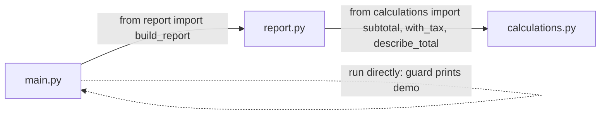

# Modular Programming

## 1. Learning Objectives

After this lesson you will be able to:

- [ ] Split a single-file program into modules with clear responsibilities, and say what belongs
      in each
- [ ] Import from another module deliberately (`import x`, `from x import name`) and explain what
      runs when an import happens
- [ ] Use the `if __name__ == "__main__":` guard so a file is both runnable *and* importable
- [ ] Diagnose import failures (`ModuleNotFoundError`, circular imports) by reading what Python
      actually searched

## 2. Prerequisites

- [functions-and-methods.md](functions-and-methods.md) — functions are the units modules
  organise; frames explain what an import binds.
- [debugging-fundamentals.md](debugging-fundamentals.md) — reading errors; this lesson's
  `ModuleNotFoundError` is read the same bottom-up way.

## 3. Introduction

A **module** is a file of Python with names other files can use: functions, constants, and later
whole types. **Modular programming** is the practice of splitting one program into several such
files, each owning one responsibility, connected by explicit **imports**. `import math` is the
mechanism you have been using since the first lesson without naming it; this lesson makes you
the author of modules, not only their user.

## 4. The Problem It Solves

One file works until it does not. At a few hundred lines, finding anything means scrolling; two
people editing the same file collide; and every function is reachable by every other, so a
one-line "fix" in the tax function silently changes the report three hundred lines down. Modules
solve all three: each file is a **boundary** — names cross it only through imports, which makes
dependencies visible (`report.py` imports `calculations.py`: you can read the relationship from
the first lines), and changes inside one file cannot ripple into another unless the imported
names themselves change. The trade — a little structure now — buys the alternative: a program
whose parts can be understood, tested, and changed one at a time.

## 5. Core Concepts

### 5.1 What a module is, and what an import does

A module is a `.py` file; its **public names** are whatever the importer asks for. Three import
forms, all seen in this subject's code:

```python
import math                    # math.pi, math.sqrt(...)  - namespace kept
from calculations import subtotal   # bare name: subtotal(...) directly
import math as m               # alias for long names
```

An import **runs the imported file, top to bottom**, once, and binds its names for you. That
"runs it" part is the fact behind every surprise in this lesson: side effects at file top level
happen at import time, wherever you import from.

### 5.2 The `__main__` guard

Every module gets a built-in name: `__name__` is `"__main__"` when the file is *run directly*,
and the module's own name (`"report"`) when it is *imported*. The guard

```python
if __name__ == "__main__":
    main()
```

means "run this only when I am the entry point" — making the file **both** a runnable program
**and** an importable library. Without it, importing `report` would re-run its demo output every
time, which is the most common modular-programming bug in practice.

### 5.3 Responsibility: one job per module

The design question is what goes where. The rule that keeps working: **a module owns one
responsibility**, named after it (`calculations.py` computes; `report.py` composes and formats;
`main.py` wires them). Signs a boundary is wrong: the module's name cannot describe its content
in one phrase; a change in one function forces edits in half the file; or two modules import each
other (section 6).

### 5.4 Packages (preview)

When modules multiply, a directory with an `__init__.py` becomes a **package** — imported as
`import mypackage.submodule`. You will build real packages in
[04](../04-JAVA-PROGRAMMING/README.md) and [08](../08-JAVASCRIPT-AND-TYPESCRIPT/README.md)'s
module lessons; the mental model here carries over unchanged: files import files, directories
group files, and the import line states the dependency.

## 6. How It Works — the three-file program

This lesson's running example: `calculations.py` (the library), `report.py` (uses it), `main.py`
(the entry point). The dependency arrows are exactly the import lines:



Two rules read off the diagram: arrows point from user to used (no cycles — a back-arrow would
be the circular-import failure in section 7), and each file runs *only its own* code on import —
`main.py`'s output happens because `main.py` is the file being run, not because importing it
does anything.

## 7. Practical Examples

All transcripts were **executed on the authoring machine** (Python 3.13.5, Windows 11, Git Bash)
in a directory holding all three files side by side — same-directory imports, which is all a
first module program needs.

**Example 1 — the library file**

```python
"""Reusable calculation helpers - the 'library' file."""


def subtotal(prices):
    return sum(prices)


def with_tax(amount, rate=0.16):
    return amount * (1 + rate)


def describe_total(amount):
    return f"Total: {amount:.2f} TZS"
```

- Nothing runs at import here except definitions — deliberately. The module has no side effects,
  so importing it is free of surprises (rule of 5.3, applied).
- **How to save/run it:** name the file `calculations.py`; it is imported by the next two files.

**Example 2 — the consumer, runnable and importable**

```python
"""Report generator - imports its dependency by name."""

from calculations import describe_total, subtotal, with_tax


def build_report(prices):
    lines = ["--- Sales report ---"]
    lines.append(describe_total(subtotal(prices)))
    lines.append(describe_total(with_tax(subtotal(prices))))
    return "\n".join(lines)


if __name__ == "__main__":
    print(build_report([12.5, 30.0, 7.25]))
```

- The `from ... import` line at the top *is* the dependency, readable in one glance — the
  visibility benefit from section 4, in code.
- **Expected output** when run directly (`python report.py`, real):

  ```text
  --- Sales report ---
  Total: 49.75 TZS
  Total: 57.71 TZS
  ```

- **Assumptions:** `calculations.py` sits in the same directory; Python 3.13.5 on the authoring
  machine.

**Example 3 — the entry point, and the guard proven**

```python
"""Entry point: uses report, executes nothing on import."""

from report import build_report

result = build_report([100.0, 250.0])
print(result)
```

**Expected output** when run directly (`python main.py`, real):

```text
--- Sales report ---
Total: 350.00 TZS
Total: 406.00 TZS
```

Now the guard's other half — *importing* a module with top-level work under the guard. Running
`python -c "import report; print('imported silently, functions available:',
report.build_report.__name__)"` produced (real):

```text
imported silently, functions available: build_report
```

- No demo output appeared, because `report.py`'s print sits *under* the guard: on import,
  `__name__` is `"report"`, not `"__main__"`. That single comparison is the whole mechanism.
- **Assumptions:** as Example 2.

**Example 4 — what a broken import actually says**

```python
import calculationz    # typo: the real module is calculations.py
```

- **Actual output** (real; the interpreter exits non-zero):

  ```text
      import calculationz
  ModuleNotFoundError: No module named 'calculationz'
  ```

- Read bottom-up as in the debugging lesson: **what** — no module by that name; **where** — the
  import line; **cause candidates** — the name is misspelled, the file is in a different
  directory, or the working directory is wrong. The message tells you the *name* Python looked
  for; checking that name against your files resolves the vast majority of import failures.

## 8. Real-World Applications

Every non-trivial codebase is modular: Java's packages ([04](../04-JAVA-PROGRAMMING/README.md)),
JavaScript/TypeScript's ES modules ([08](../08-JAVASCRIPT-AND-TYPESCRIPT/README.md)), and Spring's
service/controller/repository split ([11](../11-BACKEND-ENGINEERING/README.md)) are the same idea
in different syntax — a named boundary with an explicit import list. The guard's *spirit*
("run the demo only as the entry point") recurs as `main()` conventions in Java and
`if (import.meta.main)`-style checks elsewhere. And the standard library you have been importing
(`math`, and soon `random`, `statistics`, `csv`) is itself proof that modular organisation is how
software scales from one programmer to a thousand.

## 9. Common Mistakes

| Mistake | Why it happens | How to recognize it | How to prevent it |
|---|---|---|---|
| Forgetting the guard | Demos at file top level | Importing the file prints/builds things | Every runnable file ends with `if __name__ == "__main__":` |
| `ModuleNotFoundError` | Typo, wrong directory, wrong working directory | The last traceback line names the exact name searched | Check the name, then the file's location, then where you ran Python from |
| Circular imports | Two modules import each other | `ImportError`/partially-initialised module errors | One-directional arrows (section 6); move shared code down a level |
| God file | No split until it hurts | 1,000+ lines, everything imports it | Split by responsibility when a section needs its own docstring |
| Importing to run, not to use | Side effects at import time | Import order changes behaviour | Top level = definitions only; effects under the guard or in functions |

## 10. Best Practices

- **One responsibility, one name that matches it.** If you cannot name the module in one phrase,
  it holds more than one job.
- **Import names, not files of side effects.** A module whose import has no visible effect is a
  module you can trust anywhere.
- **Keep imports one-directional** — dependencies point from user to used, never both ways; when
  two modules want each other's names, the shared part wants its own module.
- **Put the demo under the guard,** always — it costs one line and makes the file universally
  reusable.
- **Use the standard library first** (`math`, `statistics`, `csv`, `pathlib`); a third-party
  package earns its place when the standard one is genuinely missing the capability.

## 11. Limitations and Trade-Offs

Modularity is not free: a three-file program split into nine files has nine places to look and an
import graph to keep in your head — for small programs the single file wins, and knowing when to
split is judgment. Python's same-directory imports also hide a real fragility: a module's
*availability depends on where you ran Python from*, which is why real projects fix the layout
(projects, virtual environments, packages) in
[04](../04-JAVA-PROGRAMMING/README.md)'s build-tool lesson and
[16](../16-DEVOPS-AND-INFRASTRUCTURE/README.md). And modules bound *code*, not *data*: two
modules can still fight over one file's contents, which is a different problem entirely — the
one [10](../10-DATABASE-ENGINEERING/README.md) exists to solve.

## 12. Practical Exercises

### Introductory

1. **Split a file.** Take a working single-file program of yours (or the discount examples) and
   move its functions into `helpers.py`; import them back. **Completion criteria:** the program
   runs unchanged from a single entry point; `helpers.py` has no top-level output.
2. **Predict the guard.** Write what `python -c "import report"` prints when `report.py` has a
   top-level `print` and when the print is under the guard; then verify with Example 2's file.
   **Completion criteria:** two predictions, one real run, the `__name__` values stated for each
   mode.

### Intermediate

3. **Reproduce the import error.** Deliberately misspell an import; capture the real
   `ModuleNotFoundError`; then fix it by correcting the name, and *also* by moving the file and
   running Python from the wrong directory (capture that variant too). **Completion criteria:**
   two real tracebacks, each with the cause named, and the rule you will check first in future.
4. **Design the boundaries.** For a program that reads a CSV of expenses and prints a monthly
   summary: name three modules, state each one's responsibility in a phrase, and draw the import
   arrows. **Completion criteria:** three one-phrase responsibilities, no arrow cycles, and one
   stated reason the CSV parsing should *not* live in the summary module.

### Independent problem-solving

5. **Build the two-module program.** *`textstats.py`: functions `word_count(text)`,
   `top_words(text, n)` (most frequent first, ties alphabetical), and `reading_minutes(text)`
   (200 words/minute, one decimal). `main.py`: imports it, uses a triple-quoted sample
   paragraph, prints a formatted summary, and sits under the guard. The library file must
   produce zero output when imported.* **Completion criteria:** `python -c "import textstats"`
   prints nothing; counts verified by hand on a short text; `top_words` tie-break rule
   demonstrated on an input with a tie; both files run and import cleanly from a fresh
   directory.

*Solutions: attempt first. They live in `solutions/` of this subject.*

## 13. Knowledge Check

1. When you write `from calculations import subtotal`, when does `calculations.py`'s code run?
2. In one sentence, what is the difference in `__name__`'s value between running and importing
   a file — and what does the guard do with it?
3. Your program works when you run `python main.py` but fails with `ModuleNotFoundError` when
   run from another directory. Explain why, and name the class of fix (not the specific fix).
4. Give one symptom that says "these two files should be three."
5. Why should a library module's top level contain definitions only — no prints, no file
   writing?

## 14. Completion Criteria

- [ ] You can split a working single-file program into two modules and back, unaided
- [ ] You can state what an import executes and why the guard makes a file dual-purpose
- [ ] You can read a `ModuleNotFoundError` and list the three candidate causes in check order
- [ ] You can draw a small program's module diagram with one-directional import arrows

## 15. Summary

- A module is a file of reusable names; an import runs that file once and binds what you asked.
- `if __name__ == "__main__":` separates "run me" from "import me" — both legitimate uses.
- One responsibility per module, named honestly; import arrows point one way.
- `ModuleNotFoundError` names the exact module Python looked for — check name, location, then
  working directory.
- Top level = definitions; effects live in functions or under the guard.

## 16. Next Steps

- This subject is complete: return to the [subject index](README.md) for the recap, then take
  the full [exercise set](exercises/README.md).
- Next subject: [03-DEVELOPER-TOOLS](../03-DEVELOPER-TOOLS/README.md) — the terminal, Git, and
  the environment these modules will live in.
- Where it is applied: packages in [04](../04-JAVA-PROGRAMMING/README.md), ES modules in
  [08](../08-JAVASCRIPT-AND-TYPESCRIPT/README.md), layered architecture in
  [11](../11-BACKEND-ENGINEERING/README.md).
