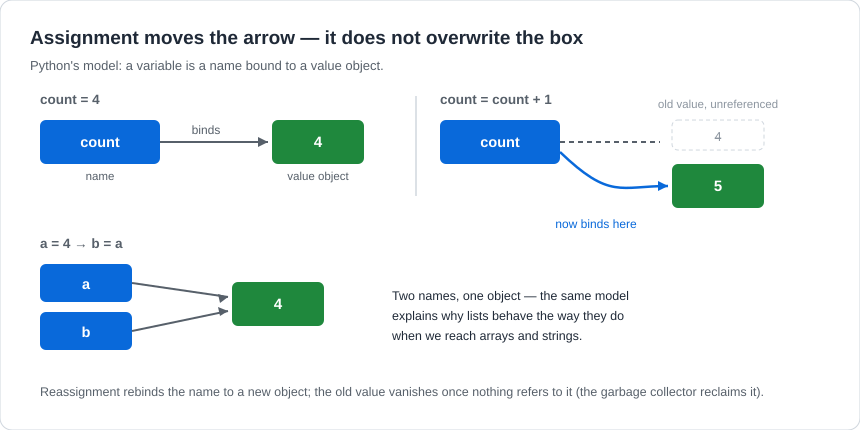

# Variables and Data Types

## 1. Learning Objectives

After this lesson you will be able to:

- [ ] Explain what a variable is in Python (a name bound to a value object) and predict what
      `x = x + 1` does to memory
- [ ] Use the core types — `int`, `float`, `str`, `bool`, `None` — and state what each is for
- [ ] Inspect a value's type at the prompt and convert between types deliberately, with `int()`,
      `float()`, `str()`
- [ ] Diagnose type errors (`TypeError`, `ValueError`) by reading the message's two halves

## 2. Prerequisites

- [../01-COMPUTER-FOUNDATIONS/memory-and-storage.md](../01-COMPUTER-FOUNDATIONS/memory-and-storage.md)
  — memory as addressed bytes; this lesson explains what a *name* over those bytes means.
- [../01-COMPUTER-FOUNDATIONS/binary-and-number-systems.md](../01-COMPUTER-FOUNDATIONS/binary-and-number-systems.md)
  — why numbers in computers are exact or inexact (connects to `float` below).
- [computational-thinking.md](computational-thinking.md) — naming parts by role; here the parts
  are values.

## 3. Introduction

A **variable** is a name attached to a value. That is the whole idea: instead of saying "the
number of apples", a program says `apple_count`, and the name keeps referring to whatever value
you last gave it. **Data types** classify what kind of value a name holds — a whole number, a
decimal number, text, a yes/no — because the kind determines which operations are meaningful and
what the machine must do to perform them.

Python adds one wrinkle that surprises everyone eventually: a variable is not a box holding a
value; it is a *name pointing at* a value. Section 6 shows why that distinction decides how your
programs behave.

## 4. The Problem It Solves

Without variables, a program could only work with numbers hardcoded into instructions — change the
budget, rewrite the program. Without types, `"5" + 3` would have to silently guess: is that 53
text-glued-to-a-number, or 8 arithmetic? Every guess is a coin flip that lands wrong half the
time, in code where "half the time" means "in production, on Tuesdays". Types move that decision
to a defined rule, and the error messages you will meet in this lesson are the rule announcing
itself. The trade-off is real, though: dynamically-typed Python forgives many "obvious" cases and
complains late, while the statically-typed Java in [04](../04-JAVA-PROGRAMMING/README.md)
complains early, before the program ever runs.

## 5. Core Concepts

### 5.1 Names and assignment

`count = 4` **binds** the name `count` to the value `4`. The left side must always be a name; the
right side can be any expression, which is computed first and then bound. Re-running the line
rebinds — the old value is not modified, it is abandoned (see section 6).

Python's naming rules, in full: names contain letters, digits, and `_`; they cannot start with a
digit; they are case-sensitive (`Count` and `count` are two different names); and Python spells
"no" as `False` and capitalises `True` and `None`. The style convention is `snake_case` for names
and `UPPER_CASE` for constants that should never change.

### 5.2 The core types

| Type | Holds | Example | Note |
|---|---|---|---|
| `int` | whole numbers, any size | `25`, `-3`, `1000000` | Exact at any size |
| `float` | decimals | `9.99`, `-0.5` | Binary approximation — see 01 |
| `str` | text | `"Neema"`, `""` | Immutable sequence of characters |
| `bool` | truth values | `True`, `False` | Capitalised, unlike most languages |
| `NoneType` | "deliberately nothing" | `None` | A value, not an error |

`type(value)` returns the type of any value; `isinstance(value, int)` answers yes/no, and is the
form you will use in real code later.

### 5.3 Type conversion (casting)

`int()`, `float()`, and `str()` convert values between types. Conversion is deliberate — Python
will not do it behind your back for arithmetic, and attempting arithmetic across types raises an
error naming both types. One direction deserves memory: `int("42")` works, but `int("42.5")`
raises `ValueError` — go through `float` first: `int(float("42.5"))`.

### 5.4 Why errors have two names

- **`TypeError: can only concatenate str (not "int") to str`** — the *kinds* of values were
  incompatible for the operation. Read both halves: it tells you what was attempted (joining
  text) and what showed up instead (a number).
- **`ValueError: invalid literal for int() with base 10: 'three'`** — the *kind* was fine (a
  string was offered to `int()`), but its *content* was not convertible.

That split — wrong kind versus wrong content — resolves most type confusion at the first reading
of the message rather than the fifth edit of the code.

## 6. How It Works — names point, they do not contain



Read the diagram's three panels left to right. Panel 1: `count = 4` creates the value `4` and
binds `count` to it. Panel 2: `count = count + 1` computes `5` as a *new* value, then moves the
name's arrow to it; the old `4` now has no names pointing at it and the garbage collector reclaims
it. Nothing was overwritten — Python values are immutable, so rebinding is the only way to
"change" a variable.

Panel 3 shows the same model explaining `b = a`: both names end up pointing at one object. For
numbers that is unremarkable, but the identical model is why lists behave surprisingly (shared
mutation) when you reach [arrays-and-strings.md](arrays-and-strings.md). One mental model, both
behaviours.

## 7. Practical Examples

All transcripts were **executed on the authoring machine** (Python 3.13.5, Windows 11, Git Bash).

**Example 1 — binding and rebinding**

```python
count = 4
print(f"count is {count}")

count = count + 1
print(f"after count = count + 1, count is {count}")

a = 4
b = a
print(f"a is {a}, b is {b}")
print(f"a is b? {a is b}")
```

- `count = count + 1` reads the old value, computes a new one, then rebinds the name — panel 2 of
  the diagram.
- `a is b` asks whether the two names point at the *same object*; for small integers Python
  caches values, so the answer is `True`.
- **Expected output:**

  ```text
  count is 4
  after count = count + 1, count is 5
  a is 4, b is 4
  a is b? True
  ```

- **How to run it:** save as `binding.py`, run `python binding.py`.
- **Assumptions:** Python 3.13.5 on the authoring machine; runs unchanged on Python 3.10+.

**Example 2 — the core types in one screen**

```python
age = 25                  # int
price = 9.99              # float
name = "Neema"            # str
is_student = True         # bool
nothing = None            # NoneType

print(type(age), type(price), type(name), type(is_student), type(nothing))

print(f"age * 2 = {age * 2}")
print(f"name.upper() = {name.upper()}")
print(f"is_student and not is_student = {is_student and not is_student}")
```

- Each type earns its keep: `int` multiplies exactly, `str` has text methods like `.upper()`,
  `bool` combines with `and`/`not`. Type decides available behaviour — that is *why* types exist.
- **Expected output:**

  ```text
  <class 'int'> <class 'float'> <class 'str'> <class 'bool'> <class 'NoneType'>
  age * 2 = 50
  name.upper() = NEEMA
  is_student and not is_student = False
  ```

- **How to run it:** save as `types.py`, run `python types.py`.
- **Assumptions:** as Example 1.

**Example 3 — conversion, and the two error kinds**

```python
text_number = "42"
print(f"text_number + 1 would be: ", end="")
try:
    print(text_number + 1)
except TypeError as err:
    print(f"TypeError: {err}")

number = int(text_number)
print(f"int(\"42\") + 1 = {number + 1}")

print(f"str(123) + \" items\" = {str(123) + ' items'}")
print(f"float(\"3.5\") * 2 = {float('3.5') * 2}")

print(f"int(\"three\") -> ", end="")
try:
    int("three")
except ValueError as err:
    print(f"ValueError: {err}")
```

- The `try`/`except` blocks let the transcript *show* the real errors without the program
  crashing — you will learn the mechanism properly in the conditional-statements and Java lessons;
  for now treat them as "catch the error and print it".
- The first error is a `TypeError` (wrong kind joined by `+`), the second a `ValueError` (right
  kind, unconvertible content) — the split from section 5.4, straight from the interpreter.
- **Expected output:**

  ```text
  text_number + 1 would be: TypeError: can only concatenate str (not "int") to str
  int("42") + 1 = 43
  str(123) + " items" = 123 items
  float("3.5") * 2 = 7.0
  int("three") -> ValueError: invalid literal for int() with base 10: 'three'
  ```

- **How to run it:** save as `convert.py`, run `python convert.py`.
- **Assumptions:** as Example 1.

## 8. Real-World Applications

Every program's data starts here: quantities as `int`, money-adjacent decimals as `float` (with
the precision caveat from
[01](../01-COMPUTER-FOUNDATIONS/binary-and-number-systems.md) — real money code uses exact
decimal types or integer cents), user input as `str` until converted, flags as `bool`, "no value
yet" as `None`. Reading config files, parsing API responses, and validating forms are all
type-conversion work in disguise, which is why the two error names from section 5.4 appear in
almost every beginner's log file — and in the interview screens of
[19](../19-PROFESSIONAL-DEVELOPMENT/README.md).

## 9. Common Mistakes

| Mistake | Why it happens | How to recognize it | How to prevent it |
|---|---|---|---|
| `count = count + 1` before `count = 4` | The name is used before any binding exists | `NameError: name 'count' is not defined` | Bind every name before its first read; the error names the exact line |
| `str` + `int` by accident | `input()` returns `str`; arithmetic expects numbers | `TypeError` naming both types | Convert at the boundary: `age = int(input(...))` |
| `int("42.5")` | Skipping the two-step conversion | `ValueError` quoting the whole string | `int(float(text))`, and validate before converting |
| Expecting `float` decimals to be exact | Binary fractions are approximations | `0.1 + 0.2 = 0.30000000000000004` | Use rounding at display time; integer cents for money |
| `=` vs `==` confusion in conditions | One equals sign everywhere else | `SyntaxError` in Python; silent wrong answers in C-family | Python rejects `if x = 5` at parse time — trust the message |

## 10. Best Practices

- **Name by role, not content:** `weekly_budget`, not `x` or `number2`. The name is the cheapest
  documentation you will ever write.
- **Convert at the boundary, once.** Get input, convert it, validate it, then let the rest of the
  program work with real numbers — not strings pretending to be numbers.
- **Use `None` deliberately** as "not set yet", and check for it explicitly (`if value is None`)
  rather than relying on `0` or `""` doing double duty.
- **Read error messages bottom-up.** The last line names the type, the operation, and often the
  offending value — usually enough to fix without a search engine.
- **Reserve `UPPER_CASE` for constants** so readers can see at a glance which names must not
  change.

## 11. Limitations and Trade-Offs

Dynamic typing buys speed of writing and pays in late discovery: a type mismatch in Python is
found when that line *runs*, which for rarely-taken branches can be weeks after it was written.
Static languages ([04](../04-JAVA-PROGRAMMING/README.md)) pay upfront ceremony and catch the same
mismatches before the program starts. `float` is another costed trade-off: fast and adequate for
measurement, wrong for exact decimal arithmetic (money, tolerances) — knowing when "good enough
arithmetically" stops being true is part of the craft. And names are not types: nothing stops
you rebinding `count = "many"`, which is flexibility you will sometimes want and sometimes regret.

## 12. Practical Exercises

### Introductory

1. **Predict, then verify.** For the lines `x = 10`, `x = x * 2`, `x = "ten"`, write the value
   and type of `x` after each; then run them with `type()` prints and compare. **Completion
   criteria:** your prediction matches the interpreter for all three states.
2. **Type detective.** At the Python prompt, determine the type of `10`, `10.0`, `"10"`, `True`,
   `None`, `10 + 0.0` — write each result, then check with `type()`. **Completion criteria:** six
   types recorded, with one sentence on why `10 + 0.0` yields the type it does.

### Intermediate

3. **Make the errors on purpose.** Reproduce a `TypeError` (text + number) and a `ValueError`
   (`int()` on non-numeric text) yourself; write down the full message for each. **Completion
   criteria:** both real messages captured, each labelled wrong-kind or wrong-content.
4. **Convert safely.** Given `reading = "42.7"`, produce the `float` value and the `int` value
   (truncated), plus the error you get from `int(reading)` directly. **Completion criteria:** all
   three results captured from a real run, with the correct two-step conversion shown.

### Independent problem-solving

5. **Build a receipt summariser.** Given the strings `item = "Notebook"`, `qty_text = "3"`,
   `unit_text = "2.50"`, write a program that converts to numbers, computes the line total,
   and prints a formatted receipt line — then extend it to print `Total: ...` for three such
   lines. **Completion criteria:** conversions deliberate and validated (a non-numeric
   `unit_text` produces a clear message, not a traceback); totals exact to two decimals;
   receipt lines align on the decimal point.

*Solutions: attempt first. They live in `solutions/` of this subject.*

## 13. Knowledge Check

1. In your own words: is `count = count + 1` changing a box, or moving an arrow? Why does the
   answer matter for what "changing a variable" can mean?
2. `x = 5` then `x = "five"` — legal or not in Python? What does that tell you about Python's
   type discipline versus Java's?
3. Why is `int("42.5")` a `ValueError` while `text + 1` is a `TypeError`? Name the difference in
   one sentence.
4. A form gives you `age_text = "1999"` and you compute `age_text + 1`. What happens, and what is
   the fix?
5. When would `None` be the right value instead of `0` or an empty string?

## 14. Completion Criteria

- [ ] You can trace three rebindings of one name and state each value and type, unaided
- [ ] You can name the five core types with a use-case for each
- [ ] You can convert `str` → `int`/`float` deliberately and explain both conversion errors
- [ ] You can read a `TypeError` or `ValueError` message and say which half to fix

## 15. Summary

- A variable is a name bound to a value object; assignment rebinds, it does not overwrite.
- The core types are `int`, `float`, `str`, `bool`, `None`; type decides available behaviour.
- Convert explicitly at the boundary: `int()`, `float()`, `str()`; `int` needs a clean numeric
  string, `int("42.5")` fails by design.
- `TypeError` = wrong kind of value for the operation; `ValueError` = right kind, wrong content.
- Names are cheap documentation: snake_case, role-naming, UPPER_CASE for constants.

## 16. Next Steps

- Next lesson: [operators.md](operators.md) — what you can *do* with these values: arithmetic,
  comparison, logic, and the precedence rules that make or break expressions.
- Practice: [exercise set](exercises/README.md) for this subject's lessons.
- Where it is applied: exact type handling for money returns in
  [11](../11-BACKEND-ENGINEERING/README.md) and the Java type system in
  [04](../04-JAVA-PROGRAMMING/README.md).
