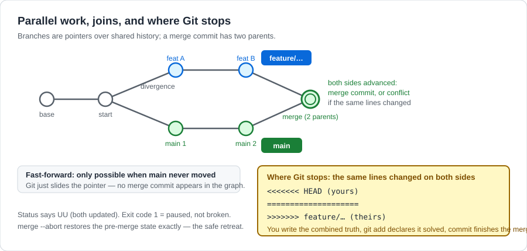
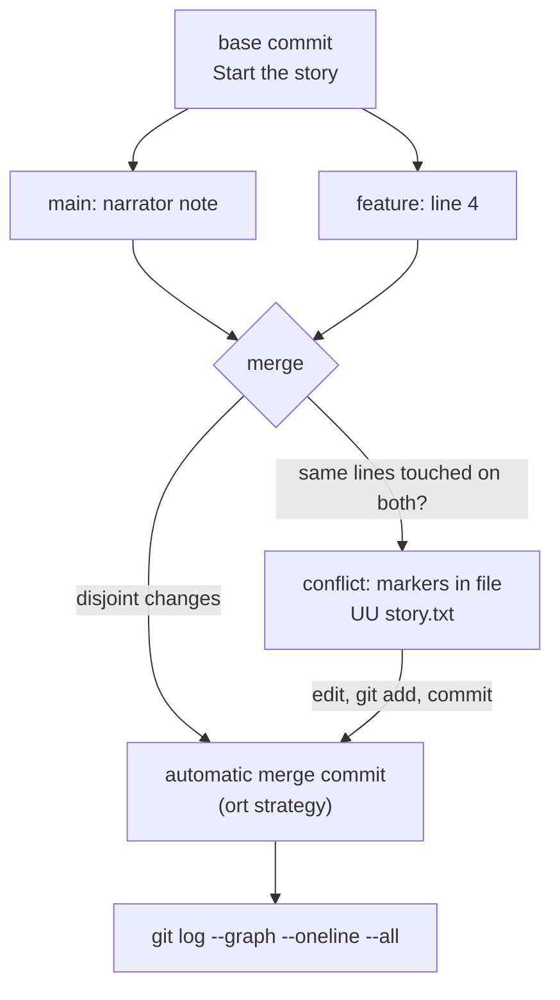

# Branching and Merging

## 1. Learning Objectives

After this lesson you will be able to:

- [ ] Create, switch, and delete branches, and explain a branch as a *pointer*, not a copy.
- [ ] Distinguish a fast-forward merge from a true merge with a merge commit, and choose with `--no-ff`.
- [ ] Produce a merge conflict on purpose, read the conflict markers, and resolve it by hand.
- [ ] Abort a merge you are not ready for, and recover from one you started by accident.
- [ ] Rebase a local branch onto updated main — and state the one rule about rebasing shared history.
- [ ] Read `git log --graph --oneline --all` as a picture of parallel work.

## 2. Prerequisites

- [git-fundamentals.md](git-fundamentals.md) — commits, the index, `restore`, and the reflog are
  the ground this lesson builds on; conflict resolution uses `git add` to stage the resolution.
- [02-PROGRAMMING-FUNDAMENTALS/algorithms-and-pseudocode.md](../02-PROGRAMMING-FUNDAMENTALS/algorithms-and-pseudocode.md)
  — following a procedure step by step matters most when the procedure is Git's merge state machine.

**Environment used in this lesson:** every transcript executed on the author's machine — Git
2.55.0.windows.3, Git Bash, sandbox identity `Learner Example`. The conflict transcripts are real
conflicts created in a practice repository and resolved there; hashes differ per run.

## 3. Introduction

A branch in Git is almost embarrassingly small: a 41-byte file containing a commit hash. That is
the whole secret — because pointers are cheap, Git can afford to let you branch per thought:
`feature/…`, `fix/…`, `experiment/…`, each one a movable label on your history. This lesson is
what you do with those labels: grow them in parallel (**branching**), bring them back together
(**merging**), handle the case where parallel work touched the same lines (**conflicts**), and
choose between two philosophies of history (**merge vs. rebase**).

## 4. The Problem It Solves

Without branches, a team shares one line of history, so half-finished work contaminates everyone
else's — the "works on my branch" era of zip files existed because there was no cheaper way to
isolate work. With branches, experimentation is free and failure is contained: the branch that
went wrong costs one `branch -d`. The *new* problem merging solves is coordination: two people
changed overlapping things — Git automates everything it safely can and hands you exactly the
remaining overlap as a conflict, which is the honest outcome (the machine cannot know your intent).

## 5. Core Concepts

### A branch is a pointer

`git branch docs` writes one file: the hash of the commit you are on. `git switch docs` moves
`HEAD` to point at that pointer. Nothing is copied — the two branches literally share history
until they diverge, which is why branching takes milliseconds and costs no disk.

### Divergence and the merge question

Two branches share a *base* commit and then each adds commits of its own. Merging asks: how do I
combine the two tips into one history?

- **Fast-forward** — if `main` did not advance, Git just moves its pointer forward. No new commit,
  perfectly linear. Cheap, but history no longer shows *that a branch existed*.
- **True merge** — if both sides advanced, Git creates a new **merge commit** with two parents,
  combining the trees automatically when the touched regions differ. History records the join.
- `--no-ff` forces the merge commit even when a fast-forward was possible — the choice teams use
  when they want the branch's existence (and its title in `git log`) preserved.

### Conflict markers

When the same lines changed on both sides, Git refuses to guess. The file gets three markers:
`<<<<<<< HEAD` (your side), `=======` (separator), `>>>>>>> other-branch` (their side). The file
is in a **both-modified (`UU`)** state; *you* write the combined truth, `git add` the file, and
commit. The merge was never broken — it is paused at exactly one disagreement.

### Merge vs rebase, stated once

**Merge** preserves what happened, in order, including the branch's own history. **Rebase**
*replays* your commits on top of the other line, producing a straight line with new hashes —
prettier history, rewritten history. The rule that keeps teams whole: **rebase your own
unpushed work; never rebase history other people have pulled** (for that, merge — or `revert`).



An original diagram for this repository — the graph half is what `git log --graph` prints; the
callout half is the exact file state you will meet in Example 3.

## 6. How It Works



Everything the diagram shows was executed in Section 7: the automatic path (`ort` strategy, its
name visible in the output), the conflict path with markers, and the graph that proves both.
`git status` is your position in this diagram at any moment — `merging` in the header means you
are inside the diamond.

## 7. Practical Examples

**Example 1 — branch, work, fast-forward back**

```console
$ git switch -c docs
Switched to a new branch 'docs'

$ echo "A tip about the ending." >> story.txt
$ git commit -qam "Add a reading tip"

$ git switch main
Switched to branch 'main'

$ git merge docs
Updating 7fc4f04..fce9b0d
Fast-forward
 story.txt | 1 +
 1 file changed, 1 insertion(+)
```

- **Fast-forward is visible as an absence**: no "Merge made by…", just `Updating <old>..<new>`.
  `main`'s pointer *moved* to the branch's tip — the history is a straight line.
- `-c` in `switch -c` means create: the branch file is written at your current commit and `HEAD`
  lands on it. Two commands total — the pointer story from Section 5, observed.

**Example 2 — a true merge, and the graph that shows it**

```console
$ git switch -c feature/add-line4     # ... commit "Add line 4"
$ git switch main                     # ... commit "Add narrator note"

$ git merge --no-ff feature/add-line4 -m "Merge branch 'feature/add-line4'"
Merge made by the 'ort' strategy.
 story.txt | 1 +
 1 file changed, 1 insertion(+)

$ git log --graph --oneline --all
*   824638a Merge branch 'feature/add-line4'
|\
| * 896c47e Add line 4
|/
* fce9b0d Add a reading tip
* 7fc4f04 Start the story
```

- `Merge made by the 'ort' strategy` — Git's default three-way merge algorithm (order-replacement
  tree); you never choose it manually, but seeing its name demystifies the output.
- The graph's `*   ` line with `|\` and `|/` **is** the merge commit: two parents, one history.
  `--no-ff` here guaranteed this shape even though `main` had moved and a merge was mandatory
  anyway — use it when *both* sides advanced and you would otherwise let Git decide silently.

**Example 3 — the conflict, end to end**

Both branches rewrite line 2 of the same file:

```console
$ git merge hotfix/line2
Auto-merging story.txt
CONFLICT (content): Merge conflict in story.txt
Automatic merge failed; fix conflicts and then commit the result.
$ echo "merge exit code: $?"
merge exit code: 1
```

```console
$ cat story.txt
line 1
<<<<<<< HEAD
line 2 (emphasized)
=======
line two, fixed
>>>>>>> hotfix/line2
line 3
A tip about the ending.
line 4

$ git status --short
UU story.txt
?? note.txt
```

- Exit code **1** is Git's contract: conflicts are a *reported failure*, not a crash — scripts
  must check it (this is why `set -e` and CI stop on merge conflicts).
- `UU` = both sides **u**pdated the file — the status language from
  [git-fundamentals.md](git-fundamentals.md), now in its merge meaning. `?? note.txt` is unrelated
  untracked work, correctly left alone.
- *(On this Windows machine the file carries CRLF endings, so the markers are followed by `\r`
  in raw bytes — invisible in a terminal, visible in editors that show control characters.
  On Linux checkouts the same conflict is LF throughout; either way the markers are the story.)*

**Example 4 — resolve by hand, commit the resolution**

```console
$ # write the combined truth yourself:
$ printf 'line 1\nline two, fixed (emphasized)\nline 3\nline 4\n' > story.txt
$ git add story.txt && git commit -q --no-edit

$ git log --graph --oneline --all | head -8
*   1b7d1c8 Merge branch 'hotfix/line2'
|\
| * ab54155 hotfix: rewrite line 2
* | f01aa6e main: emphasize line 2
|/
*   824638a Merge branch 'feature/add-line4'
...
```

- The resolution **is** a commit: `--no-accept-theirs`-style shortcuts are never the lesson — you
  edit the file until it says what you mean, `add` it (the act of declaring "this conflict is
  solved"), and Git writes the merge commit with both parents.
- The combined line `line two, fixed (emphasized)` is exactly the judgement only a human can make:
  Git cannot know you wanted *both* edits.

**Example 5 — abort on purpose, then a clean rebase**

```console
$ git merge practice-abort
Auto-merging story.txt
CONFLICT (content): Merge conflict in story.txt
Automatic merge failed; fix conflicts and then commit the result.
$ git merge --abort

$ git status --short
?? note.txt
$ git log --oneline -1
208b970 main: touch line 1
```

```console
$ git switch -c stats-section
$ git commit -qam "Add stats file"            # on the branch
$ git switch main
$ git commit -qam "Postscript on main"        # main advances
$ git switch stats-section
$ git rebase main
Rebasing (1/1)
Successfully rebased and updated refs/heads/stats-section.

$ git log --graph --oneline --all | head -6
* 845f21d Add stats file
* 52f7a45 Postscript on main
*   89aed4e Merge branch 'polish'
...

$ git switch main && git merge --ff-only stats-section
Updating 52f7a45..845f21d
Fast-forward
 stats.txt | 1 +
```

- `merge --abort` restores the pre-merge state completely (the tracked-file conflict disappears;
  unrelated untracked files stay — Git only owns what it was already tracking). This is the
  "oops, not ready" button, and it is always safe.
- The rebase replayed one branch commit onto advanced `main` → linear graph → the subsequent
  merge became a **fast-forward** (visible again as `Updating …` with no merge line). That is the
  rebase workflow's pitch in four lines: same content, straighter history, no merge commit.
- The `Rebasing (1/1)` progress and `Successfully rebased` are Git's real words — a conflict
  *during* rebase pauses the same way as Example 3, with the same markers and an extra
  `git rebase --continue` (or `--abort`).

## 8. Real-World Applications

- **Feature branches:** every team's default — work in `feature/…`, integrate by merge (or PR,
  next lesson), keep `main` always releasable.
- **Hotfixes:** production is broken; branch from the release, fix, merge back — the classic
  `hotfix/…` flow that justifies all of this machinery.
- **Release trains and long-lived experiments:** branches are also how a version is stabilized
  while development continues, and how a risky rewrite lives beside a working system.

## 9. Common Mistakes

| Mistake | Why it happens | How to recognize it | How to prevent it |
|---|---|---|---|
| Deleting the branch before merging | Context switched, muscle memory | `git branch -D` warnings; "where was my work?" — it is in the reflog, still | Check `git log --graph` first; `branch -d` (lowercase) refuses unmerged work for this reason |
| Resolving a conflict by taking one side wholesale (`checkout --theirs`) | Markers feel like noise | Someone's deliberate change silently gone | Edit markers into a *combined* line; read both sides' commits first (`git log other..HEAD`) |
| Rebasing a shared branch | Linear history looks nicer | Teammates' histories diverge; force-push required | Rebase only private commits; shared branches merge |
| Staying on your feature branch and merging `main` into it forever | Avoids switching | A merge-commit blob in the graph every day | Integrate *regularly* (daily) or rebase small — either way, often |
| Abandoning a merge in progress and working on | Not knowing it is a state | `git status` header says "All conflicts fixed but you are still merging" / nothing works | `git commit` to finish, `git merge --abort` to leave — one of the two, deliberately |
| `--no-ff` everywhere or `--ff-only` everywhere | One true belief | History either noisy or missing all branch context | Default: let Git decide; use `--no-ff` to preserve branch points you care about, `--ff-only` in automation where a merge commit means *bug* |

## 10. Best Practices

- **Branch per unit of work, name it as a sentence fragment** (`fix/login-redirect`,
  `docs/api-examples`) — the branch name is the PR title you will write later.
- **Merge or rebase, but integrate at least daily.** Long-lived divergence is what *creates*
  conflicts; frequency is the real conflict-prevention tool.
- **Read the graph on every integration:** `git log --graph --oneline --all --decorate` is the
  picture of the lesson — if you cannot narrate it, you do not know your repository's state.
- **Resolve conflicts by editing meaning, not by picking sides.** The file after a resolution
  should read as if the conflict never happened — and usually as if *both* changes were wanted.
- **Practice the failure paths while they are safe:** make a conflict on purpose this week, abort
  it, resolve one — the first conflict you meet should not be your first conflict ever.

## 11. Limitations and Trade-Offs

- Merge commits are information; they are not free — noisy graphs slow *human* reading. Teams
  choose `--squash` merges (one commit per PR) precisely to trade history detail for a clean line;
  that trade-off is a team policy, not a law.
- Automatic merges reason about *lines*, not *meaning*: Git can combine two edits to different
  lines of one function that now contradict each other. A clean merge is not a *correct* merge —
  tests are what close that gap (subject 14).
- Rebase rewrites hashes: anything referencing old hashes (open PRs, scripts) breaks. The rule in
  Section 5 exists because history rewriting is *interpersonal*, not technical.
- Renames, binary files, and mode changes are merge edge cases Git handles heuristically; big
  refactors mixed with feature work is how those heuristics get exercised the hard way.

## 12. Practical Exercises

Work in a disposable repository (`git init -b main`, a few files, a few commits).

### Introductory

1. **Reproduce Example 1** — branch, commit, fast-forward. **Completion criteria:** your merge
   output says `Fast-forward` and your `--graph` view shows a straight line with no merge commit.
2. **Pointers, seen.** After creating two branches at the same commit, inspect them
   (`git branch -v`, `git rev-parse docs main`) and confirm they hold the *same* hash; advance one
   and confirm they differ. **Completion criteria:** you have watched branch files point at
   identical then different commits, proving the pointer model.

### Intermediate

3. **Engineer and resolve a conflict** exactly as in Examples 3–4: two branches editing the same
   line, merge, read markers, write a *combined* resolution, complete the merge. **Completion
   criteria:** the resolved file contains both sides' intent (not one side copied), `git status`
   is clean afterwards, and the graph shows the merge commit with two parents.
4. **Abort, then finish deliberately.** Start a conflicting merge, `git merge --abort`, verify
   clean state; start it again and complete it. **Completion criteria:** both paths demonstrated
   from the same conflict, with the outputs showing where each leaves the repository.
5. **Rebase a small branch** (Example 5) and observe the fast-forward that follows.
   **Completion criteria:** your graph is linear *before* the merge, and the merge output shows
   `Fast-forward` — plus one sentence on which history shape you would choose for a team PR, and why.

### Independent problem-solving

6. **The integration story (completes the ROADMAP warm-up).** Grow a practice repository to a
   history containing: at least five branches you created, at least ten commits total (target
   twenty as the milestone demands), at least one true merge and one conflict resolved by hand,
   and one branch deleted after merging. **Completion criteria:** `git log --graph --oneline
   --all` tells a coherent story you can narrate in two minutes — which feature each branch was,
   why each merge happened, what the conflict was about — and every claim survives inspection of
   the commits themselves. *This exercise, with the 20 commits, is Milestone 2's required practice.*

*Solutions: attempt first; the step-by-step recovery flows live in
[troubleshooting/merge-conflict.md](troubleshooting/merge-conflict.md) and
[troubleshooting/git-recovery.md](troubleshooting/git-recovery.md), with drills in
[troubleshooting/exercises.md](troubleshooting/exercises.md).*

## 13. Knowledge Check

1. Your merge output contains no "Merge made by…" line. What does that tell you about the
   history, and how do you force the other behavior?
2. Sketch the conflict markers: which side is `HEAD`, how do you know, and what does `=======`
   separate?
3. `git merge --abort` vs `git merge --continue` (a plain `git commit`) — what is the difference
   in outcome, and when is each correct?
4. A teammate ran `git rebase main` on the shared feature branch everyone commits to. What breaks
   and what is the first repair step?
5. Why is `branch -d` safer than `branch -D`, and when is the capital version legitimately needed?

## 14. Completion Criteria

Observable evidence that you have understood this lesson:

- [ ] You have produced all three merge outcomes yourself: fast-forward, automatic merge commit,
      conflict
- [ ] You can read a `--graph` output and name every branch point, merge, and tip you see
- [ ] You resolved a real conflict with a combined (not copied) resolution
- [ ] You have aborted a merge and verified the repository returned exactly to its prior state
- [ ] You can state the rebase rule — *own work yes, shared history no* — with a concrete example
      of each side
- [ ] Your practice repository now satisfies exercise 6 (the Milestone 2 history requirement)

## 15. Summary

- A branch is a **pointer to a commit** — creating one is free, and branches share history until
  they diverge.
- **Fast-forward** moves the pointer; `--no-ff` (or divergence) creates a **merge commit** with
  two parents — the graph is the truth about which happened.
- **Conflicts pause, they do not break:** markers show both sides, you write the combined truth,
  `git add` declares it solved.
- **`merge --abort`** is a complete, safe retreat; rebase **replays with new hashes** — safe for
  your own unpushed work, forbidden on shared history.
- **Integrate often**; frequency, not cleverness, is what keeps conflicts small.

## 16. Next Steps

- Next lesson: [github-workflows.md](github-workflows.md) — remotes: how branches travel and how
  teams coordinate around them.
- Practice: [troubleshooting/merge-conflict.md](troubleshooting/merge-conflict.md) — the conflict
  playbook as a runnable drill; exercise 6 above is the Milestone 2 gate.
- Where it is applied: [19-PROFESSIONAL-DEVELOPMENT](../19-PROFESSIONAL-DEVELOPMENT/README.md)'s
  team-workflow material assumes exactly this model.
