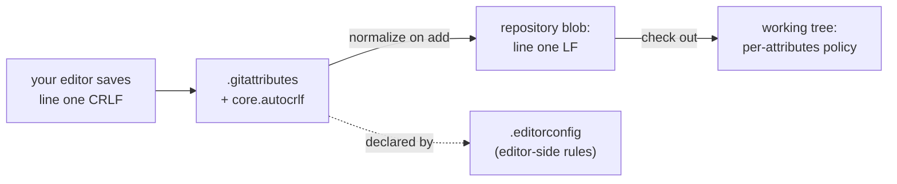

# Editors and IDEs

## 1. Learning Objectives

After this lesson you will be able to:

- [ ] Say what a text editor, a language-aware editor, and an IDE each actually do differently.
- [ ] Explain why line endings differ between Windows and Linux and prove where Git stores them.
- [ ] Configure `.editorconfig` and `.gitattributes` so whitespace policy is shared, not remembered.
- [ ] Open, search, and run code from the VS Code terminal without leaving the keyboard.
- [ ] Choose a tool for a task and defend the choice — instead of installing every tool recommended online.

## 2. Prerequisites

- [terminal-fundamentals.md](terminal-fundamentals.md) — you will edit files and run commands
  constantly in this lesson; the shell basics are assumed.
- [02-PROGRAMMING-FUNDAMENTALS/modular-programming.md](../02-PROGRAMMING-FUNDAMENTALS/modular-programming.md)
  — code spread across files is what makes an editor's navigation features worth having.

**Environment used in this lesson:** all transcripts executed on the author's machine — Windows 11,
Git 2.55.0, VS Code 1.140.0. `code --version` output is verbatim.

## 3. Introduction

An editor is the tool you will look at more than any other in your career. Choosing one is not a
personality question, though it is often sold that way — it is a *task* question: plain text
manipulation, language-aware navigation, or full project tooling. This lesson covers the
spectrum, then spends most of its effort on the one editor problem that bites every cross-platform
team: **whitespace** — line endings, trailing spaces, tabs versus spaces — which is where your
editor, your operating system, and Git each have an opinion.

## 4. The Problem It Solves

Text files are not as simple as they look. Windows files historically end lines with `CRLF`
(carriage return + line feed), Unix with `LF` alone. A file "changed" only by line endings shows
up as a whole-file diff, breaks hash comparisons, and produces phantom merge conflicts. Editor
settings that live only in *your* head (`tabs, please` / `two spaces, please`) turn every commit
into a style debate. The tools in this lesson — `.editorconfig`, `.gitattributes`, Git's
`core.autocrlf` — move those decisions out of memory and into the repository.

## 5. Core Concepts

### The three tiers

| Tier | What it adds over plain text | Examples | Use when |
|---|---|---|---|
| **Plain text editor** | Editing, search/replace | Notepad, TextEdit | Config edits, quick changes — never for code long-term |
| **Language-aware editor** | Syntax highlighting, linting, integrated terminal, Git UI | **VS Code**, Sublime, Vim/Neovim with plugins | The default for almost all development |
| **IDE** | Refactoring, debugger, build/test runners, project model built in | IntelliJ IDEA, Eclipse, Visual Studio, Android Studio | Heavy typed languages and large codebases (Java in subject 04+) |

The trend is convergence: VS Code with language extensions covers 80% of IDE ground while staying
an editor; a true IDE earns its weight by *debugging* and *refactoring* across many files. The
wrong answer is "install all of them"; the right answer is "one editor, learned deeply, plus the
IDE when the language demands it".

### Line endings and where Git's opinion lives

- **LF** (`\n`): Unix/Linux/macOS. **CRLF** (`\r\n`): classic Windows.
- **`core.autocrlf`** is a *per-machine* setting: `true` on Windows converts CRLF→LF when
  staging and LF→CRLF when checking out; `input` (typical on Linux/macOS) converts only on the
  way in; `false` stores bytes as they are.
- **`.gitattributes`** is the *per-repository* answer that travels with the project and overrides
  machine habits. When both exist, attributes win — which is why serious projects commit one.

### `.editorconfig`

A single file, read natively by VS Code (and most editors), declaring indentation, charset, line
ending, and trailing-whitespace rules per file glob. It reaches *every contributor's* editor,
including the ones you cannot configure by hand.

## 6. How It Works



One direction of truth: the *repository* stores normalized bytes (proven in Example 1), while the
*working tree* follows your machine's configured policy, and `.editorconfig` keeps the editor from
introducing style drift before Git ever sees the file.

## 7. Practical Examples

**Example 1 — what Git actually stores, byte for byte**

Two files are written with different endings and staged:

```console
$ printf 'line one\r\nline two\r\n' > dos.txt
$ printf 'line one\nline two\n' > unix.txt
$ git add .

$ git ls-files --eol
i/lf    w/crlf  attr/                	dos.txt
i/lf    w/lf    attr/                	unix.txt

$ git show :unix.txt | od -c | head -2
0000000   l   i   n   e       o   n   e  \n   l   i   n   e       t   w
0000020   o  \n

$ git show :dos.txt | od -c | head -2
0000000   l   i   n   e       o   n   e  \n   l   i   n   e       t   w
0000020   o  \n
```

- `i/lf` means **index (repository) content is LF for both files**; `w/crlf` vs `w/lf` shows the
  *working tree* kept each file's original ending. `od -c` is the proof: both stored blobs are
  byte-identical, `\n` only.
- The `attr/` column is empty because no attributes are declared yet — Git is running purely on
  machine config at this point (`git config --get core.autocrlf` answers `true` on this machine,
  the Windows installer default).
- **How to run it:** any fresh Git repo on your machine; the commands need nothing else.

**Example 2 — declare policy in the repository**

```console
$ printf '* text=auto\n*.md text eol=lf\n' > .gitattributes
$ cat .gitattributes
* text=auto
*.md text eol=lf

$ git add .gitattributes && git commit -qm "Add .gitattributes"
$ git ls-files --eol
i/lf    w/lf    attr/text=auto       	.gitattributes
i/lf    w/crlf  attr/text=auto       	dos.txt
i/lf    w/lf    attr/text=auto       	unix.txt
```

- `attr/text=auto` now appears for every file: Git normalizes line endings **by type**, on every
  machine, regardless of that machine's `core.autocrlf`. `*.md` additionally *checks out* as LF.
- **Why both layers:** config scales to your habits; attributes scale to your *team*. A project
  that relies on everyone's personal config is one new laptop away from a whole-repo diff.

**Example 3 — `.editorconfig`: style rules that reach every editor**

```ini
root = true

[*]
end_of_line = lf
insert_final_newline = true
charset = utf-8
indent_style = space
indent_size = 4

[*.md]
trim_trailing_whitespace = false
```

- `root = true` stops the search at this file (editors otherwise climb to parent directories).
- The `*.md` override is real-world nuance: Markdown uses two trailing spaces as line-break
  syntax, so blanket trailing-whitespace trimming *breaks* it — the kind of exception a shared
  config handles once instead of by memory per person.
- **How to run it:** save as `.editorconfig` at a repo root; VS Code honors it with no extension
  (most editors do today).

**Example 4 — the tool itself, from the terminal**

```console
$ code --version
1.140.0
07f806f999227108933c2e30515b26eecc1fda74
```

- `code .` opens the current folder as a project; `code <file>` opens one file. Because `code` is
  on PATH (see [windows-development-environment.md](windows-development-environment.md)), opening
  your editor is one shell command from anywhere — including from inside scripts.
- The second line is the exact build commit; when an extension behaves strangely, this is the
  number you quote in the bug report.

**Example 5 — Git's whitespace nagging (this repository's own machines speak up)**

Throughout the sandbox sessions, commits on Windows printed:

```console
warning: in the working copy of 'hello.py', LF will be replaced by CRLF the next time Git touches it
```

- This is `core.autocrlf=true` **telling you it will convert on the next checkout** — not an
  error, but a promise that your working copy's bytes will change. Teams that see this and do not
  want it add `.gitattributes` (Example 2) and silence the ambiguity permanently.

## 8. Real-World Applications

- **Code review hygiene:** reviewers reject whole-file diffs caused by line-ending flips;
  `.gitattributes` prevents the pull request from ever becoming unreadable.
- **Cross-platform teams:** one Windows, two Linux, one macOS contributor — `.editorconfig` +
  attributes are what make their diffs comparable.
- **Interviews and take-homes:** many are edited in a browser-based editor; knowing your keys and
  your whitespace rules from a desktop editor transfers directly.

## 9. Common Mistakes

| Mistake | Why it happens | How to recognize it | How to prevent it |
|---|---|---|---|
| Whole-file diff after one-line change | Line endings flipped on one side | Every line shows `+`/`-` with identical text | Commit `.gitattributes` before the team grows |
| Setting `core.autocrlf` per machine and calling it done | Installer default feels authoritative | New clone behaves differently | Repository-level attributes override machine config |
| Tabs vs spaces decided by each person | No `.editorconfig` | Style-only commits; editor wars in review | One shared `.editorconfig`, reviewed like code |
| Running an IDE *and* an editor with different settings on the same files | Parallel habits | Settings "revert" between tools | One primary editor per project |
| Editing production files live in an editor with no undo path | GUI habit | No VCS, no backup of the change | Edit through version control; the editor is for *writing*, Git is for *history* |
| Treating `trim_trailing_whitespace` as universally safe | Copy-pasted config | Markdown line breaks vanish | Scope it per glob, like the `*.md` override above |

## 10. Best Practices

- **Learn one editor's navigation deeply** — go-to-definition, symbol search, multi-cursor,
  integrated terminal. These transfer to every tool you will ever use; menu-diving does not.
- **Version-control your whitespace policy.** `.gitattributes` + `.editorconfig` at repo root,
  both treated as code: proposed in a pull request, reviewed, merged.
- **Let the editor run the shell.** VS Code's integrated terminal keeps you in one window while
  still being the real shell from [terminal-fundamentals.md](terminal-fundamentals.md) —
  same commands, same PATH, fewer context switches.
- **Configure once per machine, verify with Git.** After any editor or Git install, run
  `git config --get core.autocrlf` and `git ls-files --eol` in a scratch repo (Example 1) and
  *see* your machine's behavior instead of assuming the default.
- **Save formatting decisions for formatters.** Where an auto-formatter (Black, Prettier,
  `google-java-format`) exists, style stops being a human concern entirely — previewed in subject
  14.

## 11. Limitations and Trade-Offs

- `.editorconfig` covers *whitespace and encoding*, not formatting logic (line wrapping, import
  order) — for those you need a real formatter or linter.
- Git's line-ending conversion cannot rewrite files already committed wrong; converting a
  repository mid-life needs a deliberate `git add --renormalize .` pass that touches every file —
  do it in its own commit.
- Heavier IDEs cost startup time, memory, and attention; for config files and quick scripts they
  are slower than the terminal plus a small editor. Match tool weight to task weight.

## 12. Practical Exercises

### Introductory

1. **Reproduce Example 1 in a scratch repo.** **Completion criteria:** you see `i/lf` for a CRLF
   file with your own commands, and can explain in one sentence where the conversion happened.
2. **Audit your own editor.** Open your current editor's settings and find: default indentation,
   line ending, encoding, trailing-whitespace behavior. **Completion criteria:** four answers
   written down, with the setting's name — not "I think it's spaces".

### Intermediate

3. **Add both files to a practice repository** (`.editorconfig` and `.gitattributes` from
   Examples 2–3), commit them, and verify with `git ls-files --eol`. **Completion criteria:** the
   `attr/` column is no longer empty, and you can point at which line of `.gitattributes` produced
   which effect.
4. **Create and detect a phantom diff.** With `core.autocrlf` unset in a scratch repo, commit a
   CRLF file, flip `core.autocrlf`, and re-check out; observe with `git diff` and
   `git ls-files --eol`. **Completion criteria:** you produce (or definitively rule out) the
   phantom diff yourself and explain what would prevent it.

### Independent problem-solving

5. **Write the project policy.** For a fictional team (one Windows, two Linux, one macOS dev),
   write the exact `.gitattributes` and `.editorconfig` you would commit, with a one-line
   rationale per non-obvious rule. **Completion criteria:** the policy answers line endings,
   indentation, charset, final newline, and the Markdown trailing-space exception — and you can
   defend each line.
6. **Tool-choice memo.** Choose the editor/IDE for subject 04 (Java) and for the terminal work of
   this subject, and write a five-sentence memo: what each tool is *for*, what you will not use it
   for. **Completion criteria:** the memo cites concrete capabilities (debugger, refactoring,
   integrated terminal), not brand preference.

*Solutions: attempt first; whitespace and editor diagnosis flows live in
[troubleshooting/line-endings.md](troubleshooting/line-endings.md) and
[troubleshooting/exercises.md](troubleshooting/exercises.md).*

## 13. Knowledge Check

1. Your teammate on Linux and you on Windows both change one line; Git shows your entire file as
   changed. What is the first thing to check, and what is the durable fix?
2. What is the difference between fixing line endings with `core.autocrlf` and with
   `.gitattributes`? Which one should a shared repository depend on?
3. Why does the sample `.editorconfig` disable trailing-whitespace trimming for Markdown?
4. Name one task where a full IDE beats VS Code, and one where both lose to a shell one-liner.

## 14. Completion Criteria

Observable evidence that you have understood this lesson:

- [ ] You have proven with `od -c`/`ls-files --eol` where line endings are normalized
- [ ] Your practice repository contains `.editorconfig` and `.gitattributes`, and `git ls-files
      --eol` shows their effect
- [ ] You can name your editor's four key whitespace settings and where to change them
- [ ] You can open a project and a single file from the terminal (`code .`, `code file`)
- [ ] You can state the tier (editor / language-aware / IDE) of the tool you use for each subject
      in this curriculum, and why

## 15. Summary

- Editors come in **three tiers**; language-aware editors are the default, IDEs pay off for heavy
  typed languages and debugging.
- **The repository stores normalized bytes**; working-tree endings are policy
  (`core.autocrlf`) — verify with `git ls-files --eol`.
- **`.gitattributes` is the team's policy, `.editorconfig` the editor's** — both belong in the repo.
- **Phantom whole-file diffs are line endings**, and they are preventable, not inevitable.
- The **integrated terminal is the real terminal** — learn the editor, keep the shell.

## 16. Next Steps

- Next lesson: [package-managers.md](package-managers.md) — how the code you write depends on code
  you did not write, and why lockfiles exist.
- Practice: [troubleshooting/line-endings.md](troubleshooting/line-endings.md) — diagnose a real
  CRLF incident end to end.
- Where it is applied: every project in [20-PROJECT-LABORATORY](../20-PROJECT-LABORATORY/README.md)
  ships `.editorconfig` + `.gitattributes` from its first commit.
