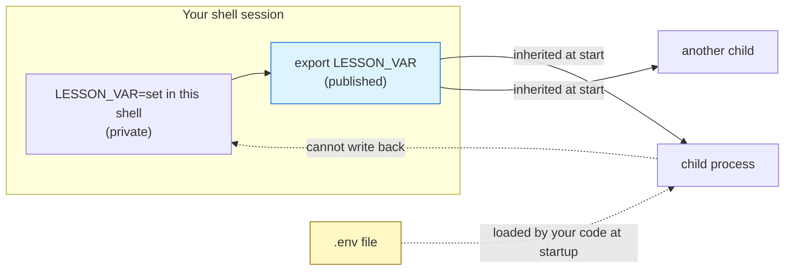

# Environment Variables

## 1. Learning Objectives

After this lesson you will be able to:

- [ ] Explain what an environment variable is, how it is inherited, and why `export` matters.
- [ ] Read and manipulate variables from bash, PowerShell, and cmd with each one's own syntax.
- [ ] Diagnose a broken `PATH` and repair it deliberately.
- [ ] Separate *configuration* from *secrets*, and use the `.env` + `.gitignore` discipline safely.
- [ ] Load a `.env` file from code without committing a credential, and say what this approach does
      **not** protect against.
- [ ] State where environment variables stop being the right tool (structured config, secret
      managers) and what to use instead.

## 2. Prerequisites

- [terminal-fundamentals.md](terminal-fundamentals.md) — variables, shells, and exit codes are
  introduced there; the broken-PATH experiment is reprised here with full context.
- [package-managers.md](package-managers.md) — project manifests, because environment variables
  and manifests together are how a project declares what it needs *and* how it is configured.
- [windows-development-environment.md](windows-development-environment.md) — the three shells and
  their variable syntaxes.

**Environment used in this lesson:** every transcript executed on the author's machine — Git Bash
5.3.15, Windows 11, Python 3.13.5. The `.env` file in the transcripts contains a **deliberately
fake** key (`demo-key-not-real`); no real credential appears anywhere in this repository.

## 3. Introduction

Two programs, byte-for-byte the same code, must behave differently on your laptop and on the
server: different database addresses, different API endpoints, different keys. Hard-coding those
differences means editing code per machine and committing secrets by accident. *Environment
variables* — named values the OS passes into a process's environment — are the oldest, most
portable answer: your program reads `DATABASE_URL` at startup and the world supplies the value.
This lesson teaches the mechanism (it is smaller than it sounds), the file convention that grew
around it (`.env`), and the honesty about where that convention's safety ends.

## 4. The Problem It Solves

Before environment variables, configuration lived in edit-the-source (recompile to change a
setting), or in config files whose paths differed per machine, or — worst — in code that shipped
to everyone. The *Twelve-Factor App* doctrine made the modern rule famous: **store config in the
environment**. One mechanism then serves laptops, containers, and CI: the code never changes,
only the values injected at launch. The same mechanism holds secrets, because a value in the
environment is never written into the repository — in theory. Section 7 shows where theory meets
practice.

## 5. Core Concepts

### What a variable is in a shell

A shell variable is a name→value pair held by the shell process. **Unexported** variables are
visible only to the shell itself; **exported** variables are copied into the *environment* of
every child process the shell starts. That is the whole inheritance model: children see their
parent's environment at start time, and cannot write back to it.

### The three dialects

| Shell | Read | Set for this session | Set permanently (Windows) |
|---|---|---|---|
| bash (Git Bash) | `echo $PATH` | `export NAME=value` | Profile script, or System Properties for the OS |
| PowerShell | `$env:PATH` | `$env:NAME = "value"` | `[Environment]::SetEnvironmentVariable("NAME","value","User")` |
| cmd | `echo %PATH%` | `set NAME=value` | `setx NAME value` (new processes only) |

"Permanently" on Windows always means **the user/machine registry value that new processes
inherit** — never the windows you already have open (the stale-terminal effect from
[windows-development-environment.md](windows-development-environment.md)).

### PATH is the variable you will actually debug

`PATH` is a list of directories, searched in order, when a command name has no slash in it. It is
an ordinary variable — which is why it can be inspected, broken, and repaired exactly like any
other, and why "command not found" is first and foremost a *PATH* question.

### `.env`: the file convention

A plain text file of `KEY=value` lines, one per line, comments with `#`, loaded into the
environment by your program (or a library like `python-dotenv`, `dotenv` for Node) at startup.
Two rules make it safe:

1. **`.env` goes in `.gitignore` — always.** It is a *local convenience*, never a distribution
   channel.
2. **`.env.example` (committed, values blanked) is the documentation.** It tells every teammate
   which keys exist without disclosing any value.

### The honest boundary

`.env` protects against *accidental commit*. It does **not** encrypt anything: anyone with the
file or with read access to the process can read the values, and a `.env` leaked once deserves
rotation once. Real secret managers (subject 15, and platform-level stores) add encryption,
rotation, and audit — environment variables remain the *interface*, not the vault.

## 6. How It Works



The shell's environment is a **snapshot handed to children at start**: `export` publishes a
variable into future snapshots; children receive copies and cannot modify the parent's originals.
The `.env` file is loaded *by the program*, which is why it works across shells and platforms —
and also why nothing stops a program from printing it (that is a code discipline, not a file
permission).

## 7. Practical Examples

**Example 1 — private, published, and immutable-to-children**

```console
$ LESSON_VAR="set in this shell" ; echo "$LESSON_VAR"
set in this shell

$ sh -c 'echo "child sees: [$LESSON_VAR]"'
child sees: []

$ export LESSON_VAR ; sh -c 'echo "child sees: [$LESSON_VAR]"'
child sees: [set in this shell]

$ sh -c 'LESSON_VAR=changed-in-child' ; echo "parent still: $LESSON_VAR"
parent still: set in this shell
```

- Without `export`, the child's environment simply does not contain the name — not "empty",
  *absent* (hence the empty brackets).
- The last block proves inheritance is one-directional: a child sets its own copy, the parent's
  value is untouched. Environments are handed *down*, never edited *up*.
- **How to run it:** any Git Bash prompt; nothing is written to disk.

**Example 2 — PATH is just a variable; break it to understand it**

```console
$ echo "$PATH" | tr ':' '\n' | head -4
/mingw64/bin
/usr/bin
/c/Users/PC/bin
/c/Program Files/Common Files/Oracle/Java/javapath

$ PATH=/nowhere ls
/usr/bin/bash: line 7: ls: command not found
exit code: 127

$ PATH=/nowhere pwd
/tmp/tools01/envtest
```

- The directories are separated by `:` on POSIX systems (by `;` on Windows in PowerShell/cmd) —
  one variable, a list inside it.
- With a worthless PATH, `ls` (an external program) becomes unreachable — exit code 127 — while
  `pwd` (a shell built-in) keeps working. Repair is just rebuilding the list; full diagnosis is
  in [troubleshooting/command-not-found.md](troubleshooting/command-not-found.md).

**Example 3 — the `.env` discipline**

```console
$ printf 'API_URL=https://example.test\nAPI_KEY=demo-key-not-real\n' > .env
$ cat .env
API_URL=https://example.test
API_KEY=demo-key-not-real

$ git init -q . ; printf '.env\n' > .gitignore ; git check-ignore -v .env
.gitignore:1:.env	.env
```

- `git check-ignore -v` is the proof step people skip: it prints *which pattern in which file*
  ignores the path. Until you have run it, `.gitignore` is a hope, not a guarantee.
- The value shown is fake on purpose; your real `.env` should never be pasted into chat, a
  screenshot, or a repository (see [15-APPLICATION-SECURITY](../15-APPLICATION-SECURITY/README.md)).

**Example 4 — reading `.env` from code, no library required**

```python
from pathlib import Path

config = {}
for line in Path(".env").read_text().splitlines():
    if line and not line.startswith("#"):
        key, _, value = line.partition("=")
        config[key] = value

print("API_URL is", config["API_URL"])
```

```console
$ python load_env.py
API_URL is https://example.test
```

- Twelve lines, executed above with Python 3.13.5 — enough to see the mechanism. Real projects
  use `python-dotenv` (`load_dotenv()`) because it also handles quoting, whitespace, and
  per-environment overrides correctly.
- **Note what this code does not do:** it does not validate, encrypt, or restrict anything — it
  reads a local file. Safety comes from what you do with the values (never log them) and from
  keeping the file out of Git.

**Example 5 — the same variable, three dialects (illustration for PowerShell/cmd lines)**

The bash lines above were executed here; PowerShell and cmd lines below are the *same operations*
in their own syntax — shown as an illustration because this transcript was captured in Git Bash:

```powershell
PS> $env:API_URL
https://example.test
PS> $env:API_URL = "https://staging.example.test"     # this session only
PS> [Environment]::GetEnvironmentVariable("PATH","User")   # persistent user PATH
```

```bat
C:\> echo %API_URL%
C:\> set API_URL=         (session only; setx for persistent)
```

- Cross-check with the real PowerShell transcript in
  [windows-development-environment.md](windows-development-environment.md) (`$env:PATH -split ';'`)
  — that one was executed, and shows the identical read syntax in situ.

## 8. Real-World Applications

- **Every deployment ever:** containers, CI runners, and PaaS hosts configure by injecting
  environment variables (`DATABASE_URL`, `PORT`, `API_KEY`) — the mechanism you just learned is
  the production mechanism, unchanged.
- **Tests and environments:** `NODE_ENV=test`, `FLASK_DEBUG=1` flip behavior without code edits —
  branching on environment is a pattern you will meet in subjects 11 and 14.
- **Secrets hygiene:** the `.env` + `.gitignore` + `.env.example` trio is the interview-answer
  and the workplace default for "how do you keep keys out of source".

## 9. Common Mistakes

| Mistake | Why it happens | How to recognize it | How to prevent it |
|---|---|---|---|
| Exporting a secret into a *committed* config or a log | Debugging with `printenv`/`echo` | Key appears in git history or CI logs | Never echo secrets; rotate immediately if logged (history rewrite does not purge clones) |
| Forgetting `export` in bash | Variable works in the shell but children see nothing | Works at the prompt, `command not found`-style empties in scripts | `export` what children need; test with `env \| grep NAME` |
| Setting a variable in an open terminal and "it didn't work" elsewhere | Environments are per-process snapshots | One window has it, new ones do not | Set persistent values at the OS/profile level, then open a *new* terminal |
| Committing `.env` because `.gitignore` was added *after* | Ignore rules do not untrack | File still listed in `git ls-files` | `git rm --cached .env` + verify with `git check-ignore -v .env`; add `.env` to `.gitignore` on day one of every project |
| Using environment variables for structured config (whole JSON blobs) | One mechanism used for everything | Parsing code, quoting bugs, unreadable values | Structured config files for structure; environment for scalars and secrets |
| Treating `.env` as encryption | Convention mistaken for protection | Plaintext readable by any process of yours | Real secret storage when values matter at scale — covered in subject 15 |

## 10. Best Practices

- **One rule, stated in your README:** *configuration goes in the environment; secrets never go in
  Git.* Teams break exactly one of these two, always.
- **Ship `.env.example`, commit it.** Keys documented, values blank — the onboarding artifact that
  costs nothing.
- **Verify ignores like you verify code:** `git check-ignore -v .env` after every `.gitignore`
  change (Example 3), because `.gitignore` patterns are quietly literal.
- **Read with a library in real projects** (`python-dotenv`, Node's `dotenv`); the hand-rolled
  parser in Example 4 exists to demystify, not to recommend.
- **Minimize exposure:** read the variable once at startup into your config object; do not pass
  secrets through child processes you do not control, and never include them in URLs that end up
  in logs.

## 11. Limitations and Trade-Offs

- The environment is a **flat namespace of strings** — no nesting, no types, no comments. Beyond a
  handful of values, config *files* (YAML/JSON) reviewed in Git are kinder; the environment then
  supplies overrides and secrets only.
- **Children see the whole environment** — any process you spawn can read every exported secret.
  Long-lived processes and third-party sub-processes widen that blast radius.
- **No audit trail or rotation** at this layer: changing a value changes behavior silently. When
  compliance or rotation matters, put a manager in front and keep the variable as the interface.
- `.env` is **per-directory**, which confuses tools run from the wrong working directory — a
  recurring source of "works in my project root, fails from the subfolder" bugs.

## 12. Practical Exercises

### Introductory

1. **Reproduce Examples 1 and 2** in Git Bash. **Completion criteria:** you can demonstrate, with
   your own output, that an unexported variable is invisible to children, and that `pwd` survives
   a destroyed PATH while `ls` does not — with the reason for the difference stated.
2. **Dialect drill.** Take one value (`MY_TOOL_PORT=8080`) and set + read it in bash,
   PowerShell, and cmd. **Completion criteria:** three successful reads, each with the correct
   syntax for that shell written down next to it.

### Intermediate

3. **Prove the ignore, then break it.** In a scratch repo: create `.env`, add it to `.gitignore`,
   confirm with `git check-ignore -v`; then commit it *accidentally* (add, commit), and recover
   with `git rm --cached .env`. **Completion criteria:** final `git ls-files` does not list
   `.env`, the ignore rule still matches, and you can say why `git rm --cached` was needed instead
   of `rm`.
4. **Ship the example.** Create `.env.example` with blank values for every key in your `.env`,
   commit it, and confirm `git status` shows only the example. **Completion criteria:** a
   teammate-style fresh clone would know which variables to create — and contains no values.

### Independent problem-solving

5. **Configuration boundary memo.** You are building the chat app from Project 04: list ten pieces
   of its configuration and sort them into: environment variable / committed config file /
   secret manager / code constant. Defend each placement in one sentence. **Completion criteria:**
   every entry is placed, and the *secrets* all land outside Git — with the reasoning naming
   who must be able to read each value.
6. **Diagnose an unknown.** With a fresh shell, find (a) every variable whose name contains
   `JAVA` or `npm` on your machine, (b) which shell profile or OS location would persist a new
   one, and (c) what would have to be reopened for it to appear. **Completion criteria:** three
   answers from commands you ran, not from memory.

*Solutions: attempt first; the PATH diagnosis flow lives in
[troubleshooting/command-not-found.md](troubleshooting/command-not-found.md), drills in
[troubleshooting/exercises.md](troubleshooting/exercises.md).*

## 13. Knowledge Check

1. A script works when you paste it line-by-line into your shell but fails as `bash script.sh`.
   What is the most likely environment-related cause, and how do you test for it?
2. Why can a child process not fix a variable for its parent? What does that imply about how
   deployment configuration must be set?
3. `.env` is in `.gitignore` — is the secret now safe? State two things `.env` does *not* do.
4. When would you choose a committed YAML config file *instead of* an environment variable?

## 14. Completion Criteria

Observable evidence that you have understood this lesson:

- [ ] You have personally broken and repaired a PATH in a subshell
- [ ] You can write the read/set syntax for bash, PowerShell, and cmd from memory
- [ ] Your practice project contains `.env` (ignored), `.env.example` (committed), and you proved
      both with `git check-ignore -v` and `git ls-files`
- [ ] You can explain export/inheritance with the one-way-child-write rule
- [ ] You can name two things `.env` does *not* protect against

## 15. Summary

- An environment is a **snapshot of exported names handed to children at start** — one-way,
  per-process, invisible to siblings.
- **PATH is an ordinary variable**, which is why "command not found" is diagnosable in three
  commands.
- **`.env` + `.gitignore` + `.env.example`** is the accident-prevention trio; verify with
  `git check-ignore -v`.
- Loading `.env` is *your code's* job (usually a library's) — the file protects nothing on its own.
- For structure, scale, or audit, **environment variables are the interface, not the vault**.

## 16. Next Steps

- Next lesson: [git-fundamentals.md](git-fundamentals.md) — the version control that makes every
  change in this lesson safe to make.
- Practice: [troubleshooting/command-not-found.md](troubleshooting/command-not-found.md) and
  [troubleshooting/exercises.md](troubleshooting/exercises.md).
- Where it is applied: [15-APPLICATION-SECURITY](../15-APPLICATION-SECURITY/README.md) builds the
  secret-handling practices this lesson starts; [16-DEVOPS-AND-INFRASTRUCTURE](../16-DEVOPS-AND-INFRASTRUCTURE/README.md)
  injects these same variables in production.
