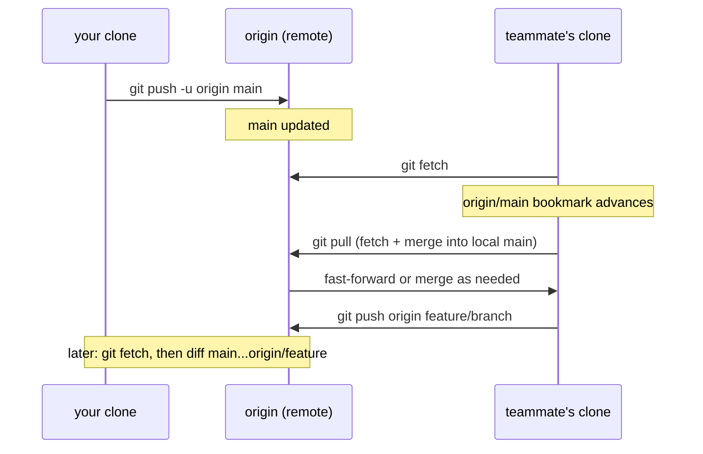

# GitHub Workflows

## 1. Learning Objectives

After this lesson you will be able to:

- [ ] Connect a local repository to a remote, push with `-u`, and explain what upstream tracking does.
- [ ] Clone, fetch, and pull — and state precisely how `pull` differs from `fetch`.
- [ ] Read a remote-tracking ref (`origin/main`) and preview incoming changes before integrating them.
- [ ] Diagnose the two classic first-push failures (missing upstream; remote HEAD pointing at the
      wrong branch) from their real error text.
- [ ] Describe the GitHub collaboration loop — issues, branches, PRs, reviews, CI — and say which
      parts are Git and which parts are platform.
- [ ] Use `gh` for day-to-day repository operations from the terminal, and know its auth states.

## 2. Prerequisites

- [git-fundamentals.md](git-fundamentals.md) — commits, staging, and the reflog are assumed.
- [branching-and-merging.md](branching-and-merging.md) — branches and merges are what travel to
  the remote in this lesson.
- [terminal-fundamentals.md](terminal-fundamentals.md) — exit codes and reading output.

**Environment used in this lesson:** every Git transcript executed on the author's machine — Git
2.55.0.windows.3 — against a **local bare repository acting as `origin`** (`git init --bare`),
so the full push/clone/fetch/pull flow runs for real without network or accounts. Where the real
GitHub *web interface* or *GitHub Actions* is described, the transcript is explicitly labelled an
**illustration** — the author's machine has `gh` 2.102.0 installed but is **not authenticated**
(its real output appears in Example 5), so nothing here pretends to be a live GitHub session.

## 3. Introduction

Everything so far has been local — one repository, one machine. Collaboration changes the topology:
your repository needs a *remote*, a URL of a repository everyone can reach, and a disciplined flow
for exchanging commits with it. GitHub is where most teams host that remote, but note the layering:
**remotes, pushing, fetching, and merging are Git**; issues, pull requests, review UIs, and
Actions are **platform** layered on top of Git's primitives. This lesson keeps that boundary
sharp — it is the difference between understanding GitHub and depending on it.

## 4. The Problem It Solves

Two developers cannot share a folder's `.git` directory and hope. The remote repository solves
coordination: a canonical, durable history both sides exchange commits *through*, with a
protocol (`https://` or `ssh://`) and a reference namespace (`origin/main` = "the `main` branch as
I last saw it *there*"). On top of that, GitHub adds the *social* layer — proposals (pull
requests), discussion (issues, review comments), and automated checks (Actions) — because pushing
code is the easy half of collaboration; agreeing on it is the hard half.

## 5. Core Concepts

### Remote, origin, upstream

A remote is a named URL: `git remote add origin <url>`. `origin` is only a convention (the
default name for the remote you cloned from), not a requirement. `upstream` in Git's vocabulary
means *the branch yours is compared against for pushes* — set with `push -u`, which makes
`git push` and `git pull` argument-free afterwards by remembering `main → origin/main`.

### The four verbs

| Command | Talks to the remote? | Changes your branches? | Safe on a whim? |
|---|---|---|---|
| `git fetch` | yes (downloads new commits into `origin/*`) | no — only remote-tracking refs | **Always.** It is read-only integration |
| `git pull` | yes | **yes** — fetch *plus* merge (or rebase) into your branch | When your work is committed or stashed |
| `git push` | yes | publishes your commits there | When history is shared-safe (see force-push rules) |
| `git clone` | yes | creates the whole local repository + `origin` | It *is* the entry point |

`pull = fetch + integrate`. That one equation explains most "my colleague's history looks
different from mine" mysteries: different moments of integration, different merge decisions.

### Remote-tracking refs

`git branch -r` lists `origin/main`, `origin/feature/greeting` — your local **snapshot of the
remote as of your last fetch**. They are bookmarks, not live connections: `origin/main` advances
only when *you* fetch. Reading `git diff main...origin/feature/greeting` is reading "what would I
be pulling in?" without touching your branches.

### GitHub's layer

- **Issue:** a tracked conversation/task, not code.
- **Pull request (PR):** a proposed merge — a branch, a description, review comments, checks, and
  a merge button. Underneath it is exactly the branch-and-merge machinery of the last lesson.
- **Actions:** CI triggered by events (push, PR) running in ephemeral VMs; the workflow file lives
  in the repository (`.github/workflows/*.yaml`).
- **`gh`:** GitHub's official CLI — the same operations as the web UI, scriptable.

## 6. How It Works



The choreography that matters: **pushes and fetches are the only lines that cross the network**;
your local branches move only when *you* integrate (`pull`) or publish (`push`). Everything else —
diffing, reviewing, deciding — happens against the `origin/*` bookmarks safely offline.

## 7. Practical Examples

**Example 1 — connect and first push**

```console
$ git remote add origin /tmp/tools01/hub/origin.git
$ git remote -v
origin	C:/Users/PC/AppData/Local/Temp/tools01/hub/origin.git (fetch)
origin	C:/Users/PC/AppData/Local/Temp/tools01/hub/origin.git (push)

$ git push -u origin main
 * [new branch]      main -> main
branch 'main' set up to track 'origin/main'.
```

- Here `origin` is a local path — deliberately, so the transcript is real; on GitHub the line
  reads `https://github.com/<you>/<repo>.git` or `git@github.com:<you>/<repo>.git`. Everything
  after the URL is identical Git behavior.
- **What `-u` actually did:** wrote the config entry `branch.main.remote=origin` +
  `branch.main.merge=refs/heads/main`. That is why afterwards you may type bare `git push` — the
  arguments were stored, not remembered by magic.

**Example 2 — a second developer clones; and the clone that lands nowhere**

```console
$ git clone origin.git second
Cloning into 'second'...
$ cd second && git log --oneline
e47194d Greet the world
be49cf5 Add hello.py
```

The same flow, before fixing one setting, produced the **most common local-hosting failure**:

```console
$ git clone origin.git second
warning: remote HEAD refers to nonexistent ref, unable to checkout
fatal: your current branch 'master' does not have any commits yet
```

- The bare `origin`'s own `HEAD` still pointed at `master` (the old default name) while the
  pushed branch was `main`. Git faithfully cloned every commit — but could not decide *which*
  branch to check out, so you land on an unborn `master` with an empty working tree.
- **The fix, and the transferable lesson:** point the remote's HEAD at the real branch once —
  `git -C origin.git symbolic-ref HEAD refs/heads/main` — then clone again. On GitHub this is
  automatic (the web UI sets the default branch), which is why the failure surprises people on
  *self-hosted* and *local* remotes. Full diagnosis:
  [troubleshooting/clone-empty.md](troubleshooting/clone-empty.md).

**Example 3 — fetch, preview, merge, pull (the four verbs in one loop)**

```console
$ # teammate's clone pushes a branch:
$ git push -u origin feature/greeting
branch 'feature/greeting' set up to track 'origin/feature/greeting'.

$ # back in your clone:
$ git fetch
From C:/Users/PC/AppData/Local/Temp/tools01/hub/origin
 * [new branch]      feature/greeting -> origin/feature/greeting

$ git branch -r
  origin/HEAD -> origin/main
  origin/feature/greeting
  origin/main

$ git diff main...origin/feature/greeting
diff --git a/hello.py b/hello.py
index cbbb3a6..04ea044 100644
--- a/hello.py
+++ b/hello.py
@@ -1 +1 @@
-print("hello", "world")
+print("hello", "world", "again")

$ git merge --no-ff feature/greeting -m "Merge branch 'feature/greeting'"
Merge made by the 'ort' strategy.
 hello.py | 2 +-
 1 file changed, 1 insertion(+), 1 deletion(-)
```

- `fetch` moved only the *bookmark*: nothing of yours changed — that is why it is always safe.
- The **three-dot diff** `main...origin/feature/greeting` shows what the branch would add *on top
  of your main* (the PR view's diff, computed locally). Two dots would show something else —
  preview-integration always uses three dots.
- The merge is the same machinery as the previous lesson — GitHub's green button runs this class
  of command server-side.

```console
$ # the teammate, on their main:
$ git pull --ff-only
Updating e47194d..e956cd7
Fast-forward
 hello.py | 2 +-
 1 file changed, 1 insertion(+), 1 deletion(-)
```

- `--ff-only` is automation-friendly: "integrate only if it is a clean fast-forward; otherwise
  fail and let me decide" — the disciplined default for scripts and for your own `main`.

**Example 4 — push errors, verbatim**

```console
$ git push
fatal: The current branch needs-upstream has no upstream branch.
To push the current branch and set the remote as upstream, use

    git push --set-upstream origin needs-upstream

To have this happen automatically for branches without a tracking
upstream, see 'push.autoSetupRemote' in 'git help config'.
exit code: 128

$ git push -u origin needs-upstream
branch 'needs-upstream' set up to track 'origin/needs-upstream'.
$ git branch -vv
  main           75c7eb4 three
* needs-upstream bf22079 [origin/needs-upstream] scratch commit
```

- Git prints its own remedy, verbatim — reading the *whole* error before reaching for a search
  engine is the habit this entire subject teaches. (`push.autoSetupRemote true` makes the `-u`
  permanent for new branches; mention it as the config alternative.)
- `branch -vv` shows tracking in brackets — the compact "what is connected to what" view.

**Example 5 — the `gh` CLI on an unauthenticated machine (real output)**

```console
$ gh --version
gh version 2.102.0 (2026-09-30)

$ gh auth status
You are not logged into any GitHub hosts. To log in, run: gh auth login
```

- Both lines are the author's machine, unedited. `gh` is *installed* but *not signed in* — and
  the tool says exactly that. This lesson therefore demonstrates `gh` **commands** as
  illustrations of its documented surface:
  `gh repo clone <you>/<repo>`, `gh pr create --title … --body …`, `gh pr checks`,
  `gh issue list`, `gh run watch`. Once authenticated (`gh auth login`, a browser flow), those
  commands are what you will actually type daily — and their outputs belong to *your* account,
  not to this transcript.
- **Auth states have meanings:** not logged in (above) → nothing works; a *revoked/expired token*
  → commands fail with 401-style errors even though you "logged in before". Checking
  `gh auth status` first turns "gh is broken" into a five-second diagnosis.

**Example 6 — the GitHub side of the loop (illustration)**

The web flow, described rather than captured, because it needs a live account:

```text
1. Push your branch:        git push -u origin feature/greeting
2. Open the PR:             gh pr create --title "Add greeting variant" --body "Why + what to check"
3. CI runs:                 .github/workflows/ci.yaml on the PR (tests, lint)
4. Review:                  teammate comments on lines; you push fixes to the same branch
5. Merge:                   squash or merge commit — team policy, then: git switch main && git pull --ff-only
```

```yaml
# .github/workflows/ci.yaml — illustration; the runner images and action versions
# are pinned per VERSIONS.md (ubuntu-24.04, actions/checkout@v7)
name: CI
on:
  push:
    branches: [main]
  pull_request:
jobs:
  test:
    runs-on: ubuntu-24.04
    steps:
      - uses: actions/checkout@v7
      - run: npm ci
      - run: npm test
```

- Every step maps to Git you already know: the PR *is* a proposed merge of your branch; CI's
  `npm ci` is [package-managers.md](package-managers.md)'s reproducibility verb; the final
  `pull --ff-only` is Example 3's command.
- Issues are deliberately simple — they are *work tracking*, not code, and their value is a
  branch/PR naming convention (`fixes #12` in the PR body closes the issue automatically).

## 8. Real-World Applications

- **The daily loop:** `git pull --ff-only` at day's start; branch; commit; `git push -u`; open PR;
  iterate on review; merge; repeat — subject 19 formalizes this as professional practice.
- **Automation:** `gh` scripts that label issues, generate release notes, or check PR status;
  Actions that gate merges. The terminal fluency from this subject is what makes those scripts
  possible.
- **Durable collaboration:** remotes are also your backup story — every pushed commit exists in
  two places, which is the cheapest disaster recovery there is.

## 9. Common Mistakes

| Mistake | Why it happens | How to recognize it | How to prevent it |
|---|---|---|---|
| Pulling with uncommitted changes | "Just getting updates" | `error: Your local changes would be overwritten` | Commit or `git stash` first; pull as a deliberate step |
| Confusing `pull` with `fetch` | Same first word, both "get stuff" | History integrates before you looked | Default to `fetch` + `diff` + decide; `pull` when you mean to integrate *now* |
| Pushing straight to `main` | Local-only habit carried over | No review, broken main risk; some repos reject it | Branch + PR; push `-u` on the branch |
| "Everything up-to-date" when you expected changes | Pushed a branch that was already there / wrong ref | Your new commits are local-only | `git status`, `git log origin/<branch>..HEAD` to see what has not been pushed |
| Clone lands on the wrong branch / empty tree | Remote HEAD points elsewhere (Example 2) | `warning: remote HEAD refers to nonexistent ref` | Fix remote default branch (`symbolic-ref`) — see the troubleshooting guide |
| Force-pushing to fix conflicts | Thinking history is a draft | Teammates' clones diverge permanently | Merge, or `--force-with-lease` only on your own PR branch after rebase |
| Assuming `gh` failure = tool broken | Auth expired/absent | 401s, or "not logged into any GitHub hosts" | `gh auth status` first, always |

## 10. Best Practices

- **Fetch before you decide; pull when you mean to integrate.** The read-only step deserves to be
  the reflex; integration deserves to be a choice.
- **Set upstream at birth:** `git push -u origin <branch>` on first push — then bare `git push`
  works forever on that branch, and Git's error messages never surprise you.
- **Name the PR's *why* the way you name commits' *why*** — the description is where reviewers
  decide what to read closely (next lesson covers the craft).
- **Make `main` protected on the platform** (PRs required, checks green) — the policy that turns
  "please don't push to main" from etiquette into architecture.
- **Learn `gh` for the operations you repeat:** `gh pr list`, `gh pr checkout`, `gh pr checks`,
  `gh run view` — each one replaces a context switch to the browser.

## 11. Limitations and Trade-Offs

- This lesson's executed transcripts use a **local bare remote**: faithful for Git's protocol and
  refs, but network authentication (HTTPS tokens, SSH keys), proxies, and GitHub's server-side
  features are not exercised here — `gh auth login` and credential helpers are the first thing to
  set up on a real account.
- `pull`'s default integration mode (merge vs rebase) is a **per-person config**
  (`pull.rebase`) — teams that disagree here get visibly different histories; pick explicitly.
- GitHub is a platform, not the protocol: every concept here exists on GitLab, Bitbucket, or a
  bare server — but *workflows* (protected branches, required checks) are configured per-platform,
  so knowing which layer you are reading prevents "why doesn't Git do this?" confusion.
- Remote-tracking refs go stale the moment you forget to fetch — `origin/main` means "as of last
  time", never "right now".

## 12. Practical Exercises

Practice against any remote you control: a classmate's clone over a shared folder, a free hosting
account, or the local-bare technique from this lesson
(`git init --bare shared.git`) — the mechanics are identical.

### Introductory

1. **Reproduce Examples 1 and 3 end to end** with two local clones and one bare origin.
   **Completion criteria:** you publish a branch with `-u`, preview it from the other clone with
   `fetch` + three-dot diff, and integrate it — with the exact outputs above in kind.
2. **Prove what `-u` stored.** After `push -u`, print the branch's config
   (`git config --get branch.main.merge` and `…branch.main.remote`). **Completion criteria:** you
   can explain, from those two values, why plain `git push` now works.

### Intermediate

3. **Recreate and repair the empty clone.** Make a bare origin whose HEAD points at the wrong
   branch (or skip straight to observing it in [troubleshooting/clone-empty.md](troubleshooting/clone-empty.md)),
   see the failure, repair with `symbolic-ref`, re-clone. **Completion criteria:** both the failure
   and the repaired clone demonstrated by you, with one sentence on why GitHub users rarely see it.
4. **Fetch vs pull, observed.** With diverged local/remote branches: run `fetch`, show that your
   branch did not move but `origin/*` did; then `pull --ff-only` and show its refusal on divergence.
   **Completion criteria:** the three states (bookmark advanced / branch untouched / ff-only
   refusal) each captured from your own run.

### Independent problem-solving

5. **Write the team's integration policy.** In one page: when to fetch vs pull, who may push to
   `main`, what CI must pass before merge, branch naming, and what happens on an urgent hotfix.
   Every rule must reference a command or platform feature from this lesson. **Completion
   criteria:** a new teammate could follow the policy on day one without asking a question — and
   you can defend each rule's failure mode ("what goes wrong without it?").
6. **Automate one operation with `gh`** (after authenticating your own account): list open PRs,
   check one PR's CI status, or open a PR from the terminal for your exercise repository.
   **Completion criteria:** the command runs against a real repository of yours, and you can say
   what the equivalent browser steps were — you have learned the *operation*, not just the tool.
   (If you have no account yet, produce the exact command line you *would* run, annotated with
   each flag's meaning — and mark it as unexecuted.)

*Solutions: attempt first; the diagnosis flows live in
[troubleshooting/clone-empty.md](troubleshooting/clone-empty.md) and
[troubleshooting/no-upstream.md](troubleshooting/no-upstream.md), with drills in
[troubleshooting/exercises.md](troubleshooting/exercises.md).*

## 13. Knowledge Check

1. You run `git fetch` and then `git status` — nothing changed. Was the fetch useless? What *did*
   it change, and how do you see it?
2. State the `pull` equation, then give a situation where you would choose `fetch` instead.
3. What does `git diff main...origin/feature/x` answer? What would two dots answer instead?
4. A clone prints `remote HEAD refers to nonexistent ref`. Where is the wrong pointer — locally
   or on the remote — and why?
5. Name three things the GitHub *platform* adds on top of plain Git, and the Git primitive each
   one builds on.

## 14. Completion Criteria

Observable evidence that you have understood this lesson:

- [ ] You have completed a full loop with a real remote: clone → branch → push `-u` → fetch →
      preview → merge → pull, with outputs you produced
- [ ] You can point at the config entries that make upstream tracking work
- [ ] You have seen (or reproduced) both first-push failures verbatim and can name the fix for each
- [ ] You can explain `origin/main` as a *stale-by-design snapshot* and prove it with a fetch
- [ ] You can list the platform-vs-Git boundary items (PR/issue/Actions vs merge/fetch/refs)
- [ ] `gh auth status` output on your machine is a state you understand — logged in or not

## 15. Summary

- A **remote is a named URL**; `-u` writes the tracking config that makes bare `git push` work.
- **`pull = fetch + integrate`**; fetch alone is always safe and is the preview-first habit.
- **`origin/*` refs are bookmarks of the last fetch** — three-dot diffs read them offline.
- First-push and empty-clone failures are **pointer problems** (`upstream`, remote `HEAD`), both
  diagnosed from Git's own error text.
- GitHub's layer — **issues, PRs, Actions, `gh`** — is platform on top of branch-and-merge; keep
  the layers apart and every error becomes localizable.

## 16. Next Steps

- Next lesson: [pull-requests-and-code-review.md](pull-requests-and-code-review.md) — the proposal
  and review culture that makes the merge button honest.
- Practice: [troubleshooting/no-upstream.md](troubleshooting/no-upstream.md),
  [troubleshooting/clone-empty.md](troubleshooting/clone-empty.md),
  [troubleshooting/exercises.md](troubleshooting/exercises.md).
- Where it is applied: [19-PROFESSIONAL-DEVELOPMENT](../19-PROFESSIONAL-DEVELOPMENT/README.md)
  (team workflows) and every project in [20-PROJECT-LABORATORY](../20-PROJECT-LABORATORY/README.md),
  which must live on a remote from day one.
