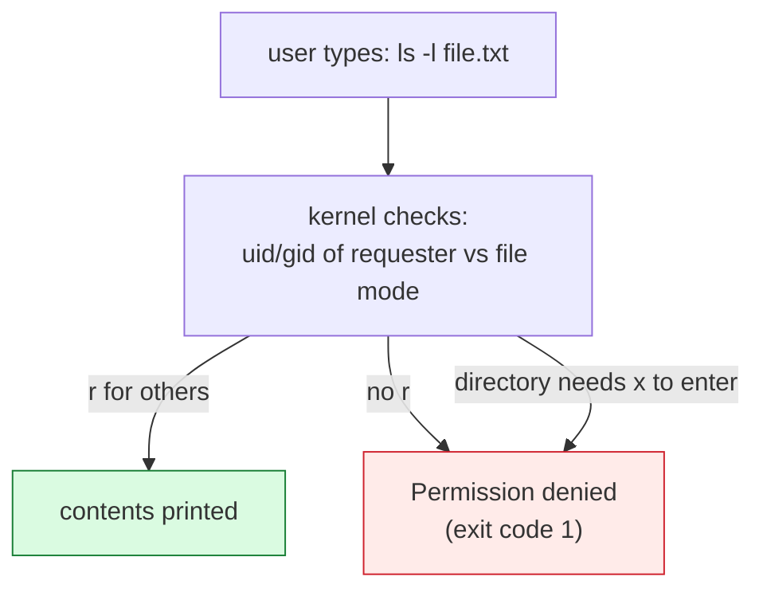

# Linux Fundamentals

## 1. Learning Objectives

After this lesson you will be able to:

- [ ] Navigate the Linux filesystem hierarchy and say what belongs in `/etc`, `/var`, `/home`, and `/usr`.
- [ ] Read an `ls -l` permission line and translate it into owner, group, and other rights.
- [ ] Explain what `chmod`, `chown`, and `sudo` do — and where each one *stops* working.
- [ ] Describe how processes relate to each other and read a process table.
- [ ] Say which parts of this lesson were executed on a Windows machine, and what differs on real Linux.
- [ ] Find documentation for any command without a search engine (`--help`, `man`, and friends).

## 2. Prerequisites

- [terminal-fundamentals.md](terminal-fundamentals.md) — navigation, paths, and exit codes are
  assumed throughout.
- [windows-development-environment.md](windows-development-environment.md) — explains why the
  transcripts here run in Git Bash and what that emulation does to Linux semantics.
- [01-COMPUTER-FOUNDATIONS/files-and-processes.md](../01-COMPUTER-FOUNDATIONS/files-and-processes.md)
  — file metadata, processes, and permissions theory.

**Environment and honesty note for this lesson:** the author's machine runs Windows, so these
transcripts were executed in **Git Bash (Msys)** — a POSIX layer that speaks Linux's *syntax* but
not Linux's *kernel*. Each transcript is labelled **[executed: Git Bash]** where that matters, and
where behavior on a real Linux distribution differs, the difference is stated rather than hidden.
Where a command's output would depend on a real distribution (package managers, `systemctl`), the
lesson describes it and marks it as an illustration. This split is deliberate: it teaches you to
distinguish "the command ran" from "the command means what I think it means" — a distinction that
matters the first time you touch a production server.

## 3. Introduction

Linux is not an operating system you use — it is an operating system your *services* use. Every
cloud VM, container, CI runner, and database server in later subjects is Linux, and you will reach
it through a shell with no file manager behind it. This lesson gives you the map (filesystem
hierarchy), the safety system (permissions), and the activity monitor (processes) before anything
is at stake.

## 4. The Problem It Solves

A Windows machine hides its filesystem behind drive letters and protects files with ACLs you never
see. A Linux machine gives you one tree rooted at `/`, every file with a permission string printed
on every listing, and every process visible in a table with a parent. The "problem" this solves is
*legibility*: on Linux, the system's state is readable from the terminal by design — which is why
server administration is possible from text alone.

## 5. Core Concepts

### The filesystem hierarchy (FHS)

One tree, rooted at `/`. The important branches:

| Path | Holds | You edit it? |
|---|---|---|
| `/bin`, `/usr/bin` | Programs every user can run | No — package manager only |
| `/etc` | System and service configuration | Yes, carefully, as root |
| `/home/<you>` | Your files, shell config, projects | Yes — this is your room |
| `/var` | Variable data: logs, queues, caches | Indirectly (logs you will read) |
| `/tmp` | Scratch space, wiped on reboot | Yes, freely — ideal for practice |
| `/root` | The superuser's home | Only *as* root, and you should rarely be there |
| `/dev`, `/proc` | Devices and process/kernel views as files | Read-only windows into the running system |

The rule that saves you: **binaries are not configuration, configuration is not data.** Package
managers own `/usr`, you own `/home`, services own their `/etc` files.

### Permissions: the `rwx` triple

Every file's `ls -l` output carries a ten-character mode: one type character, then three
triplets — owner, group, others — each `r` (read), `w` (write), `x` (execute/traverse).
Permissions answer *who may do what*; directories add a subtlety: `x` on a directory means
"traverse" — you may pass through it to reach things inside, not "run the directory".

### root, sudo, and why daily life is not root

`root` is the all-powerful account; `sudo` lets your own account run *one command* with root's
rights, logged. The design goal: privilege exists, but it is entered deliberately and
auditable — the opposite of living as administrator.

### Processes

Every program running is a process with a **PID**, a **parent PID** (the one that started it), a
command line, and a working directory. PID 1 (`systemd` or `init`) is the ancestor of everything.
Processes are created by *forking* their parent — the same `fork`/`exec` model introduced in
[01/files-and-processes.md](../01-COMPUTER-FOUNDATIONS/files-and-processes.md).

### Package managers and services (previewed, not executed here)

`apt`, `dnf`, and `pacman` install software from signed repositories into the paths above;
`systemctl start|status|enable` controls services. Neither exists on Windows, so this lesson does
not fake their output — [16-DEVOPS-AND-INFRASTRUCTURE](../16-DEVOPS-AND-INFRASTRUCTURE/README.md)
and the troubleshooting guides cover them when you have a real box (WSL counts).

## 6. How It Works



The kernel makes *every* permission decision — commands merely ask. That is why permission errors
come from the kernel's answer (`Permission denied`, errno `EACCES`/`EPERM`) regardless of which
command you used, and why faking permissions in a shell cannot work (the next section shows this
literally).

## 7. Practical Examples

**Example 1 — read a listing line by line [executed: Git Bash]**

```console
$ ls -l /tmp/tools01/practice/notes/
total 1
drwxr-xr-x 1 PC 197121  0 Oct 18 17:59 reports
-rw-r--r-- 1 PC 197121  0 Oct 18 17:59 todo.txt
-rw-r--r-- 1 PC 197121 34 Oct 18 17:59 words.txt
```

- First character: file type — `-` regular file, `d` directory.
- Next nine: `rw- r-- r--` → owner may read and write; group may read; others may read. A
  directory's `rwx` means list, create/delete (with caveats), and enter.
- The `1` (link count), owner/group, size, and timestamp complete the metadata the kernel consults.
- On Linux this same line is authoritative. On Git Bash it is a *display* — see Example 4.

**Example 2 — the permission decision, made visible [executed: Git Bash]**

```console
$ chmod 600 /tmp/tools01/practice/notes/words.txt
$ ls -l /tmp/tools01/practice/notes/words.txt
-rw-r--r-- 1 PC 197121 34 Oct 18 17:59 words.txt
```

- `chmod 600` asked for owner-read-write only. The command **succeeded** (exit 0)… and the mode
  printed right after is unchanged: `rw-r--r--`.
- Why: NTFS stores ACLs, not POSIX modes, so the Msys layer has nowhere durable to keep the
  change. **On a real Linux filesystem the same command prints `-rw-------`.** The failure here is
  the lesson: syntax ran ≠ semantics applied. Always confirm a permission change *by re-reading
  the state*, on any platform.
- **How to verify on Linux:** `stat -c '%a %n' file` → `600 file` (numeric mode).

**Example 3 — ownership refuses to move here [executed: Git Bash]**

```console
$ chown nobody /tmp/tools01/practice/notes/words.txt
chown: invalid user: 'nobody'
```

- On Linux, `chown` changes the file's owner and needs root for any change you do not already
  have. Here it fails earlier: the Msys layer's user database has no `nobody` to name. Windows
  ownership (NTFS ACLs) is a different system entirely — the tool does not even reach the file.
- On Linux the same class of problem reads `chown: changing ownership of …: Operation not
  permitted` when you lack root — a *permission* failure rather than a *lookup* failure. Both
  appear in [troubleshooting/permission-denied.md](troubleshooting/permission-denied.md).

**Example 4 — the environment's own confession [executed: Git Bash]**

```console
$ uname -a
MINGW64_NT-10.0-26100 <hostname> 3.6.9-b4195d69.x86_64 2026-06-06 17:49 UTC x86_64 Msys

$ whoami
PC

$ id
uid=197608(PC) gid=197121 groups=197121

$ pwd -W
C:/Users/PC/Desktop/PROGRAMMING
```

- *(Hostname generalized to `<hostname>`; commands and other output unmodified.)*
- `Msys` is the tell: this is a POSIX personality on Windows. `id` still answers in Linux's
  dialect — uid/gid/groups — because scripts expect that shape.
- `pwd -W` prints the Windows path of the same directory: one location, two naming systems. This
  translation is why path style must be chosen deliberately (see
  [windows-development-environment.md](windows-development-environment.md)).

**Example 5 — processes and documentation, including their absences [executed: Git Bash]**

```console
$ ps | head -5
      PID    PPID    PGID     WINPID   TTY         UID    STIME COMMAND
     1173    1167    1167        420  ?         197608 18:05:00 /usr/bin/bash
     1172    1167    1167        720  ?         197608 18:05:00 /usr/bin/ps
     1167       1    1167        3240  ?         197608 18:05:00 /usr/bin/bash

$ which grep ls git
/usr/bin/grep
/usr/bin/ls
/mingw64/bin/git

$ man ls
/usr/bin/bash: line 7: man: command not found
```

- The `PPID` column shows the family tree: this `ps` (PID 1172) and the outer bash (1173) share
  parent 1167 — the shell that ran your command. On Linux the same table exists (`ps aux` shows
  *all* users' processes) without the `WINPID` column.
- `man` is **not present** in Git Bash — a real gap, not a staged one. On Linux/macOS it is
  standard; here the fallbacks are `command --help` and the project's documentation. Knowing
  which documentation tools exist *in your current environment* is part of being independent of
  tutorials.

**Example 6 — what a real session looks like (illustration, not executed here)**

The following is what these concepts produce on an actual Linux box. It is labelled an
illustration because this authoring machine has no Linux distribution installed:

```console
$ ls -ld /etc /home /var/log
drwxr-xr-x 128 root root   12288 Oct 18 12:03 /etc
drwxr-x---  14 jules jules  4096 Oct 18 12:01 /home
drwxr-xr-x  10 root root   4096 Oct 18 12:03 /var/log

$ stat -c '%a %n' /etc/shadow
640 /etc/shadow

$ ps -o pid,ppid,cmd -p 1
  PID PPID CMD
    1     0 /usr/lib/systemd/systemd
```

- Root-owned configuration, a home directory others cannot list (`drwxr-x---`), a secret file
  readable only by root's group, and PID 1 as every process's ancestor — the three pillars above,
  in their natural habitat.

## 8. Real-World Applications

- **Server operations:** every deploy, log grep, and incident check in subjects 16–17 happens
  over SSH on a machine whose only UI is this one.
- **Containers:** Docker images are Linux filesystem hierarchies — knowing what `/etc`, `/usr`,
  and `/var` hold makes Dockerfiles legible instead of magic.
- **CI runners and WSL:** the moment you run a `.sh` script in GitHub Actions or WSL, the
  permissions and paths in this lesson become load-bearing.

## 9. Common Mistakes

| Mistake | Why it happens | How to recognize it | How to prevent it |
|---|---|---|---|
| Running daily work as root / Administrator | It makes permission errors disappear | Files owned by root in your home dir; prompts that never ask | Use your own account; reach for `sudo` per-command when asked |
| `chmod +x script.sh` then expecting it on Windows too | Git Bash reports success | Mode unchanged after `ls -l` (Example 2) | Re-read state after changing it; keep executable scripts in Linux-targeted repos |
| Treating `ps` output from Git Bash as the machine's process list | It looks like a process table | Only Msys processes visible; system services absent | Use Task Manager / `Get-Process` on Windows; `ps aux` on Linux |
| Believing `/tmp` is "where files live" | Practice habits leak into projects | Lost work after reboot; nobody can find your code | `/tmp` for scratch; projects in `/home/you/...` (or your Windows home) |
| Googling `apt install X` from a Windows prompt | Tutorial assumed a distro | `'apt' is not recognized…` | Match the tutorial's OS to your shell — this is the WSL decision from the previous lesson |
| Skipping `--help` because `man` is missing | One environment's gap taken as universal | Stuck, terminal open, search engine closed | `cmd --help` first; `man` when available; docs third |

## 10. Best Practices

- **Learn the hierarchy once; it repays every server you ever touch.** When a path is unfamiliar,
  `ls -ld <path>` before anything else.
- **Read before you write, always after you change.** Permission and ownership commands are cheap;
  confirming them with `ls -l`/`stat` costs one command and catches the Example-2 class of failure.
- **`sudo` a command, never a workflow.** If you find yourself in a root shell for more than one
  operation, you are one typo from owning your own files.
- **Label your platform in your own notes** the way this lesson labels its transcripts. "It worked"
  means nothing without "on what".

## 11. Limitations and Trade-Offs

- This lesson's executed transcripts cover POSIX *syntax*, not Linux *semantics* — permissions,
  `chown`, and process visibility were honestly shown to behave differently on Windows. For real
  Linux behavior you need WSL or a VM; the gap is flagged rather than papered over.
- `ps`'s default output is portable but sparse; modern Linux prefers `ps aux` or `top`/`htop` for
  system-wide views — covered when you have the system.
- The FHS is a convention, not a law: NixOS and container images bend it. Learn it to understand
  the mainstream, and expect deviations.

## 12. Practical Exercises

### Introductory

1. **Map your own machine's hierarchy (Git Bash view).** Run `ls -ld /etc /home /var /tmp
   /usr/bin /root 2>&1` and write one line per entry saying what the path would hold on Linux and
   what you observe here. **Completion criteria:** six entries, each with the correct Linux purpose
   and an honest note about what Git Bash shows instead.
2. **Decode three permission strings.** From any `ls -l` you run, translate the mode of three
   files into plain English ("owner reads and writes; everyone else reads"). **Completion criteria:**
   all three correct, including the directory's traverse bit.

### Intermediate

3. **Execute the proof from Example 2 yourself** — `chmod 600`, immediately `ls -l`, then (if you
   have WSL or a Linux box) the same two commands there. **Completion criteria:** you have seen
   both outcomes with your own commands and can state which part of the system refused to record
   the change on Windows.
4. **Trace a process family.** In Git Bash run a command that spawns a child
   (`bash -c 'sleep 2 &'`), then `ps` and identify PID/PPID relationships. **Completion criteria:**
   you can draw the parent-child chain from the table without help.

### Independent problem-solving

5. **Build a Linux orientation card.** Without Google, using only `ls`, `--help`, and this
   lesson: produce a one-page reference listing the eight FHS paths from Section 5, the `rwx`
   triple meaning, and the exact commands to (a) show permissions, (b) change them, (c) see
   processes. **Completion criteria:** every command in the card runs on your machine (with
   Linux-only entries explicitly marked), and a classmate can use the card to answer one
   permission question you pose.
6. **The privilege question.** Describe, in five sentences, what would happen if you `sudo`-edited
   a file in your home directory and why that is or is not a problem. **Completion criteria:** your
   answer names ownership and future access consequences, not just "sudo is dangerous".

*Solutions: attempt first; the permission-error diagnosis lives in
[troubleshooting/permission-denied.md](troubleshooting/permission-denied.md), with exercises in
[troubleshooting/exercises.md](troubleshooting/exercises.md).*

## 13. Knowledge Check

1. `ls -l` shows `-rwx--x--x` on a script owned by you. Who can run it, and who can read it?
2. Why did `chmod 600` exit successfully yet change nothing (Example 2)? What would make this same
   command trustworthy?
3. What does the `x` bit on a *directory* mean, and what breaks without it?
4. Why does this lesson refuse to print `apt` or `systemctl` output?

## 14. Completion Criteria

Observable evidence that you have understood this lesson:

- [ ] You can name what belongs in `/etc`, `/home`, `/usr/bin`, `/var`, and `/tmp` from memory
- [ ] You can read any `ls -l` mode string aloud correctly, files *and* directories
- [ ] You have personally reproduced the ineffective-`chmod` result and can explain its cause
- [ ] You can read a PID/PPID table and identify the parent of any listed process
- [ ] You can say, for every transcript in this lesson, whether it ran on Windows or Linux — and why
- [ ] You know three ways to find a command's documentation, and which are missing in Git Bash

## 15. Summary

- Linux has **one tree** rooted at `/`; binaries, configuration, data, and logs each have a home.
- **`rwx` triplets** decide access; the kernel enforces them and returns `Permission denied`.
- Git Bash prints Linux's *syntax* while NTFS ignores its semantics — **confirm changes by
  re-reading state**.
- **Root is a tool, not a mode of living**; `sudo` applies privilege per-command and per-log.
- **Processes form a PID/PPID tree** from PID 1 down — readable from any shell.

## 16. Next Steps

- Next lesson: [editors-and-ides.md](editors-and-ides.md) — where the files you now understand
  actually get written, and how editors and Git disagree about whitespace.
- Practice: [troubleshooting/exercises.md](troubleshooting/exercises.md) — permission and
  environment diagnosis drills.
- Where it is applied: [16-DEVOPS-AND-INFRASTRUCTURE](../16-DEVOPS-AND-INFRASTRUCTURE/README.md)
  runs entirely on the model built here; WSL gives you a local lab for it.
