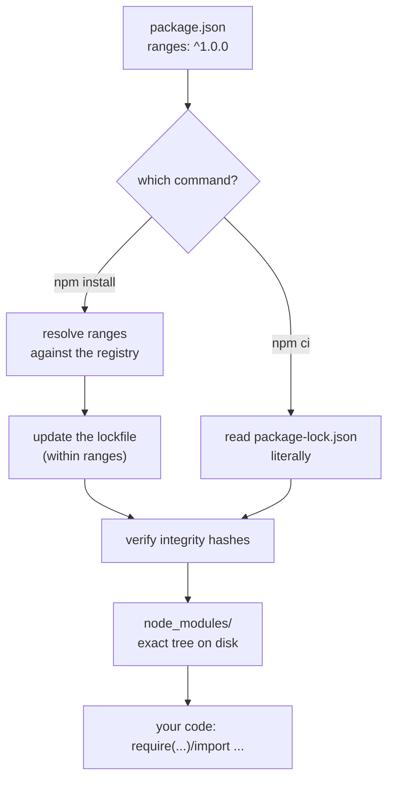

# Package Managers

## 1. Learning Objectives

After this lesson you will be able to:

- [ ] Explain what a package manager does and why hand-downloaded dependencies fail.
- [ ] Initialize a project, add a dependency, and use it from code — with npm.
- [ ] Read a `package-lock.json` and say what it guarantees.
- [ ] Distinguish installing for development (`npm install`) from reproducing exactly (`npm ci`).
- [ ] Name the equivalent package-manager concepts in Python (pip) and Java (Maven) and where their
      versions are pinned.
- [ ] Say what a *registry* and a *semver range* are, and what either one can and cannot promise.

## 2. Prerequisites

- [02-PROGRAMMING-FUNDAMENTALS/modular-programming.md](../02-PROGRAMMING-FUNDAMENTALS/modular-programming.md)
  — importing code across files; a package dependency is that idea across *projects*.
- [terminal-fundamentals.md](terminal-fundamentals.md) — you will run everything here from the shell.

**Environment used in this lesson:** every transcript executed on the author's machine — npm 11.8.0
with Node 24.13.1 (see [VERSIONS.md](../VERSIONS.md) for pinned baselines). The demo dependency is
a local folder on purpose, so the whole flow runs **without network access** — the mechanics you
are learning are identical to installing from a public registry.

## 3. Introduction

No serious program is written from zero anymore — and that is not cheating, it is engineering.
The question is not *whether* you depend on other people's code, but whether that dependency is
**declared, pinned, reproducible, and auditable**. A package manager is the tool that turns
"whatever I downloaded" into a *manifest* — and the moment two machines must produce identical
builds, the manifest plus its **lockfile** become the difference between a project and a pile of
files.

## 4. The Problem It Solves

The pre-package-manager workflow: find a library's website, download a zip, unpack it into your
project, note the version in a README (or not), tell a teammate by chat, and hope everyone's copy
matches. Then someone finds a CVE in version 2.1 and you cannot say which machines have it. The
package manager answers all of that at once: a **registry** (a searchable, hosted collection with
one canonical source), a **manifest** (what your project needs), a **lockfile** (exactly what was
resolved, byte-for-byte, last time), and a **dependency graph** (so an upgrade shows what else
moves with it).

## 5. Core Concepts

### Manifest and lockfile

- The **manifest** (`package.json` for npm, `pyproject.toml`/`requirements.txt` for Python, `pom.xml`
  for Maven) declares *what* you depend on, usually as a version *range* (`^1.2.0` — compatible
  with 1.2.x and later minors).
- The **lockfile** (`package-lock.json`, `poetry.lock`, Maven's resolved tree) records *what was
  actually installed*: exact versions, integrity hashes, and the full transitive graph. Ranges are
  for humans deciding; locks are for machines reproducing.

### Registry, cache, and the integrity hash

A registry is the canonical host npm reads (`registry.npmjs.org` by default; Maven Central for
Java, PyPI for Python). Each locked package carries a content hash; on install the manager
verifies the bytes match the lock — that check is what makes "it worked on my machine" transferable.

### devDependencies and the two install verbs

`dependencies` are needed to *run* the project; `devDependencies` (test runners, linters, build
tools) are needed to *develop* it. npm then has two distinct commands with different jobs:
`npm install` **updates** the tree within the manifest's ranges (and may refresh the lock),
while `npm ci` **reproduces** the lock exactly — clean, non-interactive, CI's command.

### The equivalent map across this curriculum

| Ecosystem | Manifest | Lockfile | Install for development | Install exactly |
|---|---|---|---|---|
| Node (taught here) | `package.json` | `package-lock.json` | `npm install` | `npm ci` |
| Python (02, 10, 14) | `pyproject.toml` | `poetry.lock` / `uv.lock` | `pip install -e .` | `pip install -r requirements.txt` |
| Java (04, 11, 16) | `pom.xml` / `build.gradle` | effective dependency tree (Maven resolves; Gradle has `*.lockfile`) | `mvn compile` | `mvn -B dependency:go-offline` |

Same ideas everywhere: declare ranges, lock exactness, verify hashes.

## 6. How It Works



`npm install` travels the left path (resolve → refresh lock → verify); `npm ci` travels the right
(path from the lock alone, refusing to touch it). Both end at the same place: a verified tree your
code can import. CI must take the right path, or the build is testing a *different* dependency set
than the lock claims.

## 7. Practical Examples

**Example 1 — a local package to depend on**

The dependency is a tiny folder inside the project, so nothing needs the network:

```json
// vendor/tiny-utils/package.json
{
  "name": "tiny-utils",
  "version": "1.0.0",
  "main": "index.js"
}
```

```javascript
// vendor/tiny-utils/index.js
function shout(text) {
  return text.toUpperCase() + "!";
}
module.exports = { shout };
```

**Example 2 — init, install, use**

```console
$ npm init -y > /dev/null && echo "npm init -y -> package.json created"
npm init -y -> package.json created

$ npm install ./vendor/tiny-utils

added 1 package, and audited 3 packages in 3s

found 0 vulnerabilities

$ npm ls
npmtest@1.0.0 C:\Users\PC\AppData\Local\Temp\tools01\npmtest
`-- tiny-utils@1.0.0 -> .\vendor\tiny-utils

$ node -e "const {shout} = require('tiny-utils'); console.log(shout('hello from a dependency'))"
HELLO FROM A DEPENDENCY!
```

- `npm init -y` writes a starting `package.json` without the interactive questionnaire.
- `npm ls` is the dependency tree as it *is* — here showing the local dependency as a link
  (`-> .\vendor\tiny-utils`), which is how npm handles `file:` dependencies.
- The `node -e` run is the proof that matters: the code resolves `tiny-utils` through npm's
  layout, not through a relative path you typed.
- **How to run it:** the three files above, in any directory, offline.

**Example 3 — the lockfile is the contract**

```console
$ head -14 package-lock.json
{
  "name": "npmtest",
  "version": "1.0.0",
  "lockfileVersion": 3,
  "requires": true,
  "packages": {
    "": {
      "name": "npmtest",
      "version": "1.0.0",
      "license": "ISC",
      "dependencies": {
        "tiny-utils": "file:vendor/tiny-utils"
      }
    },
```

- `lockfileVersion: 3` is npm's current format (npm 7+); older npm reads it, *newer* npm may
  rewrite it — which is exactly why the lockfile belongs **committed to the repository** and why
  CI uses `npm ci`, which fails loudly instead of rewriting anything.
- `"tiny-utils": "file:vendor/tiny-utils"` is the resolved source for this dependency — for a
  registry package this line's siblings carry the exact URL and the integrity hash.

**Example 4 — destroy and reproduce: `npm ci`**

```console
$ rm -rf node_modules && npm ci
added 1 package, and audited 3 packages in 3s

found 0 vulnerabilities

$ node -e "const {shout} = require('tiny-utils'); console.log(shout('npm ci restored it'))"
NPM CI RESTORED IT!
```

- `node_modules` is treated as **disposable** — and it is: the lockfile plus registry can rebuild
  it at any moment. This is why `node_modules` never belongs in version control (this repository's
  `.gitignore` excludes it), and why "delete node_modules and reinstall" is a legitimate first
  diagnostic in [troubleshooting/](troubleshooting/README.md) — with `npm ci` as the correct
  second half of the sentence.

**Example 5 — the same ideas in the other ecosystems (versions, not flows)**

```console
$ npm --version
11.8.0

$ python --version
Python 3.13.5

$ python -m pip --version
pip 26.1.2 from C:\Users\PC\AppData\Local\Programs\Python\Python313\Lib\site-packages\pip (python 3.13)
```

- pip was executed here; the Java/Maven row of the map in Section 5 is stated from
  [VERSIONS.md](../VERSIONS.md) (Maven 3.9.16 is installed on this machine) — its flow is
  exercised in [04-JAVA-PROGRAMMING/build-tools.md](../04-JAVA-PROGRAMMING/build-tools.md), not
  faked here.

## 8. Real-World Applications

- **Reproducible CI:** the first line of virtually every pipeline is `npm ci` / `pip install -r`
  / `mvn -B …` — the lockfile is what makes a build a *rerun*, not a re-resolution.
- **Security response:** when a dependency ships a compromised release, teams with lockfiles know
  instantly *which projects pin it* (`npm ls <pkg>` / `npm audit`) and can bump one line.
- **Onboarding:** `git clone && npm install && npm run dev` replaces a paragraph of manual
  download instructions — the manifest *is* the setup doc.

## 9. Common Mistakes

| Mistake | Why it happens | How to recognize it | How to prevent it |
|---|---|---|---|
| Committing `node_modules` (or omitting the lockfile) | "My project should be self-contained" | 100k-file diffs; merge conflicts inside packages | Ignore `node_modules`; **commit** the lockfile |
| Using `npm install` in CI | It is the command you know | Builds that drift; unexpected lockfile changes in PRs | `npm ci` in CI — reproducible by construction |
| `npm install` to get an exact version, then confusion | Range vs exact confusion | Version moved after a teammate's install | Exact pins live in the lock; ranges live in the manifest |
| Global installs for project tools (`npm i -g`) | Feels tidy | Works on your machine, fails everywhere else | Install per-project (or via `npx`) so the version is declared |
| Copy-pasting versions from a blog post dated unknown-when | Tutorial drift | "Cannot find module" or subtle behavior differences | Check the registry for current versions; pin what worked |
| Ignoring `npm audit` output | Noise fatigue | Known-vulnerable dependency shipped | Read new audit findings when they appear; upgrade deliberately |

## 10. Best Practices

- **Commit the lockfile, ignore the install directory.** Manifest = intent, lock = fact,
  `node_modules` = cache.
- **Separate the verbs:** `npm install` while developing (you are *choosing* new resolutions),
  `npm ci everywhere else* (you are *reproducing* agreed ones).
- **Declare everything you use.** If your code imports it, it belongs in the manifest — "it works
  because I have it globally" is undeclared debt.
- **Read a package before trusting it:** registry health, maintenance date, download counts, and
  whether it drags in a large transitive tree — the habit scales to the supply-chain risks covered
  in [15-APPLICATION-SECURITY](../15-APPLICATION-SECURITY/README.md).
- **Upgrade deliberately, in its own commit** — a dependency bump mixed with feature code cannot
  be bisected when something breaks.

## 11. Limitations and Trade-Offs

- **A range is a promise about compatibility, not behavior.** Semver (major.minor.patch) is
  followed by good packages and ignored by others; only the lockfile and your tests enforce
  reality.
- **Lockfiles do not make builds deterministic by themselves** — native binaries, environment
  variables, and toolchain versions add other axes (the subject of
  [16-DEVOPS-AND-INFRASTRUCTURE](../16-DEVOPS-AND-INFRASTRUCTURE/README.md)).
- **Dependency trees carry weight.** Every package is someone else's code and bugs in your
  supply chain; sometimes twenty lines of your own are cheaper than one dependency — a judgment
  call worth making consciously.

## 12. Practical Exercises

### Introductory

1. **Reproduce Examples 1–4 in a fresh folder.** **Completion criteria:** your `node -e` line
   prints `NPM CI RESTORED IT!` after you deleted `node_modules`, and you can say which file made
   that possible.
2. **Read your own lock.** In any npm project you have, find in `package-lock.json` one exact
   version and its integrity hash, then confirm the installed copy matches (`npm ls <pkg>`).
   **Completion criteria:** one package traced from manifest range → lock entry → installed tree.

### Intermediate

3. **Prove the difference between the two verbs.** In a scratch project, declare a range
   (`"tiny-utils": "file:vendor/tiny-utils"` stands in for `^1.0.0`), run `npm install`, modify the
   dependency's version, run `npm install` again (watch the lock move), then `npm ci` (watch it
   refuse to move). **Completion criteria:** you can state, from observed output, which command
   may change the lockfile and which one never does.
4. **Map the concepts.** For Python: create a `requirements.txt`, install with pip, and break the
   install deliberately (pin a nonexistent version) to see pip's refusal. **Completion criteria:**
   manifest/lock/install equivalents filled in for pip from your own runs.

### Independent problem-solving

5. **The forensic audit.** Take any project on your machine with dependencies: produce a one-page
   report — total direct dependencies, largest transitive chain, anything flagged by
   `npm audit`, and any dependency whose last release is over two years old. Then state one
   concrete action per finding. **Completion criteria:** every claim in the report comes with the
   command output that supports it.
6. **Design the policy.** Write the five rules you would enforce on a team repository about what
   gets committed (manifest, lock, modules, global installs) — each with its one-line *why*.
   **Completion criteria:** the five rules cover every row of Section 9's mistake table, and a
   teammate could follow them without asking a question.

*Solutions: attempt first; install-tree diagnosis lives in
[troubleshooting/dependency-tree.md](troubleshooting/dependency-tree.md) and
[troubleshooting/exercises.md](troubleshooting/exercises.md).*

## 13. Knowledge Check

1. Your teammate runs `npm install` and their `package-lock.json` shows up modified in
   `git status` though they changed no code. Explain what happened and what CI should run instead.
2. What does the integrity hash in a lockfile protect you against?
3. Why does this lesson's demo avoid the network yet still teach the real workflow?
4. A teammate says "just commit node_modules so installs are fast." Give three counter-arguments
   grounded in this lesson.

## 14. Completion Criteria

Observable evidence that you have understood this lesson:

- [ ] You have installed, used, deleted, and *exactly reproduced* a dependency tree with npm
- [ ] You can open a `package-lock.json` and point at a resolved version and its hash
- [ ] You can state which command your CI should use and why it differs from your dev command
- [ ] You know the manifest + lockfile names for npm, pip, and Maven
- [ ] You can explain `dependencies` vs `devDependencies` with an example of each

## 15. Summary

- A package manager replaces zips-in-a-folder with a **manifest**, a **lockfile**, a **registry**,
  and **integrity checks**.
- **Ranges express intent; the lock records fact** — commit both, never `node_modules`.
- **`npm install` resolves; `npm ci` reproduces** — development versus everywhere else.
- The same four ideas appear in pip and Maven under different names (Section 5's map).
- Disposability is the point: a deleted install directory is recoverable *because* everything is
  declared.

## 16. Next Steps

- Next lesson: [environment-variables.md](environment-variables.md) — configuration and secrets,
  the other half of "what makes my program run on your machine".
- Practice: [troubleshooting/dependency-tree.md](troubleshooting/dependency-tree.md) — diagnose a
  broken install end to end.
- Where it is applied: [11-BACKEND-ENGINEERING](../11-BACKEND-ENGINEERING/README.md) and
  [16-DEVOPS-AND-INFRASTRUCTURE](../16-DEVOPS-AND-INFRASTRUCTURE/README.md) both build on the
  lockfile-reproducibility habit formed here.
