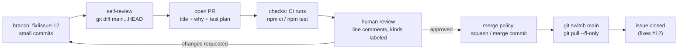

# Pull Requests and Code Review

## 1. Learning Objectives

After this lesson you will be able to:

- [ ] Explain what a pull request *is* in Git terms — a proposed merge of a named branch, with a
      conversation attached.
- [ ] Produce a PR-ready branch: small, focused, rebased or conflict-free, with a passing local check.
- [ ] Write a PR description that tells a reviewer what to read and *why* — and split work so
      review is possible at all.
- [ ] Review someone else's code with a structured checklist, distinguishing blocking issues from
      preferences, and write comments that are actionable.
- [ ] Respond to review: push fixes, resolve threads, and decide merge policy (merge commit vs
      squash) for a team.
- [ ] Generate a plain-text pull-request summary with `git request-pull`, and preview exactly what a
      reviewer will see with a three-dot diff.

## 2. Prerequisites

- [branching-and-merging.md](branching-and-merging.md) — a PR *is* a merge proposal; conflict
  resolution and `--no-ff` merging are the mechanics underneath the button.
- [github-workflows.md](github-workflows.md) — remotes, `push -u`, fetch/three-dot diff, and `gh`
  are the transport this lesson's proposals travel on.

**Environment used in this lesson:** the `git request-pull`, three-dot diff, and merge transcripts
were executed on the author's machine against the local-bare `origin` from
[github-workflows.md](github-workflows.md) (Git 2.55.0). The GitHub *web UI* walkthroughs and
review-comment examples are labelled **illustrations** — they show shape and content, not captured
sessions (this machine is not authenticated to GitHub; see github-workflows Example 5).

## 3. Introduction

A pull request is the most successful cultural artifact in software: a place where a *proposed
change*, its *rationale*, its *automated checks*, and its *discussion* live together and are
decided together. Technically it is unremarkable — a branch, a base, a diff, a merge button.
Culturally it is where quality actually happens: tests catch what they can; review catches what
they cannot — wrong assumptions, unreadable names, missing cases, the design that will be painful
in six months. This lesson teaches both halves: how to make a proposal worth reviewing, and how to
review as if the code were yours.

## 4. The Problem It Solves

Before PRs, code landed by direct push (or worse, by zip file and trust). Two failure modes
followed: nobody else ever saw the change until it was already in production, and "review" meant a
hallway conversation with no record. The PR solves coordination *and* accountability at once: the
change is *proposed* against a base, discussed line by line, checked by machines, and merged only
when both agree — and the entire conversation stays attached to the commit forever. It is also how
junior developers get senior feedback without waiting for someone to look over their shoulder.

## 5. Core Concepts

### What a PR contains

- **Base and head:** target branch (`main`) and your branch — Git-wise, "please merge *this*
  into *that*".
- **The diff:** computed as `base...head` — exactly the three-dot preview from
  [github-workflows.md](github-workflows.md): what your branch adds on top of the base.
- **Description:** the *why*, the plan of the change, and how to test it.
- **Checks:** CI runs (tests, lint) reported per commit.
- **Conversation:** line-anchored comments, resolved and unresolved threads.
- **Merge policy:** how it lands — merge commit, squash, or rebase-merge (team setting).

### The unit of review: small beats brilliant

Review capacity is finite: a 1,500-line PR gets rubber-stamped, a 150-line PR gets read. The
single highest-leverage review practice is **splitting work** so each proposal has one purpose —
formatting separated from logic, refactor separated from feature, dependency bump separated from
its adoption. Everything else in this lesson assumes the diff is reviewable in size.

### Two roles, one shared duty

*Authors* make review cheap (context, small diffs, self-review first, answers that explain rather
than argue). *Reviewers* make review worth it (read for correctness and design first, be specific,
say what is good, approve when you would maintain it yourself). The shared duty: **the PR exists
to improve the code, not to approve the author** — both sides serve the codebase, not each other's
feelings or the merge button's patience.

### Blocking vs non-blocking, and the review checklist

A review comment should carry a **kind**: *blocker* (bug, security, missing test for changed
logic), *suggestion* (clarity, structure — worth a change), or *nit* (style — optional, ideally
automated instead). The checklist itself: **correctness** (does it do what the description says,
including edge cases), **tests** (does changed logic have changed tests), **readability** (names,
size of functions, obvious control flow), **design** (does this belong here; does it duplicate
what exists), **risk** (what breaks for users of this code, and what is the rollback).

## 6. How It Works



The loop is the lesson: review findings come back as **commits to the same branch** (never as a
second, parallel PR), checks and humans gate the same button, and the last step is everyone's
`pull --ff-only` back to an updated `main`. Note where the diagram's first box sits — *small
commits on a named branch* — everything downstream degrades if that box is wrong.

## 7. Practical Examples

**Example 1 — the proposal, as plain text (`git request-pull`)**

Before any platform, Git can print what you are proposing — executed here:

```console
$ git request-pull origin/main HEAD
fatal: 'HEAD' does not appear to be a git repository
fatal: Could not read from remote repository.

Please make sure you have the correct access rights
and the repository exists.
warn: No match for commit ae7dbaddee51ab42f71b4f12c6ef769cad763db4 found at HEAD
warn: Are you sure you pushed 'HEAD' there?
The following changes since commit e47194d9c313e9446b5b33fde5d39f3206d80686:

  Greet the world (2026-10-18 18:16:37 +0300)

are available in the Git repository at:

  HEAD

for you to fetch changes up to ae7dbaddee51ab42f71b4f12c6ef769cad763db4:

  Greet everyone (2026-10-18 18:16:38 +0300)

----------------------------------------------------------------
Learner Example (1):
      Greet everyone

 hello.py | 2 +-
 1 file changed, 1 insertion(+), 1 deletion(-)
```

- The useful payload is everything from `The following changes since…`: the base, the tip, the
  author, the commit list, and the stat — *the entire PR in text form*, composed by Git itself.
- The leading `fatal:`/`warn:` pair is genuine Git 2.55 behavior here: `request-pull` probes its
  head argument through the default remote first and complains before producing the summary.
  It is noise, not failure — the summary below it is the output that matters, and the tool's
  exit status reflects the probe. Disclosed rather than edited away: this is what the command
  prints on this machine. (On GitHub the same information is the PR page itself.)
- **Historical note that explains the tool:** `request-pull` was written for *mailing-list* Git —
  paste its output into an email asking for a pull. The PR UI is its direct descendant; the
  *content* both produce is identical.

**Example 2 — exactly what the reviewer will see**

```console
$ git diff main...origin/feature/greeting
diff --git a/hello.py b/hello.py
index cbbb3a6..04ea044 100644
--- a/hello.py
+++ b/hello.py
@@ -1 +1 @@
-print("hello", "world")
+print("hello", "world", "again")
```

- The three-dot diff is the PR's diff — same computation, local, no account needed. Run it
  *before* opening the PR and again *after* pushing review fixes: what you see is what reviewers
  get.
- If this diff contains unrelated files (your debugging prints, an untouched file's line-ending
  churn), **that is the moment to fix the branch** — not after review starts.

**Example 3 — the merge, and the policy decision it reveals**

```console
$ git merge --no-ff feature/greeting -m "Merge branch 'feature/greeting'"
Merge made by the 'ort' strategy.
 hello.py | 2 +-
 1 file changed, 1 insertion(+), 1 deletion(-)

$ git log --graph --oneline --all | head -6
*   e956cd7 Merge branch 'feature/greeting'
|\
| * ae7dbad Greet everyone
|/
* e47194d Greet the world
* be49cf5 Add hello.py
```

- This is the **merge-commit** policy: the branch's identity survives as a join in the graph —
  visible here from the previous lesson's `--no-ff` command.
- **The three policies, stated as trade-offs** (platform setting, team decision):
  - *Merge commit* — full history, including the branch's incremental commits (great with
    meaningful commit messages; noisy with "wip" ×10).
  - *Squash merge* — one commit on `main` per PR: clean line, history of *how* lives in the PR
    page. Best when PR commits are throwaway.
  - *Rebase merge* — linear, keeps each commit, rewrites hashes (the Section 5 rebase rule,
    platform-managed).
  None is "correct"; the policy is part of your team's review contract, and the PR's own commits
  should be written for the policy you use.

**Example 4 — anatomy of a description a reviewer can act on (illustration)**

```markdown
## What and why
Adds a greeting variant so the CLI can greet twice in demos (issue #12).
The change is limited to hello.py; no API surface changes.

## How to test
1. node hello.py            -> prints the original line
2. node hello.py --twice    -> prints both greetings

## Risk
Low: additive flag, default behavior unchanged. Rollback = revert this PR.
```

- **What/why** (with the issue link), **how to test** (reviewers run this, so make it
  copy-pasteable), **risk** (shows you thought about production, which reviewers are scanning for).
  What it deliberately does *not* contain: a restatement of the diff line by line — that is what
  the diff is for.

**Example 5 — review comments, two shapes (illustration)**

```text
[blocker] login() now returns None on bad password, but caller dereferences it
          (line 41). The tests pass because the fixture always uses a valid
          user. Add the failure case + a guard.

[suggestion] This 60-line function does two jobs (parse + validate). Splitting
          the parsing out would let the validation be tested without files.

[nit] "data2" -> "sessionsByUser"? Optional.
```

- Every comment names **what, why, and the next step** — actionable beats blunt. The `[blocker]`
  tag maps to Section 5's kinds; notice the blocker cites a *scenario* (the fixture problem), not
  just the line.
- A review that finds nothing should still **say what it verified** ("read the diff, ran the test
  plan, checked the error paths") — silent approval teaches authors nothing.

## 8. Real-World Applications

- **Every product codebase of consequence** gates `main` behind PRs with checks; the ability to
  *give* review is now a baseline professional skill, as important as the ability to *request* it.
- **Learning accelerators:** PR review is the most reliable free mentoring in the industry —
  reading other people's diffs and getting comments on yours is how style, design sense, and
  failure-mode thinking transfer between developers.
- **Auditable change management:** "who approved this line, and what did they say?" is answerable
  — which is why regulated and security-conscious organizations cannot work any other way.

## 9. Common Mistakes

| Mistake | Why it happens | How to recognize it | How to prevent it |
|---|---|---|---|
| The mega-PR (30 files, 2,000 lines) | "It's all done" / fear of many small PRs | Review takes days; comments on file 3 only; approval with zero comments | Split by purpose *before* opening; WIP-draft PRs for early feedback |
| PR description restates the diff | Writing for yourself, not the reader | "Updated login logic" with no why | Write what/why/test/risk (Example 4); link the issue |
| Reviewing style by hand | Not trusting or configuring formatters | Endless nit threads on spaces | Automate style (subject 14); humans review logic and design |
| Treating review as personal criticism (either side) | Ego, defensiveness | Threads go cold or hostile | Comment on *code* with kinds and next steps; assume competence, discuss the artifact |
| Pushing fixes as a *new* PR / force-pushing away review commits | Disconnected workflows | Conversation orphaned; reviewers re-read everything | Push to the same branch; if you rebase, `--force-with-lease` and say so in a comment |
| Approving to be nice | Social pressure, time | Merges with unanswered blockers | Approve only code you would maintain; "request changes" is a professional act |
| Merging with red checks / unresolved threads | Deadline pressure | The button becomes ceremony | Make checks required on the platform; blockers must be resolved |

## 10. Best Practices

- **Self-review first:** run `git diff main...HEAD` and read *your own* PR as a stranger — you will
  find the debug line before they do.
- **Title = one-sentence why; body = what/why/how-to-test/risk.** (Example 4 is the template.)
- **Respond to every comment, even the ones you reject:** a one-line reason turns a thread into a
  decision instead of a lingering disagreement. Push fixes as commits, then reply "fixed in
  `<sha>`" — the reviewer's job is to verify, not to hunt.
- **Review in sittings, not in fragments:** 30 focused minutes beats a day of ambient skimming;
  start with the description and the largest files, then re-read the core logic last, cold.
- **Praise in public, block in specifics.** Naming what a diff does *well* is data too — it tells
  the author which of their habits to keep.
- **Say what you verified** in your approval — future readers (and auditors) of the PR need it.

## 11. Limitations and Trade-Offs

- Review catches what review *can see*: a diff's 200 lines, not the 20,000-line system's
  emergent behavior — that is what tests, static analysis, and production observation are for
  (subjects 14, 17).
- Text review cannot judge runtime feel (UI timing, interaction flows); some changes need a demo
  or pair session — say so in the PR instead of pretending the diff suffices.
- Review latency is a real cost: splitting work is a *throughput* decision as much as a quality
  one — teams that batch everything into weekly mega-reviews lose both.
- The platform's conveniences (suggested changes, auto-merge) are vendor features; the *discipline*
  (small diffs, actionable comments, required checks) transfers to any host — keep the practice,
  not the habit of one website's buttons.

## 12. Practical Exercises

### Introductory

1. **Run Examples 1–3 yourself** against your exercise repository and a second clone.
   **Completion criteria:** you produce a `request-pull` summary with your own commits in it, a
   three-dot diff, and a `--no-ff` merge — and can state what a reviewer would see at each step.
2. **Write the description before the code.** For your next exercise change, write the
   what/why/how-to-test/risk template *first*, then implement to it. **Completion criteria:** the
   finished PR's description needs no retro-fitting — the test plan matches what you actually did.

### Intermediate

3. **The self-review drill.** On a branch with at least two commits, produce
   `git diff main...HEAD`, read it as a reviewer would, and list everything you would comment —
   then fix half of them in a new commit. **Completion criteria:** your own comment list has at
   least three entries with kinds (blocker/suggestion/nit), and the fixes land as review would
   have driven them.
4. **Review a real diff.** Take any pull request in a public project you use (or a classmate's
   branch): read the description, then the diff, and write one blocker, one suggestion, and one
   nit — plus one thing done well. **Completion criteria:** every comment is actionable (what +
   why + next step), and the "done well" line exists — comments posted if the project invites them.
5. **Merge-policy comparison.** On a branch of three small commits, produce both outcomes you can
   control locally: a `--no-ff` merge (Example 3) and a squash (create the squashed state with
   `git reset --soft main && git commit` on the branch, then fast-forward). **Completion criteria:**
   both graphs captured, and one paragraph choosing a default policy for this curriculum's
   projects — with the failure mode of the policy you rejected.

### Independent problem-solving

6. **The full contribution loop.** For a repository you own (or your exercise repo): create an
   issue describing a small feature; branch it (`feat/…`); implement with at least two logical
   commits; self-review with the three-dot diff; write the four-part description; (if you have an
   account) open it as a real PR and request review — otherwise compose it with `gh pr create`
   command line annotated, marked unexecuted; then merge per your chosen policy and update your
   `main` with `pull --ff-only`. **Completion criteria:** the issue-to-merge trail is complete and
   consistent — a reviewer could reconstruct what happened, why, and how it was verified, from the
   artifacts alone. *This is Milestone 2's review competency, demonstrated.*

*Solutions: attempt first; PR-shaped failure modes are diagnosed in
[troubleshooting/review-loop.md](troubleshooting/review-loop.md) with drills in
[troubleshooting/exercises.md](troubleshooting/exercises.md).*

## 13. Knowledge Check

1. In Git terms, what *is* a pull request? Name the three Git primitives it is built from.
2. Why does the reviewer's diff use three dots (`base...head`)? What would you see with two?
3. Your reviewer asks for a change. You disagree — not about style, about design. Write your
   response's first two sentences.
4. Your team squashes every PR into one commit. What does that imply about how you should write
   your branch's individual commits — and what history lives *only* on the PR page?
5. `git request-pull` printed `fatal:` lines before its summary (Example 1). Is it broken? What
   did you verify, and how should a transcript like this be reported honestly?

## 14. Completion Criteria

Observable evidence that you have understood this lesson:

- [ ] You have produced `request-pull` output, a three-dot preview, and a `--no-ff` merge yourself
- [ ] Your latest branch carries a description in the what/why/test/risk format *before* anyone asked
- [ ] You can list the five-part review checklist (correctness, tests, readability, design, risk)
      and have applied it to a real diff with labeled comment kinds
- [ ] You know your team's (or your chosen) merge policy and its trade-off against the two rejected
- [ ] You have completed exercise 6's issue → branch → review → merge trail end to end
- [ ] You can state what a PR is *made of* in Git primitives — not platform vocabulary alone

## 15. Summary

- A PR is a **proposed merge of a named branch** — base, three-dot diff, description, checks,
  conversation, policy — platform-wrapped Git.
- **Small, single-purpose branches are the precondition** for every other review practice.
- Descriptions carry **what/why/how-to-test/risk**; the diff already says *what changed*.
- Reviews label their comments — **blocker / suggestion / nit** — and are read in sittings, with
  what-was-verified recorded.
- **Merge policy is a team contract:** merge-commit, squash, and rebase each keep a different
  history; write your commits for the one you chose.
- `git request-pull` proves the whole idea predates any website: **a proposal is text about a diff**.

## 16. Next Steps

- Next: [troubleshooting/](troubleshooting/README.md) — the diagnosis guides for everything that
  goes wrong in this subject, followed by the graded exercises.
- Practice: exercise 6 above — the complete issue-to-merge trail (Milestone 2 competency).
- Where it is applied: [19-PROFESSIONAL-DEVELOPMENT](../19-PROFESSIONAL-DEVELOPMENT/README.md)
  (professional workflow) and every group project in
  [20-PROJECT-LABORATORY](../20-PROJECT-LABORATORY/README.md).
