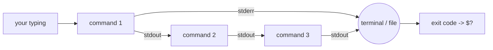

# Terminal Fundamentals

## 1. Learning Objectives

After this lesson you will be able to:

- [ ] Navigate a filesystem entirely from the command line: change directory, list contents, find files.
- [ ] Create, copy, move, and delete files and directories without a file manager.
- [ ] Explain what a *pipeline* is and combine small commands to answer questions about data.
- [ ] Redirect output into files, append to files, and capture error output separately.
- [ ] Read a command's *exit code* and use it to tell success from failure.
- [ ] Quote and escape paths correctly, including names that contain spaces.

## 2. Prerequisites

- [01-COMPUTER-FOUNDATIONS/files-and-processes.md](../01-COMPUTER-FOUNDATIONS/files-and-processes.md)
  — a file is bytes on storage; a process is a running program. The terminal runs processes and
  names files, so that model is the foundation here.
- [02-PROGRAMMING-FUNDAMENTALS/input-and-output.md](../02-PROGRAMMING-FUNDAMENTALS/input-and-output.md)
  — programs read input and write output. This lesson connects that idea to *chains* of programs.

**Environment used in this lesson:** every transcript below was executed on the author's machine —
Windows 11 with Git Bash (bash 5.3.15, GNU coreutils). On macOS the commands are identical; on a
real Linux terminal they are identical except where noted. Windows-only behaviour is flagged
explicitly.

## 3. Introduction: Why the Terminal

A graphical file manager does anything a human hand can do to one file at a time. The terminal does
anything a *script* can do to any number of files, and it remembers nothing you do not tell it to
remember — which means you can write what you did down and repeat it exactly. That repeatable
record is the seed of every automation you will ever build: the build scripts, the deployment
steps, the CI pipelines in later subjects.

The mental shift is small but real: in a GUI you select an object and pick an action; in a shell
you type an *action* and name its *arguments*. Everything in this lesson is one of those two
things — the action (command) and its arguments (paths, options).

## 4. The Problem It Solves

Imagine renaming 400 files from `IMG_1234.jpg` to `zanzibar-001.jpg`-style names, or counting how
many times each error string appears in a 50,000-line log, or copying only the `.csv` files newer
than a certain date into a folder. In a file manager this is an afternoon of clicking and a high
chance of one mistake. From the terminal it is one line — and that same line, saved in a file,
becomes a program.

## 5. Core Concepts

### The prompt, the command, and its arguments

When your shell shows you a line waiting for input, that is the *prompt*. What you type is a
*command* — the name of a program to run — followed by *arguments*: words that the program reads
as its instructions. The shell's job is to find the program named by the first word and hand it
the rest.

```text
$ grep -n alpha notes/words.txt
│    │   │     └── argument: the path to search
│    │   └──────── argument: the pattern to look for
│    └──────────── option: print line numbers
└───────────────── command: the program to run
```

An *option* (also called a flag) is an argument that starts with `-` and adjusts the command's
behaviour rather than naming a target. `grep -n` prints line numbers; `grep -c` prints a count.

### Working directory and paths

Every shell session is always *in* some directory — the *working directory*. `pwd` (print working
directory) names it. Paths come in two flavors: a **relative** path starts from the working
directory (`notes/words.txt`), an **absolute** path starts at the root (`/tmp/tools01/practice`).
On Windows, Git Bash exposes drives under `/c/`, `/d/`, … so `C:\Users\PC` is `/c/Users/PC`.

### Files are cheap, deletion is not

`touch` makes an empty file, `mkdir` makes a directory, `cp` copies, `mv` moves (and renames),
`rm` deletes. There is no recycle bin behind `rm` in the shell — the file's directory entry is
removed immediately. Treat `rm` as a loaded tool: point it at exactly what you mean, and practice
recovery paths before you need them (see
[troubleshooting/git-recovery.md](troubleshooting/git-recovery.md) for the version-control safety
net).

### Standard input, standard output, standard error

Every command starts with three connections to the outside world: **stdin** (standard input, file
descriptor 0) where it reads, **stdout** (descriptor 1) where it writes results, and **stderr**
(descriptor 2) where it writes complaints. By default all three are your screen. The power move:
you can *redirect* each one to a file instead.

### Exit codes

When a program finishes it returns a small number: **0 means success**, anything non-zero means
some failure. The shell stores it in `$?` and this is how scripts know whether to continue. It is
the single most useful invisible thing in the terminal.

### Pipelines

A *pipeline* chains commands with `|`: each command's stdout becomes the next command's stdin.
Small tools that each do one thing, composed into something greater — this is the design
philosophy of Unix and the reason a five-word pipeline can replace a hundred-line program.

## 6. How It Works



Data flows left to right through the pipeline; errors take the separate stderr channel past the
pipeline to wherever you pointed them; when the last command finishes, its exit code is in `$?`.
Explain to yourself why `command 2> errors.txt | command2` sends the *first* command's errors to
the file but the second command's errors to the screen — being able to answer that means you
understand redirection.

## 7. Practical Examples

Every command in this lesson was run in a practice folder created for the purpose. Reproduce them
in a folder of your own — that is the whole point.

**Example 1 — make a workspace and look around**

```console
$ pwd
/tmp/tools01/practice

$ ls -R .
.:
notes

./notes:
old-words.txt
reports
todo.txt
words.txt

./notes/reports:
```

- `pwd` prints where you are; `ls -R` lists recursively, so the tree structure is visible at a glance.
- The empty `./notes/reports:` line is meaningful: the directory exists and holds nothing.
- **How to run it:** `mkdir -p practice/notes/reports`, `touch practice/notes/todo.txt`, then
  create a text file and repeat the listing.

**Example 2 — count things without opening them**

```console
$ cat notes/words.txt
alpha
beta
alpha
gamma
beta
alpha

$ wc -l notes/words.txt
6 notes/words.txt

$ sort notes/words.txt | uniq -c
      3 alpha
      2 beta
      1 gamma

$ grep -n alpha notes/words.txt
1:alpha
3:alpha
6:alpha

$ grep -c alpha notes/words.txt
3
```

- `sort` puts lines in order; `uniq -c` collapses *adjacent* duplicates and counts them. That
  ordering dependency is why `uniq` almost always follows a `sort` in a pipeline.
- `grep -n` shows where matches are; `grep -c` answers "how many" directly.

**Example 3 — exit codes tell success from failure**

```console
$ grep delta notes/words.txt
exit code: 1
```

- No output and exit code **1**: `grep` found nothing. Zero would mean it found something.
  This is not an error — it is an answer.
- **Rule of thumb:** every command "fails" for a different reason and says so on stderr; the exit
  code is the machine-readable version of that story.

**Example 4 — append, redirect, and capture errors**

```console
$ echo 'line one' > log.txt && echo 'line two' >> log.txt && cat log.txt
line one
line two

$ cat notes/does-not-exist.txt 2> failed.txt; echo "exit code: $?"
exit code: 1

$ cat failed.txt
cat: notes/does-not-exist.txt: No such file or directory

$ cat notes/does-not-exist.txt > out.txt 2>&1; echo "exit code: $?"
exit code: 1
$ wc -c < out.txt
57
```

- `>` truncates and writes; `>>` appends. `2>` reroutes the stderr channel only — the message
  lands in the file, the screen stays clean.
- The failing `cat` still exits **1** with its output redirected: `$?` is the *command's* verdict,
  unaffected by where its channels go. And the 57 bytes `wc -c` counts are exactly that one error
  line (56 characters) plus its newline — the error travelled through descriptor 2 into the file.
- `2>&1` means "send descriptor 2 to wherever descriptor 1 currently goes" — one file, both
  channels, in order. (Had the `wc` been the last command with no `echo` after it, `$?` would hold
  `wc`'s verdict instead: `$?` always reports the most recent command.)

**Example 5 — find, paths, and quoting**

```console
$ find . -name '*.txt' | sort
./failed.txt
./log.txt
./notes/old-words.txt
./notes/todo.txt
./notes/words.txt
./out.txt

$ echo "$HOME"
/c/Users/PC

$ printf 'a   b	c
' | tr -s ' 	' ' '
a b c

$ cp notes/words.txt 'notes/with space.txt' && ls notes/
old-words.txt
reports
todo.txt
with space.txt
words.txt

$ rm 'notes/with space.txt' && rm notes/old-words.txt && ls notes/
reports
todo.txt
words.txt
```

- `-name '*.txt'` is quoted so the *shell* does not expand the wildcard — `find` receives the
  literal pattern and does the matching itself. Unquoted, the shell would hand over whatever files
  happened to match in the current directory.
- A filename with a space must be quoted (or escaped with a backslash) or the shell reads it as
  two arguments.
- `tr -s ' \t' ' '` squeezes runs of spaces and tabs into single spaces — the kind of one-liner
  that saves a manual editing session.

**Example 6 — a broken PATH, on purpose**

```console
$ PATH=/nowhere ls
/usr/bin/bash: line 7: ls: command not found
exit code: 127

$ PATH=/nowhere pwd
/tmp/tools01/envtest
```

- With no usable PATH the shell cannot find `ls` — exit code 127 is the shell's "command not
  found". This exact failure is the subject of
  [troubleshooting/command-not-found.md](troubleshooting/command-not-found.md).
- `pwd` still works because it is a *built-in*: code that lives inside the shell itself, not a
  separate program. Knowing which commands are built-ins explains many apparent contradictions.

## 8. Real-World Applications

- **Log triage:** `grep -c ERROR app.log`, then `sort app.log | uniq -c | sort -rn | head`
  to rank the most frequent lines — a first-response drill every backend developer knows.
- **Batch renaming and cleanup:** loops over `find` output with `mv` — used for organizing photo
  dumps, build artifacts, and data-science exports.
- **Automation:** every shell snippet you write here can be saved into a `.sh` file and run
  verbatim — by you, by your teammates, or by a CI server. That is the entire field of scripting
  built on this lesson's ten commands.

## 9. Common Mistakes

| Mistake | Why it happens | How to recognize it | How to prevent it |
|---|---|---|---|
| `>` instead of `>>` when adding to a file | The characters look similar; the GUI habit is "save over" | Previous contents gone instantly | Ask: replace or append? `>>` appends, `>` truncates |
| Unquoted paths with spaces | The shell splits words on spaces before the command sees them | `cp: cannot stat 'with'` — it names half the path | Quote every path you type: `cd "My Folder"` |
| Unquoted `*` globs reaching the wrong command | The shell expands wildcards before the command runs | `grep` receives 40 filenames instead of one pattern | Quote the pattern: `find . -name '*.txt'` |
| Ignoring exit codes | The terminal still shows a prompt after a failure | Scripts "succeed" while doing nothing | Read `$?`; in scripts use `set -e` deliberately |
| Trusting `rm -r` on a variable path | A variable expands empty and the command widens | Deletes the parent instead of the child | Echo the command first; work in a practice folder |
| Expecting shell changes to persist | Each terminal session starts fresh | `export`ed variable gone in the next window | Put permanent changes in shell startup files or the OS settings (see [environment-variables.md](environment-variables.md)) |

## 10. Best Practices

- **Think in pipelines, not in programs.** Before writing a script, ask: do `sort`, `uniq`, `grep`,
  `wc`, or `cut` already answer this? Composing beats authoring.
- **Read the error before the internet.** Shells print specific messages
  (`No such file or directory`, `Permission denied`, `command not found`); each one points at a
  different layer of the problem.
- **Quote everything that names a file.** It costs two keystrokes and eliminates a whole bug class.
- **Prefer relative safety:** run `rm -r` on the smallest possible target, never on `.` or `$VAR`
  you have not just printed.
- **Make one change, observe, then continue.** The terminal's feedback loop is fast; use it —
  type a command, look at its effect, then type the next.

## 11. Limitations and Trade-Offs

- The shell is a poor editor: serious text manipulation belongs in a program or an editor, not in
  chained `sed` one-liners you cannot read next week.
- Windows is not Unix. Git Bash gives you the Unix tools, but file permissions, line endings, and
  process behavior are emulated — [windows-development-environment.md](windows-development-environment.md)
  and [linux-fundamentals.md](linux-fundamentals.md) explain where the seams are.
- Long pipelines become unreadable; around four stages, factor the middle into a script file with
  a name that says what it does.

## 12. Practical Exercises

Work in a disposable folder (`mkdir practice && cd practice`). Nothing here needs sudo, network
access, or touching your real files.

### Introductory

1. **Reproduce every example.** Type — do not copy — Examples 1–5 into your own practice folder.
   **Completion criteria:** your terminal shows the same kinds of output, and you can say what
   each command does without notes.
2. **The exit-code ladder.** Run `true`, `false`, `ls /no/such/place`, and `grep x /etc/hostname`
   (or any file you have), printing `$?` after each. **Completion criteria:** you can predict the
   exit code of each before running it, and explain why `false` "fails" without an error message.

### Intermediate

3. **Count a file three ways.** For a text file of your choosing, produce (a) the line count,
   (b) the word count, (c) the number of lines containing a pattern you choose — using `wc` and
   `grep` only. **Completion criteria:** all three answers printed, and you explain which command
   answers which question directly versus through a pipeline.
4. **Separate the channels.** Run a command that fails (`cat missing.txt`), capture stderr to one
   file and stdout to another, then merge them into one file with `2>&1` and prove the order was
   preserved with `cat -n`. **Completion criteria:** three files exist and their contents show
   which channel carried what.

### Independent problem-solving

5. **Design your own report.** You have a folder of at least ten files of mixed types. Using only
   the commands in this lesson, produce a one-page text report: how many files of each extension
   exist, the five largest, and the total size. State the problem first as three commands, then
   run them. **Completion criteria:** the report prints from a clean shell, and you can re-run the
   same commands tomorrow and get an updated answer.
6. **Break it on purpose, then fix it.** Start a subshell with `bash`, clear its PATH
   (`PATH=/nowhere`), and recover by rebuilding it from the parent's value without exiting the
   subshell. **Completion criteria:** `ls` works again inside that subshell, and you can explain
   why `pwd` kept working while `ls` did not.

*Solutions: attempt first. Diagnosis-oriented solutions live in
[troubleshooting/exercises.md](troubleshooting/exercises.md).*

## 13. Knowledge Check

1. `grep -rn "TODO" src > todos.txt` — what ends up on the screen, in `todos.txt`, and what does
   the shell report in `$?` if `src` does not exist?
2. Why does `sort data.txt | uniq -c` give correct counts but `uniq -c data.txt` often does not?
3. When would you *not* reach for a pipeline? Give one situation where an editor or a small
   program in Python is the better tool.
4. What is the difference between `2> errors.txt` and `> out.txt 2>&1`?

## 14. Completion Criteria

Observable evidence that you have understood this lesson:

- [ ] You can navigate to any folder on your machine using only `cd`, `pwd`, and `ls`
- [ ] You can state, without notes, what `>`, `>>`, `2>`, and `|` each do
- [ ] You have run a pipeline of at least three commands and explained each stage
- [ ] You can quote a path with a spaces in it and explain why the quotes are needed
- [ ] You can check `$?` and say whether the last command succeeded
- [ ] You reproduced the broken-PATH experiment and recovered from it

## 15. Summary

- The terminal runs a **command** plus **arguments**; the shell finds the program and passes them on.
- Everything starts in a **working directory**; paths are absolute or relative to it.
- **stdin, stdout, stderr** are three channels — `>`, `>>`, and `2>` redirect them independently.
- **Pipes** (`|`) feed one command's output into the next; `sort | uniq -c` is the archetype.
- **Exit codes** (`$?`) are the machine-readable verdict: 0 is success, 127 is "not found".

## 16. Next Steps

- Next lesson: [windows-development-environment.md](windows-development-environment.md) — which
  shell to use on Windows, what PowerShell and Git Bash each are for, and where WSL fits.
- Practice: diagnosis drills in [troubleshooting/exercises.md](troubleshooting/exercises.md).
- Applied work: every project from [20-PROJECT-LABORATORY](../20-PROJECT-LABORATORY/README.md)
  onward happens in this environment.
