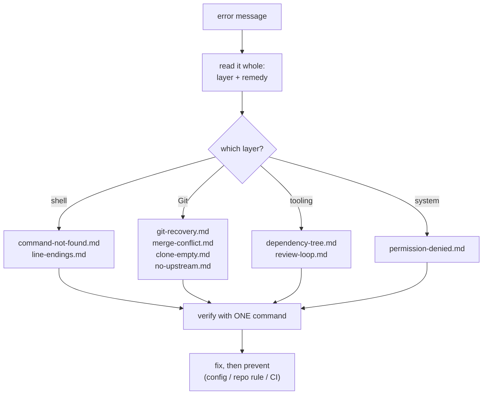

# troubleshooting/ — Diagnosis Guides and Exercises

A professional is not someone who never breaks the environment; it is someone who has a *procedure*
when it breaks. Every guide here follows the same shape — **Symptoms → Diagnosis → Fix → Prevent** —
and every command transcript inside one was executed on the author's machine (Git Bash on Windows,
Git 2.55.0) unless the guide explicitly marks a block an illustration.

## The method (works on any guide below)

1. **Read the actual error, whole.** The first line names the *layer*; the last line often names
   the *fix command*. Do not skim to a search engine before reading.
2. **Locate the layer.** Shell (PATH, syntax, quoting) → tool (Git state, package manager) →
   system (permissions, OS) → network/remote (URLs, auth). The guides below are ordered by layer.
3. **Reproduce on demand.** A bug you cannot trigger on purpose is a bug you cannot verify fixed.
4. **Change one thing, observe, then continue.** Same discipline as
   [../02-PROGRAMMING-FUNDAMENTALS/debugging-fundamentals.md](../../02-PROGRAMMING-FUNDAMENTALS/debugging-fundamentals.md),
   applied to environments.
5. **Prevent it in the repository, not in your memory** — `.gitattributes`, `.gitignore`,
   lockfiles, CI. If the fix lives only in your head, you will repeat this guide personally.

## Guide index

| Guide | Layer | Symptom it owns |
|---|---|---|
| [command-not-found.md](command-not-found.md) | shell | `command not found`, `'X' is not recognized`, stale PATH |
| [line-endings.md](line-endings.md) | shell / Git | whole-file diffs, `LF will be replaced by CRLF` warnings |
| [permission-denied.md](permission-denied.md) | system | `Permission denied`, `Operation not permitted`, chmod confusion |
| [git-recovery.md](git-recovery.md) | Git | "my commit/file is gone", detached HEAD, `reset --hard` regret |
| [merge-conflict.md](merge-conflict.md) | Git | conflict markers, `UU` status, merge stuck in progress |
| [clone-empty.md](clone-empty.md) | Git / remote | clone succeeds but working tree is empty / wrong branch |
| [no-upstream.md](no-upstream.md) | Git / remote | `has no upstream branch`, bare `git push` failing |
| [dependency-tree.md](dependency-tree.md) | tooling | broken install, `node_modules` doubt, lockfile drift |
| [review-loop.md](review-loop.md) | platform | stuck PR: stale branch, red checks, cold threads |

## Exercises (the graded practice for this subject)

[exercises.md](exercises.md) turns these guides into drills: each task puts your repository or
environment into a *real* broken state — created by you, on purpose — and requires diagnosis,
repair, and a stated prevention. They are the practice half of this subject's completion
requirements; the transcripts in the guides are the answer keys you may consult *after* attempting.

## When you are genuinely stuck

Run the guide's diagnosis block, then reduce: the smallest command that still fails, in the
smallest environment (a fresh `mkdir scratch && cd scratch`). If a fresh shell in a fresh folder
*works*, the problem is state you brought with you — and state is exactly what every guide here
knows how to find.
