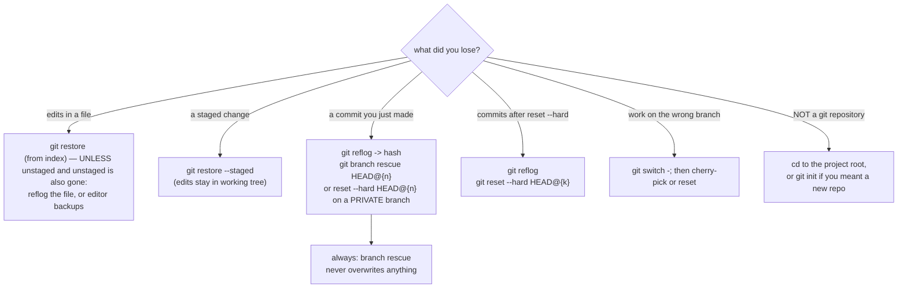

# "my commit / file is gone" — Git recovery procedures

**Layer:** Git. **Symptoms:** `git log` lost commits you remember; a file's edits vanished;
`fatal: not a git repository` outside a repo; `HEAD (no branch)` and your work floating.

## The recovery map



Every arrow's command was executed in the author's sandbox; the transcripts follow. **The first
command of any recovery is `git reflog`** — it costs nothing and shows where `HEAD` has been.

## Procedure 1 — uncommitted file edits vanished

`git restore <file>` (or an editor discard, or a checkout of a branch) overwrites working-tree
edits. The **index's** copy is your undo; if the change was staged first, unstage-then-restore is
two steps (each direction demonstrated in [../git-fundamentals.md](../git-fundamentals.md),
Example 3). If *nothing* of the file remains (deleted + committed deletion): `git log -- <file>`
finds the last commit holding it, then `git restore --source=<commit> -- <file>` brings that
version back to the working tree.

**Honest limit:** pure working-tree edits that were *never staged* and got destroyed by
`restore --hard` are *gone* — Git never saw them. That is why `git stash -u` before risky moves
exists.

## Procedure 2 — commits lost to `reset --hard` (executed, both directions)

```console
$ git reset --hard v0.1
HEAD is now at 19c50b0 Add greet() and a tiny app
$ git log --oneline
19c50b0 Add greet() and a tiny app            # history "lost" after this point

$ git reflog | head -5
c316a70 HEAD@{0}: commit (amend): Print v2 in app (amended message)
e018eaa HEAD@{1}: reset: moving to HEAD
e018eaa HEAD@{2}: commit: Print v2 in app
19c50b0 HEAD@{3}: commit (initial): Add greet() and a tiny app

$ git reset --hard HEAD@{1}
HEAD is now at c316a70 Print v2 in app (amended message)
$ git log --oneline
c316a70 Print v2 in app (amended message)
19c50b0 Add greet() and a tiny app             # fully restored
```

- The reflog entry for the reset (`HEAD@{1}: reset: moving to HEAD`) is your return ticket —
  `HEAD@{n}` addressing is the *local* breadcrumb trail explained in
  [../git-fundamentals.md](../git-fundamentals.md) Example 4.
- **Safer variant when you just want the work back on a branch:** `git branch rescue <hash>` —
  creates a new name pointing at the old commit without moving anything. Recover first, tidy
  second.
- **Scope of this power:** reflog is per-clone, ~90 days, and vanishes if `.git` is deleted. It
  does **not** recover anything already *pushed-away* history for your teammates — that is
  `git revert` territory (shared) — and it never recovers never-committed edits.

## Procedure 3 — detached HEAD holding real work (executed)

```console
$ git checkout HEAD~1
Note: switching to 'HEAD~1'.

You are in 'detached HEAD' state. You can look around, make experimental
changes and commit them, and you can discard any commits you make in this
state without impacting any branches by switching back to a branch.

$ git status --short --branch
## HEAD (no branch)

$ git reflog | head -3
3034a48 HEAD@{0}: checkout: moving from main to HEAD~1
75c7eb4 HEAD@{1}: commit: three
3034a48 HEAD@{2}: commit: two

$ git switch main
$ git status --short --branch
## main
```

If you *committed* while detached: those commits are not on any branch — but the reflog entry
`checkout: moving from main to HEAD~1` plus their hashes let you name them immediately:
`git branch rescue <hash>`. (Git's own advice text in the transcript above literally prints the
two legitimate exits: `git switch -c <new-branch>` to keep working, `git switch -` to go back.)

## Procedure 4 — `fatal: not a git repository`

```console
$ git status
fatal: not a git repository (or any of the parent directories): .git
```

Diagnosis, in order: (1) you are in the wrong directory — Git searches *parent* folders upward,
so run `pwd` and `ls -a` to confirm `.git` is above you; (2) you are inside a subdirectory of a
bigger repo than you thought — `git rev-parse --show-toplevel` names the root; (3) you meant a
**new** repository — `git init -b main` (this failure was also printed live in the sandbox when a
`git request-pull` probe misfired — error text is evidence, read it literally).

## Prevention (the rules that shrink this guide)

- **`git status` before and after every risky command** — one glance tells you which procedure
  you are about to need.
- Risky-move order: `git stash -u` (untracked too) → do the thing → `git stash pop`.
- Never `reset --hard` on a branch whose commits are pushed; use `revert` on shared history, and
  `reset --soft`/`restore --staged` when you only meant to un-commit.
- Name recoveries: `git branch rescue …` first, `reset` second — moving pointers back should be a
  decision, not the first reflex.
