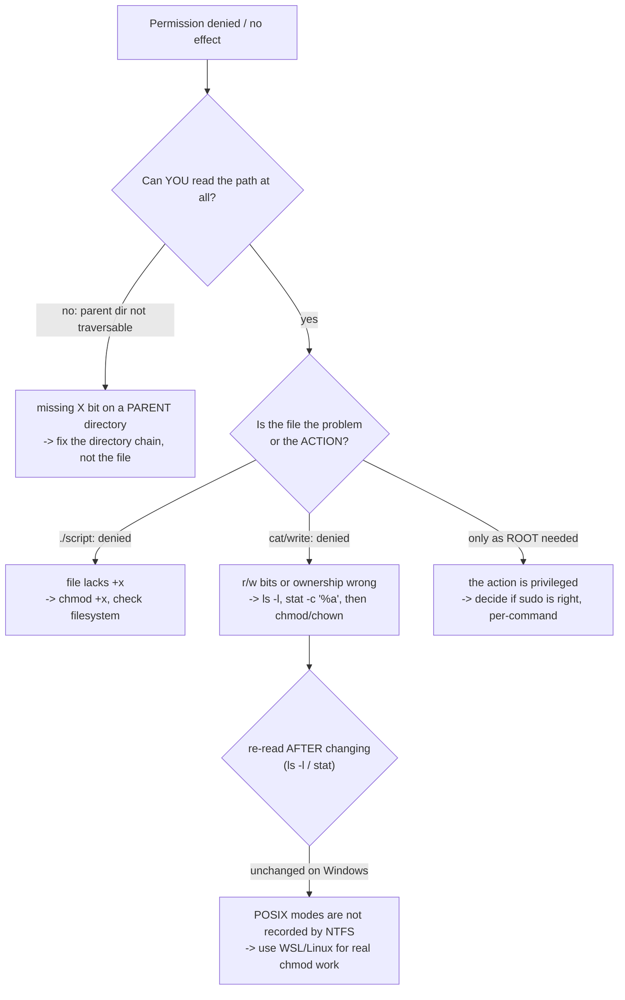

# permission denied — files, ownership, and privilege

**Layer:** system/filesystem. **Symptoms:** `Permission denied`, `Operation not permitted`,
exit code **1**, or a permission change that *claims* success and changes nothing.

## Symptoms

- `bash: ./deploy.sh: Permission denied` (the file exists — and usually lacks its execute bit).
- `cat: /etc/shadow: Permission denied` (the file exists — you may not read it).
- `chown: changing ownership …: Operation not permitted` (you are not root / not the owner).
- `chmod 600 file` succeeds, but `ls -l` shows the mode unchanged — the *silent* variant, real on
  Windows as the transcript below proves.

## Diagnosis — identify which of the three causes you have



**1. Read the mode, then re-read it after any change.** The lesson from the executed transcript:

```console
$ chmod 600 /tmp/tools01/practice/notes/words.txt
$ ls -l /tmp/tools01/practice/notes/words.txt
-rw-r--r-- 1 PC 197121 34 Oct 18 17:59 words.txt
```

`chmod` exited **0** and the mode stayed `644` — because this machine is Windows, where NTFS
stores ACLs, not POSIX modes; the Git Bash layer has nowhere durable to keep the change. **On a
real Linux filesystem the same command prints `-rw-------`** — and the *verification habit* is the
point: after any permission command, re-read state (`ls -l`, or `stat -c '%a %n'` for the numeric
mode). A tool exiting 0 only means the tool ran.

**2. Check ownership — and expect different failures per platform.**

```console
$ chown nobody /tmp/tools01/practice/notes/words.txt
chown: invalid user: 'nobody'
```

- This failure is a *lookup* failure (no such user in the Msys database). On Linux the same
  attempt without privilege gives a *permission* failure: `Operation not permitted`.
- On Linux, `ls -l`'s owner/group columns plus `stat` are the whole diagnosis; changing ownership
  needs root — which is a decision, not a reflex.

**3. Distinguish "the file" from "the path to the file."** Traversing a directory needs its `x`
bit; if a *parent* denies traversal, fixing the leaf file accomplishes nothing — walk the chain:
`ls -ld /path/to/each/parent`.

**4. Distinguish "my rights" from "the program needs privilege."** `sudo` is for actions that are
*genuinely* privileged (installing into `/usr`, binding port 80, reading root-owned service
config). It is never the answer to a wrong bit on your own file — running `chmod` as root on your
file just creates a root-owned file, moving the problem.

## Fix

| Signature | Fix |
|---|---|
| `./script.sh: Permission denied` | `chmod +x script.sh` (Linux/WSL) — *or* run it as `bash script.sh`, which needs no execute bit and is often the better habit in shared repos |
| Read/write denied on Linux you own | `chmod u+rwx file` with the smallest change that expresses intent (600 for secrets, 644 for text, 755 for scripts) |
| Denied on a file you do *not* own | `sudo chown <you> file` only when the file is truly yours to take; otherwise work with its owner |
| Directory chain blocks traversal | `chmod u+x /each/parent` — one level at a time, verifying with `ls -ld` |
| `chmod` has no effect | You are on **Windows**: real POSIX modes live in WSL/Linux — copy or edit the file there, or express the rule with ACLs (Windows side) |
| Installer/script needs admin | Re-run *that program* elevated (its own documentation will say so) — not your daily shell |

## Prevent

- **Secrets are `600`, scripts are `755`, everything else `644`** — three defaults, memorized,
  remove 90% of thought from routine modes.
- **Verify by re-reading, always** — the two-command idiom `chmod … && ls -l …` should be muscle
  memory (this guide exists because one author trusted an exit code).
- **Do not develop as root/administrator.** A daily-privilege shell turns every small mistake into
  a system-wide one; `sudo` per command keeps privilege *eventful* and logged.
- **Windows-bound projects:** keep permission-sensitive workflows (cron, shell scripts with bits,
  service users) inside WSL or CI — NTFS will not carry them, and Git's file mode support is
  similarly limited (`core.fileMode` exists for a reason).
- In repositories: state required modes in docs or provisioning scripts, so a fresh clone does not
  depend on one person's umask.
