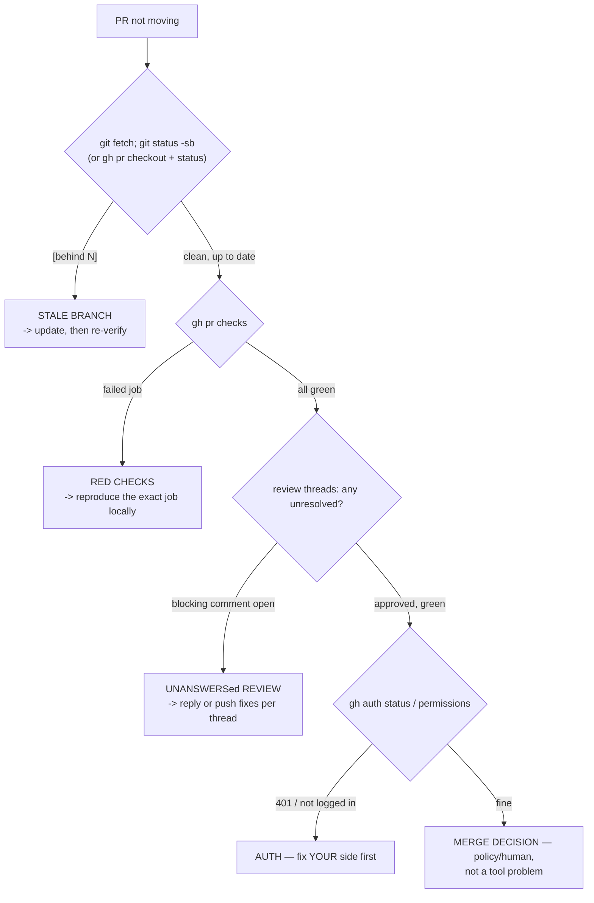

# stuck pull request — stale branch, red checks, cold threads

**Layer:** platform (Git underneath). **Symptoms:** a PR nobody is merging and nobody is
commenting on; checks red for reasons nobody has stated; conflicts appearing on a PR that was
fine yesterday; `gh` commands failing outright.

## The diagnosis order (cheapest signal first)



Follow the arrows; each box maps to a transcript below. **Never start with "the platform is
broken"** — the first two boxes are local, free, and diagnose most cases.

## 1. Stale branch (executed — a real behind-state from the sandbox remote)

After the remote's `main` advanced by two commits while a local clone stayed put:

```console
$ git fetch && git status -sb
## main...origin/main [behind 2]

$ git rev-list --count HEAD..origin/main
2
```

- `[behind 2]` is Git's own staleness marker — and the reason a "trivial" PR suddenly shows
  conflicts: the *base* moved under it. For a PR branch: `git fetch && git status -sb` after
  `gh pr checkout <n>` shows the same marker.
- **Repair, in the direction your team agreed** (pick one, deliberately):
  - `git pull --ff-only` — you are simply behind; take the new base (fast-forward, no merge commit).
  - rebase your branch onto the updated base: `git rebase origin/main`, then push with
    `--force-with-lease` *and say so in the PR thread* (safe only because the branch is yours —
    [../branching-and-merging.md](../branching-and-merging.md) §5's rule).
  - or merge the base into your branch (`git merge origin/main`) when the team reviews merge-backs.
- **Prevention:** integrate daily; a branch older than two days is a future conflict
  ([../branching-and-merging.md](../branching-and-merging.md) §10).

## 2. Red checks

```console
$ gh pr checks
# (your output) — the failing job's name and its log link
```

- **Reproduce the job locally, not the platform.** CI steps are ordinary commands —
  `npm ci && npm test` locally runs exactly what [../github-workflows.md](../github-workflows.md)
  Example 6 shows the workflow running. The overwhelming majority of "CI is broken" reports become
  "test 3 fails on a clean checkout too" within one local run — usually an uncommitted file
  (`git status`), a machine-global dependency (undeclared — see
  [dependency-tree.md](dependency-tree.md)), or a stale lock (Fix A there).
- If it **passes locally and fails in CI**, diff the environments: node/npm versions, PATH,
  operating system, environment variables ([../environment-variables.md](../environment-variables.md)).
  The runner's version lines and your `node --version` side by side usually end the argument.
- Only after a *clean local run* fails *only* in CI does the workflow file itself deserve reading —
  runner image drift, a pinned action that moved, a secret that expired (illustration-level detail
  until you are authenticated; this machine's `gh auth status` truthfully reports
  `You are not logged into any GitHub hosts` — auth problems on *your* machine are diagnosed in
  [../github-workflows.md](../github-workflows.md) Example 5, not guessed at).

## 3. Cold threads and the human layer

The platform-specific half — **shape, not captured sessions** (this machine is unauthenticated, so
these are labelled illustrations):

- **An open `[blocker]` comment is the PR's real status**, regardless of green checks
  ([../pull-requests-and-code-review.md](../pull-requests-and-code-review.md) §5 kinds). Every
  thread should end in `Resolved` — either code changed or a reason was agreed, and *both* are
  written in the thread. An unanswered blocker is not "pending"; it is a decision waiting to be
  made.
- **Stated next action beats presence.** A PR with no movement needs one sentence from someone:
  "needs your answer on X", "pushing the test fix tomorrow", "splitting this per review".
  Silence is the only truly stuck state — the tool is never what is holding it.
- **Red checks + open blockers + stale base together** almost always mean one thing: the PR should
  be **drafted or closed and split** — resurrecting a 3-week-old branch is usually slower than
  three fresh 100-line PRs. Closing a PR wastes nothing: the branch keeps its commits.

## Fix — the quick reference

| Finding | Action |
|---|---|
| `[behind N]` | `git pull --ff-only` (just behind) or rebase/merge the base into your branch; push; note it in the thread |
| Failing check | Reproduce locally (`npm ci && npm test`); fix the *cause* (undeclared dep, stale lock, real bug); push |
| `gh` 401 / "not logged in" | `gh auth status` → `gh auth login`; never "fix" by force-pushing |
| Unresolved blocker thread | Push fixes + reply `fixed in <sha>`, or reply with reasoning and ask for agreement |
| Approved + green + up to date | Merge per policy ([../pull-requests-and-code-review.md](../pull-requests-and-code-review.md) Example 3), then `git switch main && git pull --ff-only` locally |
| Unsalvageable age/size | `gh pr close --comment "splitting into smaller PRs"` — closing is a normal, professional outcome |

## Prevent

- **Branches ≤ ~2 days old and PRs ≤ ~400 lines** — the two numbers that keep every box above
  green by construction.
- **Turn on required checks + required review** on the default branch: red and unreviewed then
  *cannot* merge, so "stuck" is visible immediately instead of discovered later.
- **Resolve every thread explicitly** — an audit of an old PR should read as a complete
  conversation, not a fade-out.
- **Open the PR as a draft when it is early** — drafts ask for design feedback *before* CI and
  review mechanics start counting, which stops the "is this ready?" silence in the first place.
