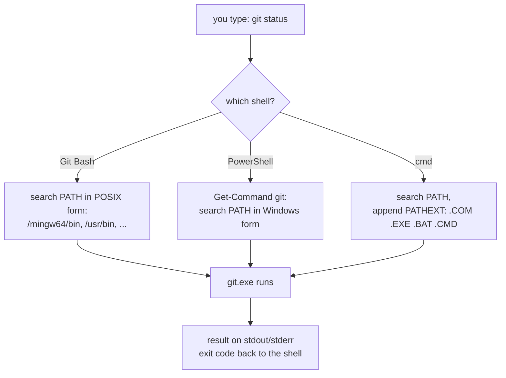

# Windows Development Environment

## 1. Learning Objectives

After this lesson you will be able to:

- [ ] Name the three shells Windows ships and say what each one is actually for.
- [ ] Run PowerShell and cmd commands, and explain when Git Bash is the right tool instead.
- [ ] Read your own `PATH` and explain how Windows decides whether a command name resolves.
- [ ] Check the PowerShell execution policy on your machine and say what it protects against.
- [ ] State what WSL is, whether it is installed on your machine, and what installing it would change.
- [ ] Choose a shell deliberately for a task instead of defaulting to whichever window is open.

## 2. Prerequisites

- [terminal-fundamentals.md](terminal-fundamentals.md) — commands, arguments, exit codes, and PATH
  are introduced there; this lesson applies them to Windows' three shells.
- [01-COMPUTER-FOUNDATIONS/software-and-operating-systems.md](../01-COMPUTER-FOUNDATIONS/software-and-operating-systems.md)
  — what an operating system kernel and userland are. WSL is best understood as two userlands
  answering to one kernel.

**Environment used in this lesson:** all transcripts were executed on the author's machine —
Windows 11 (build 26100), Windows PowerShell 5.1, Git Bash 5.3.15. The PowerShell output was
captured through a pipe, so line endings in the raw capture were CRLF; they are shown here
normalized. The WSL transcript is the machine's genuine response: **WSL is not installed on the
author's machine**, which makes it a real "before" picture rather than a staged one.

## 3. Introduction

"Windows" is not a shell — it is a kernel with *three* command-line userlands sitting on top, and
picking the wrong one is the most common early Windows dev-environment mistake. You do not need
all three daily, but you need to know they exist, what each is good for, and how a command name
like `git` becomes a running `git.exe`. That resolution is the same story as Linux — look up
`PATH` — with Windows-specific syntax layered on top.

## 4. The Problem It Solves

Two problems, historically. First: Unix development tools are written for POSIX shells; without a
compatibility layer, every tutorial assumes tools you do not have. Git Bash solves that by shipping
hundreds of Unix utilities alongside Git itself. Second: full Linux tooling (apt, systemd, real
`chmod`) needs a Linux kernel — not a compatibility layer — which is what WSL provides, when you
actually need it. Windows PowerShell, meanwhile, exists because Windows itself (registry, services,
certificates, WMI) is not scriptable from a Unix shell.

## 5. Core Concepts

### The three shells

| Shell | What it is | Reach for it when |
|---|---|---|
| **Git Bash** | A POSIX (bash) environment shipped with Git for Windows, plus coreutils | You are following a Unix-style tutorial, running `.sh` scripts, or doing anything this subject's exercises do |
| **Windows PowerShell** | Microsoft's task automation shell — its cmdlets speak to Windows itself | Managing Windows: services, registry, execution policy, installed programs, user environment variables |
| **cmd.exe** | The legacy DOS-era interpreter | A Windows program's documentation says "run `cmd /c …`", or you are pasting a one-line legacy command. Never for new work |

`PowerShell 7` (`pwsh`) is the modern, cross-platform successor to Windows PowerShell 5.1. Only
5.1 is guaranteed present on Windows; this machine has 5.1, as the transcript below shows.

### How a command name becomes a program

When you type `git`, the shell searches the directories in `PATH`, in order, for a matching
executable. The first hit wins. This is why "command not found" after an installer usually means
one thing: the installer added a directory to `PATH` and your *already-open* shell never re-read
it.

### WSL: a real Linux kernel, not an emulator

Windows Subsystem for Linux runs genuine Linux binaries on a lightweight kernel interface, with
the Linux filesystem mounted under `\\wsl$` / `/mnt/c`. It is what you install when you need
Docker's Linux containers, `apt`, or a production-parity server environment. It is *not*
installed by default — as this machine proves below.

### Execution policy: Windows' guard on scripts

PowerShell will not run `.ps1` scripts until a policy allows it. The policy is deliberately not a
security boundary against a determined attacker — Microsoft's own documentation says so — it is a
speed bump against *accidentally* running scripts you did not mean to. `RemoteSigned` (this
machine's `CurrentUser` policy) means locally written scripts run, downloaded ones need a signature
or an explicit unblock.

## 6. How It Works



All three shells consult the same underlying `PATH`; they differ in search conventions and what
they append (`cmd` adds `PATHEXT` extensions automatically, bash tries the name as-is first). The
diagram's practical consequence: *if the three shells disagree about whether `git` exists, they
are reading different PATH snapshots or different syntax — not different installs.*

## 7. Practical Examples

**Example 1 — PowerShell: the machine's own report card**

```powershell
PS> Get-ExecutionPolicy -List | Format-Table -AutoSize

        Scope ExecutionPolicy
        ----- ---------------
MachinePolicy       Undefined
   UserPolicy       Undefined
      Process       Undefined
 CurrentUser    RemoteSigned
 LocalMachine       Undefined

PS> [Environment]::OSVersion.VersionString
Microsoft Windows NT 10.0.26100.0

PS> $PSVersionTable.PSVersion.ToString()
5.1.26100.9711

PS> (Get-Command git).Source
C:\Program Files\Git\mingw64\bin\git.exe
```

- The most specific *defined* policy wins: `CurrentUser` is `RemoteSigned`, so that is the rule in
  force. Everything above it (MachinePolicy, UserPolicy) is undefined — organizations set those
  by Group Policy to override you.
- `(Get-Command git).Source` is PowerShell's equivalent of `which git` — and it answers with the
  full path, so you can see *which* git you are about to run.
- **How to run it:** open PowerShell (`Win+X` → Terminal) and type the lines after `PS>`.
- **Assumptions:** Windows PowerShell 5.1, Git for Windows installed with default options.

**Example 2 — the PATH that all three shells inherit**

```powershell
PS> $env:PATH -split ";" | Select-Object -First 5

C:\Program Files\Git\mingw64\bin
C:\Program Files\Git\usr\bin
C:\Users\PC\bin
C:\Program Files\Common Files\Oracle\Java\javapath
C:\Program Files (x86)\Common Files\Intel\Shared Libraries\redist\intel64\compiler
```

- The same list, from Git Bash's side: `echo "$PATH" | tr ':' '\n'` prints the *same* directories
  in POSIX form (`/mingw64/bin`, `/usr/bin`, …) because Git Bash translates `PATH` on startup.
- Note Git's own directories sit **first** — the installer put them there, which is why typing
  `git` finds Git for Windows' copy rather than anything else.
- **Windows rule:** edits to `PATH` apply to *new* processes. Open a fresh terminal after
  changing it; existing windows keep the old value.

**Example 3 — cmd.exe: the legacy shell, in its own dialect**

```bat
C:\> ver

Microsoft Windows [Version 10.0.26100.9711]
```

- Same build number as PowerShell reported — two shells, one kernel.
- cmd uses `%VAR%` for environment variables where PowerShell uses `$env:VAR` and bash uses `$VAR`.
  Knowing all three spellings lets you paste a command from any documentation without guessing.

**Example 4 — WSL: a genuine "not installed" transcript**

```console
$ wsl --status
The Windows Subsystem for Linux is not installed.
You can install by running 'wsl.exe --install'.
```

- This is the author's machine speaking, not a mock-up. The raw bytes of `wsl.exe`'s output are
  UTF-16, so a capture through a Unix pipe shows them spaced out (`T\0h\0e\0 …`); the message
  above is the same output read correctly.
- **What installing would change:** you would get a real Ubuntu userland (`apt`, real `chmod`,
  `/home/...`), and Linux-targeting tutorials would run unmodified — at the cost of ~1 GB and a
  second set of update chores. Install it when a tool you actually need demands it, not because a
  checklist told you to.

**Example 5 — Git Bash is a POSIX world of its own**

```console
$ uname -a
MINGW64_NT-10.0-26100 <hostname> 3.6.9-b4195d69.x86_64 2026-06-06 17:49 UTC x86_64 Msys

$ bash --version | head -1
GNU bash, version 5.3.15(1)-release (x86_64-pc-cygwin)

$ which git
/mingw64/bin/git
```

- *(The machine's hostname is replaced with `<hostname>`; everything else is unmodified output.)*
- `uname` reports **Msys**, not Linux — this is a compatibility layer, and lessons that care about
  real kernel behavior say so. That distinction is the subject of
  [linux-fundamentals.md](linux-fundamentals.md).

## 8. Real-World Applications

- **Team onboarding:** "which shell, which PATH, which version" is the first hour of every Windows
  dev-setup; the commands above are the checklist.
- **Build troubleshooting:** a build that works in one window and fails in another is almost
  always a PATH snapshot difference — the diagnosis is comparing `Get-Command <tool>.Source`
  across the two shells.
- **CI parity:** GitHub Actions `windows-latest` runners are PowerShell-first; reading logs from
  them requires exactly this literacy.

## 9. Common Mistakes

| Mistake | Why it happens | How to recognize it | How to prevent it |
|---|---|---|---|
| "Command not found" right after installing a tool | The installer updated PATH; your terminal was already open | Fresh window finds it, old one does not | Restart the terminal (or Explorer) after installs |
| Using `rm`/`ls` in PowerShell and cmd | Tutorial assumed a Unix shell | `rm : The term 'rm' is not recognized…` — PowerShell's alias may *look* like rm but behaves differently | Pick Git Bash for Unix-style work; learn `Get-ChildItem`/`Remove-Item` for PowerShell |
| Installing WSL "because everyone says so" | Checklist culture | A 1 GB download you then maintain and rarely use | Install when a concrete tool needs a Linux kernel |
| Fighting the execution policy with `-ExecutionPolicy Bypass` everywhere | Script blocked once, so it is bypassed forever | Machine runs any `.ps1` silently | Set a per-user `RemoteSigned` policy once, for scripts you wrote |
| Editing PATH in the GUI while a shell is open, then "it did not work" | Changes apply to new processes only | Old window broken, new window fine | Open a fresh terminal to verify |
| Assuming cmd is "the Windows terminal" | Historical default | No Unicode, no pipes of objects, no functions | Use cmd only when a doc explicitly requires it |

## 10. Best Practices

- **Adopt one daily driver.** For this course: Git Bash for exercises (they are POSIX), PowerShell
  when the task is Windows itself. Mixing mid-task causes half the confusion this lesson exists to
  prevent.
- **Verify versions, do not assume.** `$PSVersionTable.PSVersion`, `bash --version`,
  `git --version` — three lines that end version debates permanently (see
  [VERSIONS.md](../VERSIONS.md) for this repository's pinned baselines).
- **Fix PATH once, properly.** Edit the *user* PATH via System Properties → Environment Variables,
  not with `setx` one-offs or per-session `export`s — then open a new terminal.
- **Treat WSL as a second machine you own.** If you install it, give it the same update and
  backup discipline you give Windows.

## 11. Limitations and Trade-Offs

- Git Bash is a compatibility layer: POSIX permissions are emulated and do not survive onto the
  NTFS files they "protect" (demonstrated in [linux-fundamentals.md](linux-fundamentals.md)).
  Anything permission-critical belongs in real Linux (WSL or a server).
- Windows PowerShell 5.1 is in maintenance mode; `pwsh` 7+ is where cross-platform PowerShell is
  going, but 5.1 is what a stock Windows guarantees — scripts that must run anywhere should stick
  to the common subset.
- Path translation between `C:\...`, `/c/...`, and `\\wsl$\...` is a permanent tax when a workflow
  spans shells. Pick a path style per project and stay in it.

## 12. Practical Exercises

### Introductory

1. **Run Example 1 on your machine.** **Completion criteria:** you can state your own OS build,
   PowerShell version, execution policy in force, and the full path of the `git` you are running —
   from output you produced.
2. **The same command in three shells.** Run `git --version` in Git Bash, PowerShell, and cmd.
   **Completion criteria:** all three answer, and you can say why (one PATH, three search rules).

### Intermediate

3. **Prove the stale-PATH theory.** With a fresh terminal, run `Get-Command <tool>.Source` for
   something on your PATH; then find a terminal that has been open for hours and run it again
   after changing the PATH in the GUI. **Completion criteria:** you observe the old/new difference
   yourself and describe the mechanism in one sentence.
4. **Read your PATH both ways.** Print it from PowerShell (`$env:PATH -split ';'`) and from Git
   Bash (`echo "$PATH" | tr ':' '\n'`). **Completion criteria:** the same directories appear in
   both lists, and you can point out which shell form each uses.

### Independent problem-solving

5. **Decide your WSL question properly.** Without installing anything, find out from your own
   machine (`wsl --status`) and from two tools you actually plan to use whether you need WSL now.
   Write a five-line decision: install / do not install, with the evidence. **Completion criteria:**
   the decision cites a real tool requirement, not a tutorial's recommendation.
6. **Shell-switching drill.** Take one command from this lesson's transcripts that ran in bash and
   re-derive it in PowerShell's own idiom (`Get-ChildItem`, `Where-Object`, `Select-Object -First`).
   **Completion criteria:** the PowerShell version produces the same *kind* of answer, and you can
   say which version you would use for automation and why.

*Solutions: attempt first; environment-diagnosis solutions live in
[troubleshooting/exercises.md](troubleshooting/exercises.md).*

## 13. Knowledge Check

1. Your new tool works in a terminal you opened yesterday but not in one opened today. Which is
   more likely, and what single command proves it?
2. What does `CurrentUser = RemoteSigned` mean in practice? What is it *not* protecting you from?
3. A tutorial says `sudo apt install x`. Which environment is it assuming, and what are your three
   options on this machine?
4. Why might Git Bash say a file is `-rw-r--r--` while Windows Explorer shows no such concept?

## 14. Completion Criteria

Observable evidence that you have understood this lesson:

- [ ] You have produced your own execution policy, OS build, and shell version transcripts
- [ ] You can name which shell to open for: running this course's exercises / managing Windows
      services / running an `.sh` script — and why
- [ ] You can locate any running program's full path with `Get-Command` or `which`
- [ ] You can explain PATH, PATHEXT, and the stale-terminal effect without notes
- [ ] You can state what WSL adds, and whether it is installed on your machine *right now*

## 15. Summary

- Windows ships **three shells**: Git Bash (POSIX work), PowerShell (Windows itself), cmd (legacy).
- All three resolve commands through **PATH**; PATH changes only reach *new* processes.
- **PowerShell 5.1** reports versions and policies via `$PSVersionTable` and `Get-ExecutionPolicy`;
  `RemoteSigned` is the sensible per-user default.
- **WSL** is a real Linux kernel for Linux-only tools — genuinely absent from this machine, and a
  deliberate install, not a reflex.
- **Git Bash is Msys, not Linux** — perfect for POSIX commands, dishonest about kernel behavior.

## 16. Next Steps

- Next lesson: [linux-fundamentals.md](linux-fundamentals.md) — the filesystem hierarchy,
  permissions, and processes, so the Git Bash caveats above become a real model of a real system.
- Practice: environment drills in [troubleshooting/exercises.md](troubleshooting/exercises.md).
- Where it is applied: [16-DEVOPS-AND-INFRASTRUCTURE](../16-DEVOPS-AND-INFRASTRUCTURE/README.md)
  assumes you can read a shell transcript on any platform.
