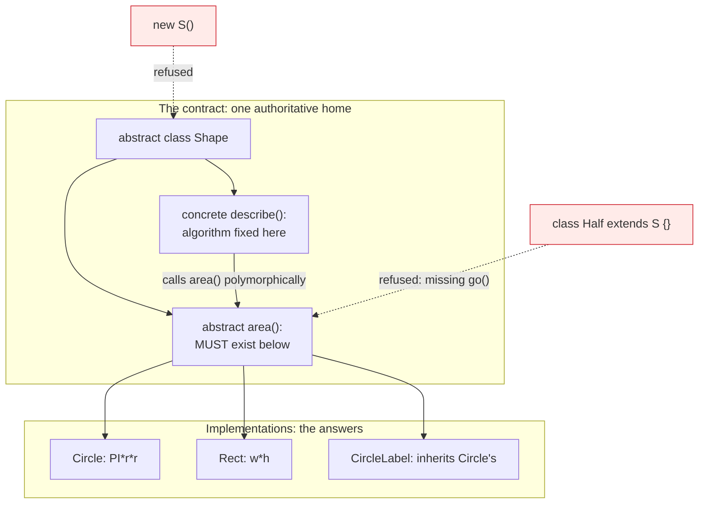

# Abstraction

## 1. Learning Objectives

After this lesson you will be able to:

- [ ] Declare an abstract class with abstract *and* concrete members, and state what each form
      promises and forbids — backed by the two executed refusals in this lesson.
- [ ] Read the template-method pattern in real code: a concrete parent method that calls an
      abstract one, executed through `Shape.describe()`.
- [ ] Apply the three-part test for whether something deserves to be abstract (meaningful base?
      real variation? shared behavior?) — and reject a case for each failure.
- [ ] Diagnose both compile failures of incomplete abstraction: instantiating the abstract
      base (`S is abstract; cannot be instantiated`) and leaving a subclass incomplete
      (`Half is not abstract and does not override abstract method go() in S`) — quoted from
      your own runs.
- [ ] Explain "leaky abstraction" with an example you can point to in this subject's own code,
      and name the mitigation.
- [ ] Choose between abstract class and interface *for the right reason* — the full decision
      framework lives in lesson 13, and this lesson states the inputs it consumes.

## 2. Prerequisites

- [inheritance.md](inheritance.md) — `extends`, constructor chaining, and the is-a sentence; the
  abstract class *is* a parent-class decision.
- [polymorphism.md](polymorphism.md) — the executed `Shape[]` loop whose design this lesson
  retroactively justifies (`Shape` was abstract there before you knew why).
- [encapsulation.md](encapsulation.md) — what a class boundary protects; abstraction decides
  what the *type* exposes vs what subclasses must supply.

**Environment used in this lesson:** every transcript executed on the author's machine —
JDK 25.0.4.1, `javac --release 21`.

## 3. Introduction

Abstraction is *designing the gap*: you write down the operations that must exist (`area()`,
`describe()`) and their promises, then leave the *how* to whoever knows the specifics. An
abstract class is Java's half-step — a class that can hold shared state and shared methods,
while refusing to exist on its own because its most important method has no answer at that
level. The two compile errors in this lesson are that refusal in action: the language, not a
style guide, prevents a "shape" that has no area from ever being built.

## 4. The Problem It Solves

Two failure modes of *concrete-first* design. First: **copy-paste contracts** — every concrete
type re-implements `area()` its own way, and callers re-learn each one; there is no single place
that says what "area" means for anything. Second: **abstract-on-fee** — `Shape` written as a
normal class with `area()` returning `0.0` "until we figure it out": now instances can exist that
lie about their most fundamental operation, and the type system cannot tell you where the truth
is still missing. The abstract class fixes both: the contract gets *one* authoritative home,
and incompleteness becomes a **compile error at the exact line where the answer is missing** —
`Half is not abstract and does not override abstract method go() in S` is the compiler pointing
at your unfinished business.

## 5. Core Concepts

### Abstract members vs abstract classes

- An **abstract method** (`abstract double area();`) is a signature with no body: subclasses
  *must* provide one — enforced by the incomplete-subclass error (Example 2).
- An **abstract class** (`abstract class Shape`) is one that has at least one abstract method
  (or is marked `abstract` to say "not instantiable" even without one): `new Shape()` is
  refused — Example 1's `S is abstract; cannot be instantiated`. The class itself is still a
  real type: references, inheritance, polymorphic calls all work — only *construction* is
  forbidden.
- Non-abstract members coexist freely: `describe()` in `Shape` is ordinary concrete code that
  happens to call an abstract one — which is the pattern's name card:

### The template method, executed

`Shape.describe()` is fixed behavior (get simple name, concatenate `area()`) that *needs an
answer only a subtype has*. The parent owns the algorithm's shape; children own the step. This
is abstraction earning its keep in one method: every future `Shape` prints itself identically
**without being told to** — polymorphism's loop ([polymorphism.md](polymorphism.md)) plus the
parent's fixed wording. (Prefix the algorithm with `final` when children must not reshape it —
a deliberate, documented narrowing, per inheritance's design-for-extension rule.)

### The three-part test: does this deserve abstraction?

1. **Is the base itself meaningful?** If every real instance is a subtype — no one ever needs
   "a generic shape" — the base exists only to be extended → abstract (or interface). If plain
   `Shape` instances are legitimate, abstraction *removes* a real object.
2. **Is there real variation — now?** One subclass and no second in sight = premature: you've
   written a contract nobody has had to satisfy yet. (The curriculum's rule: abstract at the
   *second* concrete implementation, refactor the first duplication away when it appears.)
3. **Is there shared behavior or state worth one home?** If yes, abstract class over interface
   (the interface half of the decision is lesson 13's).

Run the three in order; the first *no* ends the discussion. Example 4 (exercise 5's format) is
graded on exactly this reasoning.

### Leaky abstractions — the tax

An abstraction leaks when callers must know its internals to use it correctly. In *this
subject's own code:* the collections lesson's `List.of(...)` "immutable" abstraction leaks the
moment you catch `UnsupportedOperationException` — an implementation detail (backing array
replaced by error) surfacing through the promised interface. Examples of handling: document the
throw as part of the contract (what `List.of` does), or narrow the promise ("read-only view",
honest) — the mitigation is always **promising what you actually keep**. Inevitability is the
point: every abstraction leaks somewhere; design decides *where*, and contracts decide *whether
callers are surprised when it does*.

## 6. How It Works



Left column is *what must be true*; right column is *who makes it true*; the arrows are
obligations the compiler tracks. The two red refusals are the same mechanism seen from both
sides: an incomplete answer cannot be instantiated (top), and an unanswered question cannot be
inherited away (bottom).

## 7. Practical Examples

**Example 1 — refusing the impossible instance (executed)**

```java
abstract class S { abstract void go(); }
public class NoShape {
    public static void main(String[] a) {
        S s = new S();
    }
}
```

```console
$ javac --release 21 NoShape.java
NoShape.java:4: error: S is abstract; cannot be instantiated
        S s = new S();
              ^
1 error
$ echo $?
1
```

- The error names the class and the act — no "possibly", no warning: an object whose defining
  operation (`go()`) has no implementation *cannot exist*. Note the reference declaration `S s`
  is fine (you may name the type); only `new` is refused.
- Interfaces produce the *same* error shape — `Thing t = new Thing()` on an interface prints
  `Thing is abstract; cannot be instantiated` (executed in
  [interfaces-and-abstract-classes.md](interfaces-and-abstract-classes.md) Example 5) — Java
  treats "cannot be built, can be referenced" as one concept with two spellings.

**Example 2 — the incomplete subclass, by its exact text (executed)**

```java
abstract class S { abstract void go(); }
class Half extends S { }
public class AbsHalf { public static void main(String[] a) { } }
```

```console
$ javac --release 21 AbsHalf.java
AbsHalf.java:2: error: Half is not abstract and does not override abstract method go() in S
class Half extends S { }
^
1 error
$ echo $?
1
```

- Read the message as three facts: `Half` claims concrete (`class`, not `abstract class`),
  doesn't implement `go()`, and `go()` comes `in S`. The caret lands on the class *declaration*
  — the place the choice belongs. Two legal fixes, two different meanings: implement `go()`
  (Half is really a go-er) or declare `abstract class Half` (Half itself is still a template —
  pushing the obligation down another level, exactly how unfinished hierarchies propagate by
  *visible* design).

**Example 3 — the template method in production shape (executed; source from
[polymorphism.md](polymorphism.md) Example 1)**

The `Shape.describe()` / `CircleLabel` transcript:

```console
$ java Shapes
Circle area=3.141592653589793
Rect area=6.0
CircleLabel area=0.7853981633974483
...
```

- One parent method, three subtype answers, zero knowledge of subtypes in `describe()` — and
  `CircleLabel` prints its own name *and* its own area while inheriting **both methods from
  two different classes** (`describe` from `Shape`, `area` from `Circle`). Abstraction plus
  inheritance, one output line each.

**Example 4 — the test applied out loud (design reasoning, no run required)**

```text
"Auditable" for domain objects:  base meaningful? no (nobody needs a bare Auditable)
  -> abstract-by-interface.      variation real? yes (5 types today). shared state? no
  -> interface, not abstract class.
"AbstractList" in the JDK:      base meaningful? sometimes (a list over a fixed snapshot).
  variation real? yes (dozens of subclasses). shared state? yes (index bookkeeping).
  -> abstract class — the JDK's actual choice, for all three reasons.
```

The reasoning *is* the deliverable; each line is a test from §5 applied, and the third column
is why the same question can honestly split either way.

## 8. Real-World Applications

- **Framework base classes** — Spring's `AbstractController`, Android's `Activity` (historical
  analogues), and the JDK's `AbstractList`/`AbstractStringBuilder` are this lesson at scale:
  template methods with hooks, state managed once, subclasses filling the blanks.
- **Domain hierarchies in subject 11** (`PaymentMethod` with shared validation + abstract
  `charge()`) are the everyday use; the three-part test decides *when* your one `PaymentMethod`
  implementation should be promoted to the contract — usually when the second provider arrives.
- **Reading library design:** an API full of `Abstract*` classes is telling you where the
  framework expects variation — your extension points are the abstract methods, and everything
  else is promised-stable.

## 9. Common Mistakes

| Mistake | Why it happens | How to recognize it | How to prevent it |
|---|---|---|---|
| One-implementation abstraction | Future-proofing reflex | A contract with exactly one class — nothing polymorphic can happen | Wait for the second real variant (test 2); refactor duplication *when it exists* |
| Abstract to force behavior | Discipline anxiety | Subclasses override but call `super` anyway; nothing protected | The template pattern (Example 3) — fix the *algorithm*, not the intention |
| Fat abstract classes (10 abstract methods) | Contract-by-multiplication | Implementors hate you; every new method breaks every subclass | Narrow contracts; split by responsibility — each interface its own question |
| Pretending the base can't be instantiated *by convention* | Avoiding `abstract` keyword | `new Base()` compiles and produces a lying object | Make the refusal executable — Example 1's compile error beats a comment |
| Hiding incompleteness with default bodies | "Make it compile" reflex | Abstract method with `{ return null; }` / `0` / TODO | A lie that compiles is worse than one that doesn't — Example 2's error *is* the feature |
| Abstraction that leaks internals | Convenience wins | Callers catching implementation-specific exceptions / ordering assumptions | Promise what you keep (§5); document throws as part of the contract |
| Premature `final` on the template | Copying framework style | Children can't fix an inflexible step | `final` the *algorithm* only when steps must vary legitimately — measure first |
| Testing only one subclass | Green suite illusion | New subtype breaks parent's algorithm | Run the template across *all* implementations (polymorphism test 3) |

## 10. Best Practices

- **Abstract at the second real implementation** — the first teaches you what's common; the
  second *proves* it. (Duplication discovered once is information, not yet a design.)
- **Name abstract methods as the questions only subtypes can answer** (`area`, `charge`,
  `describeStep`) — and concrete parent methods as the algorithms that *use* those answers.
- **Keep abstract contracts small and orthogonal** — every abstract method is a tax on every
  future implementor; fewer, clearer obligations survive longer.
- **Make incompleteness loud:** never ship `{ return null; }` in an abstract-method stand-in —
  if you need an empty placeholder, the class isn't ready to be concrete (Example 2 is your
  friend).
- **Document each abstract method's promise, not just its shape** — postconditions are what
  LSP ([polymorphism.md](polymorphism.md)) will hold implementors to.
- **Where shared state is absent and variation is all you need, prefer an interface** — the
  choice framework is lesson 13's; this lesson's input is the three-part test.

## 11. Limitations and Trade-Offs

- **Java's single class inheritance** means every abstract class you choose *consumes the one
  `extends` slot* of each implementor — the deepest reason interfaces exist (lesson 13). An
  abstract class with no shared code may be actively costing subclasses their flexibility.
- **Abstraction hides cost only until you need the truth** — `List` hides resize cost until
  performance work needs it back; the leak-avoidance rule is to keep *semantic* promises
  absolute (never surprise at the API level) while letting performance remain an
  implementation detail you measure ([03-DEVELOPER-TOOLS](../03-DEVELOPER-TOOLS/README.md)'s
  measurement discipline applies to abstractions too).
- **Contracts are only as good as their tests** — an abstract method with no behavioral test in
  any subclass is a wish; the exercises' completion criteria encode this (every criterion is
  *observable output*, not a class diagram).
- **Retroactive abstraction distorts** — extracting a common parent from code written for one
  concrete case tends to enshrine that case's accidents; when refactoring toward abstraction,
  re-run the three-part test *after* extraction, not before.

## 12. Practical Exercises

### Introductory

1. **Reproduce Examples 1 and 2 exactly.** Then apply *both fixes* to Example 2: implement
   `go()`, and separately declare `Half` abstract. **Completion criteria:** four transcripts
   (original two errors + two fixes compiling) and one sentence per fix naming what the result
   now means ("Half answers go" vs "Half is still a question").
2. **Find the template.** In Example 3's source, mark which lines belong to the fixed algorithm
   and which to the pluggable step; then add a `Square extends Shape` and print the loop.
   **Completion criteria:** the annotation and one new output line — `Square area=…` — produced
   **without editing `describe()` or the loop** (state which lines you touched: the new class
   only).

### Intermediate

3. **The three-part test, six verdicts.** For each, run tests 1–3 in order and give the
   verdict (interface / abstract class / neither): a `ReportExporter` with two implementations
   and shared file-setup code; a `Point` value type; a `Command` hierarchy with one subclass
   today; a stateless `Logger` utility; an abstract `InventoryItem` with shared `restock`
   logic and four subclasses; a `Main` runner class. **Completion criteria:** six rows, each
   showing which test decided (the *first* failing test, in order), and one row where tests 1
   and 2 disagree with your first instinct — with the resolution.
4. **Break the leak, deliberately.** Take Example 3's `describe()` and change it to expose an
   internal implementation detail (e.g. `getClass().getName()` — full nested name) — then show a
   caller that depended on the old wording breaking. **Completion criteria:** before/after
   output, the "caller" that broke (write it), and your statement of which promise changed
   (hint: nothing in the type said which name form — the leak was *undocumented variation*, fix
   with a documented contract line).

### Independent problem-solving

5. **Design an abstraction you will not write yet.** Spec a form-submission pipeline with
   exactly *one* validator today. Produce: (a) the three-part test run for "abstract
   `Validator` class" — with the honest verdict; (b) the concrete single-class design you will
   ship instead, written so that extracting the contract later touches only that class (name
   the seam — one method boundary); (c) the *second* validator's arrival checklist: exactly
   which lines change when it lands. **Completion criteria:** all three parts written *before*
   any code; then a working single-validator run whose output you captured; and your commit —
   in one sentence — of *when* you would extract (a trigger, not a feeling).

*Solutions: attempt first; set practice in [exercises/README.md](exercises/README.md).*

## 13. Knowledge Check

1. Quote both executed refusals verbatim, and state which one names the *parent* (`in S`) and
   which the *child* — and why each message points where it points.
2. Why is `S s;` legal in Example 1 while `S s = new S();` is not — what can you legitimately do
   with a declared-but-unbuilt abstract reference?
3. Run the three-part test on `abstract class Shape` from this subject's own code: which line of
   the test makes it abstract, and what shared behavior exists to justify a *class* rather than
   an interface?
4. What exactly does `describe()` fix and what does it delegate? Name the pattern and one
   reason a child might *legitimately* need to override it.
5. Give one leak from this subject with its promised-vs-actual split, and the one-line contract
   change that would stop the surprise.

## 14. Completion Criteria

Observable evidence that you have understood this lesson:

- [ ] Examples 1 and 2 reproduce byte-for-byte, plus both legal fixes compile on your machine
- [ ] You added a subtype to Example 3's hierarchy and printed new output without touching the
      template method — the one-line-diff evidence
- [ ] Six three-part-test verdicts written with the deciding test named each time
- [ ] You can state the leak definition and one real leak from this curriculum's code, fixed as
      a documented promise
- [ ] You can say what *this* lesson contributes that lesson 13 builds on (the shared-state and
      shared-behavior inputs to the abstract-vs-interface choice)

## 15. Summary

- Abstract = *referenced, never built*: `new` on the base is a compile error by design
  (`S is abstract; cannot be instantiated`).
- The incomplete subclass error (`…does not override abstract method go() in S`) is unfinished
  business reported at the declaration that owes it.
- The **template method** is abstraction's daily job: parent fixes the algorithm, children
  answer the questions (`describe()`/`area()` — executed three ways).
- **Three-part test:** meaningful base? real variation? shared behavior? — first *no* wins;
  one-implementation abstraction is speculation.
- Abstractions leak; the mitigation is promising what you actually keep — and every criterion in
  this lesson was observable output, because contracts without observation are wishes.

## 16. Next Steps

- Next lesson: [interfaces-and-abstract-classes.md](interfaces-and-abstract-classes.md) — the
  other half: unlimited contracts, defaults, and the decision framework this lesson fed.
- Practice: [exercises/README.md](exercises/README.md) set 11.
- Where it is applied: [13-SOFTWARE-ENGINEERING-AND-ARCHITECTURE](../13-SOFTWARE-ENGINEERING-AND-ARCHITECTURE/README.md) —
  ports-and-adapters architecture *is* the three-part test applied to whole subsystems.
