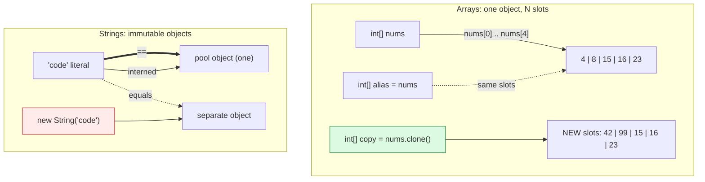

# Arrays and Strings

## 1. Learning Objectives

After this lesson you will be able to:

- [ ] Declare, initialize, index, and copy arrays — and predict when an access throws
      `ArrayIndexOutOfBoundsException` (with its real message shown by you).
- [ ] Explain jagged two-dimensional arrays and read `Arrays.toString`/`deepToString` output.
- [ ] State Java's `String` model: immutable, interned literals compared with `==`, content with
      `.equals` — with all three comparisons executed.
- [ ] Choose between `String` and `StringBuilder` for building text, and demonstrate why
      (immutability proof + chained builder output).
- [ ] Produce and read the two classic reference-type runtime errors: `NullPointerException` and
      the bounds exception — including the modern helpful NPE message.
- [ ] Transfer subject 02's array/string algorithms into Java without the off-by-one regressions.

## 2. Prerequisites

- [methods.md](methods.md) — pass-by-value of array references is what makes aliasing behavior in
  Example 1 explicable.
- [variables-and-types.md](variables-and-types.md) — `char`, numeric promotion, and reference
  defaults (`null`) are all in force here.
- [02-PROGRAMMING-FUNDAMENTALS/arrays-and-strings.md](../02-PROGRAMMING-FUNDAMENTALS/arrays-and-strings.md) —
  the same data structures in pseudocode/Python; this lesson is Java's *stricter* version.

**Environment used in this lesson:** every transcript executed on the author's machine —
JDK 25.0.4.1, `javac --release 21`. The `Account@8bcc55f`-style hash in one output varies per
run — yours will differ; that variability is itself the lesson's final point.

## 3. Introduction

Arrays and strings are where subject 02's algorithms come to live in Java — and where Java's
model makes two old habits immediately visible: **arrays are fixed-size objects** (no append —
grow by copying, a preview of subject 05's `ArrayList`), and **strings are immutable** (every
"change" is a new object). Both facts are one fact: these are *reference types*, and the rules
of references — from [methods.md](methods.md) — now apply in full.

## 4. The Problem It Solves

Fixed-size arrays are the simplest possible memory layout: contiguous slots, `length` known,
index arithmetic in one instruction — exactly why they are still the layer everything else is
built on (subject 05's structures wrap them). Immutable strings make text safe to share: any
number of methods can hold a `String` without defending it, because nothing can change it. The
*costs* of both choices are equally simple to name (copying to grow; new objects per edit), and
this lesson makes you feel each cost in a running program rather than in a paragraph.

## 5. Core Concepts

### Arrays: fixed, zero-indexed, 1:1 with their `.class`

- `int[] xs = {…}` or `new int[5]` (zeros); `xs.length` is a field, not a method.
- The JVM stores arrays as real objects (they have `.class` files — you can `javap` one), and
  `Arrays.toString(xs)` is how you *print* one — `System.out.println(xs)` instead prints the
  memory-ish default (see Example 1's `toString` usage as the correct habit).
- **Bounds are checked on every access** by the JVM: `xs[xs.length]` is guaranteed
  `ArrayIndexOutOfBoundsException` with the numbers in the message — not undefined behavior, not
  silent corruption. The safety costs one check; the error costs you nothing to read.
- **Copying is explicit:** `clone()` makes a *new* array (executed: changing the copy left the
  original untouched). Assigning (`int[] b = a;`) does the opposite — one object, two names —
  exactly the `Account` aliasing story.
- **Jagged by design:** `int[][] grid = {{1,2},{3,4,5}}` compiles because a 2-D array is *an
  array of arrays* — rows may differ in length; `grid.length` = rows, `grid[r].length` = that
  row's columns.

### Strings: immutable, and two ways to compare

- Every `String` method returns a **new** `String` (or the same one if unchanged) — the
  discarded `s.toUpperCase()` in Example 2 is not a no-op *conceptually*; the uppercased result
  simply goes nowhere. `StringBuilder` is the mutable twin for building text in loops.
- `==` on references compares **identity** (same object?), `.equals` compares **content**.
  String *literals* are interned — `"code" == "code"` is `true` because both names point at the
  pool's single object — while `new String("code")` forces a fresh object, so `==` is `false`
  while `.equals` stays `true`. One executed block, all three lines: the complete rule.
- `null` plus any method call = `NullPointerException`, and modern JDKs print a *helpful* message
  naming the variable (executed verbatim below — the message text is a JDK 14+ feature worth
  knowing when you read future traces).

## 6. How It Works



Left: `clone` draws a second box (independent slots) while plain assignment shares the first —
the same distinction as `a`/`c` vs `a`/`d` in the objects lesson, now with arrays. Right: identity
vs content — `==` is the solid line (pool only), `.equals` crosses freely; the one red node is
the `new String(...)` that breaks `==` for an innocent-looking reason.

## 7. Practical Examples

**Example 1 — arrays: read, print, copy, jagged, bounds (executed)**

```java
import java.util.Arrays;
int[] nums = {4, 8, 15, 16, 23};
System.out.println("length=" + nums.length + " first=" + nums[0]);
System.out.println("as string: " + Arrays.toString(nums));
nums[0] = 42;
int[] copy = nums.clone();            // clone makes a NEW array
copy[1] = 99;
System.out.println("original untouched: " + Arrays.toString(nums));
System.out.println("copy changed:       " + Arrays.toString(copy));
int[][] grid = {{1, 2}, {3, 4, 5}};   // jagged: rows may differ in length
System.out.println("rows=" + grid.length + " row0cols=" + grid[0].length
        + " grid[1][2]=" + grid[1][2]);
System.out.println("2D: " + Arrays.deepToString(grid));
try { System.out.println(nums[99]); }
catch (ArrayIndexOutOfBoundsException e) { System.out.println("index 99 -> " + e); }
System.out.println("new int[0].length = " + new int[0].length);
```

```console
$ javac --release 21 Arrays1.java && java Arrays1
length=5 first=4
as string: [4, 8, 15, 16, 23]
original untouched: [42, 8, 15, 16, 23]
copy changed:       [42, 99, 15, 16, 23]
rows=2 row0cols=2 grid[1][2]=5
2D: [[1, 2], [3, 4, 5]]
index 99 -> java.lang.ArrayIndexOutOfBoundsException: Index 99 out of bounds for length 5
new int[0].length = 0
```

- Lines 4–5 are the clone proof: both arrays start `[42, …]` (clone copied the *current* state,
  including the earlier `nums[0]=42`), then `copy[1]=99` moved only the copy.
- The exception message carries **both numbers** (`Index 99 … for length 5`) — JVM bounds checks
  are self-diagnosing; the `try/catch` here exists to *print* what would otherwise end the
  program (an uncaught version appears in the exercises).
- `new int[0]` is legal and useful — the canonical empty array (`length = 0`, no null check
  needed).

**Example 2 — strings: identity, content, immutability, builder (executed)**

```java
String a = "code", b = "code", c = new String("code");
System.out.println("a == b (literals) : " + (a == b));
System.out.println("a == c (new)      : " + (a == c));
System.out.println("a.equals(c)       : " + a.equals(c));
String s = "hello";
s.toUpperCase();                       // result discarded: String is immutable
System.out.println("after discarded toUpperCase: " + s);
StringBuilder sb = new StringBuilder("hello");
sb.append(" world").reverse();
System.out.println("builder chain: " + sb);
System.out.println("substring(1,4): " + "hello".substring(1, 4));
System.out.println("join(split): " + String.join(" | ", "a,b,c".split(",")));
String word = "Java";
System.out.println("length=" + word.length() + " charAt(0)=" + word.charAt(0));
for (int i = word.length() - 1; i >= 0; i--) System.out.print(word.charAt(i));
System.out.println();
try { String n = null; System.out.println(n.length()); }
catch (NullPointerException e) { System.out.println("null.length() -> " + e); }
```

```console
$ javac --release 21 Strings1.java && java Strings1
a == b (literals) : true
a == c (new)      : false
a.equals(c)       : true
after discarded toUpperCase: hello
builder chain: dlrow olleh
substring(1,4): ell
join(split): a | b | c
length=4 charAt(0)=J
avaJ
null.length() -> java.lang.NullPointerException: Cannot invoke "String.length()" because "<local7>" is null
```

- The first three lines are the *entire* `==` vs `.equals` rule — note `a == b` being `true` is
  the **interning** case, not the general one; write `.equals` always and the special case never
  bites.
- `after discarded toUpperCase: hello` — immutability proven by discard: the method *did* build an
  uppercase string; it just cannot have been *this* variable's object, because that object never
  changes. Hence `StringBuilder` for loops: `dlrow olleh` shows append + reverse chaining on a
  mutable buffer.
- The helpful NPE message (JDK 14+) names the culprit variable — when you meet one in later
  subjects, read past the first line to the `because …` clause; it is already the hypothesis.

**Example 3 — the array/string transfer hazards (from the executed error bank)**

Two errors you will meet *in your own* subject-02-to-Java ports, both already produced in this
subject's transcripts: `ArrayIndexOutOfBoundsException: Index 99 out of bounds for length 5`
(Example 1 — the loop-bound off-by-one, now with both numbers printed) and the
`NullPointerException` above (looping over an array slot you never filled — default `null` for
reference elements, per [variables-and-types.md](variables-and-types.md)'s defaults table).

## 8. Real-World Applications

- **`String` immutability is what makes strings safe as map keys, constants, and cross-thread
  values** — every `HashMap` you use in [collections-framework.md](collections-framework.md)
  depends on `hashCode` stability that mutation would destroy.
- **`StringBuilder` in hot loops** is a real optimization (string concatenation in a loop
  compiles to builder use anyway in modern javac — knowing the truth prevents both premature
  micro-optimization *and* accidental quadratic concatenation in older code you will read).
- **Bounds safety** is Java's everyday security property: parsing, slicing, and indexing bugs
  surface as catchable exceptions instead of memory corruption — the property that made
  buffer overflows a *logic bug* class rather than an exploit class in Java services.

## 9. Common Mistakes

| Mistake | Why it happens | How to recognize it | How to prevent it |
|---|---|---|---|
| `==` on strings compared by content | Primitive/Python habit | `true` for literals, `false` after `new`/computation | `.equals` (and `Objects.equals` when nulls are possible) — always |
| `println(xs)` on an array | Forgetting it is an object | `[Ljava.lang.String;@1b6d3586` gibberish | `Arrays.toString` / `deepToString` |
| Loop to `<= length` | Inclusive-range habit | `ArrayIndexOutOfBoundsException` on the last+1 | `< length`; the message prints both numbers (Example 1) |
| `String` concatenation in a big loop | `+=` reads well | Quadratic slowdown at scale | `StringBuilder` (or let javac's concatenation optimization handle modest cases) |
| Assuming `clone()` of an *object* deep-copies its arrays | Arrays lesson bleed-over | Mutating "the copy" changes the original | Arrays of objects: `clone` copies slots (references) — one level only; see collections |
| `grid[1][2]` on a *rectangular* mental model | 2-D arrays taught elsewhere | AIOOBE because row lengths differ | Remember jagged: check `grid[r].length` (executed: `rows=2 row0cols=2`) |
| `.length()` on a `null` String field | Default field felt "empty" | NPE with `because "<local7>" is null` | Defaults table; guard or initialize at declaration |
| Mutating a string in place "somehow" | Familiarity from other languages | No API exists to do it | Immutable by design — rebuild (`StringBuilder`, `substring`+concat) |

## 10. Best Practices

- **`.equals` for content, `==` only for deliberate identity checks** (enums, sentinel objects) —
  one habit, zero special cases.
- **Print arrays with `Arrays`, always** — and `deepToString` the moment nesting appears.
- **Prefer `for (int x : xs)`** when you don't need the index; classic `for` when you do (bounds
  come from `length`, not from a copied counter).
- **Build text with `StringBuilder` in loops; leave `String` everywhere else** — the split is by
  *context* (building vs holding), not by performance anxiety.
- **Initialize reference arrays deliberately** — `null` slots are a design smell; empty arrays
  (`new String[0]`) or immediate filling remove a whole NPE class.
- **Treat exception messages as data:** AIOOBE prints index and length; the helpful NPE names the
  variable — parse them instead of re-running with prints.

## 11. Limitations and Trade-Offs

- Fixed-size arrays mean growth is O(n) copy — precisely why `ArrayList` exists; knowing the
  array layer makes `ArrayList`'s amortization a *sized* fact rather than a slogan
  (subject 05).
- `String` immutability costs an object per edit — fine for typical text, wrong for byte-level
  hot loops (which is `StringBuilder`, `char[]`, or NIO's buffers territory — pragmatic
  exceptions, not refutations).
- `==`/`.equals` asymmetry is a sharp edge the language chose not to remove — the defense is the
  `.equals` habit, not a clever trick; `equals` on classes you write must be *overridden
  consistently* (a contract covered in [classes-and-objects.md](classes-and-objects.md)).
- UTF-16 `char` indexing counts code *units* — emoji and supplementary characters can split
  across two `char`s; for full Unicode correctness, work with code points (or iterate with
  `codePointAt`), a known edge documented rather than papered over.

## 12. Practical Exercises

### Introductory

1. **Reproduce Examples 1 and 2 completely.** **Completion criteria:** every output line produced
   by your runs, with the three `==`/`equals` lines predicted before you ran them — and a written
   explanation of why line 1 is `true` but line 2 is `false`.
2. **The copy matrix.** In one program: assign (`b = a`), `clone`, and `Arrays.copyOf` for the
   same source array; mutate each result; print with `Arrays.toString` after every step.
   **Completion criteria:** a table of which mutations were visible where, predicted first,
   then confirmed — three rows, all correct.

### Intermediate

3. **Provoke both reference errors deliberately.** (a) Access `nums[nums.length]` *outside* a
   try/catch and capture the program-ending stack trace and exit code; (b) call a method on a
   `null` String and capture the helpful NPE message. **Completion criteria:** both uncaught
   transcripts with exit status 1, and for each: the fix you would write (guard or
   initialization).
4. **Jagged work.** Build a ragged `int[][]` from a spec you write (e.g. row lengths 3, 1, 4),
   fill it with a nested loop using each row's `length`, print with `deepToString`, and compute
   the grand total. **Completion criteria:** correct total for your own data; every index derived
   from `.length`, never a hardcoded row size — and one sentence on why rectangular assumptions
   break here.
5. **StringBuilder vs `+=`.** Build the same 10,000-element string both ways; time them
   (`System.nanoTime()` around each) and report both durations. **Completion criteria:** both
   outputs measured on your machine, the ratio stated honestly (if `+=` is close, say so — javac
   optimizes concatenation; the exercise's point is measurement, not dogma), and the code that
   produced each.

### Independent problem-solving

6. **Text toolkit from scratch.** Implement, without `String.split`/`join`/`contains` (loop +
   `charAt`/`substring` only): (a) count occurrences of a word in a line, (b) reverse a line
   char-by-char, (c) title-case the first letter of each word. Test each on three lines you
   choose — including one empty string and one line of only spaces. **Completion criteria:**
   nine outputs from six runs (two inputs per case), all predicted first; and your answer to:
   "where would `String.split` have been the *right* tool, and why did we avoid it here?"
   (expectation: practice, not principle — naming that difference is part of the answer).

*Solutions: attempt first; set practice in [exercises/README.md](exercises/README.md).*

## 13. Knowledge Check

1. `String x = "hi"; String y = new String("hi");` — state the values of `x == y`,
   `x.equals(y)`, and `x == "hi"`, each with its mechanism (identity vs content vs interning).
2. Why did `s.toUpperCase();` leave `s` unchanged, and what *type of object* did the call
   produce? Where did it go?
3. `clone()` made `nums` and `copy` independent in Example 1 — would the same hold for
   `int[][] rows = {{1},{2}}; int[][] r2 = rows.clone();`? What does `r2[0]` share, and why?
4. A loop prints `ArrayIndexOutOfBoundsException: Index 5 out of bounds for length 5` — name the
   off-by-one, the fix, and which lesson's rule (`<` vs `<=`) you apply.
5. When would you choose `StringBuilder` over `String` — and what evidence (not folklore) would
   convince you the choice mattered? (Cite exercise 5's method.)

## 14. Completion Criteria

Observable evidence that you have understood this lesson:

- [ ] You executed both example programs in full, including provoking AIOOBE and NPE yourself
- [ ] You produced the three-line `==`/`.equals` evidence and can explain each line without notes
- [ ] You demonstrated clone-vs-alias with a mutation table you predicted first
- [ ] You have filled, printed, and summed a jagged array using only `.length`-derived bounds
- [ ] You can state the two rules — arrays fixed & checked, strings immutable & interned — and one
      real consequence of each for code you will write later

## 15. Summary

- **Arrays are fixed-size, checked objects:** `length` is a field, `clone` copies, assignment
  aliases, 2-D arrays are jagged — all executed above.
- **Bounds are always checked** and the exception prints both numbers — the off-by-one you port
  from subject 02 will identify itself.
- **Strings are immutable:** discarded methods still "ran", `==` compares identity (interning
  makes literals special), `.equals` compares content — three lines, one rule.
- **`StringBuilder` is the mutable tool** for building text in pieces.
- **`null` is the reference default** — the NPE's helpful message already names your bug.

## 16. Next Steps

- Next lesson: [classes-and-objects.md](classes-and-objects.md) — the full object model:
  constructors, `this`, equals/hashCode, and designing your own types.
- Practice: [exercises/README.md](exercises/README.md) set 4.
- Where it is applied: [collections-framework.md](collections-framework.md) wraps exactly these
  arrays; every API you build passes `String`s and `List`s per the rules proven here.
