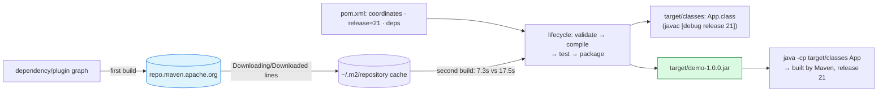

# Build Tools

## 1. Learning Objectives

After this lesson you will be able to:

- [ ] Read a `pom.xml` field-by-field (`groupId`/`artifactId`/`version`, `properties`,
      `dependencies`) and say what each becomes on disk and in a repository — from the executed
      12-line POM that produced `demo-1.0.0.jar`.
- [ ] Run the standard lifecycle (`mvn clean package`) and read its transcript as evidence:
      the compile line (`Compiling 1 source file with javac [debug release 21]`), the jar line,
      `BUILD SUCCESS`, and the timing block — knowing which phase each came from.
- [ ] Trace the `maven.compiler.release` property into the compiler's own output line and
      reconcile it with the `--release 21` discipline of every previous lesson (same knob,
      declared once instead of per-command).
- [ ] Interpret dependency resolution as it actually happened — `Downloading/Downloaded from
      central` lines with URLs and sizes — and explain what a *transitive* dependency is and
      what the local repository caches.
- [ ] Name the lifecycle phases in order (`validate → compile → test → package → install →
      deploy`) and predict which ones `package` ran, with the evidence (`clean`'s effect on
      `target/`).
- [ ] Diagnose the two failure classes this machine demonstrated by absence — Gradle's
      `command not found` vs Maven's JAVA_HOME error form from the env-setup lesson — and state
      why "the tool is missing" is a different layer than "the build failed".

## 2. Prerequisites

- [java-environment-setup.md](java-environment-setup.md) — `javac`/`java`, `--release`,
  class-file versions, and the JAVA_HOME failure form quoted here.
- [java-program-structure.md](java-program-structure.md) — packages as directories; Maven's
  `src/main/java` is the same rule with a convention in front.
- [file-handling.md](file-handling.md) and [jvm-and-memory.md](jvm-and-memory.md) — jars are
  files; the compiler release and runtime facts the POM pins.
- [03-DEVELOPER-TOOLS/terminal-fundamentals.md](../03-DEVELOPER-TOOLS/terminal-fundamentals.md) —
  exit codes and pipelines (`grep` over build output, as executed below).

**Environment used in this lesson:** every transcript executed on the author's machine —
Apache Maven 3.9.16 (Chocolatey install, per the `Maven home` line), JDK 25.0.4.1, project
`maven.compiler.release=21`. **Gradle is not installed on this machine** (`gradle: command not
found`, captured in Example 4) — every Maven line below is real output; Gradle appears only as
labelled absence and documentation-shaped description.

## 3. Introduction

For eleven lessons your build was two commands you typed yourself: `javac --release 21 A.java`
and `java A`. That works until three realities arrive: **many files** (a real project compiles
dozens together, in dependency order), **external code** (JSON parsers, web frameworks — you
will not write a JDBC driver), and **many machines** (your laptop, a teammate's, CI). A build
tool answers all three with one declarative file: the **POM** says *what* the project is and
*what it needs*; the tool does the *how* — fetching, compiling at the declared level, testing,
packaging a jar, and doing it identically everywhere. This lesson is the executed version: a
12-line POM, one `mvn clean package`, and a transcript where every meaningful line maps to a
concept.

## 4. The Problem It Solves

Hand-run `javac` has three ceilings: **scaling the compile** (which files, in what order, with
what flags — fine for one file, archaeology at fifty), **dependencies** (subject 11 will need a
JSON library; downloading jars by hand means versions, checksums, and *their* dependencies — a
transitive tree nobody keeps in their head), and **reproducibility** ("works on my machine" is
a build problem: same source, same flags, same dependency versions, or the bug is unfixable).
Maven's answers: conventions (`src/main/java` — no configuration to decide), a lifecycle (fixed
phase order, tools you plug in), a declared dependency graph resolved from a central
repository, and a **local repository** that caches every artifact so builds after the first are
offline-fast. The trade it imposes — convention over configuration, rigid directory layout — is
the price of every machine agreeing.

## 5. Core Concepts

### The POM: 12 lines that name the project

Executed verbatim in Example 1: `<groupId>com.example</groupId>` + `<artifactId>demo</artifactId>` +
`<version>1.0.0</version>` are the **coordinates** — the triple every artifact in the Maven
world is addressed by (yours became the file name `demo-1.0.0.jar`, executed); they map to
directories in the local repository (`…/com/example/demo/1.0.0/`). `<properties>` sets project
settings — the executed `<maven.compiler.release>21</maven.compiler.release>` is the
per-command `--release 21` of lessons 02–21 promoted to a **declaration**, and the compiler's
own output line proves it landed: `Compiling 1 source file with javac [debug release 21]`.
`<dependencies>` (empty here; the section exists to be filled in subject 11) is where external
code enters — one coordinate per library, and Maven fetches it *and its own dependencies* on
first use. What this POM does **not** contain matters too: no directory list (conventions
`src/main/java`, `src/test/java` supply them) and no compiler-plugin block (its defaults read
the properties).

### The lifecycle, observed

Maven's phases run in order: **validate → compile → test → package → install → deploy**. The
executed `mvn clean package` ran through `package`, which implies the earlier ones: `clean`
removed `target/` (proven — the jar was rebuilt, and the compile line appeared at all),
`compile` produced `target/classes` (the compile line names that directory), `test` found no
tests (no `src/test/java` — a silent phase is not a skipped claim; it's an empty one), and
`package` built the jar (`Building jar: …\demo-1.0.0.jar`). `install`/`deploy` were *not* run —
they'd copy the artifact to the local repository / a remote one. Reading a Maven transcript is
therefore phase forensics: each `[INFO]` line you can attribute, and `BUILD SUCCESS` at the end
with exit **0** is the same exit-code contract as `javac` ([terminal-fundamentals.md](../03-DEVELOPER-TOOLS/terminal-fundamentals.md)).

### Dependencies and the local repository, as executed

The `package` transcript is full of `Downloading from central: https://repo.maven.apache.org/maven2/…`
and `Downloaded from central: … (28 kB at 64 kB/s)` — the **central repository** URL, the
artifact paths, and the transfer itself, visible because the first build needed the *packaging
plugin's* own dependencies (archivers and friends). Those files now live in the **local
repository** (`~/.m2/repository`) — the cache that makes the next build fast (the re-run's
`Total time: 7.325 s` vs the cold build's 17.500 s: the difference is cache, and measuring it
is your first build-tool number). **Transitivity** is the concept the downloads demonstrate
without a JSON library in sight: Maven needed *four+ artifacts* to build one jar of a
one-file project — because plugins have dependencies too; with a real library (say, a JSON
parser), the same graph-walk pulls *its* dependencies for you, versions included. That is the
manual-jar problem solved by graph resolution — and the reason version conflicts are a *tool*
problem to diagnose, not a copy-paste one.

### Conventions vs the absence of Gradle

Maven's layout (`src/main/java/App.java` — executed) is a convention you obey and never
configure. Gradle, the other mainstream tool (not installed here — Example 4's captured
`gradle: command not found`), trades that for a build-script program (`build.gradle`,
flexible, incremental) — the same problem, configured instead of declared; and Maven wrappers
(`./mvnw`) pin the *tool version* per project the same way the POM pins everything else. The
choice between them is decided by the ecosystem around you (Java enterprise leans Maven;
Android and newer JVM shops lean Gradle), not by this lesson's transcripts — which stop at the
Maven boundary honestly.

## 6. How It Works



The declared file (left) drives the phases (middle) which produce the artifacts (right); the
bottom row is dependency flow — remote on first use, cached forever after (the measured
speedup). Everything solid in the graph was executed in this lesson; the cache effect is
measured, not assumed.

## 7. Practical Examples

**Example 1 — the whole project, executed (POM + source + build + run)**

```xml
<!-- pom.xml -->
<project xmlns="http://maven.apache.org/POM/4.0.0">
  <modelVersion>4.0.0</modelVersion>
  <groupId>com.example</groupId>
  <artifactId>demo</artifactId>
  <version>1.0.0</version>
  <properties>
    <maven.compiler.release>21</maven.compiler.release>
    <project.build.sourceEncoding>UTF-8</project.build.sourceEncoding>
  </properties>
</project>
```

```java
// src/main/java/App.java
public class App {
    public static void main(String[] args) {
        System.out.println("built by Maven, release 21");
    }
}
```

```console
$ mvn clean package | grep -E "Compiling|BUILD|Building jar|Total time"
[INFO] Compiling 1 source file with javac [debug release 21] to target\classes
[INFO] Building jar: C:\Users\PC\AppData\Local\Temp\java01\m\target\demo-1.0.0.jar
[INFO] BUILD SUCCESS
[INFO] Total time:  7.325 s

$ java -cp target/classes App
built by Maven, release 21
$ echo $?
0
```

- **The compile line is the POM's property arriving:** `javac [debug release 21]` — the same
  `--release 21` every prior lesson ran by hand, now declared once and applied by the build on
  every machine. `debug` is the compiler default (symbols kept — stack traces like lesson 21's
  line numbers depend on it).
- `Building jar: …\demo-1.0.0.jar` — **the coordinates became the file** (`artifactId-version.jar`);
  the jar is the packaging phase's output, a zip of `target/classes` with a manifest.
- The run line used `java -cp target/classes` — the **classpath** flag from lesson 03's package
  example; a jar can do the same (`-cp demo-1.0.0.jar`), which is what packaging is *for*.
- `BUILD SUCCESS` + exit **0** through the pipe — the grep filtered *display*, not status;
  your shell homework from terminal-fundamentals (`pipefail` when it matters) applies to build
  commands too.

**Example 2 — the environment report, executed**

```console
$ mvn -version
Apache Maven 3.9.16 (2bdd9fddda4b155ebf8000e807eb73fd829a51d5)
Maven home: C:\ProgramData\chocolatey\lib\maven\apache-maven-3.9.16
Java version: 25.0.4.1, vendor: Oracle Corporation, runtime: C:\Program Files\Java\jdk-25.0.4.1
Default locale: en_US, platform encoding: UTF-8
OS name: "windows 11", version: "10.0", arch: "amd64", family: "windows"
```

- `mvn -version` is the bug-report header that saves an hour: **tool version + which JDK the
  tool itself runs on** — note the split, again: Maven runs on 25 while the project compiles
  for 21 (the `--release` lesson's distinction, now between *build tool* and *build target*).
- `platform encoding: UTF-8` connects to file-handling's explicit-charset rule: builds have a
  default too, and the POM's `<project.build.sourceEncoding>UTF-8</project.build.sourceEncoding>`
  pins it — one property, all machines, no mojibake drift.

**Example 3 — dependency resolution in the transcript (executed, cold build)**

```console
$ mvn package   # cold: packaging plugin's own graph is missing from the local repo
Downloading from central: https://repo.maven.apache.org/maven2/org/apache/maven/maven-archiver/3.6.5/maven-archiver-3.6.5.jar
Progress (1): 3.4/28 kB | 12/28 kB | 25/28 kB | 28 kB
Downloaded from central: https://repo.maven.apache.org/maven2/org/apache/maven/maven-archiver/3.6.5/maven-archiver-3.6.5.jar (28 kB at 64 kB/s)
Downloading from central: https://repo.maven.apache.org/maven2/io/airlift/aircompressor/0.27/aircompressor-0.27.jar
Downloaded from central: https://repo.maven.apache.org/maven2/io/airlift/aircompressor/0.27/aircompressor-0.27.jar (255 kB at 1.0 MB/s)
Downloaded from central: https://repo.maven.apache.org/maven2/org/codehaus/plexus/plexus-interpolation/1.28/plexus-interpolation-1.28.jar (87 kB at 338 kB/s)
Downloaded from central: https://repo.maven.apache.org/maven2/org/codehaus/plexus/plexus-archiver/4.10.4/plexus-archiver-4.10.4.jar (227 kB at 383 kB/s)
[INFO] BUILD SUCCESS
[INFO] Total time:  17.500 s
[INFO] Finished at: 2026-10-20T13:02:36+03:00
```

- Read the URLs as **coordinates made physical**: group path / artifact / version /
  file — `org/apache/maven/maven-archiver/3.6.5/…` is `<groupId>` slashes for the path, and
  every one of these artifacts was *declared by Maven's own packaging plugin*, not by you —
  **transitivity in the raw**: you declared zero dependencies and still downloaded a graph.
- Speeds (`64 kB/s` … `1.0 MB/s`) and the 17.5 s total are the cold cache's price; the warm
  re-run's **7.325 s** (Example 1) is the same build minus the graph fetches. Two numbers,
  one cause — and the reason CI caches `~/.m2/repository` between runs.
- `Finished at: 2026-10-20T13:02:36+03:00` — builds are *timestamped events*; when a report
  says "it built at 13:02", this line is the source.

**Example 4 — the tool-missing layer (executed)**

```console
$ gradle -version
/usr/bin/bash: line 1: gradle: command not found
```

- Maven's install answers a question Gradle's absence asks: **"tool not found" is a
  setup-layer failure, not a build failure** — the shell never reached a build. Compare the
  env-setup lesson's JAVA_HOME form (`JAVA_HOME is not defined correctly …` — tool found,
  environment wrong) and a real `BUILD FAILURE` (tool found, environment right, *code* wrong).
  Three layers, three messages, one triage order: `which mvn`, `mvn -version`, then the build.

## 8. Real-World Applications

- **Every Java codebase you'll meet ships a POM or a Gradle build** — reading coordinates,
  the release property, and dependency declarations is day-one reading skill for subject 11's
  JSON project onward (that lesson adds its first real `<dependencies>` block).
- **CI pipelines run exactly `mvn -B clean verify`** — batch mode (`-B`) for logs, `verify`
  one phase past `package` so tests gate releases; the transcript-reading skills here are CI
  log-reading skills.
- **"Works on my machine" triage** starts with Example 2's header (tool + JDK + encoding),
  then the release property (did they pin it?), then dependency versions (are they
  *declared* or transitive-luck?) — the ladder this lesson's examples stand on in order.
- **Releases are jars from `package`/`install`** — `demo-1.0.0.jar`'s name-shape is what gets
  uploaded to artifact repositories; version discipline (1.0.0 → 1.0.1) is the coordinates'
  `<version>` field grown up.
- **Plugins are the extension point** — everything Maven did (compile, jar) came from default
  plugins; the compiler plugin can be *configured* (extra flags, other JDKs) without leaving
  the lifecycle — the same plug-in architecture subject 16 revisits as a design pattern.

## 9. Common Mistakes

| Mistake | Why it happens | How to recognize it | How to prevent it |
|---|---|---|---|
| Building from the wrong directory | Maven looks for `pom.xml` **cwd-upward** | `The goal you specified requires a project to execute` | Run from the POM's directory; `pwd` before `mvn` |
| Unpinned compiler level | Defaults to the *toolchain's* JDK, not yours | Bytecode major differs across machines (lesson 21's forensics) | `maven.compiler.release` property, as executed |
| Hand-downloaded jars in `lib/` | Copy-paste habit | Version soup; no transitivity; not on anyone else's machine | Declare in `<dependencies>`; let resolution fetch |
| Ignoring `BUILD FAILURE` behind a filtered pipe | `| tail` ate the red | Empty-looking success | Check exit status (`pipefail`), read the *first* ERROR |
| Assuming `test` phase ran tests | No `src/test/java` → silent | "Tests passed" with zero tests | Add a real test (subject 13); count test lines in the log |
| Committing `target/` | It feels like output worth keeping | Stale jars, merge conflicts on binaries | `target/` in `.gitignore`; only sources are truth |
| `mvn install` in shared machines without care | Local repo is global per-user | Surprise versions resolving "from nowhere" | Prefer `package`/`verify` until publishing is intended |
| Wrong-tool comparisons from memory | Gradle/Maven mixes | Script syntax in POM, or vice versa | This lesson's executed Maven only; Gradle labelled absence |
| Skipping `mvn -version` in bug reports | Feels ceremonial | Hours of version-mismatch archaeology | Paste the five-line header in every build report |

## 10. Best Practices

- **Pin the release property from the first commit** — the executed POM did; every later
  lesson's `--release 21` discipline becomes one line that CI enforces for free.
- **Declare dependencies explicitly, versions included** — transitive resolution is for
  *libraries' own* trees, not for your direct needs (subject 11's block will show the shape).
- **Read the first ERROR, not the last line** — Maven's failure output names the phase and the
  plugin; the exit code is authoritative, the summary line is decoration.
- **Treat `~/.m2` as a cache, never as a source of truth** — deleting it is always safe
  (re-download) and sometimes the correct diagnostic.
- **Report builds with `mvn -version` + the failing command + full output** — the three-part
  report this lesson's triage ladder models.
- **Keep `target/` out of version control** — reproducibility comes from sources + POM +
  pinned toolchain, not from committed artifacts.
- **Know your phase's name** — `package` builds, `verify` gates, `install` publishes locally,
  `deploy` publishes remotely; picking the least-capable phase that answers your question is
  the conservative habit.

## 11. Limitations and Trade-Offs

- **Convention over configuration cuts both ways** — `src/main/java` is free until your layout
  differs, then it's XML fight; Gradle's scripts (labelled absence here) trade declaration for
  flexibility, and the ecosystem around you usually decides.
- **XML for build logic** — readable for data (coordinates, properties) and awkward for
  conditionals; Maven's answer is "don't — use plugins", which is empowering until you need a
  plugin that doesn't exist.
- **The local repository is global state** — per-user, shared across projects: one project's
  `mvn install` can shadow a real release for another (the classic "works offline, breaks in
  CI" incident); reproducibility ultimately wants locked/verified dependency sets — the
  direction subject 16's engineering-practice topics revisit.
- **Cold builds pay network taxes** — the measured 17.5 s → 7.3 s shows the cache boundary;
  air-gapped or flaky-network environments need mirror configuration (out of scope here, noted
  honestly).
- **This lesson executed Maven only** — Gradle and build-tool *alternatives* appear here as
  absence (`command not found`) and documentation-shaped description; the concepts (coordinates,
  lifecycle, transitive resolution, caching) transfer, the commands do not — labeled as such.

## 12. Practical Exercises

### Introductory

1. **Reproduce Examples 1–3.** **Completion criteria:** the four grepped `[INFO]` lines, the
   `mvn -version` header, at least two `Downloaded from central` URLs, and the run output —
   plus the two `Total time` numbers you measured (cold vs warm) with the cache explanation in
   two sentences.
2. **Coordinates to path.** Given `<groupId>org.example</groupId><artifactId>toolkit</artifactId><version>2.3.1</version>`,
   write (a) the local-repository directory layout Maven would use, (b) the jar file name, and
   (c) the central URL form — then verify (c) against the executed URLs' shape from Example 3.
   **Completion criteria:** three written answers, each traced to an executed line or a
   documented layout rule (cite the doc you used).
3. **Phase forensics.** Run `mvn clean package` and `mvn package` (no clean) and diff what
   appears. **Completion criteria:** evidence that `clean` removed prior output (the compile
   line's presence/absence or timestamps), the phases implied, and one sentence on when a
   non-clean build is *unsafe* (incremental staleness — name the class of bug it can hide).

### Intermediate

4. **Break it on purpose — three layers.** (a) Run Maven from a directory without `pom.xml`
   (capture the "requires a project" message); (b) introduce a *compile error* in `App.java`
   and capture the first `[ERROR]` block (the compiler plugin reporting your error with line
   number — note the format); (c) the env-setup JAVA_HOME failure form (message-form citation
   is fine — it wasn't producible here). **Completion criteria:** the three transcripts, each
   labeled with its layer (tool-missing / environment / code) and the triage step that
   distinguishes it from the other two.
5. **The release knob, proven twice.** Change `maven.compiler.release` to 17, rebuild, and
   read the major version of the produced class (lesson 21's `javap -v | grep major` tool).
   **Completion criteria:** old/new major numbers (65 for 21, 61 for 17 — confirm with the
   table from env-setup), the compiler line from the log for each, and the sentence connecting
   "property in POM" to "bytecode on disk".
6. **A real dependency, resolved.** Add `<dependency>` for JUnit Jupiter (test scope — copy the
   current version from Maven Central's page for `org.junit.jupiter:junit-jupiter`, cite the
   URL) plus the surefire plugin version your Maven needs (research `maven-surefire-plugin`
   docs for the JUnit 5 requirement, cite), write one passing test in `src/test/java`, and run
   `mvn test`. **Completion criteria:** the dependency block with cited sources; the test
   transcript's `Tests run:` line (this time non-zero!); the `Downloading` lines for the
   *test-scoped* graph; and one paragraph contrasting what the tool did vs what you'd have
   downloaded by hand (name three artifacts you did *not* have to think about).

### Independent problem-solving

7. **Build a two-module story (single POM, honest scope).** Spec a small project that ships a
   **library class** and a **CLI main** in one Maven module: `com.example.greet.Greeter`
   (returning a greeting — the lesson-03 package example, now built by Maven) and
   `com.example.greet.App` (the `main`, calling `Greeter`). Requirements: package layout under
   `src/main/java`; the POM declares coordinates `com.example:greet:1.0.0` and release 21; the
   jar is executable-by-convention documented (research the jar *manifest* `Main-Class` via the
   `maven-jar-plugin` configuration — cite the doc page you used — or run via
   `java -cp target/greet-1.0.0.jar com.example.greet.App`, stating which you chose and why);
   and a `README`-style header comment in the POM noting build/run commands. Executed: `mvn
   clean package` transcript (grep-filtered lines + exit status), the run output, and
   `jar tf` (or `unzip -l`) output showing both class files *with package directories* inside
   the jar. **Completion criteria:** the spec written before the build; the four artifacts
   (filtered build transcript, run output, jar listing, plugin/doc citation); and the analysis:
   how the package-to-directory rule from lesson 03 survived unchanged into the jar — with the
   one line of the jar listing that proves it.

*Solutions: attempt first; set practice in [exercises/README.md](exercises/README.md).*

## 13. Knowledge Check

1. The compiler line read `javac [debug release 21]` — name the POM element that produced
   `21`, and explain the split visible in `mvn -version` (tool runs on 25 / project compiles
   for 21) in terms of the env-setup lesson's `--release` story.
2. You declared **zero** dependencies, yet four artifacts downloaded. Explain transitivity using
   these executions (what needed `plexus-archiver`, and why that's the same mechanism a JSON
   library would trigger), and state where the files live afterward and what the 17.5 s → 7.3 s
   change measures.
3. List the lifecycle phases in order and mark where `package` stops; for the executed
   `mvn clean package`, give one transcript line as evidence for the `clean`, `compile`, and
   `package` phases respectively — and say why the `test` phase's silence is *not* a pass.
4. `BUILD SUCCESS` came through a `grep` pipeline — what would your shell show on a failed
   build piped the same way, and what shell discipline (terminal-fundamentals) guarantees you
   see the failure?
5. Three failure layers appeared across this subject: `gradle: command not found`,
   `JAVA_HOME is not defined correctly …`, and a `BUILD FAILURE` from a syntax error. Order the
   triage (`which`/`-version`/build) and name the diagnostic each step provides.
6. Why is committing `target/` wrong, given "the build needs it"? Answer in terms of this
   lesson's reproducibility triple (sources + POM + toolchain) and the coordinates-to-artifact
   naming you executed.

## 14. Completion Criteria

Observable evidence that you have understood this lesson:

- [ ] Examples 1–4 reproduce: grepped `[INFO]` lines, version header, cold-build download
      lines with real URLs, run output, and the Gradle-absence probe
- [ ] Your two `Total time` measurements exist with the cache explanation
- [ ] The three-layer break-it exercise produced three labeled transcripts
- [ ] Release-knob forensics shows 65 ↔ 61 majors with the compiler lines
- [ ] A real test-scope dependency resolved and `Tests run:` is non-zero with cited sources
- [ ] The two-class jar (or equivalent) built, ran, and its listing proves package directories

## 15. Summary

- **One POM declares identity** (`groupId:artifactId:version` → directory and jar name),
  **level** (`maven.compiler.release` → `javac [debug release 21]`), **encoding**, and
  **dependencies** — the build turns declarations into identical artifacts everywhere.
- **The lifecycle is fixed and phase-ordered** — `clean package` executed `clean → compile →
  test → package`; `BUILD SUCCESS` and exit 0 are the same contract as `javac`, and the first
  `[ERROR]` is the real message.
- **Resolution is a graph, cached** — zero declared dependencies still downloaded a plugin's
  transitive tree from `central`; the local repository made the re-run 7.3 s vs 17.5 s.
- **Triage by layer** — tool absent (`command not found`), environment wrong (JAVA_HOME form),
  code wrong (`BUILD FAILURE`): `which`, `mvn -version`, then read the first error.

## 16. Next Steps

- This concludes the Java core sequence. Next: subject
  [05-DATA-STRUCTURES-AND-ALGORITHMS](../05-DATA-STRUCTURES-AND-ALGORITHMS/README.md) — now that
  the toolchain builds you, *implement* `MyArrayList<E>` and the complexity intuition every
  collection call in this subject assumed.
- Practice: [exercises/README.md](exercises/README.md) set 20.
- Where it is applied: [14-TESTING-AND-QUALITY](../14-TESTING-AND-QUALITY/README.md) — the
  surefire line you made non-zero is that subject's entry point.
