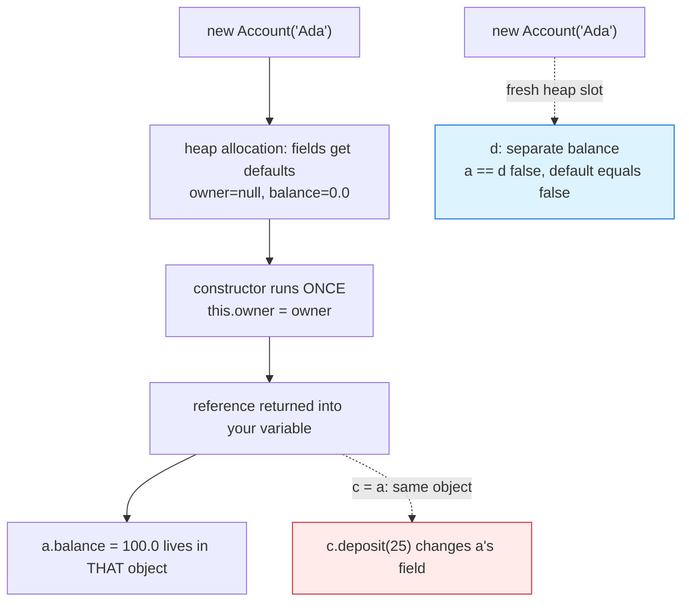

# Classes and Objects

## 1. Learning Objectives

After this lesson you will be able to:

- [ ] Design a class whose fields and methods model one coherent thing — and state what makes a
      good boundary between class and client code.
- [ ] Trace object creation step by step: allocation defaults, constructor execution, reference
      returned — with each step tied to output you have already seen in this subject.
- [ ] Predict reference behavior: `==` on two names, `equals` on two objects, mutation through
      an alias — with all three executed below.
- [ ] Override `toString`, `equals`, and `hashCode` together, correctly — and demonstrate the
      failure that happens when you override only one of the last two (executed).
- [ ] Read a `javap` member listing and identify the implicit constructor Java writes for you.
- [ ] Diagnose the four classic object bugs (alias surprises, default `equals`, state exposed
      past a field, `this` missing) from their exact runtime or compile evidence.

## 2. Prerequisites

- [java-program-structure.md](java-program-structure.md) — class files, methods, and the implicit
  constructor seen in its `javap` transcript.
- [methods.md](methods.md) — parameters, `this`, and pass-by-value of references (the mechanism
  behind every aliasing line in Example 1).
- [encapsulation.md](encapsulation.md) *comes next* — this lesson deliberately builds the model
  with package-visible fields first, so the next lesson's `private` has something to protect.
- [02-PROGRAMMING-FUNDAMENTALS](../02-PROGRAMMING-FUNDAMENTALS/README.md) — the
  dynamic-language foundation this subject builds on; here the type system makes every object
  rule executable.

**Environment used in this lesson:** every transcript executed on the author's machine —
JDK 25.0.4.1, `javac --release 21`. The `Account@8bcc55f` identity hash varies per run — yours
will differ; that variability is part of what `toString`'s default tells you.

## 3. Introduction

A class is a *contract for a kind of thing*: its fields say what state exists, its methods say
what can be done with it, and its constructor says how a valid one comes into being. Objects are
the run-time instances — each one a private copy of the state in its own heap slot. Everything
in this lesson follows from one sentence: **methods belong to objects, and two names can point
at the same object or two different ones — and your program can tell which only if you make it
able to.**

## 4. The Problem It Solves

Procedural programs keep state in global variables and functions that mutate them — subject 02's
world, and its failure mode: any function can touch any data, so every bug is a suspect. The
object model *localizes* state with behavior: a `Wallet`'s balance can only change through a
`Wallet` method (the next lesson enforces exactly that), and a bug in `deposit` cannot corrupt
some unrelated structure. The payoff compounds: code reads as the domain ("Ada deposits 100"),
tests become construction of an object plus assertions, and the class becomes the unit you can
rewrite without auditing the whole program.

## 5. Core Concepts

### Anatomy: fields, methods, constructor

- **Fields** are per-object state (`owner`, `balance`); **methods** are per-object behavior
  (`deposit`, `summary`) that read and write *that object's* fields through the implicit
  `this`. Class-level (`static`) state is shared by all — a different tool, covered with
  [methods.md](methods.md)'s static wall.
- **The constructor** (`Account(String owner)`) has the class's name, no return type, and runs
  *exactly once* — at `new`. It exists to establish **invariants**: things that must hold for
  the object to make sense (a constructed account has an owner; balance starts at the field
  default `0.0`, proven in [variables-and-types.md](variables-and-types.md) Example 2).
- Java writes a **no-arg constructor for free** when you write none — visible in
  [java-program-structure.md](java-program-structure.md) Example 2's `javap` listing
  (`public Structure();`). The moment you declare any constructor, the free one disappears —
  compile evidence: `constructor Account in class Account cannot be applied to given types` when
  a no-arg `new Account()` is attempted on the class below.

### Identity vs equality — the executed matrix

From Example 1: `a == c` is `true` (one object, two names), `a == d` is `false`, and
`a.equals(d)` is *also* `false` — because the default `equals` **is** `==` (identity). Three
distinct facts printed on one line each:

1. Assignment never copies objects (`c.deposit(25)` changed `a` — the aliasing proof).
2. `new` always makes a fresh object (`a == d : false`).
3. The default `equals` is identity — logical equality is *your* job to write (Example 3 shows
   both the failure and the fix).

`default toString: Account@8bcc55f` is the same story: `@` plus `hashCode` in hex — an identity
stamp, useless in logs until you override it (and if you override `toString` but not
`equals`/`hashCode`, you have only prettied up the identity).

### The equals/hashCode contract

`equals` and `hashCode` must agree: equal objects need equal hash codes. Example 3 executes the
break — a `Point` class without overrides puts `new Point(1,2)` in a `HashMap`, then fails to
`get` it back with an equal copy (`null`, while `contains` on a list, which only needs
`equals`, is `false` for the same reason). The `P2` twin with both overrides recovers the value.
The deeper point: **`equals` alone is not enough anywhere hashing is involved** — maps and sets
hash first, `equals` second.

## 6. How It Works



Left branch: one allocation, one constructor call, one object — then *any* number of references
pointing at it, all seeing the same fields (the `c` path, red). Right: a second `new` is a
second slot regardless of identical arguments — identity and equality split right there (blue).

## 7. Practical Examples

**Example 1 — the whole model, including its sharp edges (executed)**

```java
class Account {
    String owner;              // fields: the object's state
    double balance;
    Account(String owner) { this.owner = owner; }        // constructor
    void deposit(double amount) { balance += amount; }   // behavior: methods
    String summary() { return owner + ": $" + balance; }
}
public class Bank {
    public static void main(String[] args) {
        Account a = new Account("Ada");
        Account b = new Account("Grace");
        a.deposit(100);
        b.deposit(50);
        System.out.println(a.summary());
        System.out.println(b.summary());
        Account c = a;         // NOT a copy: a second reference to the same object
        c.deposit(25);
        System.out.println("after c.deposit: " + a.summary());
        System.out.println("a == c : " + (a == c));
        Account d = new Account("Ada");
        System.out.println("a == d : " + (a == d) + "   a.equals(d) : " + a.equals(d));
        System.out.println("default toString: " + d);
    }
}
```

```console
$ javac --release 21 Bank.java && java Bank
Ada: $100.0
Grace: $50.0
after c.deposit: Ada: $125.0
a == c : true
a == d : false   a.equals(d) : false
default toString: Account@8bcc55f
$ echo $?
0
```

- Lines 3–4: two objects, two states — instances do not share fields (compare the `static`
  wall in [methods.md](methods.md) Example 2).
- `after c.deposit: Ada: $125.0` — `c = a` copied the *reference*; `c.deposit(25)` deposited
  into Ada's account. The line prints `a.summary()` and nothing in `a`'s source suggests `c` —
  this is the aliasing hazard in its purest executed form.
- `a == d : false   a.equals(d) : false` — two equal-by-argument objects are two identities,
  and the default `equals` agrees with `==`. Both defaults are honest: they answer "same
  object?" — your domain question is "same account?", which nothing can answer but you.
- `this.owner = owner` in the constructor: `this` is *which object is running* — without it
  (a parameter named `owner` shadowing the field), the assignment would target the parameter.
  `getClass().getSimpleName()` and friends appear next lesson; here the default `toString` is
  the identity stamp.

**Example 2 — construction is observable (executed, two lessons compositing)**

```console
$ "/c/Program Files/Java/jdk-25.0.4.1/bin/javap" -p Bank.class | head -8
```

lists `class Bank`'s members; run the same on `Account.class` and you get its fields
(`java.lang.String owner; double balance;`), the constructor
(`public Account(java.lang.String);`), `deposit`, and `summary` — plus **no** free constructor
(bank's class declares one). The free-constructor rule, meanwhile, is already proven on
`Structure.class` ([java-program-structure.md](java-program-structure.md) Example 2: `public
Structure();` in a file that declares no constructor). Bytecode does not lie about either rule.

**Example 3 — equals/hashCode: the break and the fix (executed)**

```java
static class Point {                 // no equals, no hashCode
    int x, y;
    Point(int x, int y) { this.x = x; this.y = y; }
}
static class P2 {                    // both, together
    int x, y;
    P2(int x, int y) { this.x = x; this.y = y; }
    @Override public boolean equals(Object o) { return o instanceof P2 p && p.x == x && p.y == y; }
    @Override public int hashCode() { return 31 * x + y; }
    @Override public String toString() { return "(" + x + "," + y + ")"; }
}

Map<Object, String> m1 = new HashMap<>();
m1.put(new Point(1, 2), "here");
System.out.println("without equals: get = " + m1.get(new Point(1, 2)));
Map<Object, String> m2 = new HashMap<>();
m2.put(new P2(1, 2), "here");
System.out.println("with equals:    get = " + m2.get(new P2(1, 2)));
System.out.println("list contains:  " + new ArrayList<>(List.of(new Point(1, 2))).contains(new Point(1, 2)));
System.out.println("with equals toString: " + new P2(1, 2));
```

```console
$ javac --release 21 PointDemo.java && java PointDemo
without equals: get = null
with equals:    get = here
list contains:  false
with equals toString: (1,2)
$ echo $?
0
```

- `without equals: get = null` — the map hashed the *copy*, landed in a different bucket than
  the stored key, and `equals` (still identity) would have refused anyway: two failures, one
  cause. `list contains: false` shows the same missing `equals` without any hashing involved.
- `with equals: get = here` — both overrides in place, logically-equal keys find each other.
- `@Override` on all three methods: if a signature doesn't match, javac errors *at the
  annotation* ([operators-and-control-flow.md](operators-and-control-flow.md) Example 3's
  `method does not override…` family) instead of silently falling back to the parent.

## 8. Real-World Applications

- **Domain models** — `Order`, `Customer`, `Transaction` classes are how subjects 11 and the
  REST projects shape data; the fields-private, behavior-public form this lesson motivates is
  the industry default (next lesson).
- **Value objects** (`Money`, coordinates, IDs) live or die by `equals`/`hashCode`: they are
  *used as map keys and set members* constantly — every `HashMap` in the collections lesson
  depends on the contract Example 3 executes.
- **Testing reads objects:** `assertEquals(expected, actual)` calls `equals` — a test suite on
  objects without `equals` degrades to identity checks and fails mysteriously the moment it
  compares rebuilt objects (a bug class your exercises are designed to let you meet once).

## 9. Common Mistakes

| Mistake | Why it happens | How to recognize it | How to prevent it |
|---|---|---|---|
| Treating `b = a` as a copy | Value-type habit | Mutating `b` "moves" `a`'s data | Ask "reference or object?" — `==` prints `true` (Example 1) |
| Default `equals` on domain classes | Forgetting it exists | Map `get` returns `null`; set `contains` false for look-alikes | Override `equals` + `hashCode` *together* (Example 3), or use a value type (`record` — [generics.md](generics.md)) that does |
| Overriding `equals` but not `hashCode` | Half-remembered rule | Works with `List.contains`, fails with `HashMap` — the executed `null` | Both or neither; the `@Override` annotations document intent |
| Constructor that can't establish invariants | Fields left assignable later | Half-built objects circulating (null owner) | Validate in the constructor; keep fields `private` (next lesson) |
| `this` forgotten in constructors | Parameter name = field name | Field stays `null`/0 despite a "successful" `new` | Distinct names or qualified `this.` — compiler will not warn you |
| Getting/setting everything reflexively | Bean-template habit | `getWidth()` around one use; logicless wrappers | Methods that *do* things (`summary()`); getters only for data clients genuinely need |
| Deep `==` chains on Strings | Identity vs content bleed-over | `false` where text matched | `.equals` for content — [arrays-and-strings.md](arrays-and-strings.md) |
| One "god object" class | Modeling the whole program at once | Unrelated methods, giant constructor | One responsibility per class — exercised by the independent problem below |

## 10. Best Practices

- **Make the constructor establish validity:** illegal states should be unconstructible — if
  `new Account("")` is nonsense, reject it *in the constructor*.
- **Behavior over access:** expose `summary()`, not `balance` — clients ask *questions of the
  object*, it answers with what it chooses ([encapsulation.md](encapsulation.md) enforces this).
- **`equals`/`hashCode`/`toString` as a set:** override for value classes; skip `equals` for
  identity classes and say so in a comment. Either way, be deliberate.
- **Name fields for state, methods for actions** — `owner`/`deposit(100)`; if a method name
  reads like a field (`getOwner().getName()` chains), reconsider the boundary.
- **Keep classes small enough to state in one sentence.** The independent exercise in this
  lesson is graded on exactly that ability.
- **Prefer immutability where state need not change** — construction-only mutation removes the
  alias hazard class entirely (a direction collections.md calls `List.of`).

## 11. Limitations and Trade-Offs

- Objects are heap allocations and pointer-chasing — arrays of primitives beat arrays of
  objects for bulk numeric work (a cost subject 05 will size up with `ArrayList`).
- Modeling everything as objects is a *choice*, not a virtue: a DTO that is just data may
  deserve a `record`; a numeric kernel may deserve functions over arrays. Java hosts all three.
- The identity default (`==`, identity `equals`) is *correct* for stateful objects — forcing
  logical equality on things like `Thread` would be wrong. The contract is per-domain, which is
  why nothing auto-generates it for reference types (records auto-do it for value types —
  [generics.md](generics.md)).
- Visible fields (as in Example 1) trade safety for brevity; the next lesson argues for the
  other side and shows the exact compiler error that `private` produces.

## 12. Practical Exercises

### Introductory

1. **Reproduce Example 1**, then add a line printing `b == a` and predict it before running.
   **Completion criteria:** all outputs reproduced, prediction correct, and one sentence
   explaining what `c.deposit(25)` *could not* have done if `c` had held a copy instead.
2. **The construction trace.** Add a `println` inside `Account`'s constructor printing
   `constructed " + owner`; re-run. **Completion criteria:** the print appears once per `new`
   (three times — `a`, `b`, `d`), demonstrating one-constructor-run-per-object, and you can say
   why `c = a` printed nothing.

### Intermediate

3. **Break and fix `equals` yourself.** Copy Example 3's `Point`; add only `equals` (no
   `hashCode`), run, capture — then add `hashCode` and run again. **Completion criteria:** three
   transcripts (default / equals-only / both) showing the `null` in *both* of the first two —
   the proof that hashing needs the pair — plus the working `here`.
4. **Design the invariant list first.** For a `Task` class (title, done flag): write down five
   states that must never hold (empty title? done-without-title?), then implement a constructor
   that makes all five unconstructible. **Completion criteria:** the five-item list, the code,
   and two compile/run proofs — one `new` that succeeds with printed state, and your argument
   for which rejected state the constructor defends (write the illegal call you *would* have
   made and why it is now impossible).

### Independent problem-solving

5. **Model a library's loans without a design document.** You have `Book`, `Member`, and
   `Loan`. Decide: which are classes vs records, what each holds as state, which methods each
   exposes (no raw field reads from `main` — behavior only), where `equals`/`hashCode` earn
   their override (a `Book` used as a map key: yes/no, argued), and how a borrow mutates three
   objects coherently. Implement, then demonstrate: one borrow across `main` printing each
   object's `summary()`, one attempted double-borrow rejected by the model itself.
   **Completion criteria:** the decision list with one-line reasons; a compile-clean program
   whose output shows state change in all affected objects; and your answer to "which single
   line, if deleted, would break the model most — and what invariant makes it safe today?"

*Solutions: attempt first; set practice in [exercises/README.md](exercises/README.md).*

## 13. Knowledge Check

1. In Example 1, exactly how many `Account` objects exist after `Account d = new Account("Ada")`
   executes? What evidence in the output proves it?
2. Why did `a.equals(d)` print `false` — and what *should* it print if these represent the same
   logical account? What must change in the class for that?
3. What two names, printed by one line of output, tell you `toString` was never overridden?
4. If `equals` is overridden and `hashCode` is not, which two calls disagree — and which
   executed line of Example 3 demonstrates the first half of that disagreement?
5. When is the identity default (`==` as equality) the *right* semantics? Give one class from
   this subject where it would be wrong.

## 14. Completion Criteria

Observable evidence that you have understood this lesson:

- [ ] Example 1 reproduced, with the aliasing line predicted first
- [ ] Example 3's three-state matrix (default / equals-only / both) executed by you
- [ ] You can write a class with a validating constructor from a blank editor, with `this`
      used correctly
- [ ] You can read a `javap` member listing and say which constructors are present and why
- [ ] You can state identity vs equality as two different questions, each with an example

## 15. Summary

- A class is state + behavior + construction rules; `new` = allocate (defaults) → run the
  constructor **once** → return a reference.
- **Assignment copies references, `new` creates objects** — `a == c : true` and
  `a == d : false` are the same fact printed twice.
- **Default `equals` and `toString` are identity** — logical equality, readable logs, and
  hash-friendly keys are all *your* three overrides, made together.
- The hash contract (`equals` ⇔ `hashCode`) is executable: break it and `HashMap.get` prints
  `null` for a key you just stored.
- Small classes with constructors that forbid nonsense are the unit everything larger in this
  curriculum is built from.

## 16. Next Steps

- Next lesson: [encapsulation.md](encapsulation.md) — enforcing the boundary this lesson
  sketches: `private` fields, the exact compiler error that guards them, and designing methods
  that don't leak state.
- Practice: [exercises/README.md](exercises/README.md) set 7.
- Where it is applied: [11-BACKEND-ENGINEERING](../11-BACKEND-ENGINEERING/README.md)'s DTOs and
  services are this pattern at production scale.
