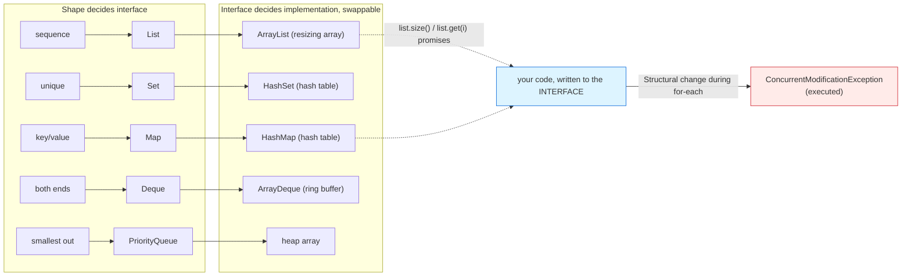

# The Collections Framework

## 1. Learning Objectives

After this lesson you will be able to:

- [ ] Choose among `List`, `Set`, `Map`, `Queue`/`Deque` by *shape of the data* — and name the
      concrete class you reach for each (`ArrayList`, `HashSet`, `HashMap`, `ArrayDeque`,
      `PriorityQueue`) with the executed behavior difference you saw.
- [ ] Read the executed transcripts of growth, lookup, mutation, ordering, and refusal
      (`List.of` → `UnsupportedOperationException`) as API documentation you produced yourself.
- [ ] Predict iteration order per structure — and know exactly which orders you saw were
      *promised* vs *this run's luck*.
- [ ] Diagnose `ConcurrentModificationException` from its classic cause (structural for-each
      removal), quoting the safe alternatives you executed (`removeIf`).
- [ ] Use the equals/hashCode contract through a map, from the executed `null` to the executed
      `here` — connecting this subject's contract lesson to library behavior.
- [ ] Declare variables at interface types (`List<String> names = new ArrayList<>()`) and defend
      why that line is the default everywhere after this lesson.

## 2. Prerequisites

- [arrays-and-strings.md](arrays-and-strings.md) — what arrays fix and fail at (fixed size,
  O(1) index, no membership test): the problem collections solve; `ArrayList` is *built on*
  those exact arrays.
- [interfaces-and-abstract-classes.md](interfaces-and-abstract-classes.md) — `List` is an
  interface and `ArrayList` an implementation; this lesson is that relationship in daily use.
- [classes-and-objects.md](classes-and-objects.md) — the equals/hashCode contract, executed
  before you need it here (PointDemo below is its library-scale payoff).
- [02-PROGRAMMING-FUNDAMENTALS/arrays-and-strings.md](../02-PROGRAMMING-FUNDAMENTALS/arrays-and-strings.md) —
  the same operations in pseudocode; the shape decisions transfer.

**Environment used in this lesson:** every transcript executed on the author's machine —
JDK 25.0.4.1, `javac --release 21`. Map iteration order in one output is *unspecified by
contract* — noted inline where it appears.

## 3. Introduction

Java's collections are **interfaces first, implementations second**: `List` promises *ordered,
indexed, allows duplicates*; `ArrayList` promises *how* (a resizing array — that detail stays a
detail, per lesson 12's leak rule). You program to the promise and swap the answer — the posture
lesson 13 argued for, now on the types you will use in every program from here. The framework's
second idea is *shape*: four questions — sequence? unique? key→value? next-out-first? — each
answered by a different interface, so the type name carries your design decision.

## 4. The Problem It Solves

Arrays from lesson 07: fixed length (append means copy-and-replace by hand), `contains` is a
loop you write, `Map`-shaped data doesn't exist without nested-array gymnastics from subject 02.
Every one of those was a *re*-implementation of logic that never changes: "keep a growable
sequence," "keep unique things," "look up by key." The framework standardizes those answers once
— with the two properties subject 02 could never promise: **behavioral contracts** (documented
ordering and complexity, testable across vendors) and **interchangeable implementations** (your
code compiled against `List` still compiles against a linked list, a copy-on-write list, or a
concurrent list — the contract is the product).

## 5. Core Concepts

### The shape table (the whole selection algorithm)

| You have / you need | Interface | Go-to implementation | Executed evidence below |
|---|---|---|---|
| Ordered sequence, duplicates OK, indexed | `List` | `ArrayList` | grow, `set`, `indexOf`, `remove` (Example 1) |
| Unique items, membership tests | `Set` | `HashSet` | `List.of(3,1,4,1,5)` → `[1, 3, 4, 5]` |
| Key → value, lookup by key | `Map` | `HashMap` | `get` hit / `null` miss (Example 1) |
| Next-out order (queue) / both ends | `Queue`/`Deque` | `ArrayDeque` | `pop=a`, `pollLast=c` |
| Smallest-out-next | `PriorityQueue` | heap | `poll order: 1 1 4 5 5` |

One program (Example 1) executes all five; the table's right column is a promise you watched
keep.

### Interface-typed variables are the default

`List<String> names = new ArrayList<>()` — the declaration says *what you need*, the object says
*what you got*. Consequences all executed here: passing an `ArrayList` anywhere a `List` is
accepted (lesson 13's upcast), and swapping in a different `List` later with zero source
changes. The diamond `<>` (the compiler infers the type argument) belongs to
[generics.md](generics.md), which follows.

### Immutability as a contract, not a class

`List.of("a", "b")` builds a list that *refuses* changes — `add` threw
`UnsupportedOperationException` (executed). This is the `List.of` leak named in
[abstraction.md](abstraction.md) §5, now first-hand: the interface promised *list-ness*, the
implementation adds a *no-writes* rule whose enforcement (a runtime exception) surfaces through
that same interface. Read it as: `List.of`'s actual promise includes the throw — part of *its*
documented contract, learned cheapest by running it.

### The structural-change rule (`ConcurrentModificationException`)

for-each over a `List` uses an iterator that **detects** concurrent structural modification:
removing the element *after the loop's last `next()`* still ends without complaint (my first
demo, removed by hand — the check happens on the *next* `next()`, and there wasn't one), while
removing mid-iteration with elements remaining prints `CME on for-each removal` (executed —
both facts, one honest pair of runs). The rule: **never structurally modify a collection during
for-each**; modify through the iterator (`it.remove()`) or in one pass with `removeIf` —
executed: `safe removal via removeIf: [1, 3, 4, 5]`.

### Keys must honor equals/hashCode

PointDemo from [classes-and-objects.md](classes-and-objects.md), restated as library behavior:
`HashMap.get` with a default-`equals` key printed `null` for a freshly built equal key; with the
contract honored, `here`. The contract isn't a Java nicety — it is **how `HashMap` finds your
data** (hash buckets first, `equals` on collision); break it and lookups fail *silently*, which
is the worst failure shape a lookup can have.

## 6. How It Works



Left-to-right is a *decision funnel*: data shape → interface → implementation, each arrow
narrowing. The dotted return arrows are the point of the whole diagram: your code speaks only
blue-side promises; implementations are free to change underneath — except for the one rule
drawn in red, which is promise-shaped too (it's how structural-change safety is *delivered*).

## 7. Practical Examples

**Example 1 — every shape, executed in one program**

```java
import java.util.*;

public class Coll {
    public static void main(String[] args) {
        List<String> names = new ArrayList<>(List.of("Ada", "Grace", "Ada"));
        System.out.println("list: " + names + " size=" + names.size());
        names.set(0, "Ada L");
        names.add("Linus");
        System.out.println("after set+add: " + names);
        System.out.println("indexOf Ada=" + names.indexOf("Ada") + "  contains Grace=" + names.contains("Grace"));
        names.remove("Ada L");
        System.out.println("after remove: " + names);
        try { List.of("a", "b").add("c"); }
        catch (UnsupportedOperationException e) { System.out.println("List.of().add -> UnsupportedOperationException"); }
        Map<String, Integer> ages = new HashMap<>();
        ages.put("Ada", 36);
        ages.put("Grace", 45);
        ages.put("Ada", 37);
        System.out.println("map: " + ages + "  get(Grace)=" + ages.get("Grace") + "  get(Alan)=" + ages.get("Alan"));
        ages.putIfAbsent("Alan", 41);
        System.out.println("after putIfAbsent: " + ages);
        for (var e : ages.entrySet()) System.out.println("  " + e.getKey() + " -> " + e.getValue());
        Set<Integer> set = new HashSet<>(List.of(3, 1, 4, 1, 5));
        System.out.println("set: " + set + "  contains(4)=" + set.contains(4));
        List<Integer> nums = new ArrayList<>(List.of(1, 2, 3, 4, 5));
        nums.removeIf(n -> n % 2 == 0);
        System.out.println("removeIf evens: " + nums);
        Deque<String> dq = new ArrayDeque<>();
        dq.addLast("b");
        dq.addFirst("a");
        dq.addLast("c");
        System.out.println("deque: " + dq + "  pop=" + dq.pop() + "  pollLast=" + dq.pollLast());
        PriorityQueue<Integer> pq = new PriorityQueue<>(List.of(5, 1, 4, 1, 5));
        StringBuilder order = new StringBuilder("poll order:");
        while (!pq.isEmpty()) order.append(' ').append(pq.poll());
        System.out.println(order);
        List<Integer> bad = new ArrayList<>(List.of(1, 2, 3, 4, 5));
        try { for (int x : bad) { if (x == 2) bad.remove(x); } }
        catch (ConcurrentModificationException e) { System.out.println("CME on for-each removal"); }
        List<Integer> ok = new ArrayList<>(List.of(1, 2, 3, 4, 5));
        ok.removeIf(x -> x == 2);
        System.out.println("safe removal via removeIf: " + ok);
    }
}
```

```console
$ javac --release 21 Coll.java && java Coll
list: [Ada, Grace, Ada] size=3
after set+add: [Ada L, Grace, Ada, Linus]
indexOf Ada=2  contains Grace=true
after remove: [Grace, Ada, Linus]
List.of().add -> UnsupportedOperationException
map: {Grace=45, Ada=37}  get(Grace)=45  get(Alan)=null
after putIfAbsent: {Grace=45, Alan=41, Ada=37}
  Grace -> 45
  Alan -> 41
  Ada -> 37
set: [1, 3, 4, 5]  contains(4)=true
removeIf evens: [1, 3, 5]
deque: [a, b, c]  pop=a  pollLast=c
poll order: 1 1 4 5 5
CME on for-each removal
safe removal via removeIf: [1, 3, 4, 5]
$ echo $?
0
```

- **List:** duplicates preserved (`list: [Ada, Grace, Ada]` — three in, three kept), `set`
  replaced positionally, `indexOf`/`contains` answer by *content* (`.equals` — lesson 07's rule
  doing library work), `remove("Ada L")` removed by value, first match only.
- **Immutability refused:** the caught `UnsupportedOperationException` is the `List.of` contract
  printing itself — the same source line succeeds on an `ArrayList`, fails on `List.of`:
  implementation choice, observable.
- **Map:** duplicate `put("Ada", …)` *replaced* (last write wins: `Ada=37`); miss returned
  `null` (map's own silent-`null` — the `getOrDefault`/`containsKey` decision you now know to
  make); `putIfAbsent` is the conditional-add idiom. **Iteration order printed is this run's —
  `HashMap` order is unspecified; never design to it** (need order? `LinkedHashMap` or `TreeMap`
  — subject 05 sizes these up). `var` in the loop is the entry type spelled by inference.
- **Set:** `1` appeared twice in input, once in output — dedup is the *definition*, and
  `contains(4)=true` is the membership operation arrays lack.
- **Deque:** `pop=a` (front), `pollLast=c` (back) — the two-ended promises of a real
  stack+queue, no hand-rolled index juggling.
- **PriorityQueue:** `poll order: 1 1 4 5 5` — *order of extraction*, not storage: the heap's
  whole personality, one line.
- **The CME pair:** same five-element list, remove `2` mid-loop → the exception on the next
  internal check; `removeIf` → the same intent, one pass, no exception. (An earlier demo with
  the removal at the *last* element didn't throw — no next `next()` to check — which is why
  the rule is phrased structurally, not "removal always throws": *detect on next access*.)

**Example 2 — the key contract at library scale (executed; source in
[classes-and-objects.md](classes-and-objects.md) Example 3)**

```console
$ java PointDemo
without equals: get = null
with equals:    get = here
list contains:  false
with equals toString: (1,2)
```

A `HashMap` with default-`equals` keys lost a stored entry (`null` for an equal rebuild); the
fixed pair retrieved it. Restated here because *collection-scale* lookups are where this
contract stops being theory: `null` for data you *know* is in there is the signature symptom.

## 8. Real-World Applications

- **Every program from here:** subject 15's structures are implementations of these very
  interfaces (you will read `ArrayList`'s source in spirit); subjects 11/17/18 build results as
  `List`/`Map` end to end. Interface declarations now are what make those later swaps real.
- **Request/response shaping:** JSON objects deserialize to `Map<String, Object>`; JSON arrays
  to `List<…>` — knowing the shapes (and their `null`/order edges) is half of API parsing work.
- **Frequency tables and grouping** — `Map` + `Set` combinations (word counts, dedup passes) are
  the bread-and-butter exercises of every interview and every data-cleanup script; the `Map`
  lines above are their smallest complete form (lesson 19 does the same work with streams).

## 9. Common Mistakes

| Mistake | Why it happens | How to recognize it | How to prevent it |
|---|---|---|---|
| Choosing by *implementation* first | Learned as names, not shapes | `ArrayDeque` justified where "sequence" was the actual need | Shape table, top-down — interface first |
| Depending on `HashMap`/`HashSet` order | It printed *something* | Works on your data, flips after a key change | Order is a promise or it isn't; need order → `TreeMap`/`LinkedHashMap`/`List` |
| Structural edit inside for-each | Loop-and-filter reflex | `ConcurrentModificationException` | `removeIf` (executed) or iterator `remove` — one-pass intent |
| `get` without a miss plan | `null` return overlooked | NPE three lines later | `getOrDefault`, `containsKey`, or `null` check *at the call* — decide per site |
| Default-`equals` keys in maps | Contract written once, needed everywhere | Silent `null` for present data (Example 2) | `equals`+`hashCode` together, or `record` keys ([generics.md](generics.md)) |
| Building immutable lists then mutating | `List.of` reads as "a list" | `UnsupportedOperationException` at runtime | Assign mutable only where you'll mutate; the throw is the contract |
| `ArrayList.contains` in hot loops | Default tool | Linear scans at scale | `Set` for membership (shape table row 2) — subject 05 puts numbers on this |
| `new ArrayList<>(null)` / raw nulls in structures | Default fields again | NPE at first use | Initialize deliberately — the `null` default rule never retires |
| Primitives unboxed into `List<Integer>` oblivion | Default boxing | Memory + speed surprises in bulk numeric work | Arrays or primitive-specialized streams for bulk; objects for structure |

## 10. Best Practices

- **Declare the interface, construct the implementation** — `List<String> names = new
  ArrayList<>()` — until you have a *shaped reason* to name the class in the declaration (you
  almost never do).
- **Choose immutability first:** `List.of`, `Map.copyOf` for input you won't change; mutable
  locals where growth happens. The refusal exception is your ally — it catches writes you never
  intended.
- **One pass per concern:** `removeIf`, `stream().filter().toList()` (lesson 18) — never
  re-enter a structure mid-iteration.
- **Treat order as a contract:** document it in your own methods ("returns insertion-ordered")
  the way `List` documents it for you; unspecified order in a returned API is a bug waiting for
  a different JVM.
- **Keys are value objects:** `String`, boxed primitives, or `record`s — identity-keyed objects
  in a `HashMap` are a defect with a delayed blast radius (Example 2's `null`).
- **Measure before optimizing** — the shape table's typical costs (array lookup fast, hash
  lookup fast, linked things slow at random access) are subject 05's exact territory; here, reach
  for *shape* correctness first.

## 11. Limitations and Trade-Offs

- **Interfaces can't promise everything:** order for hash-based sets/maps is the classic
  unspecified corner; performance characteristics live in javadoc, not in types — reading them
  is part of using them (and subject 05 turns them into numbers).
- **`null` is woven into `Map`'s contract** (`get` returns it) — a 1990s design decision you
  work *around* with defaults rather than through types; `Optional` ([lambdas-and-streams.md](lambdas-and-streams.md))
  helps at the API edge, not inside `Map` itself.
- **Generics boxing** — `List<Integer>` is objects; primitive-heavy numeric code wants arrays or
  specialized tools, which is a real cost the framework accepts for uniformity (lesson 16 owns
  the full picture).
- **CME detection is best-effort:** it *helps* you find violations (as executed); it is not a
  substitute for thread-safety — concurrent structures (`ConcurrentHashMap`, copy-on-write) are
  different tools with different promises ([concurrency.md](concurrency.md) uses one).
- **Framework ≠ algorithms:** sorting, searching, and graph work sit *above* collections
  (`Collections.sort`, subject 15's algorithms) — the framework stores and iterates; the
  reasoning about cost begins next subject.

## 12. Practical Exercises

### Introductory

1. **Reproduce Example 1 in full** — all sixteen lines. **Completion criteria:** byte-for-byte
   output (the map's printed order may differ; note yours honestly), plus annotations: for each
   of the five shapes, the line that *is* its contract (e.g. `poll order:` = priority extraction).
2. **The order audit.** Run Example 1's map block five times in a row (five runs of your
   program or a loop). **Completion criteria:** the five printed maps pasted — and your
   conclusion written against the "unspecified" claim: same or different? Which did the code
   rely on? (Correct answer under any outcome: nothing — name the line that would have to
   change if you needed order.)

### Intermediate

3. **Provoke the CME, then avoid it both ways.** (a) The mid-iteration removal (Example 1 —
   reproduce); (b) fix with `removeIf`; (c) fix with an explicit `Iterator` + `it.remove()`.
   **Completion criteria:** three runs — exception caught / clean result / clean result — and a
   one-line statement of where the check happens (on the next structural *read*, not at
   modification) that explains why the last-element edge case escapes.
4. **Contract keys, end to end.** Build a `HashMap` with your own class as key — no overrides
   → `null`; then `equals` only → still `null` (hash mismatch); then both → value found.
   **Completion criteria:** three transcripts (the executed PointDemo covers 1st and 3rd —
   produce the middle state yourself), proving the hash side fails *before* equality is even
   consulted.
5. **Shape-by-writeup.** For each — playlist (ordered, duplicates allowed), unique visitor IDs,
   HTTP status → reason, job scheduler's next task, undo stack — write interface + implementation
   + one-line shape reason, *then* run a two-line demo of each. **Completion criteria:** five
   rows written first, five demos executed, and one argument for why `PriorityQueue` is wrong
   for the undo stack (order guarantee difference, quoted from its behavior you saw).

### Independent problem-solving

6. **Library circulation, at scale.** Using only `List`/`Map`/`Set` declarations: hold 20
   books (titles unique), 5 members; support (a) borrow/return with at-most-5 enforcement, (b)
   "titles by member" lookup, (c) duplicate-title report across the catalog. Drive all from
   `main` with printed evidence for a borrow, a rejected over-limit borrow, a lookup, and the
   duplicate scan. **Completion criteria:** four outputs each predicted first; *every* variable
   declared as an interface type (grep your file: no `ArrayList`/`HashMap` on the left side of
   `=` in declarations — show it); and one sentence naming which internal structure you would
   swap first if 10,000 members arrived, using only the shape table.

*Solutions: attempt first; set practice in [exercises/README.md](exercises/README.md).*

## 13. Knowledge Check

1. For each output line, name the *promise* it proves: `[1, 3, 4, 5]`, `get(Alan)=null`,
   `poll order: 1 1 4 5 5`, `pop=a  pollLast=c`.
2. Why is the map's printed order not part of your contract — and what two facts in this
   lesson's own text tell you we treated it as luck rather than law?
3. Quote the CME catch line, then explain why my first demo (removal at the last element) *didn't*
   print it — where exactly does the detector run?
4. `without equals: get = null` — sequence the two mechanisms `HashMap.get` uses (hash, then
   ?) and say which one failed first for a default-`equals` key.
5. State the declaration rule (`List<String> … = new …`) and defend it with one sentence that
   names a *future* change it protects against.

## 14. Completion Criteria

Observable evidence that you have understood this lesson:

- [ ] Example 1 runs to completion on your machine, output annotated by contract
- [ ] You produced the CME both ways (throw + `removeIf` fix) and the iterator fix
- [ ] The three-state key-contract matrix (no equals / equals-only / both) exists on your disk
- [ ] Five shape decisions written with reasons *before* coding, then executed
- [ ] Your library-circulation demo passes with interface-only declarations, verified by search

## 15. Summary

- **Shape → interface → implementation** is the entire selection algorithm — one executed
  program demonstrates all five shapes' promises.
- Declare promises (`List`), construct answers (`ArrayList`) — swaps stay cheap forever after.
- Order is a contract or it is luck; `HashMap`'s printed order is luck (use `TreeMap` when you
  need order).
- Structural edits during for-each are violations the library *detects* — `removeIf` is the
  one-pass idiom (both executed).
- Map keys live by equals/hashCode — the contract's `null`-symptom is real, silent, and yours
  to prevent.

## 16. Next Steps

- Next lesson: [generics.md](generics.md) — the `<String>` machinery in these declarations:
  what the compiler checks, what erasure removes, and why your own types fit too.
- Practice: [exercises/README.md](exercises/README.md) set 13.
- Where it is applied: [15-DATA-STRUCTURES-AND-ALGORITHMS](../05-DATA-STRUCTURES-AND-ALGORITHMS/README.md) —
  next subject: the implementations' internals and their costs, made measurable.
