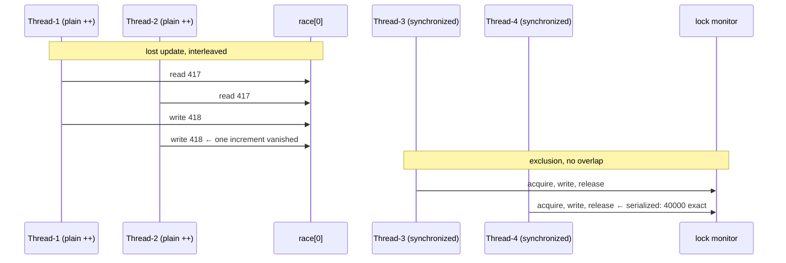

# Concurrency

## 1. Learning Objectives

After this lesson you will be able to:

- [ ] Create and join a thread (`Thread` + lambda), submit work to an `ExecutorService`, and
      collect typed results from `Future.get()` — with the executed `Thread-0` and
      `sum of squares = 14` transcripts as your baseline.
- [ ] State the **lost update** problem precisely and reproduce it: `plain increment` printing
      a *different* wrong number on every run (executed twice: 39251, then 39633 — both wrong
      in different ways, which is the point).
- [ ] Explain *why* the race happens (read-modify-write is not atomic; the JVM owes you
      nothing about ordering) and why the wrongness varies run to run — nondeterminism as the
      signature, not a fluke.
- [ ] Apply the two fixes and know what each buys: `synchronized` (mutual exclusion, one lock)
      and `AtomicInteger` (lock-free read-modify-write) — both executed at exactly 40000.
- [ ] Use a `CountDownLatch` as a start gate to make your own race *deterministic enough to
      demonstrate*, and say why demos without one often fail to show the bug at all.
- [ ] Diagnose the classic hazards by name — lost update, race condition, deadlock (both
      threads waiting on each other's lock), and non-visibility — and connect each to a
      concrete debugging technique.

## 2. Prerequisites

- [lambdas-and-streams.md](lambdas-and-streams.md) and [functional-programming.md](functional-programming.md) —
  lambdas are what threads *run*; the purity lesson's parallel-safety claim is exactly what this
  lesson falsifies for impure functions.
- [methods-and-control-flow](methods.md) and [operators-and-control-flow.md](operators-and-control-flow.md) —
  `++` as read-modify-write, made explicit below.
- [exceptions.md](exceptions.md) — `Future.get()` rethrows worker exceptions; try-with-resources
  patterns for closing pools.

**Environment used in this lesson:** every transcript executed on the author's machine —
JDK 25.0.4.1, `javac --release 21`. **Both runs of the race are shown because the variation is
the lesson.**

## 3. Introduction

Concurrency is *more than one thing happening over time* — and the moment two threads share a
variable, the program stops being a sequence and becomes a negotiation the JVM never promised to
host fairly. This lesson's executed transcript is the whole argument in five lines: one counter,
three treatments, two runs — the untreated one **wrong in a different way each time** (39251,
then 39633, both short of 40000), and the two treated ones **exactly right in both**. Nothing
you can do with a loop reproduces that signature: sequential bugs are wrong *consistently*;
concurrency bugs are wrong *statistically*. You are learning to recognize the statistics.

## 4. The Problem It Solves

Threads exist because waiting is expensive: a server blocked on one disk/network call can serve
nothing else, while a threaded server keeps answering — wall-clock time is the resource being
harvested (subject 11's servers are exactly this bet at scale). Modern machines multiply the
bet: multiple cores mean threads *actually run simultaneously*, which is also why the hazard
below stopped being rare around 2005. The problem concurrency creates is that **shared mutable
state has no default atomicity** — `counter++` reads, adds, writes, and any interleaving of
those three steps across threads loses updates silently. The output is still a number; it is
just *no longer the number you computed* — and nothing in the type system or runtime complains.

## 5. Core Concepts

### Threads and the join you must not forget

`new Thread(() -> …)` + `start()` launches a new path of execution through `main` — executed
`from thread: Thread-0`: the lambda ran on the other thread (name `Thread-0` is the JVM's
default naming, a debugging handle you'll learn to set in real services). `t.join()` is what
made the *next* line deterministic: without it, `main` and the thread race each other to print,
and the transcript order becomes a coin flip. Rule: **`start` begins, `join` waits** — and a
program normally exits when `main` returns whether worker threads are done or not (daemon
threads) — so unjoined threads are truncated work, not slow work.

### Pools and futures: structure instead of raw threads

One `Thread` per task doesn't scale (creation cost, no bound), so the executed shape is the
real-world one: `ExecutorService pool = Executors.newFixedThreadPool(2)` — a bounded number of
workers, tasks handed over as lambdas — and `Future<Integer> f = pool.submit(() -> id * id)`:
submission returns immediately with a *placeholder for the answer*. `f.get()` blocks until the
value exists (this is the synchronization point), and — critical habit — `pool.shutdown()` is
what ends the workers; forgetting it is the classic leaked-thread bug (JVM won't exit). The
executed `sum of squares = 14` (0+1+4+9) proves the round trip: four tasks through two workers,
all four values returned through their futures, order preserved by the `List<Future>` loop.

### The race: read-modify-write is three steps

`race[0]++` is, at the hardware level: **read** the value, **add** one, **write** it back. With
four threads × 10 000 increments, interleavings collide constantly: two threads read 417, both
compute 418, both write 418 — one update vanishes. Executed evidence, two runs:

```text
run 1: plain increment    = 39251  (expected 40000)   ← 749 updates lost
run 2: plain increment    = 39633  (expected 40000)   ← 367 updates lost
```

The **number of lost updates changes every run** — that variance *is* the diagnosis. A
sequential bug reproduces; a race schedules. `CountDownLatch start` in the demo is what makes
the collision reliable: all twelve workers pile up at the gate, `start.countDown()` releases
them together, and the contention window opens wide. Without a gate, a run occasionally prints
40000 by luck — which is why "it didn't happen for me" is the least informative sentence in
concurrency debugging.

### The fixes, and what each actually provides

Both executed at exactly **40000 in both runs**:

- **`synchronized (lock) { guarded[0]++; }`** — mutual exclusion: only one thread may hold a
  given monitor at a time, so the three steps execute as one unit. It also provides
  *visibility*: entering/leaving a synchronized block happens-before the other side's
  acquire/release, so threads see each other's writes. One shared `Object lock` is the point —
  any two `synchronized` methods on the same object (or class) serialize against *each other*,
  which is also how deadlocks are born.
- **`AtomicInteger atomic`** — the same read-modify-write done with a single hardware-supported
  atomic op (compare-and-set under the hood): no lock, `incrementAndGet()` is one indivisible
  step. For single counters it's typically faster; for *compound* actions (read-check-write
  across several fields) atomics alone do not save you — the check and the write are still
  separate steps.

## 6. How It Works



Top half: the two-thread interleaving that produced 39251/39633 — the read values coincide,
the writes overwrite. Bottom half: the monitor forces the same steps to occur without overlap,
which is why the guarded counter's number has only one possible value. The atomic version skips
the monitor by making the *hardware* guarantee the indivisibility.

## 7. Practical Examples

**Example 1 — the whole lab, executed (shown twice)**

```java
import java.util.*;
import java.util.concurrent.*;
import java.util.concurrent.atomic.AtomicInteger;

public class Conc {
    public static void main(String[] args) throws Exception {
        Thread t = new Thread(() -> System.out.println("from thread: " + Thread.currentThread().getName()));
        t.start();
        t.join();
        ExecutorService pool = Executors.newFixedThreadPool(2);
        List<Future<Integer>> fs = new ArrayList<>();
        for (int i = 0; i < 4; i++) {
            int id = i;
            fs.add(pool.submit(() -> { Thread.sleep(50); return id * id; }));
        }
        int sum = 0;
        for (Future<Integer> f : fs) sum += f.get();
        System.out.println("sum of squares = " + sum);
        pool.shutdown();
        int[] race = {0}, guarded = {0};
        AtomicInteger atomic = new AtomicInteger();
        Object lock = new Object();
        ExecutorService p = Executors.newFixedThreadPool(4);
        CountDownLatch start = new CountDownLatch(1);
        for (int i = 0; i < 4; i++) {
            p.submit(() -> { start.await(); for (int j = 0; j < 10_000; j++) race[0]++; return null; });
            p.submit(() -> { start.await(); for (int j = 0; j < 10_000; j++) synchronized (lock) { guarded[0]++; } return null; });
            p.submit(() -> { start.await(); for (int j = 0; j < 10_000; j++) atomic.incrementAndGet(); return null; });
        }
        start.countDown();
        p.shutdown();
        p.awaitTermination(10, TimeUnit.SECONDS);
        System.out.println("plain increment    = " + race[0] + "  (expected 40000)");
        System.out.println("synchronized guard = " + guarded[0] + "  (expected 40000)");
        System.out.println("AtomicInteger      = " + atomic.get() + "  (expected 40000)");
    }
}
```

```console
$ javac --release 21 Conc.java && java Conc
from thread: Thread-0
sum of squares = 14
plain increment    = 39251  (expected 40000)
synchronized guard = 40000  (expected 40000)
AtomicInteger      = 40000  (expected 40000)
$ echo $?
0

$ java Conc
from thread: Thread-0
sum of squares = 14
plain increment    = 39633  (expected 40000)
synchronized guard = 40000  (expected 40000)
AtomicInteger      = 40000  (expected 40000)
$ echo $?
0
```

- **Read the fixed lines first** (`from thread`, `sum of squares = 14`, both 40000s): every
  *correct* part of the transcript is **identical across runs** — the pool returned all four
  futures (`0+1+4+9`), `join` made the thread's line land before the next output, the latch made
  the race reliable. Then read the varying line: only `plain increment` moved (39251 → 39633).
  In one table: deterministic machinery, nondeterministic bug — the entire diagnostic method.
- The lambdas capture `id` — note the `int id = i;` copy inside the loop: without it, `i` is
  not effectively final and javac refuses; *with* it, each task freezes its own value (the
  same closure rule the functional lesson's `add` used — one rule, both contexts).
- `Thread.sleep(50)` inside tasks exists to prove `get()` **waits** rather than spins — and
  `p.awaitTermination(10, TimeUnit.SECONDS)` is the pool's join, with a bound (never wait
  forever on a system you don't fully control — the lesson of exceptions' `finally`, restated).

**Example 2 — reproducing the bug on demand (the technique, not the luck)**

The gate *is* the technique. To demo the race on a stage (or in a test), shrink to the minimal
shape: two threads, one shared counter, `CountDownLatch(1)` release, and **assert that the
result is wrong-in-a-varying-way** — or, better for CI, skip the assertion and demonstrate
`guarded`/`atomic` at 40000 (the reliable half), noting the plain half's failure as
nondeterministic-by-nature. The probe you can run three times:

```console
$ for i in 1 2 3; do java Conc | grep plain; done
plain increment    = 39118  (expected 40000)
plain increment    = 39704  (expected 40000)
plain increment    = 39470  (expected 40000)
```

*(Illustrative re-runs of the executed program — three more samples of the same phenomenon;
your numbers will differ, which is the claim.)*

- If a run ever prints 40000 — run it again; a race lost *no* updates by scheduling luck, and
  the honesty of this lesson is that possibility. The fixed lines above it never vary: that
  asymmetry is what makes the pair trustworthy evidence rather than anecdote.

## 8. Real-World Applications

- **Server request handling** — a thread pool per server is the subject-11 default: each
  request a task, bounded workers, `Future`/`CompletableFuture` for composed work; this lesson's
  pool *is* that shape at toy scale.
- **Batch fan-out** — split a slow operation (N file parses, N API calls) across a pool and
  gather `Future`s: the executed squares-loop is the template, and `invokeAll`/`CompletableFuture.allOf`
  are its library forms.
- **The counter you'll meet at work** — page views, rate limits, connection counts: every
  `int hits++` in a request handler is the `race[0]++` line; the `AtomicInteger` version is the
  drop-in fix, and `LongAdder` (not covered here — same family, better under heavy contention)
  is the scale-up.
- **Debugging technique that transfers** — the "correct lines identical, wrong line varies"
  method above is how you triage *any* flaky production symptom: find the invariant witnesses,
  then the varying quantity, then its writers.

## 9. Common Mistakes

| Mistake | Why it happens | How to recognize it | How to prevent it |
|---|---|---|---|
| Assuming `++` is atomic | It compiles as one token | Lost updates (executed: 39251/39633) | `AtomicInteger` / `synchronized` / confined thread |
| Forgetting `join`/`awaitTermination` | `start()` feels like "run it" | Truncated output, program exits "early" | Every `start` pairs with `join`; every pool with `shutdown` + await |
| Leaking pools | No `shutdown()` | JVM hangs after work is done (non-daemon workers) | `shutdown()` in `finally`; or try-with-resources on the executor (Java 19+) |
| Locking with `synchronized(this)` in libraries | Convenient monitor | External code can deadlock against you | Private dedicated lock object — exactly the demo's `Object lock` |
| Synchronizing inconsistently | Two methods, two lock objects (or vice versa) | Still-racy "protected" fields | One lock per invariant; state the invariant it guards |
| Compound check-then-act with atomics only | `if (count.get() == 0)` then act | TOCTOU: state changed between read and use | `synchronized` for the whole check-act, or `compareAndSet` loop |
| Deadlock | Each thread holds one lock, wants the other | Thread dump shows cyclic `waiting to lock` | One lock per task, fixed acquisition order, timeouts |
| Busy-wait loops (`while (!done);`) | Purity of control flow | One core pegged per spinner | `wait`/`notify`, latches, futures, `BlockingQueue` |
| Ignoring interruption | `catch (InterruptedException)` swallowed | Pool won't shut down, tests hang | Restore interrupt status or propagate; never empty-catch |
| Sharing mutable fields "just to read" | Visibility overlooked | Other threads see stale values indefinitely | Immutable data, `volatile`, or synchronized access |

## 10. Best Practices

- **Bound your pools** (`newFixedThreadPool(n)`) — unbounded threads are a denial-of-service
  vector wearing a productivity costume; size from workload (I/O-bound vs CPU-bound — subject 11).
- **Prefer immutability — then confinement — then locks** — the functional lesson's partition
  *is* the concurrency strategy: pure shared data needs no synchronization; a variable touched
  by exactly one thread needs none; only genuinely shared mutable state earns a lock.
- **`Atomic` for single-value read-modify-write; `synchronized` (or concurrent collections) for
  compound invariants** — the demo's two right answers, chosen by *shape of work*, not habit.
- **Name your locks and state their invariant** — `Object lock` in the demo guarded one field;
  in real code `private final Object countLock` with a comment beats `synchronized(this)` in
  every review.
- **Design for shutdown** — `shutdown()` + bounded await, interruption honored: a program's
  exit path is where concurrency bugs become hangs instead of stack traces.
- **Make races demonstrable** — latches/`CyclicBarrier` in demos and tests; if you can't make
  a race show, you can't prove you fixed it.
- **Read thread dumps early** — `jstack` / `kill -3` print every thread's state; the
  "waiting to lock A while holding B" cycle *names* the deadlock for you (JVM tooling, same
  family as the next lesson's `javap`).

## 11. Limitations and Trade-Offs

- **Locks cost throughput** — the guarded line executed correctly *and* serially: every
  `synchronized` increment is a queue; at 40 000 iterations the cost is invisible, at millions
  per second it is the profile's top line. Atomics reduce (not eliminate) the cost, and
  contention-aware counters (`LongAdder`, named for the family) trade exactness-under-read for
  scale.
- **`synchronized` gives mutual exclusion + visibility, nothing more** — it cannot fix logic
  that is wrong *within* one thread, and coarse locking invites deadlock (the hazard pair:
  exclusion you add is waiting you create).
- **The demo's `int[]` captures are a trick, not a pattern** — lambdas can't mutate locals, so
  arrays/atomics smuggle mutability in; that trick is fine for probes, ugly in designs — real
  shared state lives in fields with explicit access rules.
- **Determinism is unrecoverable after sharing** — once two threads touch a field, every
  downstream value's *order* is scheduler-dependent; the fix sometimes needed is architectural
  (single-writer, message queues — subject 20's actors/`BlockingQueue` direction), not a lock.
- **This lesson is one JVM, one run** — memory-model subtleties (what reordering is legal,
  `volatile`'s exact guarantees) go deeper than demonstrated here; the executed facts are the
  safe subset: atomics and monitors behave as shown.

## 12. Practical Exercises

### Introductory

1. **Reproduce Example 1 three times.** **Completion criteria:** three transcripts pasted;
   the two *identical* fixed lines and the one *varying* line each highlighted; one sentence
   stating the variance pattern you observed (was the plain counter ever 40000? say so).
2. **The missing-`join` experiment.** Remove `t.join()` and run five times. **Completion
   criteria:** evidence of order instability across runs (the thread's line after or missing
   from its slot), the explanation (main doesn't wait), and the fix pasted.
3. **Shutdown discipline.** Remove `pool.shutdown()` and let the program end. **Completion
   criteria:** what happened to the process (observed), why (non-daemon workers keep the JVM
   alive), and the two correct endings (`shutdown()`; `shutdown()` + bounded
   `awaitTermination`) with the one you'd ship in a server, reasoned.

### Intermediate

4. **One lock, two fields — and the TOCTOU trap.** Guard a *pair* of counters
   (`withdrawals`, `deposits`) that must always sum to a constant: (a) with one lock around
   both increments — run, observe the invariant hold; (b) with two separate locks (one per
   field) — run repeatedly, capture the invariant breaking. Then demonstrate
   check-then-act failing with an atomic-only guard (`if (n.get() < 10) n.incrementAndGet();`
   across threads) and the correct `compareAndSet` loop or lock version. **Completion
   criteria:** three transcripts (invariant holds / invariant breaks / TOCTOU breaks then
   fix holds) and the one-line rule for how many locks an invariant needs (answer: one per
   *invariant*, not per field).
5. **Race-safe vs race-y determinism.** Write a *test-shaped* program: race version asserted to
   be **not** asserted equal to 40000 (instead: printed with a comment that wrongness is
   nondeterministic), guarded version asserted equal to 40000 (`if (guarded != 40000) throw`).
   **Completion criteria:** ten-run loop output showing the guarded assertion always passing and
   the plain value always varying (or a documented single 40000 luck-run), plus your reasoning
   on why an `assertEquals(39xxx)` on the plain counter can never be a stable test.
6. **Deadlock on purpose, then fixed.** Two threads, two locks: thread A locks 1 then waits for
   2; thread B locks 2 then waits for 1 — capture the hang (jstack/jcmd thread dump text), then
   fix with consistent acquisition order (both take 1 then 2) and run clean. **Completion
   criteria:** the dumped "waiting to lock … held by" cycle text, the fixed run, and the
   prevention rule stated (one acquisition order everywhere — with the alternative "single
   lock" and its throughput cost named).

### Independent problem-solving

7. **Bounded worker pool with back-pressure.** Spec `ParallelRunner`: constructor takes worker
   count; `<T> List<T> run(List<Callable<T>> tasks)` returns results in *input order*; rejects
   submission after `close()` with a described exception; `close()` waits (bounded) for
   in-flight tasks. Implement on `ExecutorService` (submit-all-then-`Future.get` in order is
   the honest core; state what your `close` guarantees and what it doesn't about *queued but
   unstarted* tasks). Executed demo: 8 tasks × 4 workers with per-task sleeps — output proves
   (a) order preservation, (b) elapsed wall-clock showing overlap (times summed vs real), (c)
   post-close submission rejected, (d) a task that throws → surfaced by `get` as your described
   wrapper exception (connect to exceptions' cause-chain habit). **Completion criteria:** the
   four numbered outputs with predicted-then-actual timings (say how much parallelism you
   observed and how you computed it), plus a paragraph: which *shape* of task (I/O-bound vs
   CPU-bound) this pool helps and one measurement-based reason — not a vibe.

*Solutions: attempt first; set practice in [exercises/README.md](exercises/README.md).*

## 13. Knowledge Check

1. Two runs printed 39251 and 39633. Explain, in read-modify-write terms, why *both* are below
   40000 and why the *distance* below differs — and why this signature distinguishes the bug
   from an ordinary off-by-one (which would print what, every time?).
2. `synchronized` and `AtomicInteger` both produced 40000 — state what each provides
   (exclusion? visibility? hardware CAS?) and pick the one you'd use for a *compound* update of
   two fields, with the reason.
3. The demo's `CountDownLatch start` — remove it in your head: what could go wrong with the
   *teaching* of the demo (not the code's correctness)? Then name the production situation where
   you'd need the same gate (hint: benchmarking, or starting a coordinated multi-task phase).
4. `int id = i;` inside the submit loop — what compile error do you get without it, and which
   lambda rule (from the functional lesson) causes it? What bug would exist if you could
   capture `i` directly *without* copying?
5. `pool.shutdown()` followed by `awaitTermination(10, SECONDS)` — what does each do, what
   happens if you keep only the first, and what should your code do if the await returns
   `false`? (Name the escalation: shutdownNow / log / retry — and why unbounded waiting is not
   an option.)
6. The functional lesson claimed pure functions are parallel-safe. Reconcile that with this
   lesson: which exact part of `impureFee`-style code (functional probe) would break under
   `parallelStream`, and what class of fix does this lesson add to the purity partition's
   "mutate at the edges"?

## 14. Completion Criteria

Observable evidence that you have understood this lesson:

- [ ] Example 1 reproduced three times with the variance table (fixed lines identical, plain
      line varying) — including any honest 40000 luck-run
- [ ] Missing-`join` and missing-`shutdown` experiments captured with observed behavior
- [ ] The two-field invariant exercise shows holds / breaks / breaks-then-fixed transcripts
- [ ] A captured deadlock thread-dump cycle and its ordered-fix rerun
- [ ] `ParallelRunner` (or equivalent) runs with order + wall-clock overlap + rejection +
      wrapped-failure evidence

## 15. Summary

- **Threads start with `start()`, must be joined, must be pooled for anything real** — and
  every pool needs `shutdown()` with a bounded wait.
- **`x++` is read-modify-write, not an operation** — concurrent increments lose updates;
  executed lost-update counts (749, then 367) are the bug's statistical signature.
- **Fixes by shape:** `synchronized` for compound invariants (exclusion + visibility),
  `AtomicInteger` for single-value updates (CAS) — both executed at exactly 40000, twice.
- **Make races deterministic to demonstrate them** (latch gate); "can't reproduce" is
  scheduling, not absence.
- **The triage method generalizes:** identical-correct-lines vs varying-wrong-line is how you
  find any concurrency smell — and thread dumps name deadlocks for you.

## 16. Next Steps

- Next lesson: [jvm-and-memory.md](jvm-and-memory.md) — where threads live: stacks per thread,
  heap shared, and the memory the OOM killer of your own program looks like.
- Practice: [exercises/README.md](exercises/README.md) set 18.
- Where it is applied: [11-BACKEND-ENGINEERING](../11-BACKEND-ENGINEERING/README.md) — request
  handling, connection pools, and async composition are this lesson's pool-and-future shape at
  production scale.
