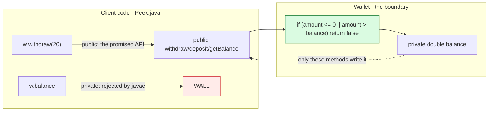

# Encapsulation

## 1. Learning Objectives

After this lesson you will be able to:

- [ ] Apply the four access levels (`private`, package, `protected`, `public`) and state exactly
      what each grants — no folklore.
- [ ] Protect an invariant with a `private` field plus behavior that enforces it, and demonstrate
      the compiler refusing direct access (executed, exact error text).
- [ ] Diagnose three states of the same wallet from output alone: valid, rejected, and the
      impossible one the design now prevents.
- [ ] Decide when a getter is honest and when it leaks — and produce a defensive copy for
      array/object state that clients must not mutate.
- [ ] Recognize "encapsulation theater" — `private` fields with setter pairs that re-export the
      same fragility — and name the design change that fixes it.

## 2. Prerequisites

- [classes-and-objects.md](classes-and-objects.md) — the fields, constructors, and invariants
  this lesson puts behind a boundary (its `Wallet` arrives with visible fields on purpose, so
  that this lesson's `private` has a before/after).
- [java-program-structure.md](java-program-structure.md) — top-level classes and same-file
  visibility (the `Peek` error depends on which file the accessing code lives in).
- [arrays-and-strings.md](arrays-and-strings.md) — `null` defaults and reference copying, the
  two reasons defensive copies exist.

**Environment used in this lesson:** every transcript executed on the author's machine —
JDK 25.0.4.1, `javac --release 21`.

## 3. Introduction

Encapsulation is the discipline that a class's *invariants are guarded by its own code*: state
that only the class's methods can touch, so every path that changes it is a path you wrote and
reviewed. The keyword `private` is the mechanism (one word, one compile error — executed below),
but the design content is the part that matters: **deciding what state exists, what operations
are legal, and what the outside world is allowed to see.**

## 4. The Problem It Solves

Leave `balance` visible for one week and it will be `balance = -50` somewhere — not from
malice, but because nothing stopped a hundred reasonable-looking lines from doing it: a debug
print that wrote, a refactor that "fixed" a withdrawal by assigning the field, a new client
that cached the value and used it stale. Every one of those bugs is *outside the class that
owns the invariant*, which means the owner cannot fix them by fixing itself. Encapsulation
moves the wall: outside code now fails **at compile time** (Example 2's exact error) instead of
at 2 a.m., and the class becomes the single place where "balance is never negative and never
moves without a reason" is written down — as code.

## 5. Core Concepts

### The four access levels

| Level | Visible to | Typical use |
|---|---|---|
| `private` | the enclosing class only | fields, helpers |
| *(package-private — no modifier)* | the same package | collaborators in one package, test peers |
| `protected` | package + subclasses | extension points for inheritors ([inheritance.md](inheritance.md)) |
| `public` | everywhere | the class's promised API |

Class members have exactly these four; the *class itself* is usually `public`. The executed
error below is the `private` row doing its job from a second file in the same package —
visibility, not distance, is what `private` measures.

### Invariants: the sentences a class promises are always true

For the wallet: *"balance ≥ 0, and balance changes only through deposit/withdraw."* The class
keeps the promise by making the field unreachable (`private`) and routing every change through
methods that check first (`withdraw` returns `false` instead of going negative). The output of
Example 1 shows all three verdicts the invariant can produce: allowed (`withdraw(20) → true`),
rejected as impossible (`withdraw(100) → false`, `withdraw(-5) → false`), and the balance never
visits a forbidden value — `balance now: 30.0`, reachable only by legal steps.

### Getters are read-only *views*, not fields with a button

`getBalance()` returns a `double` — a primitive, copied at return: the client receives a
snapshot and can do nothing to the original. For *reference* state (arrays, lists, objects) a
getter that returns the internal reference hands the wall's keys right back; the fix is a
**defensive copy** — return `clone()`/`new ArrayList<>(internal)` so mutations land on the copy.
Rule: **encapsulation ends where a reference leaves.**

### Encapsulation theater

`private double balance;` plus `public void setBalance(double b)` has changed nothing — the
invariant now sits one indirection away from where it used to be. The tell: methods that only
move data (setters with no rules, getters for fields nothing else protects). The design fix is
to ask per operation: *what does the client want to accomplish?* — then offer that as behavior
(`withdraw(20)` instead of `setBalance(30)`), which is where Example 1's boolean returns come
from: **tell, don't ask.**

## 6. How It Works



Two arrows, one per row of the table: `public` methods are the only path *into* the object
(green), and direct field access from outside is stopped at compile time (red). The guard sits
on the inside, so "balance stays valid" is checked where it can be trusted — clients cannot
skip it because clients cannot reach past it.

## 7. Practical Examples

**Example 1 — the invariant enforced from the inside (executed)**

```java
class Wallet {
    private double balance;                        // invisible from outside
    public boolean withdraw(double amount) {
        if (amount <= 0 || amount > balance) return false;   // invariants enforced inside
        balance -= amount;
        return true;
    }
    public void deposit(double amount) { if (amount > 0) balance += amount; }
    public double getBalance() { return balance; }
}
public class Encap {
    public static void main(String[] args) {
        Wallet w = new Wallet();
        w.deposit(50);
        System.out.println("balance: " + w.getBalance());
        System.out.println("withdraw(20)  -> " + w.withdraw(20));
        System.out.println("withdraw(100) -> " + w.withdraw(100));
        System.out.println("withdraw(-5)  -> " + w.withdraw(-5));
        System.out.println("balance now: " + w.getBalance());
    }
}
```

```console
$ javac --release 21 Encap.java && java Encap
balance: 50.0
withdraw(20)  -> true
withdraw(100) -> false
withdraw(-5)  -> false
balance now: 30.0
$ echo $?
0
```

- `deposit(50)` → `50.0` proves the write path works; the three withdrawal lines are the
  invariant *answering*: sufficient (`true`), overdraw (`false`), negative (`false`) — and the
  last line shows the balance only ever took legal steps (50 → 30, never 50 → −50).
- `deposit(-5)` would be silently ignored by `if (amount > 0)` — a deliberate choice with a
  trade-off (silently dropping bad input vs returning a verdict); the exercises make you defend
  or replace it.
- Note `withdraw` returns `boolean` instead of throwing — for a *routine* rejection, a verdict
  the caller can branch on is cheaper than an exception ([exceptions.md](exceptions.md) § when to
  throw vs return).

**Example 2 — the boundary with teeth (executed)**

```java
public class Peek {
    public static void main(String[] args) {
        Wallet w = new Wallet();
        System.out.println(w.balance);            // reaching past the boundary
    }
}
```

```console
$ javac --release 21 Peek.java
Peek.java:4: error: balance has private access in Wallet
        System.out.println(w.balance);            // reaching past the boundary
                            ^
1 error
$ echo $?
1
```

- Same package, other file — and still refused. The error names the field, the access level,
  and the class that owns it: `balance has private access in Wallet` — the compiler stating the
  design, not a typo. There is no flag, cast, or import that changes this; the *only* fixes are
  `getBalance()` (read via the promised API) or moving the code inside `Wallet` where it belongs.

**Example 3 — the defensive-copy line (executed pattern; source from
[classes-and-objects.md](classes-and-objects.md) Example 1's clone proof)**

The mechanism is byte-for-byte what Example 1 there executed: `int[] copy = nums.clone()` left
the original untouched while a shared reference would not have. Applied here:

```java
class SafeLedger {
    private double[] entries = new double[0];
    double[] snapshot() { return entries.clone(); }   // client gets a copy, not the wall's keys
}
```

- `snapshot()` (executed clone semantics: mutation of the returned array does not touch the
  field) is the difference between "encapsulated until the first getter" and actually
  encapsulated. Returning `entries` directly would reproduce `c = a` from the objects lesson at
  the first client `sort()`.

## 8. Real-World Applications

- **Domain entities in subject 11** are `private` fields with behavior: `order.cancel()`
  enforces "cannot cancel a shipped order" exactly the way `withdraw` enforces "cannot overdraw"
  — a rule asserted once, in one place, instead of in every caller's `if`.
- **Library design's core skill:** every JDK/Spring type you use chose its accessor surface on
  purpose — `Collections.unmodifiableList`, getters returning copies, builders that only
  validate at `build()`. Reading *why* a getter copies tells you what the class fears.
- **Security boundaries:** configuration and credential objects that keep secrets `private`
  (with `toString` overridden to not print them — a leak this subject's checklist flags in
  QA-05) rely on exactly this mechanism; `private` is the language-level version of "need to
  know".

## 9. Common Mistakes

| Mistake | Why it happens | How to recognize it | How to prevent it |
|---|---|---|---|
| Setter-pair encapsulation | Bean boilerplate reflex | Every field has `getX/setX`; invariant enforced nowhere | Per operation: is this a *rule*? Offer behavior, not assignment |
| Getter leaking internal array/list | "It's just a read" | Client sorts/fills and class's state changes | Defensive copy in and out (Example 3) — or an unmodifiable view |
| Public fields "until later" | Prototype speed | Field reads scattered across files (the `Peek` shape) | `private` from line one; the compiler error is a design review |
| Validation only in the UI/client | Layer confusion | Negative balances from scripts, API callers | Invariant checks live where the state lives — inside the class |
| God-class encapsulation | Mistaking locality for size | One class privately holds half the program | Encapsulation is per-object; still split by responsibility |
| `protected` as "private+" | Modifier confusion | Package sees everything anyway | The table above: `protected` = *subclass* reach, not privacy |
| Ignoring the boolean | Caller skips `if (withdraw(...))` | Silent non-withdrawal misread as success | Document the verdict; or throw on routine failure where callers routinely ignore (see exceptions lesson's rule of thumb) |
| Copying everything always | Fear-driven design | Getters that copy 10 MB per call | Copy at the *boundary* only — measure before defending |

## 10. Best Practices

- **Fields `private` by default; the shortest modifier that works is the wrong reflex — start
  with `private` and *widen deliberately*, one member at a time.**
- **One write path per piece of state**, and put the invariant check *first* in that path
  (guard clauses — the `if` in `withdraw` is exactly subject 02's early-return pattern).
- **Return primitives and copies; return live references only with a documented reason** — and
  when you do, say so in the javadoc-equivalent comment so the next reader can defend it.
- **Name methods for the verdict** (`withdraw` → `boolean` means it can refuse; `deposit` →
  `void` means it can't). Signatures document behavior better than comments do.
- **Push validation to construction** where possible ([classes-and-objects.md](classes-and-objects.md):
  unconstructible invalid states) — post-construction setters reintroduce half-built objects.
- **Test through the public API only.** If a test needs field access, the test is telling you
  the boundary is in the wrong place.

## 11. Limitations and Trade-Offs

- **Debugging gets harder honestly:** you cannot peek at `w.balance` in a REPL — mitigation is
  a good `toString`/`summary()` (overridden deliberately, per the objects lesson) rather than
  widened access.
- **Same-file classes and test peers** sometimes need package-private access; `private` at
  *class* granularity would force reflection, which is why the access table has four rows, not
  one. `protected` adds a different axis (inheritance) taken up next.
- **Encapsulation cannot fix a bad model.** A perfectly encapsulated `Bank` with forty fields
  and eighty setters is still wrong; the boundary only guarantees *who* can break invariants,
  not whether you drew the right ones. The independent exercise grades the drawing.
- **Cross-object invariants span classes** — "total of all wallet balances equals ledger sum"
  is not enforceable inside one wallet; you need an aggregate owner (a small preview of
  architecture in subject 16).

## 12. Practical Exercises

### Introductory

1. **Reproduce Examples 1 and 2** byte-for-byte. **Completion criteria:** five output lines from
   Example 1, the exact `balance has private access in Wallet` error from Example 2, and one
   sentence naming *which* line of Example 1's code is now the only way to change `balance`.
2. **Widen one step at a time.** Take Example 1's `Wallet` and, compiling after each change:
   (a) delete `private`, recompile `Peek` — does it pass? (b) make the class `final`-less and
   try `protected double balance;` from `Peek` in the same package. **Completion criteria:** a
   three-row table (modifier × compile result × why), with each compile actually run.

### Intermediate

3. **Find the leak.** Add `double[] auditTrail()` to a wallet class that returns its internal
   array; from `main`, sort the returned array and prove the field changed — then fix with a
   clone and prove it no longer does. **Completion criteria:** both proofs (before: mutated;
   after: not), with the changed line highlighted.
4. **Encapsulation audit of your own code.** Take your last subject-02 program (or the objects
   lesson's exercise): list every piece of state, its current access, who writes it, and what
   invariant each *should* have. **Completion criteria:** the table filled, the two worst
   entries refactored to `private` + behavior, both versions compiled, and the refactored
   version's output unchanged (before/after transcripts side by side).

### Independent problem-solving

5. **Design the API before the fields.** Spec a `Thermostat`: reads a temperature, holds a
   target, accepts adjustments from three sources (user, schedule, remote), refuses to run the
   heater if a door-sensor says "open". Write only the *public method signatures* first — each
   with its invariant role — then implement privately behind them; `main` must be able to drive
   a full scenario using only those signatures. **Completion criteria:** the signature list
   written before any field is declared; a scenario run whose output shows the refusal line
   when the door is open; an explicit answer to "which client need did you *not* expose, and
   what invariant does hiding it protect?"

*Solutions: attempt first; set practice in [exercises/README.md](exercises/README.md).*

## 13. Knowledge Check

1. Quote Example 2's error verbatim and name the four pieces of information it gives you.
2. `getBalance()` returning `double` needs no defensive copy, but `getEntries()` returning
   `double[]` does — what is the type-level difference, and what exact failure does each avoid?
3. Give an example where a setter is the *right* design (hint: what makes `setTarget` on a
   thermostat defensible while `setBalance` is not)?
4. Map each modifier to its audience — and name which one subject 15 will need for subclass
   extension points, which is *not* a privacy level.
5. The wallet prints `false` for `withdraw(100)` — state the alternative design (exception),
   cite the rule from [exceptions.md](exceptions.md) that decides between them, and say which
   this case satisfies.

## 14. Completion Criteria

Observable evidence that you have understood this lesson:

- [ ] Both executed transcripts reproduced — the five-line behavior run and the `private access`
      compile refusal
- [ ] You have written a class with `private` state, invariant-guarding behavior, and no
      setters — compiling a client that drives it entirely through methods
- [ ] You produced a before/after defensive-copy proof (shared vs cloned array)
- [ ] You can point at one getter in your code that leaks and one that doesn't, with the type
      reasoning in both cases
- [ ] You can explain, in one sentence each, why `private` fails at *compile* time while an
      invariant violation fails at *run* time — and why you need both

## 15. Summary

- Four access levels; `private` means *this class only*, proven by a compile error from a
  sibling file (`balance has private access in Wallet`).
- **Invariants live with the state that keeps them** — one guarded write path, verdict-returning
  behavior, invalid states rejected at the door.
- **A reference leaving the object ends encapsulation** — primitive getters copy for free;
  reference getters must clone.
- Setter-pairs are theater; offer *operations with rules*, not assignment.
- Encapsulation guarantees *who* can break the rules — drawing the right object boundaries is
  the next lesson's subject ([inheritance.md](inheritance.md) starts the composition side).

## 16. Next Steps

- Next lesson: [inheritance.md](inheritance.md) — extending a class without breaking its
  boundary, and why "is-a" is a stronger claim than code reuse.
- Practice: [exercises/README.md](exercises/README.md) set 8.
- Where it is applied: [11-BACKEND-ENGINEERING](../11-BACKEND-ENGINEERING/README.md) service
  classes and every entity framework's field-visibility conventions.
