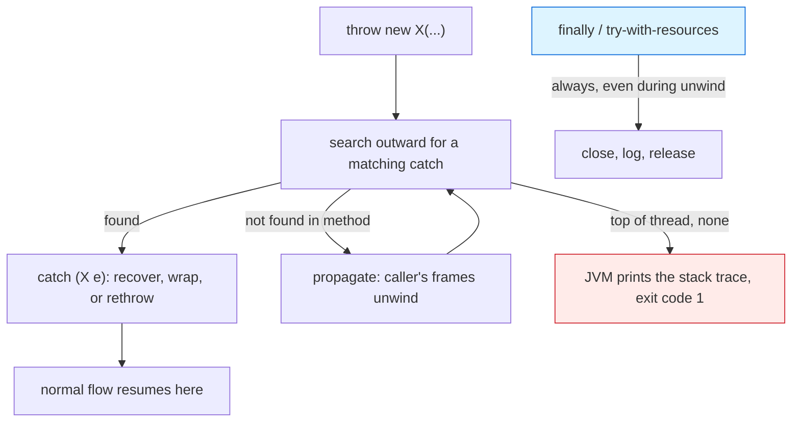

# Exceptions

## 1. Learning Objectives

After this lesson you will be able to:

- [ ] Throw, catch, propagate, and wrap exceptions — and state for any given error *which of the
      four* is the right response.
- [ ] Read a real Java stack trace top-down: message, throw site, frame chain, cause.
- [ ] Explain checked vs unchecked exceptions as a *design choice the compiler enforces*, using
      the executed `unreported exception IOException` refusal as evidence.
- [ ] Use `finally` and try-with-resources correctly — including what runs when a `continue`,
      `break`, or return sits inside the `try`.
- [ ] Write a custom checked exception that preserves its cause, and say when a custom type earns
      its keep.
- [ ] Name the four silent-failure classes this curriculum has already executed — swallowed
      overflow, empty `catch {}`, ignored return values, `null` defaults — and place exceptions
      in that map.

## 2. Prerequisites

- [methods.md](methods.md) — `throws` clauses, `main(...)`, and why a method's signature includes
  the errors it may raise.
- [operators-and-control-flow.md](operators-and-control-flow.md) — the executed `ArithmeticException`
  from short-circuit evaluation is this lesson's running example.
- [arrays-and-strings.md](arrays-and-strings.md) — `ArrayIndexOutOfBoundsException` and the
  helpful `NullPointerException` message appear here as the exception types they are.
- [02-PROGRAMMING-FUNDAMENTALS/debugging-fundamentals.md](../02-PROGRAMMING-FUNDAMENTALS/debugging-fundamentals.md) —
  the reading-the-evidence habit, now applied to traces.

**Environment used in this lesson:** every transcript executed on the author's machine —
JDK 25.0.4.1, `javac --release 21`. Line numbers inside stack traces are from the exact sources
printed; your lines will match only if your file matches.

## 3. Introduction

An exception is a *typed, structured refusal to continue*: the point of failure constructs an
object describing what went wrong, the normal path stops, and control travels outward until
somebody catches that object. Compared to the alternatives — error codes you forget to check,
globals like `errno`, crashes without context — exceptions have two properties that make them
worth their awkwardness: they **cannot be silently ignored** the way a return value can (the
compiler forces checked ones to be addressed), and they carry **a stack trace that points at
the failure's history**, not just its discovery.

## 4. The Problem It Solves

Without exceptions, every operation that can fail needs its own success channel: `if (parse(s)
!= ERROR)` … `if (result == null)` … `if (rc < 0)` … — and every caller that forgets one check
turns a bug into corrupted data. Worse, errors that *must* cross several layers (a file problem
three calls deep) force every frame to thread the failure back manually. Exceptions invert the
default: **normal code reads as the normal path**, and failure handling is written once at the
layer that can actually decide what to do — propagate when you can't, catch when you can. The
JVM's bounds checks, the compiler's definite-assignment rules, and `javac`'s `unreported
exception` refusal are all this same system at different layers.

## 5. Core Concepts

### Anatomy: throw, type, catch, propagate

- **Throw** constructs and raises an object: `throw new IOException("empty path")`. Everything
  throwable extends `Throwable` → `Error` (VM problems — `StackOverflowError`,
  `OutOfMemoryError`; never catch) or `Exception` → `RuntimeException` and siblings
  (unchecked) vs checked exceptions like `IOException`.
- **Catch** at a layer that can *do something*: recover, translate, or fail with context.
- **Propagate** with `throws IOException` in the signature when no caller-frame should handle it
  yet — the compiler tracks this across every call, and the error is executable proof
  (Example 2): `unreported exception IOException; must be caught or declared to be thrown`.
- **Wrap** when a lower-level error needs domain meaning: keep the original as the *cause*
  (executed in Example 3 — `wrapper: could not load` over `cause: db down`).

### Checked vs unchecked — the line Java draws

Checked = everything under `Exception` except `RuntimeException`: `IOException`,
`ParseException`, your own `Exception` subclasses. The **compiler** refuses to compile a call
path that ignores them (Example 2). Unchecked = `RuntimeException` family (`NullPointerException`,
`ArithmeticException`, `ClassCastException`, `ArrayIndexOutOfBoundsException`) and `Error`s: the
assumption is they indicate *programming* bugs, so forcing every signature to list them would be
noise. The rule of thumb this subject uses: **if a caller can reasonably be expected to handle
it, make it checked; if it means "your code is wrong," make it unchecked.**

### `finally`, and try-with-resources — what always runs

`finally` executes whether the `try` completed, threw, or left via `break`/`continue`/`return` —
executed in Example 1's loop (both `finally` lines printed on the *break* path and the
*continue* path). Resources that must close get try-with-resources (`try (var br = …)`), which
is `finally` for closables without the ceremony: the header's variable is closed in reverse
order even on exception.

### Reading a stack trace

Innermost frame first: the line *after* `Exception in thread "main"` is the throw site; the
frames below show the path that got there. Example 1's `nested` trace is the picture — five
frames, `main` at the bottom, throw at `Ex1.java:13`. After the frames, modern JDKs may add
`Caused by:` chains (a *cause*, as Example 3 constructs deliberately).

### The silent-failure map (why exceptions are only half the story)

Executed elsewhere in this subject: overflow does **not** throw ([variables-and-types.md](variables-and-types.md)
Example 5), boolean-returning methods can be ignored, `null` defaults wait for an NPE
([arrays-and-strings.md](arrays-and-strings.md)), empty `catch {}` erases evidence (below).
Exceptions are loud *when they reach somebody* — your job is to never silence them and never
rely on them where the failure is silent by design.

## 6. How It Works



The JVM walks the call stack outward looking for a `catch` whose type matches — the *search* is
the mechanism; propagation is just frames disappearing while the search continues. If the stack
empties, the thread (often the program) dies with the trace. `finally` is bolted onto every
unwind: it runs mid-search, whichever direction things are headed.

## 7. Practical Examples

**Example 1 — one program, every mechanism (executed)**

```java
import java.io.IOException;
import java.io.StringReader;

public class Ex1 {
    static int parseAge(String s) {
        try { return Integer.parseInt(s); }
        catch (NumberFormatException e) { return -1; }
    }
    static void rethrow(String path) throws IOException {
        if (path.isEmpty()) throw new IOException("empty path");
    }
    static void nested(int depth) {
        if (depth == 0) throw new IllegalStateException("depth 0");
        nested(depth - 1);
    }
    public static void main(String[] args) {
        System.out.println("parseAge(17)=" + parseAge("17") + "  parseAge(oops)=" + parseAge("oops"));
        try { rethrow(""); }
        catch (IOException e) { System.out.println("caught: " + e.getMessage()); }
        try { System.out.println(10 / 0); }
        catch (ArithmeticException e) { System.out.println("div -> " + e); }
        try { int[] a = new int[2]; a[3] = 1; }
        catch (ArrayIndexOutOfBoundsException e) { System.out.println("aioobe -> " + e.getMessage()); }
        try (var br = new java.io.BufferedReader(new StringReader("line1\nline2"))) {
            System.out.println("twr read: " + br.readLine());
        } catch (IOException e) { System.out.println("io -> " + e); }
        int i = 0;
        while (true) {
            try { if (i++ > 0) break; continue; }
            finally { System.out.println("finally runs (i=" + i + ")"); }
        }
        try { nested(3); }
        catch (IllegalStateException e) {
            System.out.println("caught nested: " + e.getMessage());
            e.printStackTrace();
        }
        System.out.println("done");
    }
}
```

```console
$ javac --release 21 Ex1.java && java Ex1
parseAge(17)=17  parseAge(oops)=-1
caught: empty path
div -> java.lang.ArithmeticException: / by zero
aioobe -> Index 3 out of bounds for length 2
twr read: line1
finally runs (i=1)
finally runs (i=2)
caught nested: depth 0
java.lang.IllegalStateException: depth 0
	at Ex1.nested(Ex1.java:13)
	at Ex1.nested(Ex1.java:14)
	at Ex1.nested(Ex1.java:14)
	at Ex1.nested(Ex1.java:14)
	at Ex1.main(Ex1.java:32)
done
$ echo $?
0
```

- Line 1: a *catch* that recovers (`-1` is the contract for unparseable input) — the exception
  was handled at the layer that owns the decision. Line 2: a *checked* exception thrown and
  caught in the same frame. Line 3: `div ->` prints the object — `toString()` on a throwable is
  `fully.qualified.Type: message`.
- `finally runs (i=1)` proves `continue` still pays the `finally` bill; `finally runs (i=2)`
  proves `break` does too — both printed on the way out of the loop.
- The `nested` trace: **frame 1 is the throw site** (`Ex1.java:13` — the `throw` statement),
  frames 2–4 are the recursive calls, frame 5 is `main`. Read top-down for *where*, bottom-up
  for *how we got here*.
- The program still ends `0` — a caught exception is a handled event, not a crash.

**Example 2 — the compiler forces the decision (executed)**

```java
import java.nio.file.Files;
import java.nio.file.Path;

public class NoHandle {
    public static void main(String[] args) {
        Files.readString(Path.of("x.txt"));
    }
}
```

```console
$ javac --release 21 NoHandle.java
NoHandle.java:6: error: unreported exception IOException; must be caught or declared to be thrown
        Files.readString(Path.of("x.txt"));
                        ^
1 error
$ echo $?
1
```

- `readString` may fail (file missing, locked, unreadable) — javac refuses to compile code that
  pretends otherwise. The two fixes: `try/catch` around it, or `main(...) throws IOException`
  (handing the decision upward). There is no third option and no ignore-flag — that is what
  *checked* means.

**Example 3 — custom type, preserved cause (executed)**

```java
public class CustomEx {
    static class DataException extends Exception {
        DataException(String msg, Throwable cause) { super(msg, cause); }
    }
    static void load(String why) throws DataException {
        try { throw new java.io.IOException(why); }
        catch (java.io.IOException e) { throw new DataException("could not load", e); }
    }
    public static void main(String[] args) {
        try { load("db down"); }
        catch (DataException e) {
            System.out.println("wrapper: " + e.getMessage());
            System.out.println("cause:   " + e.getCause().getMessage());
        }
    }
}
```

```console
$ javac --release 21 CustomEx.java && java CustomEx
wrapper: could not load
cause:   db down
$ echo $?
0
```

- `DataException` earns its keep because *callers can now distinguish it* from unrelated
  failures without string-matching messages. The cause survives: the low-level fact (`db down`)
  is still reachable for logs even though the catch saw only the domain-level wrapper.

## 8. Real-World Applications

- **Service layers** (subject 11) follow the Example 3 pattern exactly: infrastructure exceptions
  (`SQLException`, HTTP client failures) are caught once at a boundary and rethrown as domain
  exceptions (`OrderNotFound`, `PaymentDeclined`) with causes intact for logs.
- **`main` and job runners** catch *once* at the top, log the trace, and exit non-zero — the
  pattern your exercises use so failures are visible in CI.
- **Try-with-resources** is how every file, socket, and database handle in production code is
  written; the manual `finally`-close you might meet in older code is the problem it replaced.

## 9. Common Mistakes

| Mistake | Why it happens | How to recognize it | How to prevent it |
|---|---|---|---|
| `catch (Exception e) {}` — silent swallow | "Make it compile" reflex | Bug vanishes; later symptom has no trace | Never empty: log, wrap, or rethrow — the compiler error was trying to tell you something |
| Catching too early (deep in the stack) | Fear of the `throws` clause | Trace caught where nothing can be done; context lost | Catch only where a decision exists; otherwise propagate |
| Catching too broadly (`catch (Exception)` mid-stack) | Wanting one handler for all | Unrelated failures mislabeled as the same problem | Narrowest type that changes your response; `Exception` only at the program's outermost edge |
| Using exceptions for normal flow | Familiarity from languages where they're cheap | `parseInt` in a loop, exceptions as booleans | Parse properly or validate first; exceptions cost stack-frame work and readability |
| Catching and losing the cause | Wrapping without `super(msg, cause)` | `Caused by:` chain dead-ends | Constructor with `Throwable cause` — as in Example 3 |
| `catch (RuntimeException)` to "be safe" | Unchecked errors feel scarier | Programming bugs laundered into business paths | Fix the bug; unchecked means *your code* is wrong |
| Catching `Error` types | Broad catch-all | `catch (Throwable)` swallowing `OutOfMemoryError` | Never catch `Error`; let the VM die loudly |
| Resources closed in `finally` by hand, minus one path | Pre-try-with-resources habit | Handle leak under exception paths | `try (var x = open())` — closing becomes structural |

## 10. Best Practices

- **Catch only where you can act.** A handler must do one of: recover, add context and rethrow,
  or translate to a domain type. If it does none of those, it belongs further out — or nowhere.
- **Fail at the boundary, remember in the cause.** Wrap low-level exceptions in domain ones with
  `super(msg, cause)`; logs keep the detail, callers keep the simplicity.
- **Let `finally`/try-with-resources own cleanup.** Open in the header, never close in the body;
  cleanup that follows control flow statements can't be skipped by a `return`.
- **Top-of-the-stack catch in `main`:** log the trace to stderr, exit non-zero. One handler, no
  decisions above it.
- **Unchecked for programmer errors, checked for environmental ones** — and if you find yourself
  catching the same checked exception in twenty places, the *signature* is wrong: move the
  decision up to where the error first becomes meaningful.
- **Validate before you throw when it's cheaper** — an early `if (n <= 0) throw …` with a clear
  message beats an `ArithmeticException` three frames deep (guard clauses from
  [operators-and-control-flow.md](operators-and-control-flow.md)).

## 11. Limitations and Trade-Offs

- Checked exceptions are divisive: they make failure explicit, and they infect signatures
  (`throws` chains) that teams often route around with wrapping. Java's own ecosystem hedges
  (JDBC's checked exceptions are almost always wrapped immediately). Know the tool, and know
  that *the curriculum's default for application code is: checked at the boundary, unchecked
  underneath, domain types in between*.
- Exceptions are not cheap where they're frequent: constructing traces costs frames — never use
  them as loop control for conditions that occur normally.
- A caught exception thrown away is worse than a crash — a crash at least keeps the trace
  (Example 1's uncaught form exits 1 with full evidence; the empty `catch` exits 0 with none).
- The JVM's own loudest failures — `Error` types — are *not* for handling: an
  `OutOfMemoryError` that "recovered" (executed in [jvm-and-memory.md](jvm-and-memory.md) as a
  death inside the reporting code) shows why. Treat them as diagnostic, not as control flow.

## 12. Practical Exercises

### Introductory

1. **Reproduce Example 1 fully**, then remove the `catch (IOException)` around `rethrow("")` and
   add `throws IOException` to `main` instead. **Completion criteria:** both versions compile
   and run (the second ending at `done` too), and one sentence stating which layer now owns the
   decision — and why that is the honest answer for a `main`.
2. **Provoke the checked refusal.** Compile Example 2 as printed. Then add *only* a `catch
   (IOException e) { System.out.println("read failed"); }` and compile again. **Completion
   criteria:** the exact `unreported exception IOException` transcript captured first, and the
   fixed version's output after.

### Intermediate

3. **Stack-trace reading on your own trace.** Write `a → b → c` where `c` throws
   `IllegalStateException("bottom")`; catch in `a` and `printStackTrace()`. **Completion
   criteria:** the trace shows three frames bottom-up with the throw line in `c`, and you can
   point to the frame that *decided* to handle it.
4. **The `finally` matrix.** For each of `return`, `break`, `continue`, and normal end inside a
   `try`, print from `finally`. **Completion criteria:** four runs showing the `finally` line
   in all four cases — the executed behavior section 6 claims.
5. **Wrap-and-preserve.** Take Example 3; remove the `cause` argument and confirm
   `e.getCause()` prints `null`; restore it and capture both outputs. **Completion criteria:**
   both transcripts, plus the rule you will follow when wrapping (from now on).

### Independent problem-solving

6. **Design an error hierarchy for a loan-application service.** Spec: validation failures
   (user-fixable), not-found (lookup misses), infrastructure timeouts (retryable). Produce:
   three exception types with when-to-throw documentation, the signature of the service method
   that raises them, and a `main`-level handler showing which are caught vs propagated.
   **Completion criteria:** a compile-clean demo where each type is thrown and observed
   (print a distinguishing line per catch), one custom type that *wraps* a cause from a lower
   layer, and a written justification for every checked/unchecked choice — including one place
   you deliberately chose *not* to throw (a validation that returns a result instead), with the
   reason.

*Solutions: attempt first; set practice in [exercises/README.md](exercises/README.md).*

## 13. Knowledge Check

1. `Files.readString` compiled without complaint in Example 1's program but not in Example 2's —
   what structural difference in the *surrounding code* explains it?
2. Walk Example 1's five-frame trace: which frame is the throw site, which is the decider, and
   what would add a `Caused by:` section?
3. State the checked/unchecked boundary as the JVM sees it, and one case where you would choose
   each for an exception *you* write.
4. What guarantees does `finally` make across `break`, `continue`, `return`, and thrown
   exceptions — and which mechanism in try-with-resources relies on exactly that guarantee?
5. Name two failures from earlier lessons that *never produce an exception at all*, and explain
   why catching harder would not have helped.

## 14. Completion Criteria

Observable evidence that you have understood this lesson:

- [ ] Example 1 runs byte-for-byte, and you can point at the two `finally` lines and say which
      loop statement each one rode out on
- [ ] You have captured the `unreported exception` refusal yourself, then fixed it both ways
- [ ] You can read a fresh stack trace in under a minute: message, throw site, path, cause
- [ ] Your custom exception demo preserves a cause (both printed lines)
- [ ] You can list the silent-failure map — the failures no `catch` will ever see — with one
      executed example each

## 15. Summary

- Exceptions are **typed refusal**: throw an object, JVM searches outward for a matching `catch`,
  else the trace ends the thread.
- **Checked = compiler-enforced attention** (`unreported exception IOException` is the proof);
  unchecked = "your code is wrong" — the division is a design line, not a fact of nature.
- **`finally` always runs** — cleanup by structure (try-with-resources), not by discipline.
- **Wrap with causes intact**; catch only where a decision exists; never empty-catch, never
  catch `Error`.
- **Half of real failure is silent** — overflow, ignored returns, `null` defaults, empty catches
  live outside this system entirely.

## 16. Next Steps

- Next lesson: [collections-framework.md](collections-framework.md) — the first library whose
  *contract* can throw (`IndexOutOfBounds` from `List`, `UOE` from `List.of`) — exceptions as
  API documentation.
- Practice: [exercises/README.md](exercises/README.md) set 6.
- Where it is applied: [11-BACKEND-ENGINEERING](../11-BACKEND-ENGINEERING/README.md)'s
  error-handling layer is this lesson scaled to a whole service.
