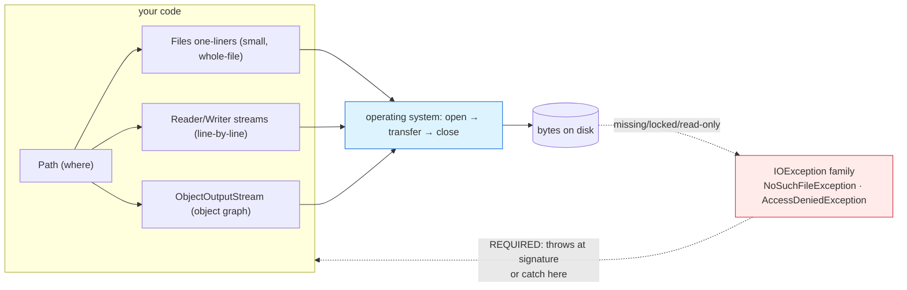

# File Handling

## 1. Learning Objectives

After this lesson you will be able to:

- [ ] Use `Path` as the value type it is — build it, join it, ask about it — instead of
      string-concatenating paths, and say why `Path.of("a", "b")` beats `"a/" + b`.
- [ ] Read and write text files with the `Files` one-liners (`writeString`, `readAllLines`,
      `write` with append, `lines`) — and reproduce the executed byte count that proves what
      `writeString` actually wrote.
- [ ] Choose between the `Files` one-liners and the buffered `Reader`/`Writer` pair, using the
      executed uppercase-copy example as the shape of each.
- [ ] Turn "the file isn't there" from a stack trace into a **typed, caught outcome** —
      `NoSuchFileException` — using the executed refusal at the end of Example 1.
- [ ] Apply the two safety rules every file API obeys: `throws IOException` at the signature, and
      try-with-resources for every stream you open.
- [ ] Serialize and deserialize an object round-trip (`Serializable`, `ObjectOutputStream`), read
      the executed `NotSerializableException` refusal, and state erasure's file-time consequence.

## 2. Prerequisites

- [exceptions.md](exceptions.md) — checked exceptions, `catch` by type, try-with-resources;
  this lesson is exceptions applied to their most common habitat.
- [generics.md](generics.md) — `List<String>` in, `List<String>` out of `readAllLines`.
- [methods.md](methods.md) and [operators-and-control-flow.md](operators-and-control-flow.md) —
  `String.join`, loops, and `&&` for the existence checks.
- [03-DEVELOPER-TOOLS/terminal-fundamentals.md](../03-DEVELOPER-TOOLS/terminal-fundamentals.md) —
  files from the shell's side (`cat`, `wc`, exit codes) for reading these transcripts.

**Environment used in this lesson:** every transcript executed on the author's machine —
JDK 25.0.4.1, `javac --release 21`, Git Bash on Windows (line endings noted where they matter).

## 3. Introduction

So far every program in this subject has died with its variables. A file is how a program
**remembers between runs and shares with other programs** — the same bytes you have been
creating with `echo > file` in subject 03, now reached from inside Java. The lesson's shape:
Java splits the job into a *value type* (`Path` — where), a *static toolbox* (`Files` — what),
and *streams* (`Reader`/`Writer`/`ObjectOutputStream` — how, for the cases the toolbox doesn't
cover); every one of them can fail at any moment, so the compiler forces the failure conversation
you learned in exceptions to happen **before** the file does.

## 4. The Problem It Solves

Without file I/O a program's only outputs are the console (gone when the window closes) and
variables (gone at `main`'s end). Everything real needs persistence: a config your program reads,
a log it appends, a report it exports, a cache between runs — subjects 09 (JSON),
10 (SQL), and 11 (services) are all *file-shaped problems* with servers attached. The second
problem files uniquely create is that **the disk is not yours**: it may be missing, locked,
read-only, half-written, or populated by a different program — so file APIs are where Java's
checked exceptions stop being a classroom exercise and start being the only honest interface.

## 5. Core Concepts

### `Path` — a value type, not a string

`Path p = Path.of("notes.txt")` parses a string *for your platform* into a path object with
methods: `resolve` (join: `p.resolve("sub")`), `getParent`, `getFileName`, `toAbsolutePath`,
`Files.exists(p)`. `Path.of("dir", "f.txt")` joins with the platform's own separator — the one
portability bug string concatenation (`"dir/" + f`) bakes in silently on Windows, where `/`
happens to mostly work until it doesn't. Paths *compare* with `equals`/`hashCode`, and passing a
`Path` where an `InputStream` is expected is a compile error — the type system catching the
wrong-argument class of bug.

### `Files` — the static toolbox, one-liners per job

Executed in Example 1: `writeString(p, "alpha\nbeta\n")` overwrites; `readAllLines(p)` →
`[alpha, beta]`; `size(p)` → **11** (bytes, not characters — `\n` is one byte here, and a
non-ASCII file would show you the difference); append is **explicit** (`StandardOpenOption.APPEND`),
never implicit; `Files.write(p, List.of(…), APPEND)` writes *lines* with separators for you;
`Files.copy` needs `REPLACE_EXISTING` or it refuses to clobber (deliberate — the same
conservatism as `Files.delete` on a missing file); `Files.lines(p)` streams lines lazily in a
try-with-resources; and `NoSuchFileException` is a **subclass of `IOException`** you can catch
by its exact type — the executed last block printed `NoSuchFile: missing.txt` and the program
still exited **0** because the failure was *handled*, not swallowed (compare exit codes in
[exceptions.md](exceptions.md)).

### Streams — when the one-liners don't fit

`BufferedReader.readLine()` returns `null` at end-of-file — the canonical `while ((l = br.readLine()) != null)`
loop, executed in Example 1's uppercase copy — and `BufferedWriter` batches writes instead of
touching the disk per line. Rule of thumb: **`Files` one-liners for whole files that fit in
memory; streams for line-by-line processing, filtering, or files bigger than memory.** The
`try (var s = Files.lines(p))` form shows the toolbox and streams meeting — the `lines` stream
*must* be closed (it holds the file open), hence try-with-resources rather than a bare call.

### Serialization — objects across the byte boundary

`implements Serializable` marks a class as writable; `ObjectOutputStream.writeObject` produced a
binary `user.bin`, `readObject` read it back — executed `round-trip: Ada age=36`, identity of
fields restored through a file. Two lessons collide visibly here: exceptions (`NotSerializableException`
for the plain `new Object()` — `java.lang.Object` printed as the refusing type) and
**erasure** (`readObject` returns `Object`; your cast ` (User) …` is the one place generics
cannot help — Java's serialization API predates them and never gained type parameters). The
`serialVersionUID` line in Example 2 is the compatibility contract: without it, any class edit
breaks old files silently.

## 6. How It Works



Left-to-right is every path a file request takes; the red back-edge is the loop the compiler
forces: **no call reaches the OS without a declared failure plan.** Three front doors (toolbox,
streams, serialization) converge on one OS boundary — which is why the failure types are shared
and the safety rules are the same for all three.

## 7. Practical Examples

**Example 1 — the whole `Files` toolbox, executed end-to-end**

```java
import java.io.*;
import java.nio.file.*;
import java.util.List;

public class Files1 {
    public static void main(String[] args) throws IOException {
        Path p = Path.of("notes.txt");
        Files.writeString(p, "alpha\nbeta\n");
        List<String> lines = Files.readAllLines(p);
        System.out.println("lines=" + lines + " bytes=" + Files.size(p));
        Files.writeString(p, "gamma\n", StandardOpenOption.APPEND);
        try (var s = Files.lines(p)) { s.forEach(l -> System.out.println("  > " + l)); }
        Files.write(p, List.of("one", "two"), StandardOpenOption.APPEND);
        System.out.println("after write-list: " + String.join("|", Files.readAllLines(p)));
        Path copy = Path.of("copy.txt");
        Files.copy(p, copy, StandardCopyOption.REPLACE_EXISTING);
        System.out.println("copy exists=" + Files.exists(copy));
        try (BufferedReader br = new BufferedReader(new FileReader("notes.txt"));
             BufferedWriter bw = new BufferedWriter(new FileWriter("out.txt"))) {
            String l; int n = 0;
            while ((l = br.readLine()) != null) { bw.write(l.toUpperCase()); bw.newLine(); n++; }
            System.out.println("upper-copied lines=" + n);
        }
        System.out.println("out.txt: " + String.join("|", Files.readAllLines(Path.of("out.txt"))));
        Files.delete(copy);
        System.out.println("copy exists after delete=" + Files.exists(copy));
        try { Files.readString(Path.of("missing.txt")); }
        catch (NoSuchFileException e) { System.out.println("NoSuchFile: " + e.getFile()); }
        Files.delete(p);
        Files.delete(Path.of("out.txt"));
    }
}
```

```console
$ javac --release 21 Files1.java && java Files1
lines=[alpha, beta] bytes=11
  > alpha
  > beta
  > gamma
after write-list: alpha|beta|gamma|one|two
copy exists=true
upper-copied lines=5
out.txt: ALPHA|BETA|GAMMA|ONE|TWO
copy exists after delete=false
NoSuchFile: missing.txt
$ echo $?
0
```

- **Read line-by-line in order:** `bytes=11` is `"alpha\nbeta\n"` counted as *bytes* (6+5) —
  `size` never lies about encoding; the three `>` lines are `Files.lines` streaming the file
  after the first append (gamma), before the list-append added `one|two` — read the joined line
  (`alpha|beta|gamma|one|two`) as a transcript of *both* appends in order.
- `upper-copied lines=5` counts with the `readLine` loop itself — end-of-file is `null`, not an
  exception — and `out.txt` proves case transformation through a file round-trip (both files
  deleted afterward: the program leaves nothing behind, the discipline you want in tests).
- The **`throws IOException` on `main`** is why all of this compiles at all — and the *one*
  failure the program chose to handle itself is the typed `NoSuchFileException`: printed name,
  caught by type, exit **0**. Everything else delegated to the signature; one thing was handled
  locally. That ratio is the judgement call of the whole exceptions lesson applied to files.

**Example 2 — serialization round-trip, and its refusal (executed)**

```java
import java.io.*;

public class Ser {
    static class User implements Serializable {
        private static final long serialVersionUID = 1L;
        String name; int age;
        User(String name, int age) { this.name = name; this.age = age; }
    }
    public static void main(String[] args) throws Exception {
        try (ObjectOutputStream oos = new ObjectOutputStream(new FileOutputStream("user.bin"))) {
            oos.writeObject(new User("Ada", 36));
        }
        try (ObjectInputStream ois = new ObjectInputStream(new FileInputStream("user.bin"))) {
            User back = (User) ois.readObject();
            System.out.println("round-trip: " + back.name + " age=" + back.age);
        }
        try (ObjectOutputStream oos = new ObjectOutputStream(new FileOutputStream("bad.bin"))) {
            oos.writeObject(new Object());
        } catch (NotSerializableException e) {
            System.out.println("NotSerializable: " + e.getMessage());
        }
        new File("user.bin").delete();
        new File("bad.bin").delete();
    }
}
```

```console
$ javac --release 21 Ser.java && java Ser
round-trip: Ada age=36
NotSerializable: java.lang.Object
$ echo $?
0
```

- Fields **and their types** survived the disk: `Ada` came back typed enough for
  `back.name + " age=" + back.age` to compile — though note the `readObject` cast is the
  pre-generics wart flagged in [generics.md](generics.md) (erasure: the stream can't know).
- The refusal is caught **by exact type** and prints the refusing class from `getMessage()` —
  `java.lang.Object` didn't implement `Serializable`, and Java named it.
- **Transitive rule worth stating:** one non-serializable field anywhere in the object graph
  fails the whole write at that object's position — which is how to read a real
  `NotSerializableException: com.acme.DbConnection` (it's telling you exactly which member
  dragged the graph down).

## 8. Real-World Applications

- **Config and reports** — read a properties/CSV file at startup, export results as CSV/TSV at
  the end: both are exactly Example 1's lines with real file names; subject 11 does JSON on the
  same `readString`/`writeString` skeleton with a parser.
- **Logs** — append-mode writes (`StandardOpenOption.APPEND`) with a timestamp prefix is a
  fifty-line logger you will build in subject 08's capstone; the pattern is `Files.write(log,
  List.of(line), APPEND)`.
- **Serialization at the edges** — Java's binary serialization appears in caches, session
  stores, and RMI-style transports; more often you'll meet it as *why not to use it* (the
  format's security history is why JSON/XML wins for untrusted bytes — noted honestly here, and
  [11-BACKEND-ENGINEERING](../11-BACKEND-ENGINEERING/README.md) picks up the safe side).
- **Caching between runs** — keys this subject's later lessons: a `computed results` file means
  the second run of an expensive script starts warm; the `Files.exists` check is the cache hit.

## 9. Common Mistakes

| Mistake | Why it happens | How to recognize it | How to prevent it |
|---|---|---|---|
| String paths (`"dir/" + name`) | Shell habits from subject 03 | Breaks on the other OS; no join/normalize | `Path.resolve("dir", name)` / `Path.of(a, b)` |
| Forgetting `APPEND` → overwrote the file | Default of `writeString` is truncate | Old content gone after one write | Append is explicit; state intent in the method name you write |
| Missing `throws IOException` / catching too narrow | Not expecting the OS to fail | `unreported exception IOException` at compile time | Signature-level `throws` for `main`/services; catch only the ones you handle |
| Swallowing (`catch (Exception e) {}`) | "make it compile" | Silent data loss — no output, no exit code | Caught ≠ swallowed: print, rethrow, or convert to a typed outcome |
| Not closing streams (`FileWriter` left open) | try-with-resources skipped | Truncated file *later*, Windows file locks | `try (var x = …)` for **every** open — two resources, one `try` |
| Assuming `readAllLines` encoding | Default-charset roulette | Mojibake on another machine | State `UTF_8` explicitly when files cross machines |
| `Files.delete` on possibly-missing file | Cleanup code | `NoSuchFileException` from *cleanup* | `deleteIfExists` for the cleanup direction |
| `readObject` + untrusted file | Format used as a shortcut | `StreamCorruptedException` / worse — gadget exploits | Don't deserialize untrusted bytes; JSON for interchange |
| Skipping `serialVersionUID` | "it works today" | `InvalidClassException` after any edit | Declare `private static final long serialVersionUID = 1L` from day one |

## 10. Best Practices

- **`Path` at the edges, strings inside** — accept/build `Path` everywhere; convert to `String`
  only for display.
- **Whole small file → `Files` one-liner; big or streaming → `lines()`/readers** — the executed
  Example 1 is literally both halves side by side; pick by size and need.
- **`throws IOException` up, handle only what you can act on** — Example 1's ratio (one local
  `NoSuchFileException` catch, everything else declared) is the template.
- **Try-with-resources is not optional** — one `try (` header with both reader and writer was
  all the safety in the copy loop; closing is the compiler's job now.
- **Explicit encoding whenever bytes leave your machine** (`StandardCharsets.UTF_8`) —
  "platform default" is a time zone for files.
- **Leave the disk as you found it in tests** — the deletes at Example 1's end make the program
  re-runnable; tests that pollute the working directory are tomorrow's flaky suite.
- **Serialization for Java-to-Java, text for everything else** — and if Java-to-Java must cross
  versions, `serialVersionUID` is contract, not decoration.

## 11. Limitations and Trade-Offs

- **Binary serialization is version-fragile and unsafe on untrusted input** — the format
  evolved from "handy object dump" to a documented attack surface; text formats (subject 11)
  trade space and speed for auditability. Know both, choose deliberately.
- **`readAllLines` loads whole files** — elegant until the file is 4 GB; streams scale but
  re-introduce manual loops (and their off-by-one surface). The size/memory trade decides.
- **Checked `IOException` is noisy** — a deliberate Java trade: file code *cannot* pretend
  failure is exceptional-by-omission; frameworks often wrap it in `UncheckedIOException` —
  know which convention your codebase picked.
- **Platform dependence hides in separators, case sensitivity, and locks** — `Path` erases the
  separator difference, but a file named `X` vs `x` still bites across OSes; Windows file
  locking makes delete-while-open fail where Unix won't. Test on both when it matters.
- **No atomic write in the one-liners** — `writeString` truncates then writes; a crash mid-write
  leaves a half-file. Solutions (temp file + `ATOMIC_MOVE`) are exactly the kind of hard-won
  detail this subject's exercises reward.

## 12. Practical Exercises

### Introductory

1. **Reproduce Examples 1 and 2 byte-for-byte.** **Completion criteria:** all nine `Files1`
   output lines, exit 0, and both `Ser` lines captured; plus one sentence per example naming the
   exact safety mechanism that let `main` compile (signature vs catch) and which line used which.
2. **Prove the encoding/byte count.** Write a file containing `café\n` with `writeString`, print
   `Files.size`, then re-read with `readAllLines` and `length()` of the string. **Completion
   criteria:** size printed (and your byte-vs-char explanation for `é` — 1 or 2 bytes by
   encoding, which of Java's two default-encoding cases your machine took); re-read equals input.
3. **Append vs truncate drill.** Run Example 1's first two writes *without* `APPEND`, then with
   it. **Completion criteria:** both outputs, and the one-line rule for which `writeString`
   signature you reached for and why.

### Intermediate

4. **Typed failure inventory.** Using only the JDK, force and catch by type: (a) missing file
   (`NoSuchFileException`), (b) writing to a path whose directory doesn't exist
   (`NoSuchFileException` on the parent — check which path `getFile()` reports), (c) reading a
   directory as a file. **Completion criteria:** three outputs each showing *your printed
   message + the exception's own text*, and a sentence on why (b)'s reported path differs from
   (a)'s.
5. **Line-processing pipeline.** Process `words.txt` you create (≥5 lines) *line by line* with
   `Files.lines` in try-with-resources: print uppercase lines and a total-line count (count via a
   loop or `map(...).count()` — compare both). **Completion criteria:** output listing, count,
   and evidence the resource closed (your note on what a leaked `lines()` handle does to a
   second open on Windows specifically).
6. **Serialization contract.** Extend `User` with a field *without* touching
   `serialVersionUID`, recompile, read the old file → capture the failure; then recompile *with*
   the UID kept → read succeeds for the old file? (test and see — `OptionalDataException`/
   behavior noted honestly). **Completion criteria:** at least the first transcript captured
   verbatim and a two-sentence verdict on what `serialVersionUID` does and does not protect.

### Independent problem-solving

7. **A crash-safe report writer.** Spec `SafeReport.write(Path target, List<String> rows)` with
   these guarantees: (1) writes are UTF-8 with explicit charset; (2) on any failure `target` is
   *either* the old file or the complete new file — never a half-file; (3) the method either
   returns normally or throws a *described* exception (no swallow). Implement using a temp file
   in the same directory + `Files.move(…, REPLACE_EXISTING, ATOMIC_MOVE)` (research the option's
   JDK docs), then write a test that (a) shows a successful write, (b) simulates failure *before*
   the move (throw from your own row-serialization step) and shows `target` untouched.
   **Completion criteria:** the three guarantees written as assertions *before* code; five output
   lines (write OK, size, forced failure message, target-content check, cleanup) each predicted
   first; and a note on which guarantee `ATOMIC_MOVE` specifically provides vs what it doesn't
   (same-filesystem requirement — from the docs you read, quoted with URL).

*Solutions: attempt first; set practice in [exercises/README.md](exercises/README.md).*

## 13. Knowledge Check

1. From Example 1: `bytes=11` — write out the exact eleven bytes `writeString` stored, and say
   which two of Java's I/O layers (`Path`/`Files`/streams) each line of the transcript used.
2. Why does `Files.write(p, lines)` need `StandardOpenOption.APPEND` explicitly, and what would
   the same call *without* it do? What does that default reveal about Java's opinion on
   accidental truncation?
3. The copy loop's `while ((l = br.readLine()) != null)` — explain the double-parenthesis
   idiom (why assignment inside `while` needs parens, from lesson 05's precedence rules) and what
   `readLine` returns instead of throwing at EOF.
4. `catch (NoSuchFileException e)` worked on `missing.txt` but `readString` on a *directory*
   throws a different type (exercise 4) — both extend `IOException`. What does that subtype
   design let a caller do that `catch (IOException)` alone would flatten?
5. Serialization's `readObject` returns `Object` and you cast to `User` — connect that cast to
   erasure from [generics.md](generics.md): why can't the stream API be typed
   `ObjectInputStream.readObject()` → `<T> T` safely, and what breaks when it's wrong?
6. State the two safety rules this lesson never violated once — signature-level `throws` and
   try-with-resources — and name the line in Example 1 where *both* applied simultaneously.

## 14. Completion Criteria

Observable evidence that you have understood this lesson:

- [ ] Examples 1–2 reproduce byte-for-byte, exit 0 each, temp files cleaned up
- [ ] The three forced failures of exercise 4 print your message + JDK's text, each by subtype
- [ ] Your line-processing pipeline ran with a closed `lines()` resource and a stated count
- [ ] `SafeReport`'s three guarantees exist as demonstrated behaviors, not prose
- [ ] You can point at any line of the transcript and say which of the three front doors
      (`Files` / streams / serialization) it used and why that door

## 15. Summary

- **`Path`** is the where (platform-correct joins, comparisons); **`Files`** is the what
  (one-liners: write/read/append/copy/delete/exists, sizes in bytes); **streams** are the how
  for big or line-at-a-time work (`readLine() == null` at EOF).
- Everything can fail, so the compiler forces the conversation: **`throws IOException` up
  front, typed `catch` only where you act** — the executed `NoSuchFileException` (exit 0) is
  handled failure; exit 1 elsewhere in this subject is declared failure.
- **Try-with-resources closes what you open** — one header covered reader and writer; `Files.lines`
  demands it too.
- **Serialization round-trips objects through bytes** and refuses non-`Serializable` types by
  name (`java.lang.Object`, executed) — versioning (`serialVersionUID`) and trust (never
  untrusted bytes) are its two standing conditions.

## 16. Next Steps

- Next lesson: [lambdas-and-streams.md](lambdas-and-streams.md) — the `Files.lines` stream in
  Example 1 was a preview; now the whole pipeline style, executed.
- Practice: [exercises/README.md](exercises/README.md) set 15.
- Where it is applied: [11-BACKEND-ENGINEERING](../11-BACKEND-ENGINEERING/README.md) — same
  `readString`/`writeString`, real formats, and the safe half of the serialization trade.
