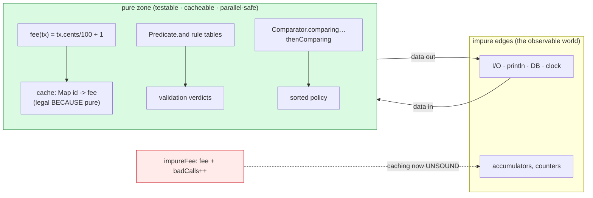

# Functional Programming

## 1. Learning Objectives

After this lesson you will be able to:

- [ ] Define **purity** operationally — same inputs, same outputs, no observable side effects —
      and cite the executed contrast (`pure total` vs `impure same-input`) as the test.
- [ ] Explain what purity *buys*: memoization/caching is legal (executed `cache = {a=3, b=10, c=2}`),
      parallel safety is plausible, and reasoning is local to one function.
- [ ] Compose functions and predicates as first-class values (`andThen`/`compose`, `Predicate.and`)
      — with the executed 12-vs-11 direction pair and the three-verdict username table.
- [ ] Use a returning-function (`a -> b -> a + b`) and name the pattern (currying / factory of
      configured functions) from its executed output.
- [ ] Judge the trade-off honestly: when a value-oriented style wins (transformations,
      validation, rules-as-data) and when mutation and steps stay the right tool (I/O,
      accumulation with early exit, performance-critical loops).
- [ ] Map Java's toolbox to the paradigm — `Comparator.comparing(...).reversed().thenComparing(...)`
      and `groupingBy` as declarative data, from the executed `Func` transcript.

## 2. Prerequisites

- [lambdas-and-streams.md](lambdas-and-streams.md) — the syntax this lesson reasons *about*;
  Examples reuse that executed `Func` transcript and a new executed `Pure` probe.
- [methods.md](methods.md) — signatures; a functional function is a signature with a value form.
- [generics.md](generics.md) — `Function<T, U>`'s type parameters make "input type out, output
  type in" a checked statement.
- [encapsulation.md](encapsulation.md) and [classes-and-objects.md](classes-and-objects.md) —
  immutability and `equals`/`hashCode` are the data half of the style.

**Environment used in this lesson:** every transcript executed on the author's machine —
JDK 25.0.4.1, `javac --release 21` (Example 2 is the executed `Func` program from
[lambdas-and-streams.md](lambdas-and-streams.md), re-examined here through design questions).

## 3. Introduction

Functional programming is not a language feature; it is a **design discipline about where
behavior and state live**. The paradigm's central bet: a function that only computes — no
wandering eyes, no mutation, no clock, no disk — is dramatically easier to test, cache, retry,
parallelize, and reason about than one that does *and* changes things. Java will not force this
style on you (unlike Haskell); it hands you lambdas, immutables (`record`, `List.of`), and
collection pipelines and lets you earn the benefits by *choosing* purity where it pays. This
lesson is that choosing: the executed probe below puts a pure fee function and an impure twin
side by side so the bet's terms are measurable, not mystical.

## 4. The Problem It Solves

Impure functions are **coupled to everything**: a method that computes a fee *and* increments a
counter, logs, and reads the clock cannot be tested without configuring all of that world, cannot
be cached (is the value still valid? who knows), and cannot be safely parallelized (the counter
races — [concurrency.md](concurrency.md) measures exactly that loss). Multiply by a codebase and
the cost appears as flaky tests, heisenbugs, and caches nobody trusts. The functional answer is
a partition: **compute in pure functions, mutate at the edges** (I/O, UI, database). The middle
of your program becomes a fold — data in, data out — and every pure function in it is
independently testable with a table of inputs and outputs, which is precisely how the exercises
in this course have been grading you all along.

## 5. Core Concepts

### Purity, operationally

A pure function: (1) result depends only on arguments — no fields, statics, randomness, or I/O;
(2) it mutates nothing observable. Executed contrast in Example 1: `fee` called twice on
identical input printed identical values *and was safe to cache*; `impureFee` — one extra
`badCalls++` — proved the diagnostic: same inputs, but the *call itself* was the visible event
(`calls=2`). Note the subtlety the probe shows: impure `f1` and `f2` still printed `3, 3` —
purity's failure is not always a wrong *value*; it's the lost *guarantee* (you can't replace
two calls with one cached call — the counter would differ — while `putIfAbsent` on the pure
version is behavior-preserving by construction).

### Functions as values: composition and factories

Java's functional interfaces make behavior assignable: `Function<Integer, Integer> inc = n -> n + 1`.
**Composition** orders them — executed `inc.andThen(dbl).apply(5) = 12` (6 → 12) vs
`inc.compose(dbl).apply(5) = 11` (10 → 11): same parts, opposite flow, one word deciding it.
**Predicates compose into rule tables** — `notBlank.and(shortEnough)` executed three verdicts
(`buffy` true, blanks false, overlong false): the validation *policy* is now data you can build,
store, and test apart from any form or request. **Returning functions** configure once, apply
many — `Function<Integer, Function<Integer, Integer>> add = a -> b -> a + b; add(3).apply(4) = 7`
— the closure `a` was captured by the inner lambda (locals in lambdas are effectively final, so
each `a` is frozen into its own inner function). This is the same shape as the map supplier and
downstream collector arguments from the previous lesson: higher-order functions all the way down.

### Declarative data: comparators and collectors

The executed `Func` run (re-examined here) is the paradigm's portfolio piece:
`Comparator.comparing(Person::age).reversed().thenComparing(Person::name)` is a **sorting policy
as one readable line** — key extractor, direction, tiebreaker — replacing a 20-line anonymous
class with nested `if`s; `groupingBy(p -> p.age / 10 * 10)` is a **report as one expression**,
with the classifier as a pluggable value. Notice what's absent in both: no loop variable, no
temporary map, no index — the *what* survives alone, which is why these pipelines survive code
review better than the loops they replace.

### The honest boundary

Purity is a spectrum, not a religion: streams over 10 GB files want `forEach`-style mutation or
chunking; `System.out.println` is impure by definition (Example 1's own prints are — they're the
*observable* part); algorithms with early exit often read better as loops (a `find` you can't
express without `findFirst` + Optional gymnastics). The paradigm's real export is the
*default*: **start pure, drop to mutation with a reason** — the reason "I/O at the edge" and the
reason "I couldn't be bothered" look different in review.

## 6. How It Works



The green zone is where this lesson's executed lines live; the edges feed it data and receive
results. The red dotted edge is the whole argument in one arrow: the moment a function touches
shared mutable state, the cache (and the parallel run, and the single-call test) stops being
sound — the impure twin in Example 1 demonstrated the mechanism.

## 7. Practical Examples

**Example 1 — the purity probe, executed (side-by-side pure/impure)**

```java
import java.util.*;
import java.util.function.*;

public class Pure {
    record Tx(String id, int cents) {}
    static int fee(Tx t) { return t.cents() / 100 + 1; }          // pure
    static int badCalls;
    static int impureFee(Tx t) { badCalls++; return t.cents() / 100 + 1; }
    public static void main(String[] args) {
        List<Tx> txs = List.of(new Tx("a", 250), new Tx("b", 990), new Tx("c", 120));
        int total = txs.stream().mapToInt(Pure::fee).sum();
        System.out.println("pure total = " + total + "  repeat = " + txs.stream().mapToInt(Pure::fee).sum());
        Map<String, Integer> cache = new HashMap<>();
        for (Tx t : txs) cache.putIfAbsent(t.id(), fee(t));
        System.out.println("cache = " + cache);
        int f1 = impureFee(txs.get(0));
        int f2 = impureFee(txs.get(0));
        System.out.println("impure same-input: " + f1 + ", " + f2 + "  calls=" + badCalls);
        Predicate<String> notBlank = s -> !s.isBlank();
        Predicate<String> shortEnough = s -> s.length() <= 8;
        Predicate<String> username = notBlank.and(shortEnough);
        System.out.println("username(buffy) = " + username.test("buffy"));
        System.out.println("username(blanks) = " + username.test("            "));
        System.out.println("username(long) = " + username.test("very-long-username"));
        Function<Integer, Function<Integer, Integer>> add = a -> b -> a + b;
        System.out.println("add(3).apply(4) = " + add.apply(3).apply(4));
    }
}
```

```console
$ javac --release 21 Pure.java && java Pure
pure total = 15  repeat = 15
cache = {a=3, b=10, c=2}
impure same-input: 3, 3  calls=2
username(buffy) = true
username(blanks) = false
username(long) = false
add(3).apply(4) = 7
$ echo $?
0
```

- Line 1 is the purity *test*: identical result on the repeated pipeline (250/100+1 = 3,
  990→10, 120→2, sum 15) — because nothing outside the arguments could have changed between
  calls. Line 2 is the *reward*: caching those results was legal, and the map shows each fee
  keyed by id — a warm second pass costs map lookups, not recomputation.
- Line 3 is the counterexample you can read: the values *still matched* (3, 3) — yet the
  `calls=2` proves each call performed observable work; you may no longer replace the second
  call with a cache hit without changing program behavior. Impurity's damage is to guarantees,
  often not to values — which is why it hides in code review.
- Lines 4–6: validation as data — one composed `Predicate`, three verdicts, zero coupling to
  any input mechanism; line 7: the closure factory — `add` is a *function generator*, `a`'s
  value baked into each returned inner function.

**Example 2 — composition, sorting policy, and grouping (executed `Func`, re-examined)**

```console
$ javac --release 21 Func.java && java Func
inc.andThen(dbl).apply(5) = 12
inc.compose(dbl).apply(5) = 11
inc.andThen("n=" +).apply(5) = n=6
ada Ada Grace linus 
Person[name=Grace, age=45]
Person[name=Alan, age=41]
Person[name=Ada, age=36]
grouped by decade: {40=[Person[name=Grace, age=45], Person[name=Alan, age=41]], 30=[Person[name=Ada, age=36]]}
by initial (TreeMap): {A=1, G=1, a=1, l=1}
$ echo $?
0
```

- Read as this lesson's portfolio: **composition as data** (lines 1–3 — direction is the only
  difference between 12 and 11, and `andThen` into `String` shows the result type changing
  mid-chain), **policy as data** (the comparator chain behind the sorted people — extractor,
  reversal, tiebreaker, no loop anywhere), **aggregation as data** (two `groupingBy` calls whose
  *arguments* — classifier; supplier+downstream — are the entire difference between the two
  output shapes).
- The stable-sort detail (`ada` before `Ada` under `compareToIgnoreCase`) is a purity-adjacent
  guarantee worth filing: deterministic algorithms on deterministic inputs give you the *same
  transcript every run* — the property that made this course's transcript-teaching style
  possible at all.

## 8. Real-World Applications

- **Domain services** — `BigDecimal price(Order o)` as a pure function is the unit every pricing
  rule in subject 11 hangs off; tests are input/output tables, no mocks needed.
- **Validation layers** — `List<Predicate<Request>>` with `allMatch` makes rule sets
  configuration-shaped; subject 12's security checks are the same idea with signatures and
  hashes.
- **Caching and memoization** — pure computations are the *only* safe cache keys-to-results
  mappings; the executed `putIfAbsent` loop is the two-line version of every cache library's
  contract ("compute if absent" exists because purity makes the absent-compute sound).
- **Parallel mapping** — `parallelStream().map(pureFn)` is legal *because* `pureFn` has no
  shared state; the moment your mapper mutates, subject 20's lost-update demo (executed there)
  becomes your production incident.
- **Test design** — this course's own exercise grading (predict output, then diff) is the
  functional-testing style: pure function, pure expectations, no fixture.

## 9. Common Mistakes

| Mistake | Why it happens | How to recognize it | How to prevent it |
|---|---|---|---|
| "Pure enough" functions touching statics/clock/random | Convenience | Flaky tests; cache misses that recompute always | Inject time/randomness as *parameters*; keep the core pure |
| Mutating captured locals in lambdas | Loop-counter habits | Compile error: "local variables referenced from a lambda expression must be final or effectively final" | Accumulate with `reduce`/`collect`, or use `int[]`/`AtomicInteger` *consciously* |
| Caching impure results | Purity assumed, not verified | Stale values after any external change | Only cache functions you can state as `f(args) -> result` with nothing else named |
| Composition chains past readability | One-liner pride | A 10-stage pipeline nobody can predict | Split at named steps: `Function<A,B> normalize = …;` then compose |
| `andThen` vs `compose` reversal | English order ≠ application order | 12 where you predicted 11 (executed pair!) | Name the pipeline out loud; add a comment with the trace |
| Parallelizing impure mappers | Streams look parallel-safe | Wrong counts, races (see concurrency lesson) | Rule: parallel only with pure element functions and thread-safe collectors |
| Forcing FP on stepwise I/O | Dogma | Hidden mutation inside `map` doing I/O | I/O at edges is the honest style; `map` computes, edges act |
| Predicate `or` chains with wrong grouping | Precedence intuition from `&&`/`||` | Verdict surprises on mixed rules | `a.or(b).and(c)` parenthesizes *by method call order* — read it as data |

## 10. Best Practices

- **Default pure, mutate with a reason** — the partition (pure middle, impure edges) is the
  paradigm's practical export; write the reason in a comment when you step out of it.
- **Name functions as values when reused** — `Predicate<String> username = …` turned three
  lines of lambdas into a testable noun; do the same for sort keys and mappers you reference
  twice.
- **Records + `List.of`/`Map.copyOf` as the data baseline** — immutability is half of purity;
  the record's generated `equals`/`hashCode` (classes lesson) make the other half testable.
- **Compose small functions; keep each one's contract one sentence** — `fee(tx) = cents/100+1`
  fits in a comment; if your pure function needs a paragraph, split it.
- **Test pure functions with input/output tables** — exactly this course's exercise style; add
  edge rows (0 cents, 99 cents) instead of mock frameworks.
- **Keep I/O at the boundary objects** — `main`, controllers, and tests call *in*; pure cores
  never import `java.io` (a lint-able rule in every serious codebase).

## 11. Limitations and Trade-Offs

- **Purity doesn't come free in Java** — no compiler enforcement (any method can mutate or
  print), so the discipline is cultural; `List.of` immutables cost defensive copies, and
  persistent data structures (real structural sharing) aren't in the JDK — you mutate copies.
- **Performance shape** — allocation-heavy pipelines (autoboxing, intermediate objects) can lose
  to tight mutable loops; the primitive streams lesson is the mitigation, and measurement beats
  ideology (this course measures, never asserts).
- **Debugging shifts** — with mutation you step and watch variables change; with pipelines you
  re-run and inspect values (or split the pipeline to peek) — a real workflow change, not a free
  upgrade.
- **Some problems are inherently stateful** — incremental parsers, GUIs, connection pools,
  streaming aggregates with early termination: here mutation *is* the model, and the functional
  style's job is to fence it (subject 11's services are exactly this fence at architectural
  scale).
- **Java's FP is a hybrid** — lambdas close over effectively-final locals only, `Optional`
  discipline is optional, and `null` still lurks at legacy edges — the paradigm's guarantees
  hold only as far as the code you control.

## 12. Practical Exercises

### Introductory

1. **Reproduce Example 1.** **Completion criteria:** all seven lines captured (exit 0); then
   delete `badCalls++` and re-run — the `calls=` line now reads what, and why doesn't the *first*
   line change? (State the invariant.)
2. **Purity audit.** Classify eight functions you've already written this course: pure / pure
   with injected environment / impure. **Completion criteria:** the table with a one-line
   justification each; for two impure ones, the concrete refactor that makes them pure
   (parameter injection named explicitly).
3. **Composition trace drill.** Predict `inc.compose(dbl).andThen(dbl).apply(5)` and
   `dbl.andThen(inc.compose(dbl)).apply(5)` — **Completion criteria:** both predictions, both
   runs, the trace `5 → … → result` per line, and the general rule for reading mixed
   `andThen`/`compose` chains.

### Intermediate

4. **Rule table as data.** Build `List<Predicate<String>>` of four username rules and evaluate
   with `allMatch`, then add an error-message-carrying variant (pair each predicate with its
   message — a small record — and collect failed messages). **Completion criteria:** one
   accepted and two rejected usernames executed with *all* failing messages shown, and a note on
   what the predicate-only version could not express (which failure happened).
5. **Memoize a pure function.** Generalize Example 1's cache into `static <T, R> Function<T, R>
   memoize(Function<T, R> f)` using a `HashMap` (single-arg is fine; state the thread-safety
   caveat). Then memoize `n -> fib(n)` and execute `fib(10)` twice with a call counter inside
   the raw function. **Completion criteria:** outputs showing the second `fib(10)` costing zero
   inner calls; the exact compile error you hit when trying to mutate the cache map from a
   lambda *without* the map reference trick, with the fix explained.
6. **Comparator policy rebuild.** Re-derive the executed sorted-people output from an
   *imperative* comparator (anonymous class with nested ifs), then from the declarative chain.
   **Completion criteria:** identical output from both; line counts; and the one sentence on
   which comparator you'd trust to review six months later.

### Independent problem-solving

7. **Pure pricing core.** Spec a fee schedule as data and a pure evaluator: `record Rule(int
   upToCents, double rate)`, `record Tx(String id, int cents)`, and
   `double fee(List<Rule> schedule, Tx tx)` — first matching rule applies (state the tie/first-
   match policy), result rounded half-up to cents, unknown/empty schedule throws a described
   exception. Write **property-style tests**: for 20 generated (schedule, tx) pairs, assert
   (a) determinism (same inputs → identical results, run twice), (b) bounds (0 ≤ fee ≤
   cents/100 + epsilon, whatever your schedule implies — state it), (c) monotonicity (a bigger
   `cents` never yields a smaller fee for the same schedule — if your rule set violates this,
   say so honestly and fix the property or the rules). Executed demo: the 20-pair harness output
   plus one deliberately-throwing case caught and printed. **Completion criteria:** the spec +
   policies written before code; the harness transcript; and one paragraph on why determinism
   (a) made (b) and (c) *checkable at all* — the lesson's thesis in your own words.

*Solutions: attempt first; set practice in [exercises/README.md](exercises/README.md).*

## 13. Knowledge Check

1. The probe printed `impure same-input: 3, 3` — the values *matched*. Argue from `calls=2`
   why the function is still impure, and name the specific guarantee (cache/parallel/repeat)
   that died anyway.
2. `add(3).apply(4) = 7` — explain where `3` *lives* between the two `apply` calls (closure
   over effectively-final local), and why you cannot write `a -> b -> a += b`-style mutation
   inside it (compile rule from lesson 06).
3. Trace `inc.andThen(dbl).apply(5) = 12` vs `inc.compose(dbl).apply(5) = 11` and state the
   reading rule; then predict `dbl.andThen(dbl).compose(inc).apply(0)` and verify by running it.
4. From the re-examined `Func` transcript: which two lines are "sorting as data" and
   "aggregation as data"? For each, name the *arguments* that carry the policy (not the method).
5. Give the two-sided argument for caching: what purity guarantees make `putIfAbsent` sound,
   and what single added statement (`badCalls++`) makes it unsound — without changing any
   returned value.
6. When is a `while` loop the *right* answer under this lesson's discipline? Name two concrete
   situations and the principle ("mutation at the edges / early exit clarity") that sanctions
   them.

## 14. Completion Criteria

Observable evidence that you have understood this lesson:

- [ ] Example 1 reproduces byte-for-byte; the purity-audit table exists with named refactors
- [ ] Your composition traces predict correctly (drill 3) without running first
- [ ] The memoized `fib` transcript shows a zero-cost second call, and the lambda-mutation
      compile error is in your notes with its fix
- [ ] Rule-table-with-messages (drill 4) shows all failing messages, not just a boolean
- [ ] The pricing core runs its 20-pair harness + property verdicts, and your thesis paragraph
      (drill 7) exists

## 15. Summary

- **Purity is testable, not theoretical:** same-in/same-out, no observable effects — proven by
  the executed repeat line and the legal cache; broken by one `++` whose damage shows in
  *guarantees* (`calls=2`), not values.
- **Functions are values:** compose them (`andThen`/`compose` — direction decided by one
  word), return them (`a -> b -> a + b`), store rules as `Predicate`s — executed all three.
- **Declarative policy reads as data:** comparator chains and `groupingBy` arguments are the
  executable spec (the re-examined `Func` portfolio).
- **Java's style is hybrid by design:** default to pure, mutate at the edges with a reason —
  the discipline the compiler won't enforce for you.

## 16. Next Steps

- Next lesson: [concurrency.md](concurrency.md) — purity's parallel-safety claim gets its
  executed counter-example: the lost updates a single `++` costs across threads.
- Practice: [exercises/README.md](exercises/README.md) set 17.
- Where it is applied: [11-BACKEND-ENGINEERING](../11-BACKEND-ENGINEERING/README.md) — service
  layers as pure cores behind impure transports is the architecture this lesson's partition
  scales into.
