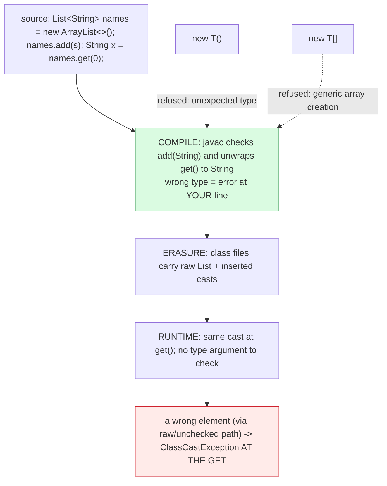

# Generics

## 1. Learning Objectives

After this lesson you will be able to:

- [ ] Write and call generic methods and classes — type parameters, bounds, and diamond
      inference — with your own `<T>` method executed below.
- [ ] Read type errors as *early* bugs: `incompatible types: String cannot be converted to
      Integer` (or the collections equivalent) is the compiler doing runtime work in advance.
- [ ] Apply both wildcard directions from the PECS rule (`Producer Extends, Consumer Super`) on
      the executed `sum`/`fill` pair.
- [ ] Explain **erasure** — why generic type arguments exist at compile time and mostly vanish
      afterward — using the two executed refusals `unexpected type` for `new T()` and `generic
      array creation` for `new T[…]`.
- [ ] Declare records with type parameters (`Pair<A, B>`) and read their generated accessors
      from output you produced.
- [ ] Diagnose the raw-type and diamond habits: what `List` without `<>` means to javac now, and
      why `new ArrayList<>()`'s inference is safe.

## 2. Prerequisites

- [collections-framework.md](collections-framework.md) — every declaration there carried
  `<String>`/`<Integer>`; this lesson unpacks machinery you already use.
- [methods.md](methods.md) — signatures, overloads, and return types; generic methods extend
  exactly that grammar.
- [classes-and-objects.md](classes-and-objects.md) — `equals`/`hashCode` and identity, needed
  for the erasure discussion (type tokens are gone at runtime; object identity is not).
- [interfaces-and-abstract-classes.md](interfaces-and-abstract-classes.md) — bounded types
  (`T extends Comparable<T>`) reuse that lesson's interface grammar.

**Environment used in this lesson:** every transcript executed on the author's machine —
JDK 25.0.4.1, `javac --release 21`.

## 3. Introduction

Generics are **the compiler checking your types a second time, at the container level**: without
them, `list.get(0)` hands back `Object` and every call site casts by hand — a typo'd cast
compiles and explodes later. With them, the type argument travels in the declaration
(`List<String>`), javac proves every `add` and every `get` matches *before anything runs*, and
the proof costs nothing at runtime because — the twist of this lesson — **the runtime mostly
forgets it**. Compile-time strength, runtime amnesia: everything surprising about generics
follows from that split.

## 4. The Problem It Solves

Pre-generics Java's answer was covariant arrays plus casts: `Object[] xs` accepts anything, and
`String s = (String) xs[3]` is a runtime bet. The failure mode is one line long —
`ClassCastException` at the line that *reads* your bug back three frames away from its cause —
plus array covariance's famous hole (`Object[] a = new String[1]; a[0] = 5;` compiles, dies
later; lesson 07's bounds checking catches the *index*, not the *element type*). Generics move
the whole class of failure from runtime to the editor: a wrong `add` is a red underline where
you typed it. The second problem they solve is *API expressiveness*: `Comparator<Person>.comparing(Person::age)`
([functional-programming.md](functional-programming.md)) and `Map<String, List<Integer>>` say
exactly what they hold — no prose needed.

## 5. Core Concepts

### Type parameters: names for types

`static <T> T first(List<T> xs)` — `<T>` *declares* a type parameter for the method; `List<T>`
ties the argument's element type to it; return `T` ties the result. Callers never write `T`:
`first(List.of("a", "b"))` infers `T = String` from the argument (executed: returns `a` as a
`String`). Class-level `<T>` works the same for the whole class (`Box<T>`, `Map<K, V>`), and
`<>` on the right side of an assignment (`new ArrayList<>()`) says "infer from context" — the
diamond in collections was always this lesson deferred.

### Bounds: type parameters with requirements

`<T extends Comparable<T>>` — `T` may be any type that implements `Comparable<T>` (interface or
class; `extends` covers both here). The bound is what makes `x.compareTo(best)` compile: without
it, `T` has no `compareTo`. Executed: `max(List.of("pear", "apple", "fig"))` → `pear` — the
bound both enabled the call and *rejected at compile time* any caller passing a non-comparable
type. Multiple bounds (`<T extends A & B>`) join with `&`.

### Wildcards: "some type I don't name" — PECS

From Example 2, executed both directions:

- `double sum(List<? extends Number> xs)` — the list is a **producer** of `Number`s: you may
  read `Number` elements out (an `Integer` list *is-a* `Number` list for reading), you may not
  `add` anything but `null`. Served `List<Integer>` and `List<Double>` — both accepted, summed
  as `6.0` / `4.0`.
- `static void fill(List<? super Integer> xs)` — the list is a **consumer** of `Integer`s:
  `add(42)` is safe (something *above* `Integer` must be storing them), reading as `Integer` is
  not. Served `List<Object>` — printed `[42]`.

The rule in one line — **PECS: producer `extends`, consumer `super`** — and the reason is
assignability: reads give you the bound, writes take the bound. Forgetting it produces the two
classic errors: `cannot be applied to given types` on a write to `? extends`, or an
`incompatible types` on a read from `? super`.

### Erasure: the runtime forgot, the compiler didn't

`List<String>` and `List<Integer>` are, after compilation, essentially `List` with `Object`
inside and **inserted casts** at your `get`s (that's the standard implementation story — hence
`ClassCastException` still being possible at all: the cast is real, it just happens at the
`get`, with the *right* type because javac proved the chain). Two executed refusals show what
erasure costs — the compiler will not invent *new* objects of an unknown type:

```console
GenBad.java:4: error: unexpected type
    static <T> T make() { return new T(); }
                                     ^
  required: class
  found:    type parameter T
GenBad.java:5: error: generic array creation
    static <T> void toArray(List<T> list) { T[] a = new T[list.size()]; }
```

`new T()` is refused because `T` might be an `int`-backed or interface type — no way to
allocate an unknown; `new T[…]` because arrays *reify* their element type (they remember —
lesson 07's runtime array checks) and a reified `T` doesn't exist. The bridge: pass a
`Class<T>` token (`t.newInstance()`-style reflection) or a factory — the type is needed *at
runtime* to make one, which is precisely the information erasure removed.

## 6. How It Works



Left-to-right is the lifecycle of one generic line: proof (green — where generics *live*),
forgetting (neutral), consequences (red — where unchecked code can still bite). The two red
*dotted* refusals on the bottom are erasure's visible price tag: the compiler declines to do
runtime-type work it provably cannot do after forgetting.

## 7. Practical Examples

**Example 1 — generic method, bound, and parameterized record (executed)**

```java
import java.util.*;

public class Gen {
    static <T> T first(List<T> xs) { return xs.get(0); }
    static <T extends Comparable<T>> T max(List<T> xs) {
        T best = xs.get(0);
        for (T x : xs) if (x.compareTo(best) > 0) best = x;
        return best;
    }
    record Pair<A, B>(A first, B second) {}
    public static void main(String[] args) {
        System.out.println("first(List<String>)  = " + first(List.of("a", "b")));
        System.out.println("first(List<Integer>) = " + first(List.of(10, 20)));
        System.out.println("max(List<String>)    = " + max(List.of("pear", "apple", "fig")));
        Pair<String, Integer> p = new Pair<>("id", 7);
        System.out.println("pair = " + p + "  first=" + p.first());
    }
}
```

```console
$ javac --release 21 Gen.java && java Gen
first(List<String>)  = a
first(List<Integer>) = 10
max(List<String>)    = pear
pair = Pair[first=id, second=7]  first=id
$ echo $?
0
```

- Lines 1–2: one method body, two type arguments — `T` bound to `String` then `Integer` at the
  call sites, both inferred with no explicit `<…>` anywhere. The `first(List.of(10, 20))`
  result is an `Integer` *without a cast* — pre-generics this line was `Object` + cast.
- Line 3: the bound in action — `compareTo` compiled because `T extends Comparable<T>`, and
  strings compared lexicographically: `pear` beats `apple`/`fig`.
- Line 4: a *record with type parameters* — `Pair<A, B>` gets its accessors, `toString`
  (`Pair[first=id, second=7]`), `equals`/`hashCode` all generated, all typed: `p.first()` is a
  `String` at compile time. The diamond/`<>` story in one compact type.

**Example 2 — PECS, both directions, executed**

```java
import java.util.*;

public class GenWild {
    static double sum(List<? extends Number> xs) {
        double s = 0;
        for (Number n : xs) s += n.doubleValue();
        return s;
    }
    static void fill(List<? super Integer> xs) { xs.add(42); }
    public static void main(String[] args) {
        System.out.println("sum(List<Integer>) = " + sum(List.of(1, 2, 3)));
        System.out.println("sum(List<Double>)  = " + sum(List.of(1.5, 2.5)));
        List<Object> sink = new ArrayList<>();
        fill(sink);
        System.out.println("fill(List<Object>) = " + sink);
    }
}
```

```console
$ javac --release 21 GenWild.java && java GenWild
sum(List<Integer>) = 6.0
sum(List<Double>)  = 4.0
fill(List<Object>) = [42]
$ echo $?
0
```

- Two different concrete list types through one signature — variance expressed *where it's
  used*, not by making `List<Integer>` a subtype of `List<Double>` (it isn't; wildcards are
  usage-site variance, the only kind Java's classes have).
- `fill(List<Object>)` consumed `42` happily — the `? super Integer` promise ("I store
  `Integer`s or their supertypes") is exactly what made that `add` legal.

**Example 3 — erasure's refusals (executed)**

```console
$ javac --release 21 GenBad.java
GenBad.java:4: error: unexpected type
    static <T> T make() { return new T(); }
                                     ^
  required: class
  found:    type parameter T
  where T is a type-variable:
    T extends Object declared in method <T>make()
GenBad.java:5: error: generic array creation
    static <T> void toArray(List<T> list) { T[] a = new T[list.size()]; }
                                                    ^
2 errors
$ echo $?
1
```

- Read `required: class / found: type parameter T` as the compiler's confession: it knows the
  *kind of thing* `T` is (a type variable) but not what class it will be — so it cannot name a
  constructor to call. Both errors are erasure's boundary markers, exactly where the compile-time
  story stops being enough.

## 8. Real-World Applications

- **Every collection declaration you write from now on** — subject 05's structures will be
  *re-implementing* these signatures (`class MyArrayList<E>`), and subjects 11+ pass
  `List<Order>` across layers where a raw list would mean unchecked casts at every boundary.
- **Type-safe APIs you already met:** `Comparator<Person>.comparing(Person::age)` (next lesson)
  refuses to compare apples to oranges *at compile time*; Spring's `Repository<Order>` and
  JUnit's `Assertion<…>` generics are the same machinery at framework scale.
- **DTOs and results:** `Optional<User>` ([lambdas-and-streams.md](lambdas-and-streams.md)),
  `Map<String, List<String>>` form parameters, `Class<T>` token patterns for factories — all
  type-parameter designs you now read critically instead of mystically.

## 9. Common Mistakes

| Mistake | Why it happens | How to recognize it | How to prevent it |
|---|---|---|---|
| Raw types to "avoid generics" | Legacy habit / fighting inference | `List` without `<>`: unchecked warnings, `get()` returns `Object` | Never write raw `List`; diamond `<>` is always available |
| Casting *out of* a generic (`(String) names.get(0)`) | Old code muscle memory | Redundant cast — or worse, compiling because you raw-typed first | If you're casting, the declaration's type argument is wrong — fix that |
| Expecting `new T()` / `List<T>` reification | Other languages' generics (C# reified) | `unexpected type` / `generic array creation` / `instanceof List<String>` errors | Type arguments are compile-time; runtime type needs `Class<T>` (Example 3) |
| `? extends` then trying to `add` | Read/write symmetry assumed | `cannot be applied to given types` / capture-of warning | PECS: producers you read, consumers you write |
| Bounded but wrong bound (`T extends Object` default) | Skipping the requirement | `compareTo does not exist in type T` | Declare the actual requirement: `<T extends Comparable<T>>` |
| Generic arrays (`new T[10]`, `T[]` fields) | Container symmetry with arrays | `generic array creation` (executed) | Use `List<T>`; arrays and reified generics do not mix |
| `instanceof List<String>` after casting | Reified intuition again | Doesn't compile (type argument cannot be tested) | `instanceof List<?>` — test the raw shape, prove elements by `get` |
| Wildcard-everything (`List<?>` params always) | Defensive reflex | Methods you can't write anything useful in | Wildcards when *calling out*; concrete `T` when *relating* types inside |
| Inferring to `Object` by assigning badly | Diamond in the wrong position | `ArrayList<Object>` where `ArrayList<String>` was meant | Let the *declaration* drive inference; check the left side first |

## 10. Best Practices

- **Let inference work; annotate intent on the left** — `List<String> names = new ArrayList<>()`
  is *more* informative than `new ArrayList<String>()` repeated: the promise lives in the
  declaration (collections lesson's rule, now with its mechanism).
- **PECS at every wildcard boundary** — write the rule at the top of the method when the
  signature gets hairy; reads want `? extends`, writes want `? super`.
- **Bounds express requirements honestly** — `<T extends Comparable<T>>` documents a real
  obligation; empty `<T>` that calls `compareTo` anyway (via raw hacks) hides one.
- **Generics for relationships, wildcards for independence** — `Map<K, V>`'s two parameters
  *relate* key to value usages; a method that merely passes a list through wants `? extends`.
- **Type tokens when the runtime needs the type** (`Class<T>`, supplier/factory parameters) —
  the documented escape from erasure, used by reflection and serialization frameworks.
- **No raw types, no redundant casts** — if a cast survives next to generic code, either the
  cast is dead (delete) or the type argument is wrong (fix it).

## 11. Limitations and Trade-Offs

- **Erasure means no runtime type information:** `instanceof List<String>` is impossible;
  overloads differing only in type arguments collide (both erase to the same signature — the
  compiler's "name clash" complaint); array covariance holes reappear in unchecked corners.
  The design trade: seamless evolution (adding a type parameter to an existing API didn't break
  binaries) at the cost of runtime blindness.
- **Primitive boxing:** generics only hold reference types — `List<int>` is illegal, `List<Integer>`
  boxes every element (subject 05 measures this; streams' primitive specializations
  `IntStream` etc. are the concession).
- **Variance limits:** Java's generics are *invariant* — `List<Integer>` is not a
  `List<Number>` — wildcards patch it at usage sites but make signatures heavier; other
  languages chose declaration-site variance and pay differently. PECS is Java's compromise.
- **Bridge methods and weird stack traces:** erased dispatch can show synthetic `…$1` bridge
  frames in traces — a known readability cost; read past them to the erased source frame.

## 12. Practical Exercises

### Introductory

1. **Reproduce Examples 1 and 3.** **Completion criteria:** the four `Gen` lines and both
   `GenBad` errors captured — plus, under Example 3's first error, one sentence in your words
   answering "what would the compiler have to *know* to make `new T()` legal — and why is that
   exactly what erasure removed?"
2. **The cast you no longer write.** Write the pre-generics version (`List` raw, `Object` in,
   cast out) beside the generic one; run both with a wrong-type `add` where possible.
   **Completion criteria:** both versions running for the happy path; the raw version's
   wrong-type `add` *succeeding at compile time* (unchecked) while the generic one fails at the
   line — the one-output proof of where generics moved the work.

### Intermediate

3. **PECS four-way.** For one `List<? extends Number>` and one `List<? super Integer>`: attempt
   a read and a write on each (four compilations). **Completion criteria:** a 2×2 table
   (direction × operation → compiles / exact error), and the PECS sentence justified from the
   table rather than quoted alone.
4. **Bound it, then break it.** Run Example 1's `max` with `List.of(10, 2, 30)` (works —
   `Integer` is `Comparable`); then make a non-comparable class and pass a list of it.
   **Completion criteria:** `max = 30` output, then the exact bounded-type compile error
   (naming your class vs `Comparable`), and the two fixes (implement `Comparable`, or write an
   explicit `Comparator` — note which lesson supplies the second).
5. **Type-token factory.** Implement `static <T> T make(Class<T> c) throws … { return
   c.getDeclaredConstructor().newInstance(); }` and call it for two classes. **Completion
   criteria:** two construction outputs proving the erasure escape hatch works — and one line
   comparing it to the refused `new T()` (what information the `Class<T>` parameter restored).

### Independent problem-solving

6. **Design a typed result wrapper.** Spec `Result<T>` holding either a `T` value or an error
   message (no nulls), with: `static <T> Result<T> ok(T value)`, `static <T> Result<T> error(String)`,
   `boolean isOk()`, `T get()` (throwing a described exception when absent), and a
   `static <T, U> Result<U> map(Result<T>, Function<T, U>)` — signatures first, then
   implementation, then an executed demo: ok-path map, error-path map, and the `get()`-on-error
   failure printed by your catch. **Completion criteria:** the signature block written before
   code; six output lines (ok, mapped, error passthrough, isOk verdicts ×2, caught get) each
   predicted first; and your note on which line would break if `Result` were raw `List`-style
   untyped (name the exact lost check).

*Solutions: attempt first; set practice in [exercises/README.md](exercises/README.md).*

## 13. Knowledge Check

1. `first(List.of(10, 20))` returned `10` — state where `T` was inferred, and what type the
   *class file* ultimately holds at that call (erasure's answer).
2. Quote both `GenBad` errors, and explain why arrays specifically *cannot* be erased the way
   lists can (connect to lesson 07's runtime element checks).
3. Apply PECS out loud: `void copyAll(List<? extends T> from, List<? super T> to)` — say why
   each wildcard direction is the only legal one (what operations each list performs).
4. Why does `<T extends Comparable<T>>` compile `compareTo` while `<T>` doesn't? What would you
   write if `T` needed to be both `Comparable` and `Serializable`?
5. Give one thing *impossible* with erasure, with its type-level cause — and one thing
   generics demonstrably caught earlier (an executed line from this or any lesson).

## 14. Completion Criteria

Observable evidence that you have understood this lesson:

- [ ] Examples 1–3 reproduce byte-for-byte, both errors included
- [ ] Your 2×2 PECS table exists from four real compilations
- [ ] The type-token factory works and you can say in one sentence what `Class<T>` restores
- [ ] You have written a working parameterized class (`Result<T>` or equivalent) with a
      generic `map` — signatures first
- [ ] You can state erasure's cost/benefit in one sentence each, without notes

## 15. Summary

- Type parameters let *one* implementation serve every type, checked at **your** lines —
  inference means you rarely even spell the argument.
- Bounds (`T extends Comparable<T>`) are requirements in the grammar; wildcard directions are
  usage variance — **PECS: producer extends, consumer super**.
- **Erasure:** the compiler checks everything, then mostly forgets — `new T()` and `new T[]`
  refusals mark exactly where runtime type would be needed but isn't.
- Records parameterize beautifully (`Pair<A, B>`) — typed accessors, generated contract methods.
- Raw types are the exit ramp nobody needs; the declaration's type argument is the API.

## 16. Next Steps

- Next lesson: [file-handling.md](file-handling.md) — generics hold in memory; files are where
  the objects meet bytes (and serialization is a generic-free zone, executed).
- Practice: [exercises/README.md](exercises/README.md) set 14.
- Where it is applied: [15-DATA-STRUCTURES-AND-ALGORITHMS](../05-DATA-STRUCTURES-AND-ALGORITHMS/README.md) —
  you will now *implement* `MyArrayList<E>` and feel every constraint from this lesson.
