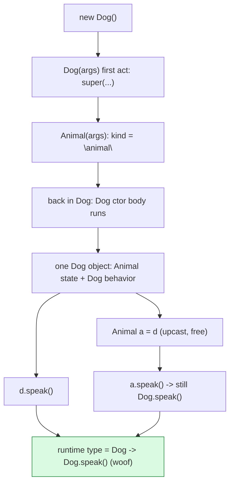
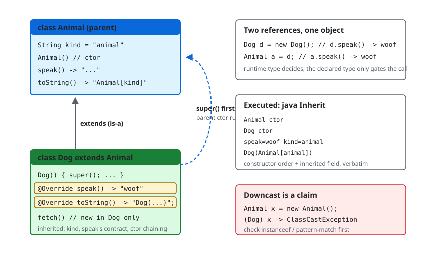

# Inheritance

## 1. Learning Objectives

After this lesson you will be able to:

- [ ] Model an "is-a" relationship with `extends`, state what the subclass inherits (fields,
      methods, visibility), and read constructor order from output you produced.
- [ ] Use `super(...)` and `super.method()` deliberately, including the implicit first-statement
      rule and the free no-arg `super()` call.
- [ ] Apply `@Override` as a contract check — and fix the exact compiler complaint when it
      doesn't match (executed: `method does not override or implement a method from a
      supertype`).
- [ ] Predict a downcast outcome before running it — legal via `instanceof`, fatal via a bare
      cast (the executed `ClassCastException` text included).
- [ ] Argue is-a vs has-a for a given design, and name the mechanism to reach for when the
      answer is has-a (composition) — with the failure mode inheritance-for-reuse causes.
- [ ] Explain `protected` as the subclass-facing access level, connecting the access table from
      [encapsulation.md](encapsulation.md) to real extension points.

## 2. Prerequisites

- [classes-and-objects.md](classes-and-objects.md) — constructors, `this`, and object identity;
  inheritance adds a second class to every one of those.
- [encapsulation.md](encapsulation.md) — the four access levels; `protected` here gets its
  first real use.
- [methods.md](methods.md) — the `@Override`-missed error appeared there first as a compile
  refusal; this lesson makes it a daily tool.
- [02-PROGRAMMING-FUNDAMENTALS](../02-PROGRAMMING-FUNDAMENTALS/README.md) — the foundation
  where behavior and data first met; Java's syntax makes the contract enforceable.

**Environment used in this lesson:** every transcript executed on the author's machine —
JDK 25.0.4.1, `javac --release 21`. The diagram in section 6 is
[inheritance-diagram.svg](../assets/java/inheritance-diagram.svg).

## 3. Introduction

Inheritance lets one class be declared as a *specialization* of another: `Dog extends Animal`
means a dog **is an** animal — it inherits `Animal`'s fields and methods and may add its own or
refine them. Java's version is deliberately strict: one parent (`extends` only, no multiple
inheritance of classes), constructors that must chain, and `@Override` as a compile-time
contract. This lesson treats inheritance as a *modeling decision with obligations* — not a way
to save keystrokes — because the next two lessons (polymorphism and abstraction) only work if
the "is-a" claim is true.

## 4. The Problem It Solves

Before inheritance, shared behavior was copied — `speak()`-adjacent logic in every animal-ish
class, fixed in three of five places. The copy is the symptom; the disease is that *there is no
name for the shared part*. Inheritance gives the shared part a class of its own, so common state
(`kind`) and common behavior (`toString`) are written once and *stayed written*. The second
problem it solves is subtler: calling code that wants "any animal-ish thing" needs a type that
means that — `Animal` — and inheritance is what creates the subtype relationship that makes the
call honest. (Subject 05's collections and this subject's polymorphism both lean on exactly
that subtype.)

## 5. Core Concepts

### What `extends` grants

A subclass gets everything in the parent that it can *see*: `public` and `protected` members
always, package-private members when in the same package — never `private` fields (though
`private` methods still *run* as part of the parent's code). Executed below: `Dog` inherits the
field `kind` (initialized by `Animal`'s field initializer — `kind=animal` prints through a
`Dog` reference) and the `describe`-style pattern of using inherited state in overridden
behavior.

### Constructors always chain upward

`new Dog()` printed `Animal ctor` **then** `Dog ctor` — every constructor starts by running its
parent's, explicitly via `super(...)` as its first statement or implicitly via a free
`super()`. That is why the parent's fields are valid before the child's constructor body runs —
initialization order is bottom-up, execution order is top-down. The same rule explains why
`this(...)` and `super(...)` cannot both appear as the first statement (two different firsts),
and why a parent with no no-arg constructor *forces* you to say `super(args)` — with a compile
error naming the constructor otherwise.

### `@Override` is a check, not a comment

`Ov.java`'s `@Override void helper()` — annotating a method that overrides nothing — fails at
compile time:

```
error: method does not override or implement a method from a supertype
```

Same error family as [methods.md](methods.md) Example 2's static-context refusal: the compiler
refusing to let a *claim* stand unchecked. Rename the parent's method and the child's override
silently stops overriding — without `@Override` you find out at runtime, with it you find out at
line 2 of the file you were editing anyway.

### Upcast free, downcast checked

`Animal a = d;` — widening to the parent is always legal and needs no cast (the compiler knows
every `Dog` is an `Animal`). The reverse is a *claim about runtime type*: a bare `Animal x = new
Animal(); Dog bad = (Dog) x;` printed `ClassCastException` at run time with the full nested
class names — because `x` was simply not a `Dog`. Java's rule: **check with `instanceof` (or use
pattern matching — [polymorphism.md](polymorphism.md)) before casting down**, and treat a
`ClassCastException` in your code as a design question you skipped.

### Is-a vs has-a — the decision rule

`Dog extends Animal` passes: every dog, everywhere, forever, is an animal. `Employee extends
Car` fails: an employee *has* a car — inheriting would couple employee code to car internals and
lie about substitutability. When the answer is has-a, use **composition**: hold the object as a
field and delegate. Inheritance-for-reuse (extending a class just to grab its utility methods)
couples you to the parent's entire future — every `private` change, every signature change —
which is why the exercise below makes you *defend* each `extends` you write.

## 6. How It Works



One object, one type (`Dog`), regardless of which reference name is used — the upcast arrow
changes only the *view*, never the object, so both `d.speak()` and `a.speak()` resolve through
the same runtime type. That is the whole mechanism this diagram exists to show: **references
have declared types; objects have runtime types; overrides follow the object.**



The SVG lays the same facts out statically: what each class contributes, where `super(...)`
travels, and which members are inherited vs overridden vs added.

## 7. Practical Examples

**Example 1 — the full mechanics, executed in one program**

```java
public class Inherit {
    static class Animal {
        String kind = "animal";
        Animal() { System.out.println("Animal ctor"); }
        String speak() { return "..."; }
        @Override public String toString() { return "Animal[" + kind + "]"; }
    }
    static class Dog extends Animal {
        Dog() { super(); System.out.println("Dog ctor"); }
        @Override String speak() { return "woof"; }
        @Override public String toString() { return "Dog(" + super.toString() + ")"; }
        void fetch() { System.out.println("fetching"); }
    }
    public static void main(String[] args) {
        Dog d = new Dog();
        System.out.println("speak=" + d.speak() + "  kind=" + d.kind);
        System.out.println(d);
        Animal a = d;
        System.out.println("as Animal: speak=" + a.speak());
        System.out.println("instanceof Dog: " + (a instanceof Dog));
        try { Animal x = new Animal(); Dog bad = (Dog) x; }
        catch (ClassCastException e) { System.out.println("CCE: " + e.getMessage()); }
        System.out.println("new Dog().toString(): " + new Dog());
    }
}
```

```console
$ javac --release 21 Inherit.java && java Inherit
Animal ctor
Dog ctor
speak=woof  kind=animal
Dog(Animal[animal])
as Animal: speak=woof
instanceof Dog: true
Animal ctor
CCE: class Inherit$Animal cannot be cast to class Inherit$Dog (Inherit$Animal and Inherit$Dog are in unnamed module of loader 'app')
Animal ctor
Dog ctor
new Dog().toString(): Dog(Animal[animal])
$ echo $?
0
```

- **Lines 1–2:** constructor chaining, parent first — the `super()` you see is explicit, and the
  free-`super()` variant behaves identically (remove it and re-run to see — same two lines).
- **Line 3:** `kind=animal` proves the *parent's field initializer* ran inside the child's
  construction; `speak=woof` proves the child's override is what `d.speak()` resolves.
- **Line 4:** `toString` composing through `super.toString()` — overriding *extending* the
  parent's answer, not replacing the idea (`Dog(Animal[animal])` contains the parent's whole
  rendering).
- **Lines 5–6:** upcast reference, runtime type unchanged — `a.speak()` still prints `woof`,
  and `instanceof` confirms what the compiler already allowed.
- **The CCE line:** the nested-name format (`Inherit$Animal`) is how JVM class names encode
  nested classes; `loader 'app'` is the application class loader — both parts of reading real
  cast failures. Notice *two* `Animal ctor` lines flank it — the throwaway `x` is constructed
  just to prove the cast fails, and the final `new Dog()` reprints the chain for `toString`.
- `fetch()` exists only on `Dog`: `a.fetch()` would not compile — upcasting loses members the
  parent type never promised (the price of the free downcast-free view).

**Example 2 — the contract check, executed**

```console
$ javac --release 21 Ov.java            # Ov declares: @Override void helper() {}
Ov.java:2: error: method does not override or implement a method from a supertype
    @Override
    ^
1 error
$ echo $?
1
```

- The annotation turned "I believe this overrides" into a *checkable claim*. Fix by either
  matching the parent's signature exactly (name + parameter types + compatible return) or
  deleting the annotation — and the first fix is almost always right.

## 8. Real-World Applications

- **Framework extension points:** Spring controllers, servlet `HttpServlet` subclasses, and
  test fixtures (`@Before`) are all "extend this and override the hook" — the pattern this
  lesson's `speak()` executes at toy scale. Reading `extends` in a framework signature tells you
  exactly which methods you *may* override and which you must not.
- **Domain hierarchies that earn it:** `SavingsAccount extends Account` (with everything an
  account is, plus interest rules) is a true is-a used across subject 11's data modeling — and
  its counter-examples (`Manager extends Project`) appear in the exercises to be rejected.
- **Modeling real variation** — payment methods, notification channels, report formatters — any
  set of interchangeable behaviors behind one contract benefits *when the is-a holds*; when it
  doesn't, the same variation is modeled with interfaces + composition (next two lessons).

## 9. Common Mistakes

| Mistake | Why it happens | How to recognize it | How to prevent it |
|---|---|---|---|
| Extending for code reuse | "I want those methods" | `X extends Utilities`; clients holding `X` where `Utilities` type shows up | Composition: hold it, delegate; the `is-a` test (every dog…) |
| Forgetting the parent's constructor needs arguments | Parent has only a parameterized ctor | `constructor Animal in class Animal cannot be applied to given types` | Explicit `super(args)` as the subclass's first statement |
| Overriding with a different signature | Typo'd parameters | `@Override` fires `method does not override…` (Example 2) — *without* it, a silent new method | Keep `@Override` on every intended override |
| Calling `super.method()` when you meant the child | Flattened mental model | Parent's version runs though child exists | Read the call: `super.` is explicitly the parent's implementation |
| Bare downcast trusting "it'll be a Dog" | Upcast symmetry assumption | `ClassCastException` at the worst time | `instanceof`/pattern-matching first — executed above |
| Hierarchy for the *future* ("we'll need subclasses") | Speculative generality | One subclass, zero differences | Wait for the second real variant; interfaces are the cheap speculation ([interfaces-and-abstract-classes.md](interfaces-and-abstract-classes.md)) |
| Mutating parent state through child freely | `protected`/public fields | Child and parent disagree on state | Invariants stay guarded ([encapsulation.md](encapsulation.md)); child gets behavior, not keys |
| Deep chains (A→B→C→D) | Layered modeling reflex | Constructor order unreadable; change in A breaks D | Keep chains short; model layers with interfaces when depth grows |

## 10. Best Practices

- **Write the is-a sentence first, out loud:** "`Dog` is an `Animal`" — if you need "has-a",
  "uses-a", or "behaves-like-a" instead, you want composition or an
  [interface](interfaces-and-abstract-classes.md).
- **`@Override` on every override**, no exceptions — it's a free compile-time test of your
  assumption (Example 2 is the test failing).
- **Design for extension or close the class:** `final class` (or `final` methods) says "not an
  extension point" — a real design statement, and the honest default when you haven't thought
  about subclass contracts ([polymorphism.md](polymorphism.md) § LSP).
- **Chain constructors deliberately:** keep parent constructors few-argument; parameterized
  parents force every child's signature to grow.
- **Prefer overriding for variation, adding for extension** — a child that *changes* `speak()`
  is polymorphic (lesson 11); a child that adds `fetch()` is just extended. Mix both knowingly.
- **Keep `private` parent members private** — a child needing them is a boundary smell; widen to
  `protected` only with a reason tied to the subclass contract.

## 11. Limitations and Trade-Offs

- **Single inheritance only:** a class can extend exactly one class. Wanting behavior from two
  parents is a genuine Java design constraint — the language's answer is interfaces (unlimited
  `implements`) plus composition; subject 13 argues the split.
- **Inheritance couples forever:** every parent change can ripple to children, including ones in
  other codebases you don't own — the reuse argument of §5 in reverse. Composition's delegation
  cost is a line; inheritance's coupling cost is permanent.
- **Fragile super-call chains:** construction order is a *contract* you can break silently
  (parent constructor calling overridable methods before the child is initialized — the classic
  "null field in constructor" bug, noted here so you recognize it in the wild; it needs a
  framework context to reproduce, so it is stated as a pattern, not a transcript).
- **`protected` is not privacy** ([encapsulation.md](encapsulation.md)'s table): package peers
  see it too — real extension contracts are expressed by *what you expose to subclasses*, which
  is why many codebases minimize `protected` fields in favor of protected *methods*.

## 12. Practical Exercises

### Introductory

1. **Reproduce Example 1 fully.** Then (a) delete the explicit `super();` and re-run,
   (b) add `System.out.println(a.kind);` after the upcast, (c) attempt `a.fetch();` and compile.
   **Completion criteria:** the two-line constructor order unchanged by (a); `animal` printed by
   (b); (c)'s compile error captured with the exact missing-method complaint, and one sentence
   explaining why upcast access to `fetch` was never granted.
2. **Constructor forcing.** Give `Animal` only a `Animal(String kind)` constructor; recompile
   Example 1. **Completion criteria:** the exact `cannot be applied to given types` transcript,
   and the two possible fixes (child passes `super("…")`; or add a no-arg parent constructor)
   with a note on which you'd choose for a real model and why.

### Intermediate

3. **The `@Override` lie.** In a two-class file, override `speak` in the child, then change the
   *parent's* name to `speakUp` — compile with and without `@Override` on the child.
   **Completion criteria:** four transcripts (child compiles / parent renamed × annotation on /
   off) showing that the annotation turns a silent behavior change into a compile error at the
   exact override line.
4. **Upcast/downcast matrix.** With Example 1's classes, execute and capture: free upcast
   (`Animal a = d`), legal downcast after `instanceof`, and bare downcast that fails — the last
   is in Example 1 already; produce the *first* two with their own prints. **Completion
   criteria:** three outputs — upcast succeeds and `a.speak()` prints `woof`; checked downcast
   succeeds; unchecked downcast prints the `ClassCastException` line — plus a one-line rule
   you'll follow for each direction.

### Independent problem-solving

5. **Defend an hierarchy.** Given six pairs — `SavingsAccount:Account`, `Manager:Project`,
   `Circle:Shape`, `User:UserProfile`, `Cat:Animal`, `HttpResponse:Request` — decide extend /
   compose / interface for each, one written justification per line using the is-a sentence
   test. Then implement *one* non-trivial pair you judged `extends` plus *one* you judged
   compose, compiling both. **Completion criteria:** the six-line decision table with reasons;
   two compile-clean implementations; the composed one's `main` demonstrating equivalent
   behavior through delegation — and your statement of what the composed version can do the
   inherited one couldn't (couple independently), with the reverse cost of composition.

*Solutions: attempt first; set practice in [exercises/README.md](exercises/README.md).*

## 13. Knowledge Check

1. Order the four events of `new Dog()` as executed: `Dog ctor body`, `Animal ctor`,
   `kind = "animal"`, reference returned — and say what guarantees that order.
2. `d.speak()` and `a.speak()` printed the same value though `a` is declared `Animal` — which
   *type* decided the answer, and what would `a.fetch()` do and why?
3. Quote the `@Override` failure text verbatim, and explain what the same situation produces
   *without* the annotation.
4. Why is `Animal a = d;` safe without a cast while `Dog b = a;` is not? Where does Java check
   each — compile time or run time?
5. Give the is-a sentence for one accepted and one rejected pair from exercise 5, and name the
   mechanism you chose instead for the rejection.

## 14. Completion Criteria

Observable evidence that you have understood this lesson:

- [ ] Example 1 runs byte-for-byte on your machine, including the CCE line
- [ ] You have produced the `super(args)` forcing error and both fixes
- [ ] You demonstrated the `@Override` contract check failing on a renamed parent method
- [ ] You can draw (on paper) the construction-order diagram from section 6 without looking
- [ ] You have defended an `extends` decision in one sentence — and rejected one with the
      mechanism that replaces it

## 15. Summary

- `extends` = true is-a: inherited members, one parent, constructors chain **parent first**
  (`Animal ctor` before `Dog ctor`).
- `@Override` turns "I mean to override" into a **compile-time contract** — the executed error
  text is that contract failing.
- Upcasts are free and lose nothing the parent promised; downcasts are claims — check with
  `instanceof`, or pay `ClassCastException`.
- Composition beats inheritance for reuse — the decision test is the is-a sentence, not the
  similarity of code.
- `protected` exists for extension points; overriding exists for variation — both are part of
  the parent's *design for children*, taken up as a system in the next two lessons.

## 16. Next Steps

- Next lesson: [polymorphism.md](polymorphism.md) — what a reference *doesn't* decide: runtime
  dispatch through `Shape[]`, interface calls, and the substitutability rule.
- Practice: [exercises/README.md](exercises/README.md) set 9.
- Where it is applied: [11-BACKEND-ENGINEERING](../11-BACKEND-ENGINEERING/README.md) service
  interfaces (`PaymentProcessor` implementations) build directly on this lesson's subtype facts.
