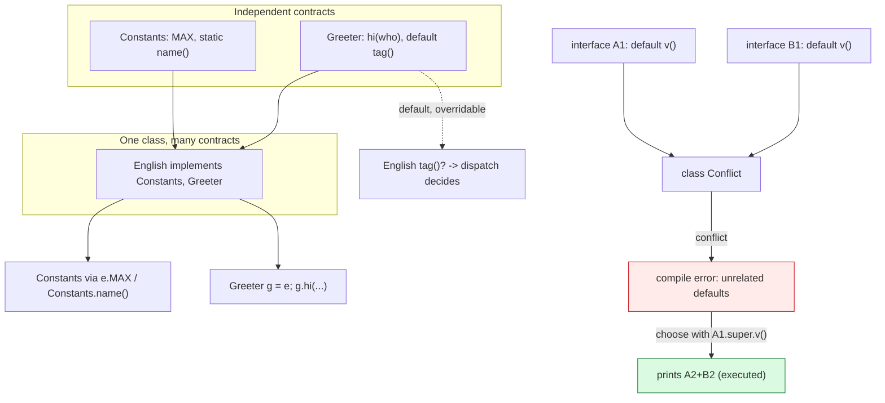

# Interfaces and Abstract Classes

## 1. Learning Objectives

After this lesson you will be able to:

- [ ] Declare and implement interfaces — abstract methods, `default` methods, `static` methods,
      constants — and read each mechanism's executed output.
- [ ] Implement *several* interfaces on one class, and dispatch through interface references
      (executed via `Greeter g = e` and the `Printable`/`Tagged` channels of
      [polymorphism.md](polymorphism.md)).
- [ ] Resolve a default-method conflict — with the exact `inherits unrelated defaults` compile
      error and the `Iface.super.method()` fix, both executed here.
- [ ] State why interfaces cannot be instantiated, quoting the refusal Java actually prints
      (`Thing is abstract; cannot be instantiated`).
- [ ] Choose between an interface and an abstract class using the full decision framework —
      shared state, access needs, the one-`extends`-slot cost, and evolution (who breaks when
      the contract grows?) — and defend each half of the choice in writing.
- [ ] Apply the evolution rule: adding a *default* method is compatible; adding an *abstract*
      one breaks every implementor — and say which contract shape survives change.

## 2. Prerequisites

- [abstraction.md](abstraction.md) — the three-part test; this lesson consumes its output (the
  "shared behavior/state?" column) and completes the choice it deliberately deferred.
- [inheritance.md](inheritance.md) — `extends` mechanics; here you learn what `implements` does
  differently (and why Java gives you both).
- [polymorphism.md](polymorphism.md) — interface dispatch and default methods already executed
  through `Shapes.java`; this lesson unpacks their rules.
- [classes-and-objects.md](classes-and-objects.md) — the object side of the identity question
  reappears as `instanceof` across interfaces (Example 1, line 6).

**Environment used in this lesson:** every transcript executed on the author's machine —
JDK 25.0.4.1, `javac --release 21`.

## 3. Introduction

An interface is a contract with no state: a named set of methods a type *promises*, implementable
by any class and by any number of classes at once. Where an abstract class says "here is how my
family works, subclasses fill the blanks," an interface says "anyone who claims this name can do
*this* — and I will never ask about your internals." That no-state property is the source of
everything distinctive: multiple `implements`, safe evolution, lambdas as implementations
([lambdas-and-streams.md](lambdas-and-streams.md) cashes that check), and the decision rule of
this lesson — *state or shared internals → abstract class; pure contract → interface.*

## 4. The Problem It Solves

Inheritance has two hard limits Java refuses to soften: **one class slot** (a `Dog` that also
needs `Serializable` and `Comparable` cannot extend three parents) and **structural coupling**
(subclass inherits the parent's state design — good or bad — permanently). Software that wants
*capability, not ancestry* needs another word: `CircleLabel implements Printable, Tagged` takes
on two capabilities while remaining a `Circle` — two interfaces and one class, all at once,
compiled and executed in this subject's own code. The second problem interfaces solve is
evolution: with an abstract class, every contract addition taxes every subclass; with an
interface, a new *default* method arrives for free — the compatibility math of §5's last rule.

## 5. Core Concepts

### Anatomy, by what the executed code shows

- **Contract methods:** `interface Greeter { String hi(String who); }` — implicitly `public
  abstract`; `English implements Greeter` had to write `public String hi(...)` (the *narrower*
  package-private form would not compile — the override cannot reduce visibility; you will meet
  that rule if you try it).
- **Constants:** `interface Constants { int MAX = 3; }` — implicitly `public static final`;
  read *through the implementing class* in Example 1 (`e.MAX` prints `3`) because a constant
  belongs to the type, not instances.
- **`static` methods:** `Constants.name()` — implementation that belongs to the contract itself,
  called without any instance (`static: constants` in Example 1).
- **`default` methods:** real bodies with `default`, inherited by implementors, *overridable* —
  `Tagged.tag()` printed `tagged:CircleLabel` through dispatch, not through a copy.
- **No instance state:** interfaces have no fields-as-state, no constructors. Nothing to
  initialize is nothing to inherit wrongly — the reason for the last rule's existence.

### Multiple implements, one object, many views

`English implements Constants, Greeter` — one class, two contracts, both satisfied by one
object; `instanceof Greeter` across them printed `true` (Example 1), and upcasting to *any*
implemented interface is free while gating only member visibility ([polymorphism.md](polymorphism.md)'s
declared-type clause). The class hierarchy and the interface set are independent axes on the
same object: ancestry answers *what I am*; interfaces answer *what I can do*.

### The diamond Java does allow — and doesn't

Classes: one parent, no diamonds. Interfaces: unlimited parents, and diamonds are *fine* until
two parents supply the **same default method** with no resolution. Then javac stops you:

```
error: types A1 and B1 are incompatible;
  class Conflict inherits unrelated defaults for v() from types A1 and B1
```

(Example 3, verbatim — note the two-line form: headline plus the *detail* indented beneath,
which names both suppliers.) Resolution is an explicit act in the child class:
`public String v() { return A2.super.v() + "+" + B2.super.v(); }` — you choose, visibly, and the
executed fix prints `A2+B2` (Example 3b). Class inheritance always wins over interface defaults
implicitly; only interface-vs-interface needs the explicit vote.

### No instances, ever

`new Thing()` on an interface prints the *same refusal* an abstract class gives:
`Thing is abstract; cannot be instantiated` (Example 5 — executed). One concept — *referenceable
contract, never a built thing* — two spellings, one message.

### The decision framework (the lesson 12 promise, cashed)

| Question | Abstract class | Interface |
|---|---|---|
| Need per-instance **state** or non-public helpers? | Yes → here | Cannot (no state) |
| Need **two+ contracts** on unrelated classes? | No (consumes the one `extends` slot) | Yes → here |
| Contracts on classes with **different parents**? | Impossible | The tool |
| Grow the contract later: who breaks? | Every subclass (new abstract method) | Nobody, if the addition is `default` |
| Shared *implementation* across the contract? | Yes, ordinary methods run directly | Defaults, with the conflict rules above |

Run it top-down: **state/access first** (it decides alone), then **slot count**, then
**evolution**. Only when *all three* say interface does the shared-behavior column of lesson
12's test matter — and then defaults usually suffice. The exercises grade the framework as
written reasoning, not intuition.

## 6. How It Works



Left: interfaces are *orthogonal axes* joining one object — nothing in `Constants` knows
`Greeter` exists. Right: the same independence produces the default diamond, which compiles
only after the implementor casts the vote. Both halves are executed in Examples 1 and 3.

## 7. Practical Examples

**Example 1 — every interface mechanism, one run (executed)**

```java
interface Constants { int MAX = 3; static String name() { return "constants"; } }
interface Greeter { String hi(String who); default String tag() { return "greeter:" + getClass().getSimpleName(); } }
class English implements Constants, Greeter { public String hi(String who) { return "hi " + who; } }
public class Iface {
    public static void main(String[] a) {
        English e = new English();
        System.out.println("MAX = " + e.MAX);
        System.out.println(e.hi("Ada"));
        System.out.println(e.tag());
        System.out.println("static: " + Constants.name());
        Greeter g = e;
        System.out.println("as Greeter: " + g.hi("Grace"));
        System.out.println("is-a Greeter: " + (e instanceof Greeter));
    }
}
```

```console
$ javac --release 21 Iface.java && java Iface
MAX = 3
hi Ada
greeter:English
static: constants
as Greeter: hi Grace
is-a Greeter: true
$ echo $?
0
```

- Line 1: constant read through the instance — `MAX` resolved on the *type* (it exists once,
  for everyone; assignment would fail: `final`, per the implicit-modifier table). Line 2:
  abstract contract answered by `English`. Line 3: default body running, with
  `getClass().getSimpleName()` proving dispatch consulted the runtime class inside interface
  code.
- Line 4: the static method — reachable with no object at all (`English.name()` also works via
  inheritance of static interface members; `Constants.name()` is the honest spelling).
- Lines 5–6: upcast to the interface, identical behavior; `instanceof Greeter` across the
  implements line — the object was always both.

**Example 2 — dispatch and multi-implements through `Shape`s (executed; full source in
[polymorphism.md](polymorphism.md) Example 1)**

```console
$ java Shapes
...
circle r=2.0 area=12.57
tagged:CircleLabel
p instanceof Shape: true
```

`CircleLabel extends Circle implements Printable, Tagged` — ancestry *and* contracts: the class
axis gave it `r`, `area`, `describe`; the interface axes gave it `render` and inherited `tag`.
Two interfaces, zero overlap with the class chain — the composition Java actually allows,
running.

**Example 3 — the conflict, and the vote (executed)**

```console
$ javac --release 21 Conflict.java        # class Conflict implements A1, B1 — both default v()
Conflict.java:3: error: types A1 and B1 are incompatible;
public class Conflict implements A1, B1 {
       ^
  class Conflict inherits unrelated defaults for v() from types A1 and B1
1 error
$ echo $?
1
```

```java
public class ConflictFixed implements A2, B2 {
    @Override public String v() { return A2.super.v() + "+" + B2.super.v(); }
    public static void main(String[] a) { System.out.println(new ConflictFixed().v()); }
}
```

```console
$ javac --release 21 ConflictFixed.java && java ConflictFixed
A2+B2
$ echo $?
0
```

- The error is the design talking: *two equally entitled answers, no default winner* — Java
  refuses to pick for you (compare the class rule, where the class always wins — no ambiguity
  possible).
- The fix names its choice per call — `A2.super.v()` reads "A2's implementation of `v`" — and
  the output `A2+B2` proves both implementations actually ran, neither swallowed.

**Example 4 — statics and constants are type-level (from Example 1's source)**

`Constants.name()` worked with no object because `static` interface methods belong to the
contract; `e.MAX` worked because constants do too. Neither can be overridden (they are not
instance methods) — they are the interface's *own* baggage, which is why Java bans interface
instance state outright: state would need instances, and instances of contracts are exactly
what Example 5 forbids.

**Example 5 — the refusal, in interface spelling (executed)**

```java
interface Thing { void go(); }
public class NewThing { public static void main(String[] a) { Thing t = new Thing(); } }
```

```console
$ javac --release 21 NewThing.java
NewThing.java:2: error: Thing is abstract; cannot be instantiated
public class NewThing { public static void main(String[] a) { Thing t = new Thing(); } }
                                                                        ^
1 error
$ echo $?
1
```

- Byte-for-byte the abstract-class error of [abstraction.md](abstraction.md) Example 1 — Java
  has one word for both spellings (`abstract`) in its diagnostics, because the *guarantee* is
  one thing: contracts get referenced, never built.

## 8. Real-World Applications

- **Every Java API you will call is interface-first:** `List`, `Map`, `Runnable`,
  `Comparable`, `Iterator`, `Stream` — programs are written against these names; concrete
  classes (`ArrayList`, `HashMap`) are swappable details. This is exactly lesson 15's posture
  (`List<String> names = new ArrayList<>()`), and it is why `Collections.sort` can process your
  class: you implemented *its* contract, not its parentage.
- **Service interfaces in subject 11 / 16:** `PaymentProcessor`, `NotificationSender`,
  repositories — one implementation now, a second (test double, new provider) later, discovered
  by *type*, never by `instanceof` chains.
- **Framework hooks and plugins:** anything discovered or invoked reflectively (Spring beans,
  JUnit extensions, serialization) needs the contract name, not a class ancestry — the default
  methods in those APIs are the evolution rule above in action.

## 9. Common Mistakes

| Mistake | Why it happens | How to recognize it | How to prevent it |
|---|---|---|---|
| Abstract class as the reflex for any contract | One tool known well | `abstract class` with zero state and zero shared code | Framework table, top-down: state first — usually interface wins |
| Interface with one implementor forever | Premature contract | Contract mirrors one class's methods exactly | Wait for the second implementor (or test 2 of lesson 12); refactor when real |
| Adding abstract methods to a used interface | Evolving carelessly | Every implementor fails to compile at once | New capability → `default` (or a new interface); see evolution rule |
| Ignoring the default conflict until compile day | Diamond rare in design | `inherits unrelated defaults` mid-integration | Draw interface parents before `implements` lines; resolve in the child as in Example 3 |
| Expecting interface `static`s to be overridable or inherited polymorphically | Instance-method intuition | `Constants.name()` behaves identically everywhere | Statics are the contract's own tools — no dispatch, by definition |
| `implements` a parent *and* its subinterface redundantly | Belt-and-braces habit | Harmless but noisy; muddies the design's story | Subinterface implies parent; declare only the *most specific* contract |
| Public fields in interfaces as "config constants" misuse | Convenience | Mutable-looking `int MAX` read as tunable config | `final` is enforced; real config lives elsewhere — constants only for true invariants |
| Using an interface where behavior+state belong | Framework-first instinct | Glue code duplicating per implementor | The framework table's row 1 — that's what abstract classes are for |

## 10. Best Practices

- **Interfaces for capabilities, abstract classes for lineages** — name them accordingly
  (`Printable`, `Comparable` — verb/property; `AbstractList` — the thing itself).
- **Design small, orthogonal contracts** — one question per interface (subject 02's single
  responsibility, now at type level); fat interfaces make implementors fat and evolve badly.
- **Grow with defaults; break only with intent** — when an abstract addition *is* right (all
  implementors genuinely must change), say so in release notes; that is a versioned contract,
  not an accident.
- **Program to the interface from line one** — `List<String> names = new ArrayList<>()`: the
  declaration states the promise, the right side states today's answer (lesson 15 does this
  throughout, and lesson 16 explains the `<>`).
- **One explicit vote per default conflict** — no reflective tricks, no reshuffling parents to
  dodge the error; `IName.super.method()` in the child documents the decision forever.
- **Prefer interfaces in public APIs even when you own every implementor today** — the one-slot
  cost of an abstract class is paid by your *future self* the day a second parent appears.

## 11. Limitations and Trade-Offs

- **Interfaces cannot carry per-instance state** — a contract needing instance fields must be
  split: contract (interface) + state (implementing classes), or an abstract class when the
  state *is* the family's story. The split is a feature until you fight it.
- **Defaults are second-class behavior:** no `super` field access, conflict rules to learn,
  and implicit public visibility — richer shared logic with real edges (Examples 3 and the class-
  wins rule being the two you will meet first).
- **The evolution rule cuts both ways:** a *bad* default ships to everyone and cannot be
  unsent without breaking; abstract methods break loudly but safely. Choose your failure mode,
  don't pretend neither exists.
- **Over-interfaceing costs indirection and one more file to open** — for a hierarchy with one
  true family and shared internals, the abstract class remains honestly simpler; the framework
  table exists to prevent both failure modes, not to crown a winner.

## 12. Practical Exercises

### Introductory

1. **Reproduce Examples 1 and 5 fully.** **Completion criteria:** the six-line `Iface` output
   and the `Thing is abstract; cannot be instantiated` error, each captured from your runs —
   plus one annotation per `Iface` line naming the interface mechanism it proves (constant /
   abstract / default / static / upcast / instanceof).
2. **Produce the visibility rule yourself.** Implement `Greeter` with `String hi(String)` —
   no `public` — and compile. **Completion criteria:** the exact error (it will say the
   method `cannot implement` with weaker access — read it aloud in your notes as: interface
   methods are public, so implementations must be too), then the fixed compile, and one line on
   why contracts can't have secret members.

### Intermediate

3. **Force and resolve a default conflict** (Example 3, your machine): create your own pair of
   interfaces with a same-named default, compile the clash, then fix it *two ways* —
   (a) override with `I1.super.m()` picking one, (b) overriding with your own body using both.
   **Completion criteria:** three transcripts (error, fix-a output, fix-b output) and one
   sentence on which fix you would ship when the two behaviors are alternatives vs when they
   should both happen (the executed `A2+B2` is the second).
4. **Contracts on unrelated families.** Make `class Money` and `class Text` both implement one
   interface you write (`Describable`), with a method each defines *differently*; drive both
   through `Describable` references in one array. **Completion criteria:** output showing two
   unrelated classes, one contract, one loop — the case where "just use an abstract class" is
   provably impossible (state why in one line: different parents, one `extends` slot).

### Independent problem-solving

5. **The framework decision, defended twice.** Spec a notification system: (a) first *without*
   any shared state, then (b) discovering that all channels share retry counters. For each
   version, run the decision table of §5 top-down and produce the chosen design (interface-only
   vs interface + abstract base vs abstract base alone), the implemented sketch for your chosen
   one, and an executed demo of two channels through one contract reference. **Completion
   criteria:** both table runs written *before* code, with each row's verdict visible; the
   working demo; and the precise sentence that changed when the shared-state requirement
   appeared (row 1 flipped) — plus what you would do if a third parent class later blocked the
   abstract-base route (slot count, row 2).

*Solutions: attempt first; set practice in [exercises/README.md](exercises/README.md).*

## 13. Knowledge Check

1. List every member kind an interface can hold, with its implicit modifiers — then one thing it
   *cannot* hold, and the error that enforces it.
2. `English` printed `greeter:English` — inside interface code. Which two mechanisms (dispatch +
   `getClass`) produced that line, and would an English subclass change it?
3. Quote the default-conflict error verbatim (both lines) and the one-line fix whose output
   proves both defaults ran.
4. State the evolution rule with its asymmetry: what breaks when an abstract method is added to
   each of (a) an interface with three implementors, (b) an abstract class with three
   subclasses? Which failure mode do you prefer, and why?
5. Run the decision table out loud for `Shape` from this subject — why does row 1 kill the
   interface-only option there? (Hint: what does `Shape` hold?)

## 14. Completion Criteria

Observable evidence that you have understood this lesson:

- [ ] Examples 1, 3, and 5 reproduce byte-for-byte on your machine
- [ ] Your own conflict forced and resolved both ways, with both outputs captured
- [ ] Unrelated-families demo (exercise 4) runs through one contract array
- [ ] The decision table applied in writing twice (exercise 5), each row's verdict shown
- [ ] You can recite the evolution rule and name which failure mode you accept, in one sentence

## 15. Summary

- Interfaces = stateless contracts: abstract methods, defaults, statics, constants — multiple
  `implements`, free upcasts, dispatch through the runtime object (executed four ways).
- The default diamond is legal until two answers compete; the child votes with
  `IName.super.method()` — executed as `A2+B2`.
- `new` on a contract prints the same refusal as an abstract class: *referenced, never built*.
- The decision framework: **state/access → abstract class; slots/evolution/unrelated families →
  interface**; shared behavior last, where defaults usually suffice.
- Evolution is the quiet half of design: additions that need no vote are `default`; everything
  else is a breaking change you owe your callers a version note for.

## 16. Next Steps

- Next lesson: [collections-framework.md](collections-framework.md) — interfaces like `List`,
  `Map`, `Set` meet their implementations (`ArrayList`, `HashMap`): this lesson's posture in
  daily use.
- Practice: [exercises/README.md](exercises/README.md) set 12.
- Where it is applied: [11-BACKEND-ENGINEERING](../11-BACKEND-ENGINEERING/README.md) — every
  `@Service` boundary you design is this lesson's decision table.
