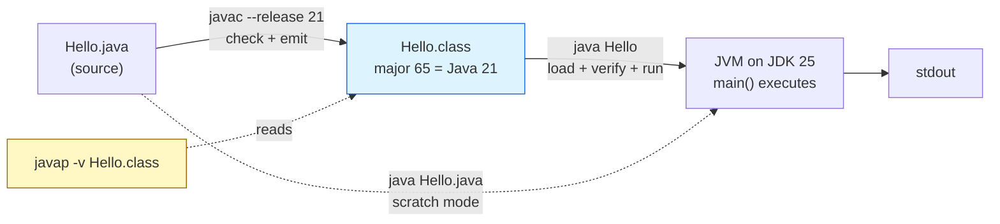

# Java Environment Setup

## 1. Learning Objectives

After this lesson you will be able to:

- [ ] Say what the JDK contains beyond the JRE, and locate `javac`, `java`, and `javap` on your machine.
- [ ] Compile a `.java` file and run the resulting `.class` — and explain what each step produced.
- [ ] State this curriculum's version policy: **JDK 21 language level via `javac --release 21`,
      run on any JDK 21+** — and *prove* which level a class file targets using `javap -v`.
- [ ] Use the single-file source launcher for scratch programs, and say when a real project layout
      becomes the better choice.
- [ ] Diagnose the three classic setup failures (`javac` not found, wrong `JAVA_HOME`, compiled
      against the wrong level) from their real error text.
- [ ] Verify your own toolchain with commands you ran, not with an installer screenshot.

## 2. Prerequisites

- [03-DEVELOPER-TOOLS/terminal-fundamentals.md](../03-DEVELOPER-TOOLS/terminal-fundamentals.md) —
  you will compile, run, and read errors entirely from the shell.
- [03-DEVELOPER-TOOLS/environment-variables.md](../03-DEVELOPER-TOOLS/environment-variables.md) —
  `PATH` and `JAVA_HOME` are environment variables, with all that implies.
- [02-PROGRAMMING-FUNDAMENTALS/modular-programming.md](../02-PROGRAMMING-FUNDAMENTALS/modular-programming.md) —
  the idea that programs split into files with names.

**Environment and honesty note:** every transcript in this lesson was executed on the author's
machine — Windows 11, Git Bash, **JDK 25.0.4.1** (`javac -version` and `java -version` outputs
below are verbatim), compiling with `--release 21` as pinned in [VERSIONS.md](../VERSIONS.md).
The **installation walkthrough** (downloading a JDK, clicking an installer) is necessarily labelled
an **illustration** — it cannot be executed on a machine that already has the toolchain; everything
after installation is executed.

## 3. Introduction

Java's reputation for ceremony starts here: two programs (`javac` and `java`), a home directory
(`JAVA_HOME`), and a compile-time vs run-time distinction other languages hide. The ceremony is
small and it buys something concrete: because compilation is a separate, explicit step against a
*named language level*, you always know what your code was checked against — and that is exactly
what this lesson makes you able to *demonstrate* rather than assert.

## 4. The Problem It Solves

Without a separate compiler, the machine that runs your program meets your mistakes at 2 a.m.
Java's split puts the meeting at build time: `javac` checks the whole file against the rules of a
declared release, and only verified bytecode reaches the JVM. The *level* part matters just as
much: teams on JDK 17, 21, and 25 must agree on what their shared code is allowed to use —
`--release` is that agreement, enforced by one flag instead of by convention.

## 5. Core Concepts

### JDK, JRE, JVM — the nesting doll

- **JVM (Java Virtual Machine):** the runtime that executes bytecode. Platform-specific.
- **JRE:** JVM + the standard libraries — enough to *run* Java.
- **JDK:** JRE + `javac`, `javap`, packaging tools, and the source-level API docs — enough to
  *build* Java. You need the JDK. (Since Java 11 the JRE as a separate download is essentially
  historical; the split survives as a mental model.)

### The two commands, and the file between them

`javac File.java` checks source and writes **one `.class` file per class** (bytecode). `java
ClassName` starts a JVM, loads those classes, and runs `main`. The `.class` file is the contract —
it carries the **class file format version**, a number that *is* your language level in the file:
Java 21 → major version **65**.

### `--release`: one flag for source, API, and bytecode

`javac --release 21` means three things at once: accept Java 21 *syntax*, link against the Java 21
*API surface*, and emit Java 21 *bytecode*. On a newer JDK (here, 25) that last part is what stops
you from accidentally using a library method that does not exist on your team's JDK 21 runtime —
the compile succeeds today and fails in production. This repository's rule: **always pass
`--release 21`**, whatever JDK is installed.

### `JAVA_HOME`, PATH, and where the tools actually live

`JAVA_HOME` names the JDK's directory; many tools (Maven, IDEs, build scripts) read it instead of
guessing. `PATH` is what makes bare `javac` work — and on this machine PATH resolves `javac`
through Oracle's `javapath` shim rather than the JDK's own `bin`, which is why `javap` (not part
of the shim) is *not* on PATH here even though the JDK is installed. Knowing your own arrangement
beats assuming it — exactly the discipline of
[03-DEVELOPER-TOOLS/troubleshooting/command-not-found.md](../03-DEVELOPER-TOOLS/troubleshooting/command-not-found.md).

### The single-file source launcher

`java File.java` compiles and runs a source file in one shot (Java 11+), keeping state only in
memory — no `.class` files on disk. Perfect for a 20-line experiment; wrong for anything with
multiple files, because there is no place for a package structure or a build to live.

## 6. How It Works



The solid path is the real build (source → bytecode → run); the dashed `java Hello.java` path is
the launcher collapsing the first two steps for scratch work; `javap` is the inspection tool that
reads the bytecode *back* — which is how the "major 65" claim in this lesson gets verified instead
of asserted.

## 7. Practical Examples

**Example 1 — verify the toolchain (executed)**

```console
$ which javac java
/c/Program Files/Common Files/Oracle/Java/javapath/javac
/c/Program Files/Common Files/Oracle/Java/javapath/java

$ javac -version
javac 25.0.4.1

$ java -version
java version "25.0.4.1" 2026-08-18 LTS

$ echo $JAVA_HOME
C:\Program Files\Java\jdk-25.0.4.1
```

- Note `javac -version` prints the **compiler** and `java -version` the **runtime** — on a
  machine with several JDKs they can legitimately differ; compare them before blaming code.
- `which` shows this machine resolves tools through Oracle's `javapath` shim while `JAVA_HOME`
  names the real JDK directory — two answers, both correct, different questions.
- **How to run it:** any Git Bash or terminal on your machine. If `javac` is missing, your layer
  is installation or PATH — fix that before reading one more line of Java.

**Example 2 — the compile/run cycle (executed)**

```java
// Hello.java
public class Hello {
    public static void main(String[] args) {
        System.out.println("Java " + Runtime.version().feature() + " via --release 21");
    }
}
```

```console
$ javac --release 21 Hello.java && java Hello
Java 25 via --release 21
```

- `Runtime.version().feature()` reports the **running** JVM (25); the flag `--release 21` decided
  what the *compiler* allowed. One line, two different version numbers, both true — that split is
  the whole lesson.
- `javac` wrote `Hello.class`; `java Hello` names the **class**, not the file (no `.java`, no
  `.class` suffix — the launcher takes the class name).
- **Assumptions:** JDK 25.0.4.1, source level 21.

**Example 3 — prove the level, don't claim it (executed)**

```console
$ "/c/Program Files/Java/jdk-25.0.4.1/bin/javap" -v Hello.class | grep -E 'major|minor|public class'
public class Hello
  minor version: 0
  major version: 65
```

- **65 = Java 21's class file format.** (Java 17 → 61, 21 → 65, 25 → 69; the number is
  `10 + (release - 1.1)` history — just memorize: 61/65/69 for 17/21/25.)
- On this machine `javap` is *not* on PATH (`javap: command not found` when tried bare — real
  output captured), so it is invoked by full path from `JAVA_HOME\bin`. One command, and your
  `--release` claim is evidence instead of adjective.

**Example 4 — the scratch-mode launcher (executed)**

```console
$ java Structure.java one
course=CodePath args=1
helper ran
```

- Runs the `.java` source directly, in memory — no class files appear. (`Structure.java` is the
  two-class file from the next lesson; here it just proves the launcher works with arguments
  passed straight to `main`.)
- **Rule of thumb:** scratch and teaching snippets → launcher; anything you will keep →
  `javac`/`java` (or Maven, in [build-tools.md](build-tools.md)).

**Example 5 — installation (illustration, cannot be executed here)**

```text
1. Install a JDK 21+ (e.g. Temurin 21 LTS or JDK 25) from your platform's normal source.
2. Set JAVA_HOME to the JDK directory; add %JAVA_HOME%\bin (Windows) or $JAVA_HOME/bin (Linux/macOS) to PATH.
3. Open a NEW terminal and run Example 1 until both versions print.
```

Steps 1–2 are platform GUI/OS work performed once, on a machine that already has them — presented
as an illustration, not a transcript. Step 3 is executed, and it is the only step that *proves*
anything.

**Example 6 — the three setup failures, by their real text (executed)**

```console
$ javap -version
/usr/bin/bash: line 1: javap: command not found
$ echo $?
127
```

```text
# wrong/missing JAVA_HOME seen in build tools and IDEs (message form, from Maven's output):
   JAVA_HOME is not defined correctly. We
   cannot execute ...
```

```console
$ javac --release 99 Bad.java
error: release version 99 not supported
Usage: javac <options> <source files>
use --help for a list of possible options
$ echo $?
2
```

- The first is PATH (executed here; exit **127** is bash's "command not found" code, and the
  `line 1` counter is bash numbering whatever snippet it ran — the number moves with context, the
  message does not). The third is a **usage** failure: `javac` rejects unknown releases with its
  usage text and exits **2** — not the 1 a real compile error costs
  ([java-program-structure.md](java-program-structure.md) Example 3 shows that one); scripts can
  branch on the difference. **The compiler tells you which levels exist**; read it, then set a
  level from [VERSIONS.md](../VERSIONS.md). The middle one is the class of error *other tools*
  raise when `JAVA_HOME` is wrong — quoted as the message form rather than a transcript because
  this machine has `JAVA_HOME` set correctly (Example 1) and could not produce it honestly.

## 8. Real-World Applications

- **CI builds** run exactly these commands (via Maven, [build-tools.md](build-tools.md)) on a
  clean runner — "works on my machine" ends where `--release` and a lockstep build begin.
- **Debugging sessions** start with `javap`/`javap -v`: what is *actually* in this class file is
  a question professionals answer with bytecode, not memory.
- **Upgrades** are version negotiations: when the team moves 21 → 25, the first hour is running
  Example 1 and Example 3 on every machine.

## 9. Common Mistakes

| Mistake | Why it happens | How to recognize it | How to prevent it |
|---|---|---|---|
| Running `java File.java` outputs nothing / wrong class | Stale `.class` files from an earlier `javac` shadow the source | Editing `.java` but seeing old behavior | Delete `.class` (or stop compiling manually) when behavior is frozen; Maven handles this |
| `javac` not found right after installing | New JDK, old terminal | Example 6's first message | Open a **new** terminal; verify with Example 1 (03's stale-PATH rule) |
| No `--release`, then surprise failures on the real JDK | "My JDK compiles it" | Uses APIs missing on the team's JDK; class file major ≠ target | Always `javac --release 21`; prove with `javap -v` (Example 3) |
| `java Hello.java` for a growing program | Launcher feels simpler | No packages, no multi-file, no build | Switch to a project layout early ([java-program-structure.md](java-program-structure.md), [build-tools.md](build-tools.md)) |
| Confusing class name with file name | `java Hello.class` / `javac Hello` | `ClassNotFound…` / `error: class Hello is public, should be declared in a file named Hello.java` | `javac` takes the **file**, `java` takes the **class** |
| Assuming `javap` is on PATH because `javac` is | Shim vs JDK `bin` (real here!) | `command not found` for siblings | Invoke via `"$JAVA_HOME/bin/javap"` — or fix PATH to the JDK `bin` |

## 10. Best Practices

- **Pin the level, not just the JDK:** `--release 21` in every compile command you type by hand;
  in Maven, `maven.compiler.release=21` ([build-tools.md](build-tools.md)) — same flag, build tool.
- **Verify with evidence:** `javap -v … | grep 'major version'` after any environment change —
  one line that ends "but which level was that, really?" forever.
- **Keep `JAVA_HOME` correct and visible** — it costs one line in your shell profile and saves
  every tool that reads it (Maven does, loudly, per Example 6).
- **Scratch first, structure second:** the launcher is the right home for a 10-line experiment;
  graduate it the moment a second file appears.
- **Record versions when asking for help** — `javac -version`, `java -version`, and your OS. The
  three lines that make other people's diagnoses possible.

## 11. Limitations and Trade-Offs

- `--release` prevents *API* and *bytecode* drift, not *behavioral* drift: a library that changes
  semantics between versions still needs tests (subject 14).
- The single-file launcher keeps everything in memory and **single-file by design** — no
  dependencies, no packages; its simplicity ends abruptly at project scale.
- One JDK per machine is a myth: IDEs and CI often use different JDKs than your shell — which is
  why every verification here is command-based, not "my IDE says so".
- The class-file version numbers (65, 69, …) are historical artifacts; they are stable and worth
  memorizing exactly three of, not deriving.

## 12. Practical Exercises

### Introductory

1. **Reproduce Examples 1–3 on your machine.** **Completion criteria:** your own `javac -version`,
   `java -version`, `JAVA_HOME`, a compiled-and-run `Hello.java`, and a `major version:` line —
   four outputs you produced, with the release number you compiled for named beforehand.
2. **Prove the launcher's boundary.** Run a `.java` file with `java File.java`, then `javac` the
   same file; show which one leaves `.class` files behind (`ls *.class`) and say why that matters
   for a project you will revisit. **Completion criteria:** both runs captured, files listed,
   one-sentence rule for when you would use each mode.

### Intermediate

3. **Break the level deliberately.** Take a program that compiles with `--release 21`, and
   (a) compile it without the flag, (b) compile it with a release number that does not exist
   (e.g. `99`), capturing both errors. Then verify with `javap -v` which major version *no flag*
   produced on your machine. **Completion criteria:** three transcripts, and one sentence naming
   what `--release` protects that "it compiles" does not.
4. **Find `javap` your way.** Determine where `javap` lives on your machine (PATH? `JAVA_HOME/bin`?
   IDE-bundled JDK?) and run `javap -v` on any compiled class to list its major version.
   **Completion criteria:** the command you actually used, and the version line it printed — if
   bare `javap` failed first, that failure is part of the evidence.

### Independent problem-solving

5. **Write the team setup card.** For a hypothetical teammate joining a project that must run on
   JDK 21: a one-page card with (a) install step, (b) the *verification commands* and the exact
   outputs that prove success, (c) the compile command with the level flag, (d) the two most
   likely failures they will hit and their fixes from Example 6. **Completion criteria:** every
   command on the card runs on your machine today, and the "proves success" outputs match what
   you actually saw — a card whose commands you have not run is a guess.
6. **Version audit of your machine.** Find every JDK installed (IDE bundles, `JAVA_HOME`, PATH's
   answer, package managers) and write the map: which tool uses which JDK, and whether any of them
   differs from the level you teach yourself (`--release 21`). **Completion criteria:** each JDK
   located with a command, and one decision written down: keep / align / remove, with a reason.

*Solutions: attempt first; environment diagnosis drills live in
[../03-DEVELOPER-TOOLS/troubleshooting/exercises.md](../03-DEVELOPER-TOOLS/troubleshooting/exercises.md)
and the set-based practice in [exercises/README.md](exercises/README.md).*

## 13. Knowledge Check

1. Your program compiled on your laptop and threw `UnsupportedClassVersionError` on the server.
   Which version numbers are involved (major formats for 17/21/25), and which command proves what
   the server received?
2. What exactly does `javac --release 21` fix that omitting it does not — name the three aspects.
3. `java Hello.java` and `javac Hello.java && java Hello` produce the same output. What differs
   about their effects on disk, and why does it matter in week two of a project?
4. Why does this machine have `javac` on PATH but not `javap`? What does that tell you about
   PATH's role as *your* system's history rather than a universal truth?
5. `javac -version` says 25 and your class file says 65. Are these inconsistent? Explain.

## 14. Completion Criteria

Observable evidence that you have understood this lesson:

- [ ] You have produced all four verification outputs (versions, JAVA_HOME, run, `major version`)
      on your own machine
- [ ] You can explain the JDK ⊃ JRE ⊃ JVM nesting and the two-command compile/run cycle without notes
- [ ] You have demonstrated what the single-file launcher does to disk versus `javac`
- [ ] You can state this curriculum's version policy and point at the line in `VERSIONS.md` that pins it
- [ ] You have *seen* at least two of Example 6's failures with your own commands (the `javap`
      PATH gap counts, if it was real on your machine)
- [ ] You know where `javap` lives on your machine, and have run one `javap -v`

## 15. Summary

- **JDK = compiler + tools + runtime + libraries**; `javac` emits `.class` files, `java` runs them.
- **`--release 21` is three promises at once:** syntax, API, bytecode — and `javap -v` shows the
  proof (`major version: 65`).
- **Compiler version and runtime version are separate answers** (`javac -version` vs
  `java -version` vs `Runtime.version().feature()`).
- **PATH decides what runs by name; `JAVA_HOME` decides what tools build with** — verify both,
  assume neither.
- **Launcher for scratch, project for anything you keep** — and Maven for anything you share.

## 16. Next Steps

- Next lesson: [java-program-structure.md](java-program-structure.md) — what the compiler just
  did with your file: classes, `main`, and the one-class-one-file rule.
- Practice: [exercises/README.md](exercises/README.md) — set 1 drills this lesson's commands.
- Where it is applied: every Java file in subjects 05–21 assumes this toolchain; the CI in
  [16-DEVOPS-AND-INFRASTRUCTURE](../16-DEVOPS-AND-INFRASTRUCTURE/README.md) runs the same
  `--release` verification.
