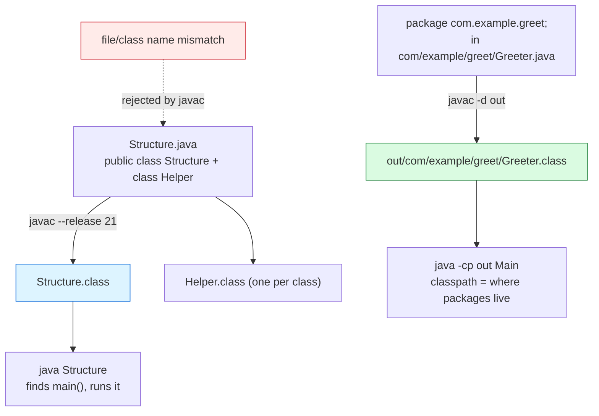

# Java Program Structure

## 1. Learning Objectives

After this lesson you will be able to:

- [ ] Read any Java file and identify its classes, the `main` signature, comments, and statements.
- [ ] Explain the file-naming rule — *one public top-level class per file, named exactly after it*
      — with the compiler's own error as evidence.
- [ ] Compile a multi-class source file and show that **one `.class` file per class** appears.
- [ ] Create a package, compile with `-d`, and show class files mirroring the directory tree.
- [ ] State what `import` does (and doesn't) and why `String` works without one (`java.lang`).
- [ ] Diagnose the three starter compile errors — missing semicolon, unknown symbol, wrong file
      name — by their real `javac` text.

## 2. Prerequisites

- [java-environment-setup.md](java-environment-setup.md) — the two-command compile/run cycle and
  the `--release 21` policy are assumed throughout.
- [02-PROGRAMMING-FUNDAMENTALS/modular-programming.md](../02-PROGRAMMING-FUNDAMENTALS/modular-programming.md) —
  splitting programs into files with clear responsibilities; this lesson shows how Java *enforces*
  the split structurally.
- [03-DEVELOPER-TOOLS/troubleshooting/command-not-found.md](../03-DEVELOPER-TOOLS/troubleshooting/command-not-found.md) —
  when the compiler itself is the thing you cannot find.

**Environment used in this lesson:** every transcript executed on the author's machine —
JDK 25.0.4.1, `javac --release 21`, Git Bash. Error outputs are verbatim, carets included.

## 3. Introduction

Where subject 02 could put a whole program in one file and move on, Java makes the *container* a
first-class decision: source is organized into classes, classes into files with strict naming,
files into packages with directory trees that must agree. Beginners experience this as rules;
professionals experience it as navigation — because once the structure is this regular, any tool
(or teammate) can find anything: "where is `Greeter`?" is answered by its package name alone.

## 4. The Problem It Solves

Languages without a structural contract make every codebase a different shape, and half of
onboarding is reverse-engineering *this* project's conventions. Java's contract — one public type
per file, name = address, package = directory — was chosen so that compilation units, namespace,
and filesystem agree **mechanically**: the compiler can reject a mismatch (executed below), tools
can locate classes without config, and namespace collisions become impossible by construction
rather than by etiquette.

## 5. Core Concepts

### The class is the unit

Every Java program is classes; a class groups state (fields) and behavior (methods). Even the
entry point is a method *on a class*: `public static void main(String[] args)`. Decode that
signature once and it never confuses you again: **public** (callable from the launcher),
**static** (no object needed to start), **void** (returns nothing), **`String[] args`** (the
command-line arguments, as an array).

### The file rules (enforced, not suggested)

- One **public** top-level class/interface per file, and the file name must equal it exactly.
- Non-public top-level classes are allowed as helpers — `Structure.java` below holds two classes
  and compiles to **two** `.class` files.
- A file with no public class may have *any* name — the public one is what pins the name.

### Statements, blocks, comments

Statements are semicolon-terminated lines of action — the semicolon is part of Java's grammar,
not a line terminator, so the compiler will happily report `error: ';' expected` at the *end* of
the line where you forgot it. Braces form blocks; blocks form scopes (methods own theirs — the
detail lives in [methods.md](methods.md)). Comments are `//`, `/* */`, and the tool-readable
`/** */` that generates API docs.

### Packages and imports

`package com.example.greet;` claims a namespace *and* a directory: the file belongs in
`com/example/greet/`, and `javac -d out` will place the class file exactly there (executed below).
`import` pulls a type's name into scope so you write `Greeter`, not `com.example.greet.Greeter`;
`java.lang` is imported implicitly — which is why `String` and `System` need no import while
`java.util.Arrays` does.

### What the compiler produces

`javac` writes bytecode — one `.class` per class, carrying the class file version (major 65 for
`--release 21`, verified in [java-environment-setup.md](java-environment-setup.md)) and readable
back with `javap`. Source structure and bytecode structure are *the same story told twice*.

## 6. How It Works



Three relationships the diagram pins: **class ↔ class file** (1:1, mechanical), **package ↔
directory** (names map to paths, `-d` materializes it), and **name mismatch → compile error**
(the contract has teeth — the red arrow is Example 3's transcript).

## 7. Practical Examples

**Example 1 — two classes in one file, two class files out (executed)**

```java
// Structure.java
// A line comment. /* A block comment sits across lines. */
public class Structure {
    static final String COURSE = "CodePath";    // class member
    public static void main(String[] args) {    // the entry point
        int shown = args.length;                // args arrives from the command line
        System.out.println("course=" + COURSE + " args=" + shown);
        Helper.hi();
    }
}
class Helper {                                  // a second top-level class, same file
    static void hi() { System.out.println("helper ran"); }
}
```

```console
$ javac --release 21 Structure.java && java Structure alpha beta
course=CodePath args=2
helper ran

$ ls a1/*.class
a1/Helper.class
a1/Ops.class
a1/Structure.class
a1/Types.class
```

- `args` is **2** — `alpha` and `beta` arrived from the command line into `main`; the launcher
  passes whatever follows the class name.
- The `ls` output includes classes from other exercises in the folder, but the point stands:
  **`Helper.class` exists** — the second class became its own class file without its own source
  file.
- `static final String COURSE` is the class-level constant form; `static` methods belong to the
  class, callable without an object (`Helper.hi()`).
- **How to run it:** the two commands above; the file is in this lesson's exercises as well.

**Example 2 — inspect what javac made (executed)**

```console
$ "/c/Program Files/Java/jdk-25.0.4.1/bin/javap" -p Structure.class | head -7
Compiled from "Structure.java"
public class Structure {
  static final java.lang.String COURSE;
  public Structure();
  public static void main(java.lang.String[]);
}
```

- `javap -p` lists members including private ones; note the **implicit no-arg constructor**
  (`public Structure()`) — Java writes it for you when you declare no constructor; constructors
  themselves arrive in [classes-and-objects.md](classes-and-objects.md).
- Signatures are fully qualified (`java.lang.String[]`) — the bytecode has no imports left to
  resolve; `import` was a source-level convenience only.

**Example 3 — the rules with teeth (executed, three errors)**

```console
$ javac --release 21 Right.java          # file Right.java declares: public class Wrong {}
Right.java:1: error: class Wrong is public, should be declared in a file named Wrong.java
public class Wrong {}
       ^
1 error
$ echo $?
1
```

```console
$ javac --release 21 Bad1.java           # statement without its semicolon
Bad1.java:3: error: ';' expected
        System.out.println("no semicolon here")
                                               ^
1 error
```

```console
$ javac --release 21 Bad3.java           # a typo'd name
Bad3.java:3: error: cannot find symbol
        System.out.println(mesage);
                           ^
  symbol:   variable mesage
  location: class Bad3
1 error
```

- Read the third error's **extra lines** — `symbol:` and `location:` — they are the compiler
  telling you both what it expected and where it looked. That pair is the most useful two lines
  in Java pedagogy: most "cannot find symbol" errors are typos, wrong imports, or wrong scope,
  and the `location:` line already says which.
- All three exit **1** — `javac` failures are script-branchable exactly like shell failures
  ([03-DEVELOPER-TOOLS/terminal-fundamentals.md](../03-DEVELOPER-TOOLS/terminal-fundamentals.md)
  §exit codes).

**Example 4 — packages: namespace becomes directory (executed)**

```java
// src/com/example/greet/Greeter.java
package com.example.greet;

public class Greeter {
    public static String hi(String name) { return "Hi, " + name + "!"; }
}
```

```java
// src/Main.java
import com.example.greet.Greeter;

public class Main {
    public static void main(String[] args) {
        System.out.println(Greeter.hi("packages"));
    }
}
```

```console
$ javac --release 21 -d out src/com/example/greet/Greeter.java src/Main.java && java -cp out Main
Hi, packages!

$ find out -name '*.class' | sort
out/Main.class
out/com/example/greet/Greeter.class
```

- `-d out` made `out/com/example/greet/` **because** the package line said so — the tree in the
  output is the source's namespace made physical.
- `java -cp out Main`: `-cp` (classpath) tells the launcher *where package roots live*; without
  it, `com.example.greet.Greeter` would be invisible. The classpath is the single most
  important runtime concept Maven later automates ([build-tools.md](build-tools.md)).
- `import` shortened the spelling in `Main`; the compiler still recorded the full name
  (Example 2's qualified signatures show the end state).

## 8. Real-World Applications

- **Spring applications** (subject 11) are exactly this pattern scaled up: packages like
  `com.acme.orders` map to folders, and the framework *scans* those packages to find your classes
  — structure doing work no configuration file can do.
- **Debugging output** (`at com.acme.orders.OrderService.place(OrderService.java:41)`) is package +
  file + line — reading stack traces fluently means reading Java structure fluently.
- **Team namespace hygiene:** `com.yourcompany.feature` prevents two `Utils` classes from ever
  colliding — the reason every language since has copied the idea.

## 9. Common Mistakes

| Mistake | Why it happens | How to recognize it | How to prevent it |
|---|---|---|---|
| Forgetting the semicolon | Line-based editor habit from other languages | `error: ';' expected` at line end (Example 3) | Read the caret's line end; semicolons terminate *statements* |
| Typo in a name | Muscle memory from Python/JS | `cannot find symbol` + `symbol:`/`location:` lines | Let the two extra lines diagnose: typo, import, or scope — in that order |
| File name ≠ public class | IDE created/renamed one, not the other | `class X is public, should be declared in a file named X.java` | Rename both together; let the IDE own renames |
| `package` line doesn't match folders | Files moved without editing the declaration | `error: wrong filename` / class found in wrong place; or `-d` tree surprises | Compile with `-d` early — the output tree proves agreement |
| Calling `Structure.java` from `java` (or `java Structure.class`) | Mixing the two commands' arguments | `ClassNotFound…` / launcher confusion | `javac` takes **files**, `java` takes **class names** |
| Putting several public classes in one file | "Less files" instinct | Same filename error as above | One public type per file; helpers may be package-private |
| `import` expecting to *run* code | Thinking import = include | `import` only names a type | Imports are for the compiler's name resolution, nothing more |

## 10. Best Practices

- **Let the IDE create the package + folder + class together**, then *read back* what it made —
  you are learning the convention it follows, not fighting it.
- **Name packages for what changes together:** `com.acme.orders`, not `com.acme.utils2`.
- **Keep `main` thin:** it should read like a table of contents (calls into classes that do the
  work) — the habit that makes the later OOP lessons feel natural instead of ceremonial.
- **Comment the *why*; the code is the *what*** — and reserve `/** */` for API docs tools read.
- **Compile early and often by hand** while learning (`javac --release 21 File.java && java …`);
  the fluency you build here is what later makes Maven's black box unsurprising.

## 11. Limitations and Trade-Offs

- One public type per file is ceremony for tiny programs — deliberate friction that pays off
  only at scale (and which languages like Kotlin relaxed for small files, without dropping the
  file↔type idea).
- The classpath is a global namespace per JVM run — two libraries shipping the same class name is
  a real failure mode (the historical "jar hell"); Maven's dependency resolution
  ([build-tools.md](build-tools.md)) exists largely to manage it.
- Packages give *structure*, not *privacy* by themselves — package-private visibility is a tool,
  not a guarantee; true boundaries are the encapsulation lesson's subject.
- Source and bytecode agreeing does not mean *behavior* agrees — only tests tell you that
  ([14-TESTING-AND-QUALITY](../14-TESTING-AND-QUALITY/README.md)).

## 12. Practical Exercises

### Introductory

1. **Reproduce Example 1 end to end**, then add a third top-level class to the same file that
   `main` also calls. **Completion criteria:** three `.class` files appear (`ls *.class`), all
   three behaviors print, and you can point at which line of which class each output came from.
2. **Decode the signature from memory.** Write out what each word of
   `public static void main(String[] args)` means, then verify by experiment: change `String[]`
   to `String` and compile — capture the launcher's response to a class that *has* a main it
   cannot use. **Completion criteria:** your five-word decode, plus the captured error.

### Intermediate

3. **Reproduce all three errors of Example 3** in your own files (create `Right.java` containing
   `public class Wrong`, a missing-semicolon line, a typo'd symbol). **Completion criteria:** three
   `javac` failures with exit code 1 each, and for the symbol error, your read of the
   `location:` line.
4. **Build the package tree twice:** once with the files *already* in matching directories and
   `javac -d`, and once with everything flat and the `package` line removed — then compare `find`
   output. **Completion criteria:** you can state exactly which step creates the directory tree,
   and what breaks when the declaration and the path disagree.

### Independent problem-solving

5. **Plan a two-package program before writing it.** Sketch: `com.acme.library.model` (holds
   `Book`) and `com.acme.library.cli` (holds `Main` that prints a `Book` line). Write the file
   tree first, then the four files, then compile exactly as your sketch prescribes — without
   consulting the lesson after the sketch is down. **Completion criteria:** `java -cp out
   com.acme.library.cli.Main` runs, the `-d out` tree matches your sketch line for line, and you
   can explain why `Main` needs `import …model.Book` while `Book` needs no import at all.
6. **The anatomy audit.** Take any Java file from this repository's exercises (or any open-source
   file your IDE can open) and annotate every top-level element: class/public-ness, package,
   imports, field vs method vs constructor, comment kinds. **Completion criteria:** every line of
   the file falls into one labeled category — and one sentence on what the file's *package* tells
   you about where it belongs.

*Solutions: attempt first; set-based practice is in [exercises/README.md](exercises/README.md).*

## 13. Knowledge Check

1. `Helper` has no `main`, but the program prints `helper ran`. Explain the full path from the
   command line to that output.
2. Why does `String` need no import but `Arrays` does? What does `import` actually change — and
   what does it *not*?
3. After Example 4's compile, where does `Greeter.class` live, and which line of source decided
   it? What would `java Main` (no `-cp`) report?
4. A teammate renames `Order.java` to `OrderService.java` but not the class. Quote the error the
   compiler gives and say what the fix is.
5. `javap -p` showed `public Structure()`. Who wrote it, when, and what happens to that answer
   once you declare your own constructor?

## 14. Completion Criteria

Observable evidence that you have understood this lesson:

- [ ] You have compiled a multi-class file and shown one `.class` per class
- [ ] You have produced all three of Example 3's errors yourself, with their exact text
- [ ] You created a package tree with `-d`, ran with `-cp`, and can predict the `find` output
      before running it
- [ ] You can decode `public static void main(String[] args)` without notes
- [ ] You can name what `import` does, what `java.lang` provides, and what `javap` reads
- [ ] Every line of your Example-1 file falls into a labeled category (comment/field/method/class)

## 15. Summary

- Java's structure is a **contract:** one public class per file named after it, `package` = directory —
  the compiler enforces both (errors executed above).
- **One class → one `.class` file**; `javac` writes them, `javap` reads them back.
- **`main` is a method on a class**: `public static void main(String[] args)` decodes once, forever.
- **`import` names types; `java.lang` is implicit; the classpath (`-cp`) is where packages live at
  runtime.**
- The three starter errors — semicolon, symbol, file name — carry enough text to diagnose
  themselves; read the whole message.

## 16. Next Steps

- Next lesson: [variables-and-types.md](variables-and-types.md) — what you declare inside these
  structures: Java's eight primitives and the compiler's conversion rules.
- Practice: [exercises/README.md](exercises/README.md) set 1 (structure drills).
- Where it is applied: [11-BACKEND-ENGINEERING](../11-BACKEND-ENGINEERING/README.md)'s Spring
  packages are this lesson's pattern at production scale.
