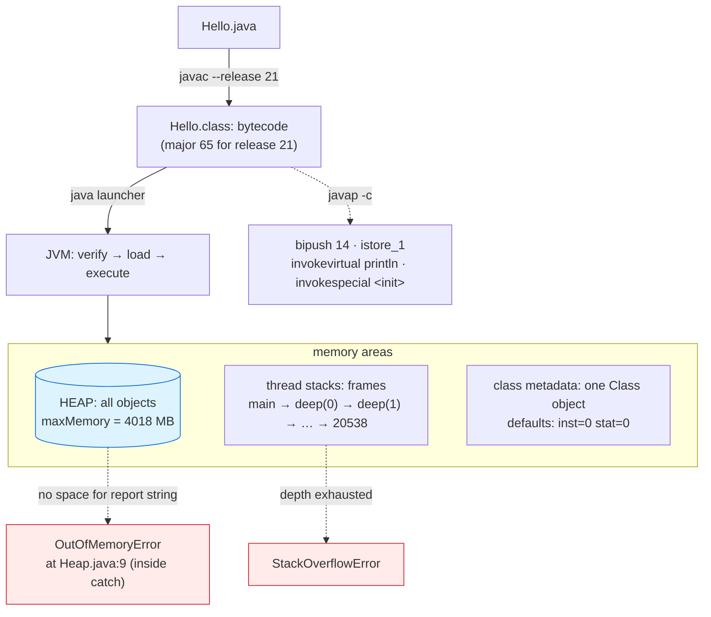

# JVM and Memory

## 1. Learning Objectives

After this lesson you will be able to:

- [ ] Describe the run-time architecture you actually observed — `main` on a thread, heap for
      objects, per-thread stacks that overflow independently — using the executed
      `StackOverflowError after 20538 frames` as the stack's existence proof.
- [ ] Read `javap -c` disassembly of a three-line program and map each bytecode to the source
      it came from (`bipush 14`, `istore_1`, `invokevirtual println`), then say what the
      implicit constructor's `invokespecial` line reveals.
- [ ] Set and read heap limits with `-Xmx`, and diagnose the **location** of an
      `OutOfMemoryError` in a stack trace — the executed error landed *inside the catch block*
      (line 9), and you can say exactly why.
- [ ] Explain default initialization (`inst=0 stat=0`), the one-`Class`-object-per-type rule
      (`same Class object: true`), and how arguments reach `main` (`args = [one, two]`).
- [ ] Connect the memory areas to earlier lessons: strings/boxes on the heap, frames per call,
      `synchronized` monitors per object, and where serialization writes from.
- [ ] Use JVM inspection as a habit: `javap -v` for major versions (env-setup's 65 = Java 21),
      `-Xmx` for bounded experiments, and `Runtime` introspection from inside a program.

## 2. Prerequisites

- [java-program-structure.md](java-program-structure.md) — `javap -p` on your own class files;
  this lesson adds the `-c` lens (bytecode, not signatures).
- [java-environment-setup.md](java-environment-setup.md) — `javap` full-path invocation and
  class-file major versions; `--release 21` vs running JVM 25.
- [exceptions.md](exceptions.md) — `Error` vs `Exception`, stack traces by line number, and the
  catch-block behavior the OOM example hinges on.
- [concurrency.md](concurrency.md) — threads already appeared; now the memory each one owns.

**Environment used in this lesson:** every transcript executed on the author's machine —
JDK 25.0.4.1, `javac --release 21`. (`StackOverflowError` frame counts vary run to run — the
executed run shown reported 20538; your machine will differ and that difference is itself a
teaching point about stack sizing.)

## 3. Introduction

You have been *using* the JVM for eight lessons; this lesson is what you were using. Java source
compiles to bytecode (`javac`), and the **JVM executes that bytecode** — a machine that has
nothing to do with your CPU: its own instruction set (`bipush`, `invokevirtual`), its own
memory areas (heap and stacks), its own error taxonomy (`Error` is a different word than
`Exception` for a reason). The lesson's spine is a simple rule with sharp consequences:
**objects live on a shared heap; each thread gets its own stack of frames.** From it flow the
defaults you observed (`inst=0`), the overflows you've seen (`StackOverflowError`), the memory
you measured (`maxMemory = 4018 MB`), and the OOM you can now provoke on demand with `-Xmx`.

## 4. The Problem It Solves

Why not compile straight to machine code? The JVM buys four things at once: **portability**
(one `Hello.class`, every OS with a JVM — the write-once half of the language's contract);
**dynamic safety** (bytecode is verified before execution; the array bounds and null checks
from lesson 07 are instructions, not hopes); **runtime services for free** (garbage collection
— heap objects with no references are reclaimed; you have never written a `free`); and
**late-bound everything** (class loading, `virtual` dispatch from [polymorphism.md](polymorphism.md),
reflection, hot code recompilation by the JIT). The cost is the indirection this lesson makes
visible: your `2 + 3 * 4` survives as instructions for a computer that doesn't exist yet — and
the memory model behind it has areas, limits, and failure modes you can now name.

## 5. Core Concepts

### The areas, observed one by one

Executed in Example 1: **heap** — `maxMemory = 4018 MB` (the `Runtime` introspection; the JVM's
default ceiling on this machine — your number will differ, which is why `-Xmx` exists);
**stacks** — `deep(0)` recursed until `StackOverflowError after 20538 frames`, caught and
counted: each frame (one method activation: locals, operands) consumes stack, the per-thread
default is small (~512 KB–1 MB), and the *depth* being finite-and-countable is the stack's
signature vs the heap's. **Statics and class metadata** — `defaults: inst=0 stat=0` shows field
zero-initialization for both instance and static fields (the "locals aren't zeroed but fields
are" split from [classes-and-objects.md](classes-and-objects.md), now at the VM level — class
initialization happens once, lazily, when the class is first used); and
`same Class object: true` — every instance of `JvmDemo` shares **one** `Class` object (created
when the class was loaded), which is the mechanism `a.getClass()` exposes and reflection builds
on ([generics.md](generics.md)'s `Class<T>` token passes through this door).

### Bytecode: the instructions you've been writing

`javap -c Calc.class` (Example 2) reads the *code* of a method: `bipush 14` pushes the constant
(the source `int s = 2 + 3 * 4;` was constant-folded by the **compiler** — 14, not an addition
tree: javac computes compile-time constants; the JVM never saw `*`), `istore_1` stores it as
local `s`, `getstatic #7` fetches `System.out` (the `#7` is a constant-pool index — names live
in a pool, instructions carry numbers), `iload_1` loads `s`, `invokevirtual #13` calls
`println(int)` — the *virtual* dispatch keyword is polymorphism's mechanism named in the
instruction set. The implicit constructor's `invokespecial #1 … Object."<init>"` is the
non-virtual call to the superclass constructor — the same constructor-order fact the
inheritance lesson read from printed output, now seen as the instruction that executes it.

### `-Xmx`, and where errors land

`java -Xmx32m Heap` (Example 3): capping the heap at 32 MB made the list-of-1-MB-chunks run
out — `OutOfMemoryError: Java heap space`, **exit 1**. The detail worth the whole example: the
trace's line is `at Heap.main(Heap.java:9)` — line 9 is **inside the catch block** (the
reporting `println`), not the `hog.add` loop. Why: the catch ran, then the *concatenation*
`"OutOfMemoryError: " + e.getMessage() + …` needed fresh heap to build the report string — and
there was none. Teaching order: (1) `Error`s are catchable (Java doesn't stop you, it just
labels the class of failure as un-recoverable-in-principle); (2) recovery code itself allocates,
so an OOM can re-fire inside your handler; (3) a *bounded* experiment (`-Xmx`) turns a
production mystery ("it crashed one Tuesday") into a two-second reproducible transcript — the
same discipline as `--release`, applied to memory.

## 6. How It Works



Left-to-right: source → bytecode → the machine that runs it. The two red edges are the areas'
independent exhaustion modes — heap runs out of *space* (growable up to `-Xmx`), stacks run out
of *depth* (small by design, per thread). The bottom dotted edge is the inspection tool for the
same artifact `javac` wrote.

## 7. Practical Examples

**Example 1 — the runtime's four facts, executed**

```java
import java.util.Arrays;

public class JvmDemo {
    static int statField;
    int instField;
    static int deepest;
    public static void main(String[] args) {
        JvmDemo a = new JvmDemo();
        JvmDemo b = new JvmDemo();
        System.out.println("defaults: inst=" + a.instField + "  stat=" + statField);
        System.out.println("same Class object: " + (a.getClass() == b.getClass()));
        System.out.println("args = " + Arrays.toString(args));
        System.out.println("maxMemory = " + Runtime.getRuntime().maxMemory() / (1024 * 1024) + " MB");
        try { deep(0); }
        catch (StackOverflowError e) {
            System.out.println("StackOverflowError after " + deepest + " frames");
        }
    }
    static void deep(int n) { deepest = n; deep(n + 1); }
}
```

```console
$ javac --release 21 JvmDemo.java && java JvmDemo one two
defaults: inst=0  stat=0
same Class object: true
args = [one, two]
maxMemory = 4018 MB
StackOverflowError after 20538 frames
$ echo $?
0
```

- Line 1: **field zero-initialization** — two objects, static or instance, `int` fields came
  out 0 without ever being assigned (contrast: *locals* are compile-error-if-unassigned —
  the split is deliberate and now visible from the VM's side).
- Line 2: **identity of types** — `a.getClass() == b.getClass()` is `true` because both
  instances were built from the same loaded class (one `Class` object per type per classloader);
  this is also the equality `instanceof` and casts consult.
- Line 3: **`main`'s array** — `one two` arrived as `args[0] args[1]`, printed by
  `Arrays.toString` (the launcher constructs the `String[]`; lesson 03 showed the same fact
  through `args.length`).
- Lines 4–5: **the two limits, one program** — the heap ceiling reported by `Runtime` (4018 MB
  here; default-derived, machine-specific) and the stack's depth limit, felt as
  `StackOverflowError` with a *counted* depth (20538 this run — varies with native/thread stack
  configuration; a wrong answer's variance that means *sizing*, not *bug*). The error was
  **caught inside `main`** — `Error` is catchable, and the lesson's honest note is that catching
  `StackOverflowError` to log-and-continue is a demo technique, not production policy (the
  stack may be too shallow to trust afterward).

**Example 2 — bytecode of three source lines, executed**

```console
$ "/c/Program Files/Java/jdk-25.0.4.1/bin/javap" -c -p Calc.class
Compiled from "Calc.java"
public class Calc {
  public Calc();
    Code:
         0: aload_0
         1: invokespecial #1                  // Method java/lang/Object."<init>":()V
         4: return

  public static void main(java.lang.String[]);
    Code:
         0: bipush        14
         2: istore_1
         3: getstatic     #7                  // Field java/lang/System.out:Ljava/io/PrintStream;
         6: iload_1
         7: invokevirtual #13                 // Method java/io/PrintStream.println:(I)V
        10: return
}
```

- Source: `int s = 2 + 3 * 4; System.out.println(s);` — five instructions did the arithmetic
  *entirely at compile time* (`bipush 14` is the folded constant; no `iadd`/`imul` exists in
  the listing — javac evaluates constant expressions, the JVM executes the result).
- `istore_1`/`iload_1`: locals are *numbered slots* (`s` is slot 1 — slot 0 of a static method
  is the first argument in general; here it's unused), a fact the compiler decided and your
  source names never see.
- `invokevirtual` vs `invokespecial`: the print is **virtual** (the receiver's runtime type
  picks the override — polymorphism's dispatch, named as an opcode); the constructor call is
  **special** (non-virtual, superclass-init, called before this object's fields are anything).
  The `#N` operands are constant-pool references — symbolic names live in the pool; the code
  carries indices (which is also why `javap -v` can show you the pool and the `major version`
  — 65 = release 21, from the env-setup lesson).

**Example 3 — the heap, bounded until it broke (executed)**

```java
import java.util.*;

public class Heap {
    public static void main(String[] args) {
        List<byte[]> hog = new ArrayList<>();
        try {
            for (int i = 0; ; i++) hog.add(new byte[1024 * 1024]);
        } catch (OutOfMemoryError e) {
            System.out.println("OutOfMemoryError: " + e.getMessage()
                    + "  after " + hog.size() + " x 1MB chunks");
        }
    }
}
```

```console
$ javac --release 21 Heap.java && java -Xmx32m Heap
Exception in thread "main" java.lang.OutOfMemoryError: Java heap space
	at Heap.main(Heap.java:9)
$ echo $?
1

$ java -Xmx64m Heap
Exception in thread "main" java.lang.OutOfMemoryError: Java heap space
	at Heap.main(Heap.java:9)
$ echo $?
1
```

- **Both heap sizes produced the identical trace — at line 9, inside the catch block.** Read
  the source: the loop (line 7) threw, the `catch` was entered, and the *report itself*
  (`"OutOfMemoryError: " + …` on line 9) needed new heap to build its string — none existed, so
  the error re-raised from the reporting line. Recovery allocates; bounded heaps make that
  visible in one run.
- `Exception in thread "main" … ` + exit **1** — an uncaught `Error` kills the thread (here the
  whole program, since `main` was the only one): the same exit-code discipline as compile
  errors, now from the runtime side ([terminal-fundamentals.md](../03-DEVELOPER-TOOLS/terminal-fundamentals.md)'s
  `$?` reading transfers unchanged).
- The teaching use of `-Xmx`: cap it small and a class of production failures ("died on a
  Tuesday, fine since") becomes a **reproducible experiment** — the same move as `--release`,
  and the reason every serious service sets `-Xmx` explicitly rather than accepting the
  machine's 4018 MB default mood.

## 8. Real-World Applications

- **Production memory triage** — `-Xmx` is set on every real service JVM (containers get a
  fraction of host RAM; the default would overcommit it); OOM + heap dump is the incident
  workflow, and its first step is exactly the bounded repro from Example 3.
- **Stack-overflow debugging** — a `StackOverflowError` in production means *unbounded
  recursion* or absurd default depth (the trace's frame count is your first clue; the recursion
  lesson's `deep` is the minimal form). Seeing 20538 counted frames teaches you to read the
  *depth* as data.
- **Reflection and frameworks** — `getClass()`, `Class<T>` tokens ([generics.md](generics.md)),
  and annotation scanning all stand on the one-`Class`-object fact from Example 1; Spring,
  Gson, and JUnit are that door at scale.
- **Performance reading** — `javap -c` answers "did the compiler do what I think?" questions:
  constant folding (observed), boxing sites, inlining surprises; the `-v` variant additionally
  shows the constant pool and major version, the env-setup lesson's tool.
- **Portability evidence** — the same `Hello.class` here ran on JDK 25 (major 69 runtime)
  accepting `--release 21` bytecode (major 65): the compatibility contract, executed.

## 9. Common Mistakes

| Mistake | Why it happens | How to recognize it | How to prevent it |
|---|---|---|---|
| Catching `Error` to "recover" | `catch (Exception)` habits extended too far | Handler throws again (Example 3's line 9) | Catch `Error`s only to log/clean-up and rethrow; fix the cause |
| OOM without a bound | Default `-Xmx` is machine-sized | Dumps too big to share; container OOMKilled | Set `-Xmx` (containers: percentage of limit); reproduce bounded first |
| Interpreting OOM line 9 as "the bug is in the handler" | Trace-reading shortcut | Handler is *reporting*, not failing | Read frames top-down; find where allocation was *needed*, not only where it failed |
| Ignoring `StackOverflowError` as "impossible" | Small real depths | Deep-recursion incidents at scale | Recursion with depth bounds or explicit stacks; learn frame cost |
| Expecting `javap`-visible constants to compute at runtime | Source arithmetic intuition | `bipush 14` with no opcodes | Constant-folding is javac's; verify with `-c` when it matters |
| Assuming `main`'s locals are zeroed like fields | The two initialization rules blur | `variable might not have been initialized` in *your* code, `0` in output from *fields* | Fields zero, locals must initialize — enforced both ways |
| Trusting a catch-of-SOE program's later stability | Error recovered from | Odd behavior deep in the handler | Treat post-SOE state as suspect; restart or restructure |
| Comparing `Class` objects with `.equals` instead of `==` | General `equals` habit | Works, but obscures the point | `getClass() ==` is identity — the fact being taught |
| Assuming `-Xmx` affects stacks | One knob intuition | Unchanged `StackOverflowError` | Heap flags grow space; thread stack sizes are separate (`-Xss`) |

## 10. Best Practices

- **Set `-Xmx` deliberately** in every deployable artifact (and read your container's memory
  limit first); the 4018 MB default is a *host* number, not your program's requirement.
- **Reproduce memory failures bounded** — `-Xmx32m` turned a crash into a transcript; the same
  discipline as `--release 21` turning "works on my JDK" into a stated level.
- **Read traces as frame stacks, top line = where it died, frames below = who called it** —
  and note line numbers against *source*, not prose (debugging-fundamentals' habit, JVM-grade).
- **`javap -c` when the compiler surprises you; `javap -v` when the version or pool matters** —
  an inspection habit like `git log`: evidence over memory.
- **Know the areas' rules** (objects → heap; frames → per-thread stack; one `Class` per type;
  fields zero-initialized) — most "why is my value 0/why did it overflow" questions are these
  four sentences.
- **Errors are for conditions, not for control flow** — catching `Error` is a last-resort
  boundary (the `finally`-cleanup pattern), never a branch of business logic.

## 11. Limitations and Trade-Offs

- **Indirection costs** — bytecode → interpreter/JIT → machine code has overhead the first
  moments of a program's life (warm-up) and a memory model that hides allocation costs behind
  the convenience of `new`; "it's just objects" bills arrive as GC pauses and cache misses at
  scale (measured, not feared — subject 21 profiles this).
- **The heap is one shared pool** — simple to manage (GC), hostile to isolation: one leaking
  allocation can starve everything (the `-Xmx` incident workflow exists because of this
  topology); the alternative (per-request arenas, off-heap) trades simplicity for control.
- **Stacks are small on purpose** — deep recursion is bounded by design (`-Xss` exists but
  should rarely be the answer); unbounded data structures want heap, not frames.
- **Catchable `Error`s are a footgun Java keeps** — the compiler will let you catch OOM; only
  discipline stops you (this lesson's line-9 run is the cautionary exhibit).
- **This lesson is one JVM's observable behavior** — the memory model's formal rules
  (happens-before, final fields, `volatile`) are deeper than demonstrated; the executed subset
  (defaults, one Class, `-Xmx`, stack depth, bytecode shape) is exactly what every day of
  reading traces needs.

## 12. Practical Exercises

### Introductory

1. **Reproduce Examples 1 and 3.** **Completion criteria:** JvmDemo's five lines (exit 0) and
   the OOM trace at line 9 with exit 1 for **both** `-Xmx32m` and `-Xmx64m`; plus one sentence:
   why did the frame count for `StackOverflowError` differ from the transcript (or not), and
   which JVM setting is the likely cause of variation?
2. **Disassemble your own class.** Take any program from lessons 03–08 and run `javap -c -p`.
   **Completion criteria:** one source line of yours mapped to its instruction sequence with a
   short annotation (which opcode did the work; where the constant pool index appears), and one
   surprise (folding, synthetic access, string concat shape) written up in two sentences.
3. **Four areas, four observations.** Write one program that prints: (a) a field default and a
   deliberately-uninitialized local's compile refusal (paste the error), (b) `getClass()` of two
   instances, (c) `Runtime` free/total/max memory before and after allocating a 10 MB array,
   (d) a recursion depth counter via caught `StackOverflowError`. **Completion criteria:** four
   output fragments matching the four area-rules from Section 5, each with the rule it proves.

### Intermediate

4. **The catch-block OOM, dissected.** Modify `Heap` to print the failure with **no string
   concatenation** (e.g. `e.printStackTrace()` or a single pre-built constant + `size()`), same
   `-Xmx32m`. **Completion criteria:** the new trace's line number (loop vs catch — explain the
   difference from Example 3 in three sentences), and the general rule for OOM-handling code
   (what operations are safe/unsafe inside a handler — from your experiment, not folklore).
5. **Version forensics.** Compile one file with `--release 17`, one with `--release 21`, one
   plain; read each major version with `javap -v | grep major` (or the class-file constant).
   **Completion criteria:** a 3-row table (command → major version → running-JVM compatibility
   comment), reconciled with env-setup's "61/65/69 for 17/21/25" and with Example 1's runtime
   facts (which JVM ran them?).
6. **`-Xmx` escalation ladder.** Run `Heap` at 16m, 32m, 64m, 128m and record what each run
   reports (chunks attempted / where it died). **Completion criteria:** a 4-row table, the
   linear-ish relationship between cap and progress stated (1 MB chunks ≈ cap in MB — confirm
   or refute with your numbers), and one sentence on why production OOM reports *without* a set
   `-Xmx` are so much harder to compare across machines.

### Independent problem-solving

7. **A memory-aware budget harness.** Spec `Budget.run(int mbCap, Runnable work)`: fork-free
   (in-process), it records `Runtime` free/total/max *before* and *after* the work, computes
   bytes actually consumed (`(total-free)` delta), and reports whether the work completed or
   died of OOM — with the OOM case caught and reported using **only pre-allocated state** (no
   concatenation in the handler, per exercise 4). Work = allocate N 1 MB chunks into a list and
   drop references periodically (e.g. clear the list every 8 chunks — so GC has something to
   reclaim; you'll see "consumed" stop climbing when it does). Executed runs at two caps (32 MB,
   64 MB) × two workloads (keep-all → should die; drop-every-8 → should survive your chosen N).
   **Completion criteria:** the spec + predicted outcome per (cap × workload) written first;
   four transcripts; and the analysis paragraph: what delta behavior distinguished *leak-shaped*
   growth from *reclaimed* growth — with the one GC-truth your numbers demonstrate (and one
   they cannot: name what an in-process view hides that a heap dump would show, from the docs
   you read — cited).

*Solutions: attempt first; set practice in [exercises/README.md](exercises/README.md).*

## 13. Knowledge Check

1. `defaults: inst=0 stat=0` — state the initialization rule for fields vs locals, and where in
   the JVM's life it happens (class initialization vs per-object allocation).
2. `same Class object: true` — connect this to `getClass()`, to `instanceof`, and to
   [generics.md](generics.md)'s `Class<T>` token: three features standing on one loaded-class
   fact.
3. The disassembly showed `bipush 14` for source `2 + 3 * 4` — who did the arithmetic, what
   opcode is *absent*, and what does `invokevirtual` vs `invokespecial` tell you about
   `println` vs the constructor call (tie to polymorphism's dispatch rule)?
4. Both `-Xmx32m` and `-Xmx64m` failed at **line 9** — narrate the exact sequence (loop throws →
   catch runs → concatenation allocates → error re-raises), then say what changes in your own
   handler code to avoid the re-fire.
5. `StackOverflowError after 20538 frames` — why is this count *variable* across runs/machines
   while a heap OOM's chunk-count is more predictable, and which flag would you reach for if
   the depth itself were the problem (`-Xss` vs `-Xmx` — name the right one and why)?
6. "Errors are catchable" — from this lesson's evidence, give the rule for when catching an
   `Error` is legitimate (cleanup/logging + rethrow) and one scenario where it would be
   actively harmful.

## 14. Completion Criteria

Observable evidence that you have understood this lesson:

- [ ] JvmDemo reproduces (five lines) and Heap dies at line 9 under both caps, exit 1
- [ ] Your own class disassembled and annotated, with one surprise written up
- [ ] The four-area observation program exists with the four matching rules
- [ ] The no-concat handler experiment changed the trace line — explained
- [ ] Version-forensics table (17/21/plain → majors) reconciled with env-setup
- [ ] Budget harness ran its 2×2 matrix with the leak-vs-reclaimed analysis paragraph

## 15. Summary

- **The JVM is a machine with its own instruction set**: `javac` wrote bytecode (`--release`
  decides its version: 65 for 21), `javap -c` reads it back (`bipush`, `istore`, `invokevirtual`,
  `invokespecial`) — constant folding proved javac computes constants before the JVM ever runs.
- **Two areas, two failure modes:** shared heap (objects, GC, `maxMemory`, `-Xmx`, OOM at the
  *needing* line) and per-thread stacks (frames, `StackOverflowError`, depth counted). Fields
  are zero-initialized; locals are not; one `Class` object per type is what `getClass()`
  exposes.
- **`Error` is catchable but not for control flow** — the OOM-inside-the-catch run is the
  exhibit: recovery allocates, and bounded experiments (`-Xmx`, `--release`) convert mysteries
  into transcripts.

## 16. Next Steps

- Next lesson: [build-tools.md](build-tools.md) — everything so far was `javac` by hand; now
  the tool that runs it for you, declares dependencies, and produced `demo-1.0.0.jar` in the
  executed Maven session.
- Practice: [exercises/README.md](exercises/README.md) set 19.
- Where it is applied: [03-DEVELOPER-TOOLS](../03-DEVELOPER-TOOLS/README.md) (JVM flags,
  process inspection) and later [13-SOFTWARE-ENGINEERING-AND-ARCHITECTURE](../13-SOFTWARE-ENGINEERING-AND-ARCHITECTURE/README.md)
  (memory models as architecture).
