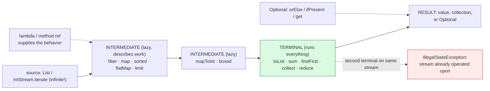

# Lambdas and Streams

## 1. Learning Objectives

After this lesson you will be able to:

- [ ] Write a lambda in both syntaxes (`n -> n + 1`, `(a, b) -> …`, `() -> { … }`), bind it to
      a functional interface, and say what makes a target type a *functional* interface.
- [ ] Read a stream pipeline as one declarative sentence — `filter → map → sorted → collect` —
      and predict its output line-by-line against the executed transcript in Example 1.
- [ ] Distinguish **stream** from **collection** (lazy, single-use, no storage), eager vs lazy
      operations, and terminal vs intermediate — using `findFirst` vs `count` and the
      `limit(5)`-on-infinite proof as evidence.
- [ ] Choose an `Optional` policy — `orElse`/`orElseGet` vs `ifPresent` vs deliberate `get`
      inside `catch` — and explain the executed `NoSuchElementException` refusal.
- [ ] Use the primitive streams (`IntStream`, `mapToInt`, `boxed`) to avoid boxing, and say why
      `List<Integer>` can't be a `Stream<Integer>`'s primitive.
- [ ] Recognize `flatMap` (flatten one level), `reduce` (the general terminal), and collect's
      big three (`toList`/`joining`/`toMap`) from executed output.

## 2. Prerequisites

- [methods.md](methods.md) — signatures and return types; a lambda is an anonymous one.
- [arrays-and-strings.md](arrays-and-strings.md) and
  [collections-framework.md](collections-framework.md) — the data being piped.
- [generics.md](generics.md) — `Function<String, Integer>`'s type arguments, inference of `T`.
- [file-handling.md](file-handling.md) — `Files.lines(...)` in try-with-resources was your first
  stream; this lesson is the whole style.

**Environment used in this lesson:** every transcript executed on the author's machine —
JDK 25.0.4.1, `javac --release 21`.

## 3. Introduction

Loops say *how*; streams say *what*. Compare lesson 05's sum loop (initialize, iterate, mutate,
return) with `words.stream().mapToInt(String::length).sum()` — one line, no mutable accumulator,
no index, nothing to get off-by-one. The two mechanisms enabling that sentence are **lambdas**
(functions without names, passed as values) and **streams** (lazy pipelines over a source). This
lesson is style more than machinery: the compiler already checked your types; now it's teaching
you to *express intent at one level up* — and the executed outputs below are the answer key for
every prediction you make while reading a pipeline.

## 4. The Problem It Solves

Three recurring costs in loop code: **boilerplate** (the accumulator ritual ×100 files),
**coupling** (the loop body can't be extracted, reused, or tested apart from the loop), and
**implicit ordering** (what happens *when* is entangled with *what*). Lambdas detach the action
from the structure — `filter(w -> w.length() > 4)` is a predicate you can name, pass, and
compose ([functional-programming.md](functional-programming.md) does exactly this) — and
streams sequence the actions declaratively so the *pipeline shape* survives code review at a
glance. The payoff is visible in production Java: `groupingBy`, `joining`, `toMap` replace
paragraphs of hand-rolled map/list building, and the executed `by length (merged)` line is one
such paragraph compressed to two.

## 5. Core Concepts

### Lambdas: an interface's worth of syntax

`Runnable r = () -> System.out.println("lambda runnable");` — no `new`, no class: the lambda
*is* the implementation, and the target type supplies the contract. The rules, all visible in
Example 1: target type must be a **functional interface** (exactly one abstract method —
`Runnable.run`, `Function.apply`, `Predicate.test`); parameter types are inferred
(`n -> n + 1` for `Function<Integer, Integer>`); a body is either an *expression* (implicit
return) or a *block* `{ … return …; }` (explicit); zero params `() -> …`, one `n -> …`,
two `(a, b) -> …`. `String::length` is the **method reference** shorthand for `s -> s.length()`
— four spellings of the same idea: lambda expression, lambda block, method reference, and
(older, explicit) anonymous class.

### Streams: lazy, single-use, non-storage

Four properties, each with executed evidence: **no storage** — the source is a `List`, the
stream holds neither; **lazy** — nothing runs until a *terminal* op (`toList`, `sum`, `findFirst`,
`forEach`, `count`), intermediate ops (`filter`, `map`, `sorted`) only *describe* work (the
`limit(5)` line consumed an `IntStream.iterate(...)` that would never end — laziness is the only
reason that compiles into `[1, 3, 5, 7, 9]`); **single-use** — one stream, one terminal (call
`findFirst` then `count` on the same variable and the second throws — pipelines are consumed);
**ordered-ish** — `findFirst` returned `beta` (first *encounter*), `findAny` is allowed to pick
any, and `sorted` on an ordered source is stable (preserves equal-element input order —
`filtered+sorted = [alpha, delta, gamma]` came from insertion order among the >4 lengths).

### The pipeline grammar

`source → intermediate* → terminal`: `words.stream()` (source: collection → stream), then
`filter` (keep), `map` (transform 1:1), `sorted`, `flatMap` (transform 1:many then flatten —
`"a b" → [a, b]`, executed), `distinct`, `limit`, `peek`, and terminals `toList`/`forEach`/
`sum`/`count`/`max`/`findFirst`/`collect`/`reduce`. `mapToInt(String::length)` widens to a
**primitive stream** (`IntStream`) — avoiding `Integer` boxing per element — and `boxed()` goes
back. `Optional<T>` is the terminal for "zero or one": `findFirst().orElse("none")` printed
`beta  present=true`; bare `.get()` on the empty optional threw `NoSuchElementException` —
**executed inside a `catch`** to show the refusal, and the policy lesson: `orElse`/`ifPresent`
for expected emptiness, `get` only where emptiness is a bug.

### Collect: where pipelines build things

`collect(Collectors.joining(", ", "[", "]"))` → `[alpha, beta, gamma, delta]` (separator +
prefix/suffix in one call); `toMap(keyFn, valueFn, mergeFn)` — the third argument exists
*because* two words can share a length (executed merge produced `alpha/gamma/delta`); and
`groupingBy(classifier)` → `Map<…, List<…>>` with optional `TreeMap::new` and downstream
`counting()` (both executed in Example 2's `Func` run). The merge function and downstream
collector are the two knobs that turn a one-liner into a paragraph of loop code.

## 6. How It Works



Data flows left-to-right only when the terminal pulls — intermediate stages fuse into one pass.
The red edge is the consumed-stream rule: the pipeline variable is *spent* after a terminal, the
one runtime error this style adds over loops, and the fix is always "start a new stream."

## 7. Practical Examples

**Example 1 — lambda syntaxes and a full pipeline menu, executed**

```java
import java.util.*;
import java.util.function.*;
import java.util.stream.*;

public class Lambdas {
    public static void main(String[] args) {
        Runnable r = () -> System.out.println("lambda runnable");
        r.run();
        Function<String, Integer> len = String::length;
        System.out.println("len.apply(\"hello\") = " + len.apply("hello"));
        List<String> words = List.of("alpha", "beta", "gamma", "delta");
        List<String> longs = words.stream().filter(w -> w.length() > 4).sorted().toList();
        System.out.println("filtered+sorted = " + longs);
        System.out.println("sum lengths = " + words.stream().mapToInt(String::length).sum());
        Optional<String> first = words.stream().filter(w -> w.startsWith("b")).findFirst();
        System.out.println("findFirst startsWith b = " + first.orElse("none") + "  present=" + first.isPresent());
        System.out.println("join = " + words.stream().collect(Collectors.joining(", ", "[", "]")));
        Map<Integer, String> byLen = words.stream()
                .collect(Collectors.toMap(String::length, w -> w, (a, b) -> a + "/" + b));
        System.out.println("by length (merged) = " + byLen);
        List<String> flat = List.of("a b", "c d").stream()
                .flatMap(l -> Arrays.stream(l.split(" "))).toList();
        System.out.println("flatMap = " + flat);
        System.out.println("evens 1..10 = " + IntStream.rangeClosed(1, 10).filter(n -> n % 2 == 0).count());
        OptionalInt max = IntStream.of(3, 9, 4).max();
        System.out.println("max = " + max.orElse(-1));
        System.out.println("reduce sum = " + words.stream().map(String::length).reduce(0, Integer::sum));
        List<Integer> odds = IntStream.iterate(1, n -> n + 2).limit(5).boxed().toList();
        System.out.println("infinite->limit odds = " + odds);
        try { words.stream().filter(w -> w.length() > 100).findAny().get(); }
        catch (NoSuchElementException e) { System.out.println("Optional.get on empty -> NoSuchElementException"); }
    }
}
```

```console
$ javac --release 21 Lambdas.java && java Lambdas
lambda runnable
len.apply("hello") = 5
filtered+sorted = [alpha, delta, gamma]
sum lengths = 19
findFirst startsWith b = beta  present=true
join = [alpha, beta, gamma, delta]
by length (merged) = {4=beta, 5=alpha/gamma/delta}
flatMap = [a, b, c, d]
evens 1..10 = 5
max = 9
reduce sum = 19
infinite->limit odds = [1, 3, 5, 7, 9]
Optional.get on empty -> NoSuchElementException
$ echo $?
0
```

- Read **each line as the answer to a prediction**: `filtered+sorted` (which words have length
  > 4? sorted how? — answer: alpha/delta/gamma, lexicographic), `sum lengths` (5+4+5+5 = 19,
  via `mapToInt` — no `Integer` boxing in the hot path), `findFirst` (why `beta` and not
  nothing — one word starts with b; `present=true` is the Optional's own verdict).
- **`by length (merged)` is the map lesson in one line:** keys are lengths (4, 5), and the
  collision of alpha/gamma/delta at 5 was resolved *by the third lambda* (`a + "/" + b`) —
  without it, `IllegalStateException: Duplicate key` (the failure the merge argument exists to
  prevent; run it without and see).
- **The infinite line is laziness as proof:** `IntStream.iterate(1, n -> n + 2)` has no end;
  `limit(5)` cut it before materialization, `boxed` restored `Integer` for the list — three
  concepts, one output.
- **`reduce(0, Integer::sum)` under `map(String::length)`** — the general terminal behind
  `sum`: identity (`0`), accumulator, and *then* the sum: 19 again, same answer as `mapToInt`
  by a different road (compare the two lines deliberately).

**Example 2 — composing functions, sorting, and grouping, executed**

```java
import java.util.*;
import java.util.function.*;
import java.util.stream.*;

public class Func {
    record Person(String name, int age) {}
    public static void main(String[] args) {
        Function<Integer, Integer> inc = n -> n + 1;
        Function<Integer, Integer> dbl = n -> n * 2;
        System.out.println("inc.andThen(dbl).apply(5) = " + inc.andThen(dbl).apply(5));
        System.out.println("inc.compose(dbl).apply(5) = " + inc.compose(dbl).apply(5));
        System.out.println("inc.andThen(\"n=\" +).apply(5) = " + inc.andThen(n -> "n=" + n).apply(5));
        List<String> names = List.of("ada", "Grace", "linus", "Ada");
        names.stream().sorted(String::compareToIgnoreCase).forEach(n -> System.out.print(n + " "));
        System.out.println();
        List<Person> people = List.of(new Person("Ada", 36), new Person("Grace", 45), new Person("Alan", 41));
        people.stream()
              .sorted(Comparator.comparing(Person::age).reversed().thenComparing(Person::name))
              .forEach(p -> System.out.println(p));
        Map<Integer, List<Person>> byDecade = people.stream()
              .collect(Collectors.groupingBy(p -> p.age / 10 * 10));
        System.out.println("grouped by decade: " + byDecade);
        Map<String, Long> initialCounts = names.stream()
              .collect(Collectors.groupingBy(s -> s.substring(0, 1), TreeMap::new, Collectors.counting()));
        System.out.println("by initial (TreeMap): " + initialCounts);
    }
}
```

```console
$ javac --release 21 Func.java && java Func
inc.andThen(dbl).apply(5) = 12
inc.compose(dbl).apply(5) = 11
inc.andThen("n=" +).apply(5) = n=6
ada Ada Grace linus 
Person[name=Grace, age=45]
Person[name=Alan, age=41]
Person[name=Ada, age=36]
grouped by decade: {40=[Person[name=Grace, age=45], Person[name=Alan, age=41]], 30=[Person[name=Ada, age=36]]}
by initial (TreeMap): {A=1, G=1, a=1, l=1}
$ echo $?
0
```

- **`andThen` vs `compose` is direction, not math:** 12 (inc then dbl: 6→12) vs 11 (dbl then
  inc: 10→11) — same two functions, one word apart, and `andThen` into `String` output shows the
  result type changing mid-chain (`n=6` — a `Function<Integer, String>` appeared from
  `Integer → Integer` parts).
- **Case-insensitive sort ran stable:** output `ada Ada Grace linus` kept *input order* among
  equals (`ada` before `Ada`) — `sorted` is stable, worth knowing for keys that compare equal.
- The comparator chain (`comparing(age).reversed().thenComparing(name)`) is the lambda-era
  answer to anonymous `Comparator` classes — read it as one sentence: *by age descending, then by
  name.*
- **Grouping twice, two shapes:** a classifier alone gives `Map<Integer, List<Person>>`; adding
  a **map supplier** (`TreeMap::new`) + **downstream collector** (`counting()`) gives a sorted
  `Map<String, Long>` — `A=1, G=1, a=1, l=1` — same call, three arguments' worth of intent
  (note `linus`/`Ada`-style case folding *not* applied: `a` and `A` are separate keys, the
  honest result of `substring(0, 1)`).

## 8. Real-World Applications

- **DTO mapping** — `orders.stream().map(Order::toDto).toList()` is the layer-translation line
  in every service in subject 11; the pipeline *is* the spec.
- **Reports and grouping** — `groupingBy(Order::status, counting())` builds the exact
  status-count map a dashboard shows; add `summingDouble` downstream for revenue-by-status.
- **Validation fan-out** — a list of checks as `Predicate<T>`, evaluated with `stream().allMatch(...)`
  — predicates are values now, so rules can live in configuration-shaped code.
- **File-at-a-time processing** — `Files.lines(path).filter(...).count()` (lesson 17's stream,
  now with the full grammar) — grep as a Java statement, lazily, without loading the file.
- **Concurrency hand-off** — `pool.submit(() -> …)` in [concurrency.md](concurrency.md) takes
  lambdas all day; `CompletableFuture.thenApply(this::load)` is `andThen` across threads.

## 9. Common Mistakes

| Mistake | Why it happens | How to recognize it | How to prevent it |
|---|---|---|---|
| Reusing a stream after a terminal | Collections taught `list` is reusable | `IllegalStateException: stream already operated upon` | One stream per pipeline; rebuild from source |
| Mutating shared state in a lambda | Loop-counter habits | Lost updates (concurrency lesson) or surprise side effects | Lambdas read locals (effectively final); pipelines *return*, not mutate |
| `forEach` + `add` instead of `map(...).toList()` | Imperative reflex | Growing an ArrayList inside `forEach` | Terminal = `collect(toList())` when you want a list |
| Forgetting the `toMap` merge fn | Single-valued key assumption | `IllegalStateException: Duplicate key` | Third argument whenever keys can collide (executed merge) |
| Blocking `.get()` on `Optional` as style | Java 8 habits | `NoSuchElementException` exactly when data is thin | `orElse`/`ifPresent` for expected emptiness; reserve `get` for invariants |
| Boxing by default (`Stream<Integer>` + `max`) | Natural `List` start | Slow hot paths, no `IntStream` API | `mapToInt`/`mapToDouble`/`IntStream` at the primitive boundary |
| Eager `.toList()` mid-pipeline "to be safe" | Unclear laziness | Extra memory, earlier work | Intermediate ops stay lazy; collect only at the end |
| `sorted()` on huge/infinite streams | `sorted` is **blocking and all-in-memory** | Hang on `iterate` without `limit` | `limit` before `sorted` on unbounded sources |
| Method-ref on wrong overload | `String::valueOf` ambiguity | `reference to … is ambiguous` | Lambda with explicit params forces one signature |

## 10. Best Practices

- **Name the pipeline's *verb* in your head** ("join filtered long words") — if you can't say it
  in one sentence, the pipeline wants a loop or two stages.
- **Primitive streams at numeric boundaries** — `mapToInt`/`sum`/`average` on the hot path;
  `boxed` only at the edges (Example 1's `sum` vs `reduce` both read fine; only one boxes).
- **`Optional` for results, `null` only at legacy seams** — `findFirst` *gives* you an Optional
  because zero matches is normal; then pick `orElse`/`ifPresent`/`map` — never habit-`.get()`
  (the executed refusal shows where habit ends).
- **Collect's knobs over loop-building** — `joining` for text, `toMap` with a merge for dicts,
  `groupingBy` + downstream for reports; the three arguments of `groupingBy` encode supplier +
  classifier + aggregation that loops express as twenty lines.
- **Side-effect-free stages** — `filter`/`map` should be pure; `peek` exists for debugging, not
  for production work (it's the one intermediate whose name *admits* it's a peek).
- **Method references where the lambda adds nothing** (`String::length` over `s -> s.length()`);
  lambdas where reading the body helps (`w -> w.length() > 4` — the operator *is* the value).

## 11. Limitations and Trade-Offs

- **Single-use, no random access:** you cannot index into a stream or run two terminals —
  rebuild per question (streams are pipelines, not data structures; that's the point *and* the
  cost).
- **`sorted` is O(n log n), blocking, and memory-resident** — a laziness trap next to infinite
  sources (`limit` first) and a real cost on big data where a `TreeMap`-style incremental
  approach or database ORDER BY scales better.
- **Debuggability:** a 12-stage pipeline's exception line points at the *terminal*, not the
  stage that lied — the style trades loop-level stepping for reading discipline (and
  `peek`/two-liners when diagnosing).
- **Primitive coverage is finite** — `IntStream`/`LongStream`/`DoubleStream` exist; `char`,
  `byte`, `short` do not box-free — generics' reference-only rule ([generics.md](generics.md))
  is why.
- **Parallel is opt-in and not free** — `parallel()` exists (subject 20 measures when it wins);
  the design default is sequential-correct-first, and per-element lambdas must still be
  thread-safe for parallel to be legal.

## 12. Practical Exercises

### Introductory

1. **Reproduce Examples 1 and 2.** **Completion criteria:** all thirteen `Lambdas` lines and all
   seven `Func` lines captured (exit 0 each); plus your one-sentence prediction for
   `filtered+sorted` and `by length (merged)` written *before* running — then diffed.
2. **Prediction drill on five pipelines.** For each — `filter(startsWith a).count()`,
   `map(toUpperCase).sorted().toList()`, `distinct().toList()` on
   `List.of("x","y","x")`, `anyMatch(isEmpty)`, `mapToInt(length).average()` — write the output
   first, run, then explain any miss. **Completion criteria:** five predictions + five outputs +
   an annotated diff (the pipeline that fooled you, and which stage you misread).
3. **Lambda vs anonymous class.** Write `Runnable` three ways (anonymous class, lambda,
   `this::method` where applicable) and run each. **Completion criteria:** identical output from
   all three, then one sentence on what the lambda *cannot* do that the anonymous class can
   (answer: multiple methods / `this` semantics — check and state which applies).

### Intermediate

4. **The single-use rule, witnessed.** Deliberately call two terminals on one stream variable.
   **Completion criteria:** the exact `IllegalStateException` text captured; then the same logic
   rewritten correctly (two pipelines or intermediate `.toList()`), with both outputs, and a
   note on which version you'd ship and why.
5. **Optional policy shootout.** For `findFirst` on empty: run `orElse("none")`,
   `ifPresent(…)`, `map(…).orElse(…)`, and bare `get()` (inside `catch`). **Completion
   criteria:** four outputs; a decision table (expected-empty / bug-if-empty × policy → verdict),
   and the executed `NoSuchElementException` line from Example 1 re-derived as your table's
   "bug-if-empty" cell.
6. **Rebuild a loop paragraph.** Take the 15-line loop that groups words by first letter *and*
   counts them (write the imperative version first). **Completion criteria:** both versions'
   outputs identical; the loop version's line count vs the `groupingBy(…, counting())` one-liner;
   and one case where you'd keep the loop (name it — e.g. early exit — with reasoning).

### Independent problem-solving

7. **Top-N with a merge.** Spec `Map<String, Long> topN(List<String> words, int n, int
   minLen)` — words of length ≥ `minLen`, case-insensitive, counted, sorted by count desc then
   alphabetically, truncated to `n`. Write the pipeline as one `collect` + sort + cut (hint:
   `toMap` with merge, or `groupingBy` + downstream `counting`, then sort entries and cut — pick
   one and justify). Executed demo on ≥12 words with a deliberate count-tie and a case-collision
   (`"Go"/"go"`). **Completion criteria:** the signature and output shape spec written first;
   six output lines (raw counts, tie resolved, case merged, top-2, minLen filter effect, empty
   input) each predicted first; and a sentence on *where* case-insensitivity was applied —
   before the classifier (right) or in the sort (too late) — evidenced by your chosen output.

*Solutions: attempt first; set practice in [exercises/README.md](exercises/README.md).*

## 13. Knowledge Check

1. `inc.andThen(dbl).apply(5) = 12` vs `inc.compose(dbl).apply(5) = 11` — trace both chains
   numerically, then state the rule for reading a composition *left-to-right* despite `compose`
  's name.
2. Why did `limit(5)` on an infinite `IntStream.iterate` succeed while `sorted()` on that same
   stream without `limit` would hang? Name the property (laziness) and which operation breaks it
   (blocking materialization).
3. `findFirst` uses `Optional` but `count()` returns `long` — explain from pipeline semantics
   why one has a "zero case" that must be modeled and the other doesn't.
4. In `toMap(String::length, w -> w, (a, b) -> a + "/" + b)` — label the three lambdas
   (key/value/merge) and reconstruct the executed `{4=beta, 5=alpha/gamma/delta}` line from the
   input list order.
5. The executed refusal: `Optional.get on empty -> NoSuchElementException` — it was caught on
   purpose. Say what the *uncatched* version would do to exit code and stack trace (connect to
   lesson 14's rules), and name two API policies you'd use in production instead of `get`.
6. `flatMap` turned `["a b", "c d"]` into `[a, b, c, d]` — what would `map(Arrays::stream)`
   have produced instead (a stream of streams?), and why is *flatten* the point?

## 14. Completion Criteria

Observable evidence that you have understood this lesson:

- [ ] Examples 1–2 reproduce byte-for-byte, including the stable-sort line's trailing space
- [ ] Your five-prediction drill has an annotated diff (misses explained, not just checked)
- [ ] The single-use `IllegalStateException` and the empty-`Optional` refusal are both in your
      notes as captured text with causes
- [ ] The loop-paragraph rebuild shows identical outputs and a justified line-count comparison
- [ ] `topN` (or equivalent) runs with tie + case-collision evidence and a stated policy point

## 15. Summary

- **Lambdas** are values: one abstract method, inferred params, expression or block body;
  method references are the terse spelling; functional interfaces (`Function`, `Predicate`,
  `Comparator`, `Runnable`) are the contracts.
- **Streams** are lazy, single-use pipelines: intermediate ops *describe*, terminals *run*;
  one terminal per stream; laziness is why infinite sources with `limit` are legal.
- **`Optional` replaces null-at-the-API** — choose `orElse`/`ifPresent` for expected emptiness;
  bare `get` is a stated invariant, and the executed `NoSuchElementException` is what breaking
  it costs.
- **Collect is the builder:** `joining`, `toMap`(+merge), `groupingBy`(+supplier,+downstream)
  — executed all four knob combinations in Example 2.
- **Primitive streams dodge boxing** at numeric boundaries; `boxed` is the way back.

## 16. Next Steps

- Next lesson: [functional-programming.md](functional-programming.md) — the same lambdas seen as
  *design*: purity, composition laws, and when declarative stops paying.
- Practice: [exercises/README.md](exercises/README.md) set 16.
- Where it is applied: [11-BACKEND-ENGINEERING](../11-BACKEND-ENGINEERING/README.md) — stream
  pipelines are the everyday grammar of service-layer mapping and reporting.
