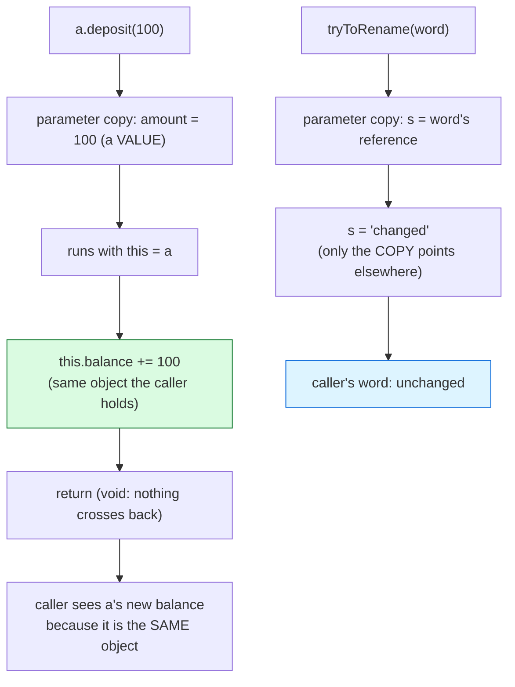

# Methods

## 1. Learning Objectives

After this lesson you will be able to:

- [ ] Write methods with parameters, return types, and clear names — and say what each part of the
      signature promises.
- [ ] Prove Java's parameter rule with output: **values are passed by value — references included** —
      and predict exactly when a callee's changes are visible to the caller.
- [ ] Overload a method deliberately (different parameter types) and explain how the compiler picks
      the overload.
- [ ] Distinguish `static` from instance members using the compiler's own refusals as evidence
      (`non-static method … cannot be referenced from a static context`).
- [ ] Trace a recursive call to its base case and locate the result on the call stack — including
      what happens when the base case is missing.
- [ ] Read the launcher's entry-point rules for `main` as they actually behave on a modern JDK.

## 2. Prerequisites

- [java-program-structure.md](java-program-structure.md) — methods live inside classes; `main` is
  itself a method (its signature was decoded there).
- [variables-and-types.md](variables-and-types.md) — parameter and return types are the same type
  system, including the silent-overflow behavior shown again here.
- [02-PROGRAMMING-FUNDAMENTALS/functions-and-methods.md](../02-PROGRAMMING-FUNDAMENTALS/functions-and-methods.md) —
  parameters, returns, scope, and the mutable-default trap in the language-agnostic; this lesson
  is the transfer with Java's static type system attached.

**Environment used in this lesson:** every transcript executed on the author's machine —
JDK 25.0.4.1, `javac --release 21`. The `main`-discovery transcripts reflect **this machine's
launcher** (JDK 25); Section 5 notes where older launchers differ, without inventing their text.

## 3. Introduction

A method is a contract in four parts: a name (the intent), parameters (the inputs), a return type
(the output's shape), and a body (the implementation you are free to change). Everything hard in
this lesson — pass-by-value, `static` vs instance, overloading, recursion — is a consequence of
taking that contract seriously: what exactly travels in, what exactly comes back, and on whose
object the method runs.

## 4. The Problem It Solves

Two failure modes, opposite directions. **Copy-paste logic** — the same ten lines in four places,
fixed in three of them — is what decomposition prevents: name the logic once, call it everywhere
(subject 02's core argument). **Aliasing surprises** — "I called a helper and my object changed!" —
is what *understanding the parameter model* prevents: if you know only values cross the call,
every visible mutation is explained by a reference you shared on purpose. Java's rule gives one
answer for all types; this lesson makes you able to *demonstrate* that answer rather than
parrot it.

## 5. Core Concepts

### The signature is the contract

```java
static String describe(int x)   // static | return type | name | parameters
```

`void` means "returns nothing" (and cannot be used as a value — a `return;` statement is legal
only in `void` methods). Parameter types are mandatory: Java has no optional or default
parameters — alternatives are overloading, builders, or records of options (seen ahead in
[collections-framework.md](collections-framework.md) and beyond).

### Pass-by value — for *everything*

Java copies the **value** of each argument into the parameter. For primitives that is the number;
for references it is **the reference itself** — a copied address. Consequences, all executed below:

1. Reassigning a parameter (`s = "changed"`) changes nothing the caller can see — the caller's
   variable still points where it always did.
2. Mutating the *object* a reference points at (`sb.append(...)`) **is** visible to the caller —
   both references share one object.
3. Therefore: a method can never swap or replace your caller's variables; it *can* modify shared
   state. Design accordingly — pass immutable values (`String`, boxed numbers) when you want
   isolation, and be explicit when you hand out a mutable object.

### `static` vs instance — which world the method lives in

`static` belongs to the class: callable without any object (`Helper.hi()`), no `this`. Instance
methods belong to *an* object: `a.deposit(100)` runs with `this = a`. The compiler enforces the
wall in both directions — calling an instance method statically is the executed error
`non-static method go() cannot be referenced from a static context`. `main` must be `static`
because nothing exists yet when the launcher starts the program… with a modern wrinkle: on **this
machine's JDK 25 launcher, an instance `main` ran anyway** (the launcher's discovery rules
evolved — JEP 512-era instance-main support), while `public static void main(String[] args)`
remains the universal, version-proof form this curriculum writes.

### Overloading: same name, different parameter types

Two `describe` methods differ by parameter type (`int` vs `double`); the compiler resolves the
overload **at compile time** from the argument types (`describe(42)` → `int` version). Overloads
differ in *parameter lists*, never in return type alone — changing only the return type is not a
second method at all.

### Recursion is just frames

A recursive method calls itself with a **smaller problem** and a **base case** that stops.
Each call adds a *frame* to the call stack (same stack from subject 01); base case returns unwind
the chain. The overflow story — a missing base case producing `StackOverflowError` — is executed
in [jvm-and-memory.md](jvm-and-memory.md), where the stack itself is the subject.

## 6. How It Works



One diagram, both halves of pass-by-value: the *same copied reference* runs the method (top — so
mutation of that object shows up in the caller), while rebinding the copy itself never reaches
back (bottom). Everything else in this lesson hangs off this picture.

## 7. Practical Examples

**Example 1 — the value/reference proofs, executed together**

```java
static int factorial(int n) {                     // recursion with a base case
    return n <= 1 ? 1 : n * factorial(n - 1);
}
static String describe(int x)    { return "int: " + x; }     // overloads differ in
static String describe(double x) { return "double: " + x; }  // parameter types
static void tryToRename(String s) { s = "changed"; }        // reassigning a parameter
static void appendTo(StringBuilder sb) { sb.append("!"); }  // mutating the argument's object

System.out.println("factorial(5) = " + factorial(5));
System.out.println(describe(42) + " | " + describe(4.5));
String word = "original";
tryToRename(word);
System.out.println("after tryToRename: " + word);
StringBuilder sb = new StringBuilder("shout");
appendTo(sb);
System.out.println("after appendTo: " + sb);
try { System.out.println(factorial(25)); }
catch (ArithmeticException e) { System.out.println("overflow is silent: " + factorial(25)); }
```

```console
$ javac --release 21 Methods.java && java Methods
factorial(5) = 120
int: 42 | double: 4.5
after tryToRename: original
after appendTo: shout!
2076180480
$ echo $?
0
```

- **`after tryToRename: original`** — rebinding the parameter moved only the copy. **`after
  appendTo: shout!`** — mutating through the copied reference changed the shared object. The two
  lines *are* Java's pass-by-value rule, printed.
- The overload line shows compile-time selection: `42` (an `int`) chose the `int` overload,
  `4.5` (a `double`) the `double` one — no ambiguity, no runtime lookup.
- The last output is `factorial(25)` in **`int` arithmetic: `2076180480`, and note what did *not*
  print — the catch line. Overflow does not throw `ArithmeticException` (division does);
  the `try/catch` ran as written and simply never matched, which is exactly why
  [variables-and-types.md](variables-and-types.md) Example 5 exists. The `long` twin prints
  `7034535277573963776` there; both are wrong in the same silent way.

**Example 2 — the static/instance wall, both refusals captured**

```console
$ javac --release 21 NoStatic.java        # contains: Thing.go();  (instance method)
NoStatic.java:4: error: non-static method go() cannot be referenced from a static context
        Thing.go();
              ^
1 error
```

```console
$ javac --release 21 NotEntry.java && java NotEntry   # public void main(String[] a) — no static
never runs this way
$ echo $?
0
```

- First: the compiler's wall — an instance method needs an *instance*, and `Thing.go()` supplies
  none. Fix = `new Thing().go()` (which object?) or make `go` genuinely `static` (does it need
  one?).
- Second: on **this machine's JDK 25 launcher**, a non-static `main` **runs** — captured above,
  verbatim. The launcher's discovery rules have widened (instance-main support became final in
  JDK 25's era); what still doesn't work is a wrong *shape*. A class with no `main` of any kind —
  and a `static` main with the wrong parameter type, `main(String s)` — both produce this,
  executed on this machine:

```console
$ java NoMain
Error: Main method not found in class NoMain, please define the main method as:
   public static void main(String[] args)
or a JavaFX application class must extend javafx.application.Application
$ echo $?
1
```

  **Curriculum rule:** write `public static void main(String[] args)` — the form every JDK from
  1.0 through 25 accepts, the form every teammate reads, the form CI runs.

**Example 3 — `static` where it belongs, instance where it matters (executed)**

From [classes-and-objects.md](classes-and-objects.md)'s running example: `main` is `static` (the
entry point has no object), while `deposit`/`summary` are instance methods — because each call
must run against *one specific account*:

```console
$ java Bank
Ada: $100.0
Grace: $50.0
after c.deposit: Ada: $125.0
```

`a.deposit(100)` and `b.deposit(50)` changed different objects — the proof that instance methods
are per-object, with `this` naming which one (`this.owner = owner` in the constructor is the same
mechanism).

**Example 4 — recursion's frames, visible in the output**

`factorial(5)` → `120` (Example 1). Unroll it: `f(5)` calls `f(4)` calls … `f(1)` returns 1,
each frame then multiplies on the way out: `1·2·3·4·5 = 120`. The base case (`n <= 1`) is the
only reason a frame ever stops being added — remove it and the same machine produces
`StackOverflowError` instead, demonstrated where the stack is taught
([jvm-and-memory.md](jvm-and-memory.md)).

## 8. Real-World Applications

- **Service layer design:** every method you design in subject 11 is a contract like these —
  inputs validated at the top (guard clauses from
  [operators-and-control-flow.md](operators-and-control-flow.md)), side effects explicit in the
  name (`withdraw` vs `getBalance` tells you which mutates).
- **Utility classes** (`String.join`, `Math.max`) are `static` methods on final classes — the
  pattern's real home; knowing *when* something deserves `static` (stateless, no per-object
  context) is a daily design call.
- **Testability:** methods that take their inputs as parameters (instead of reaching for globals)
  are the ones that can be unit-tested in isolation — the habit subjects 02 and 14 both reward.

## 9. Common Mistakes

| Mistake | Why it happens | How to recognize it | How to prevent it |
|---|---|---|---|
| "Java passes objects by reference" folklore | Mutation *looks* like reference passing | Surprised that `s = "changed"` "didn't work" (or that shared state *did* change) | Learn the two executed lines of Example 1; design for shared vs isolated deliberately |
| Everything `static` from the start | No objects learned yet | Methods with no `this`, fields that outlive everything, untestable code | Instance by default; `static` only when there is genuinely no per-object state |
| Overload chosen "at runtime" | Dynamic-dispatch intuition | Confusion when a supertype reference picks the *static* overload | Overload resolution is compile-time from declared types; overriding (runtime) is [polymorphism.md](polymorphism.md) |
| Recursion without a base case | The pattern copied before the exit condition | `StackOverflowError` | Write the base case *first*; or ask "is iteration simpler here?" — usually yes below depth ~1000 |
| Returning arrays/objects as a "copy" | Reference copying feels like copying | Caller mutated what the method "returned" and state changed | Return defensive copies (`clone`), immutable views, or document sharing explicitly |
| `void` method used in an expression | `System.out.println(foo())` where `foo` is void | `error: cannot find symbol`/`incompatible types: void` | Read the return type in the signature *before* the body |
| Deep parameter lists (7+ args) | Nothing forces structure yet | Call sites unreadable; positional bugs | Bundle related parameters into an object/record — a design move the exercises practice |

## 10. Best Practices

- **Name methods for their contract:** `withdraw(amount)` returning `boolean` reads as a question
  with a side effect — verbs for actions, `is/has/can` for predicates, no surprises in either.
- **Validate at the top, compute in the middle, return at the bottom** — one shape for every body;
  guard clauses ([operators-and-control-flow.md](operators-and-control-flow.md)) make it read flat.
- **Prefer immutability at the boundaries:** take `String`, take primitives/records, return the
  same — shared mutable parameters are where aliasing bugs are born.
- **Overload only for genuinely different inputs of the same concept** (`describe(int)` /
  `describe(double)`), never to disguise different behavior behind one name.
- **Small and shallow:** a method that needs the stack trace to explain itself is too long; extract
  before the nesting, not after the incident.
- **Recursion for naturally recursive problems** (trees — subject 05) — for simple counting,
  loops keep the frames (and the risk) out of the machine.

## 11. Limitations and Trade-Offs

- No default/optional parameters means overloads multiply — modern Java's answer for *many*
  options is a builder or a record parameter, both seen later in the curriculum.
- Pass-by-value prevents genuine in/out parameters — if a method must "return" several values,
  you need a container type (a small class or, in modern Java, a `record` — introduced with
  collections and used everywhere after).
- Deep recursion is bounded by the stack (frames are real memory) — beautiful for tree work,
  wrong for million-iteration loops; the overflow is *provable*, not hypothetical
  ([jvm-and-memory.md](jvm-and-memory.md)).
- Compile-time overload resolution means a *supertype* reference picks the supertype overload
  (static), while *overridden* methods dispatch on the runtime type (dynamic) — the distinction
  that takes a full lesson: [polymorphism.md](polymorphism.md).

## 12. Practical Exercises

### Introductory

1. **Reproduce Example 1 line for line**, then add a third overload `describe(boolean)` and call
   it. **Completion criteria:** the four original outputs plus one new line, and a written note of
   which *declared parameter type* selected each overload.
2. **The two-pass-by-value lines, generalized.** Write your own pair: a method that reassigns a
   caller's `int[]` parameter (to a new array) and one that mutates the existing array — run and
   predict both. **Completion criteria:** `original untouched` / `mutated in place` outputs,
   predicted first, one sentence tying both to the copied-reference picture.

### Intermediate

3. **Static wall, both directions.** (a) Capture `Thing.go()`'s compile error (Example 2's exact
   text — reproduce it yourself). (b) From an instance method, call a `static` method (legal —
   show it) and an *uninitialized* instance context (illegal — show which). **Completion
   criteria:** three compilations with outcomes, and your one-line rule for which direction is
   always allowed.
4. **Recursion ladder.** Implement `sum(n)` recursively with the base case written first; then
   deliberately remove it and capture the failure (it will be `StackOverflowError` — the full
   transcript is in [jvm-and-memory.md](jvm-and-memory.md); produce it there or here and cite
   it). Then rewrite both as loops. **Completion criteria:** working recursion, captured
   failure, loop versions — plus timing intuition: run `sum(1_000_000)` both ways and report
   which survived, with the output.
5. **The parameter-list rudder.** Take a method with five parameters (e.g.
   `createUser(name, email, role, active, team)`) and refactor to a `UserSpec` record-like holder
   (a small class is fine pre-collections) — compile both versions. **Completion criteria:** both
   compile; you can state which call site a reader can check without counting commas.

### Independent problem-solving

6. **Design a text-report API.** From a spec: given lines of text, callers need (a) count of
   lines containing a word, (b) the longest line, (c) a formatted one-line summary. Design the
   methods — names, parameters, returns — *before* writing bodies; decide for each: `static` or
   instance? `void` or returning? Any parameter that should be an object instead? Then implement
   and demonstrate on three sample lines. **Completion criteria:** a signature block you wrote
   first, each decision with a one-line reason, and executed outputs for all three operations —
   including one call that *would* have mutated shared state had you passed the mutable buffer,
   deliberately avoided by your chosen signature (state how).

*Solutions: attempt first; set practice in [exercises/README.md](exercises/README.md).*

## 13. Knowledge Check

1. `static void bump(int[] xs)` sets `xs = new int[0]` and also `xs[0] = 9`. Which change, if
   either, can the caller observe? Why is the answer the same for a `String` parameter?
2. Why can overloads differ by parameter type but *not* by return type alone?
3. Quote the exact compiler error when calling an instance method statically, and give the two
   possible fixes with the question that decides between them.
4. `describe(42)` vs `describe(4.5)` — which overload runs, when is that decided, and how does it
   differ from which `area()` runs in `Shape[] shapes` (a preview of overriding)?
5. Why does `factorial(5)` return `120` while `factorial(25)` prints nonsense? Which lesson's
   output proves the second claim, and what would fix it (`long`? `BigInteger`?)?
6. On this machine, an instance `main` ran. What is still the *right* signature to write, and
   what are the two arguments for it (version-proofness; readability)?

## 14. Completion Criteria

Observable evidence that you have understood this lesson:

- [ ] You produced both pass-by-value lines (`original` unchanged, `shout!` mutated) and predicted
      them first
- [ ] You have captured the static-context compile error with its exact text
- [ ] You wrote an overload and stated, before compiling, which overload each call selects
- [ ] You demonstrated recursion with its base case and can point at where each frame returns
- [ ] You can decode any signature — modifiers, return type, name, parameters — from memory
- [ ] You know this machine's `main` discovery result *and* the curriculum's universal signature
      rule, with both reasons

## 15. Summary

- A signature is a **contract**: name, parameters, return type — `void` means nothing comes back.
- **Everything is passed by value; references included** — rebinding the copy is invisible,
  mutating the shared object is not (both printed above).
- **`static` = class-level, instance = per-object**; the compiler polices the wall with a named
  error, and `main`'s static form remains the universal one.
- **Overloads resolve at compile time** from declared argument types; overriding — runtime, from
  the object — is the next lesson's subject.
- **Recursion = frames + a base case**; missing base cases are a JVM-stack phenomenon, proven in
  [jvm-and-memory.md](jvm-and-memory.md).

## 16. Next Steps

- Next lesson: [arrays-and-strings.md](arrays-and-strings.md) — the two reference types you will
  pass to methods every day, and their different mutability rules.
- Practice: [exercises/README.md](exercises/README.md) set 3.
- Where it is applied: [11-BACKEND-ENGINEERING](../11-BACKEND-ENGINEERING/README.md) service
  methods follow exactly the validate-compute-return shape practiced here.
