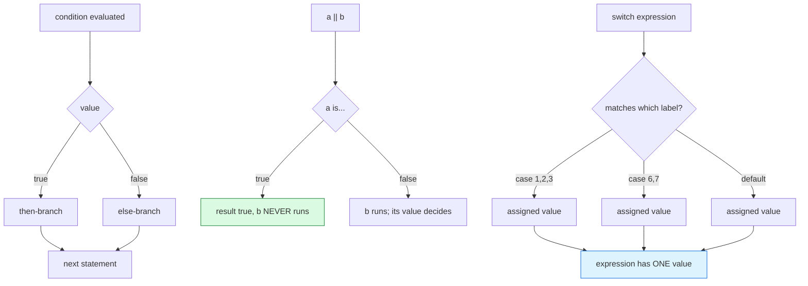

# Operators and Control Flow

## 1. Learning Objectives

After this lesson you will be able to:

- [ ] Predict Java's arithmetic and string-concatenation results, including integer division and
      the `"10" + 3` trap.
- [ ] Explain short-circuit evaluation and demonstrate it with a program that would crash if the
      right side ever ran.
- [ ] Write `if`/`else`, every loop form, and an arrow-style `switch` *expression* — and say when
      each is the readable choice.
- [ ] Trace `&&`, `||`, `!`, `?:` precedence against the table and verify with output, not memory.
- [ ] State exactly how Java's boolean rules differ from subject 02's truthiness — with the
      compiler's refusal as evidence.
- [ ] Diagnose the beginner control-flow failures (missing branch, accidental infinite loop,
      `=` vs `==`) from symptoms, not from luck.

## 2. Prerequisites

- [variables-and-types.md](variables-and-types.md) — types and conversions decide what operators
  *return* (`7 / 3` was already half the story there).
- [java-program-structure.md](java-program-structure.md) — statements, blocks, and `main`.
- [02-PROGRAMMING-FUNDAMENTALS/conditional-statements.md](../02-PROGRAMMING-FUNDAMENTALS/conditional-statements.md)
  and [loops.md](../02-PROGRAMMING-FUNDAMENTALS/loops.md) — the same ideas in pseudocode and
  Python; this lesson is the transfer, with Java's stricter grammar.

**Environment used in this lesson:** every transcript executed on the author's machine —
JDK 25.0.4.1, `javac --release 21`. The `ArithmeticException` stack trace is the interpreter's
real output, file and line included.

## 3. Introduction

You already know what conditions and loops *mean*. What Java adds is precision under pressure:
an operator table you can predict, booleans that accept **only** `boolean` (no truthiness), and
a `switch` that has grown from a jump table into an *expression* with a value. The stakes are
the usual ones — every production bug in this area is a prediction somebody never made.

## 4. The Problem It Solves

Two ancient failure modes motivate the design. **Ambiguous evaluation:** languages where
`f() || g()` might call both make side effects unpredictable — Java's guaranteed short-circuiting
makes `x != null && x.size() > 0` not just idiomatic but *safe* (executed below). **Implicit
truth:** languages accepting `if (1)` turn typos (`if (x = 5)`) into logic bugs — Java's
`int cannot be converted to boolean` refusal moves that bug to compile time, where its caret
lands on your mistake.

## 5. Core Concepts

### The operator table, ranked the way Java evaluates

| Priority | Operators | Notes |
|---|---|---|
| high | `()` grouping | Always wins; use it liberally in combinations |
| | unary `+ - ! ++ -- ~` | `!` only on `boolean` |
| | `* / %` | All *numeric* — integer inputs give integer results |
| | `+ -` | `+` also concatenates when either side is a `String` |
| | `< <= > >= instanceof` | Produce `boolean` |
| | `== !=` | References compare *identity*; content needs `.equals` |
| | `&&` | Short-circuits |
| | `\|\|` | Short-circuits |
| | `?:` | The ternary: a compact expression, not a statement |
| low | `= += -= *= /= %=` | Assignment is an *expression* in Java — but never use its value |

`2 + 3 * 4 = 14` and `(2 + 3) * 4 = 20` (both executed) are the whole precedence idea; past
that, **parenthesize to say what you mean** — clarity beats demonstrating memory.

### Short-circuit evaluation, proven

`a || (1/0 == 0)` prints `true` without touching the division when `a` is `true`; with `a`
`false`, the right side runs and the program dies with a real `ArithmeticException`. Java
*guarantees* left-to-right, right-side-only-if-needed — so guard clauses (`x != null && …`,
`i < n && a[i] == v`) are correct by language law, not by convention.

### Strings hijack `+`

`10 / 3` is `3`, but `"10" + 3` is `"103"`: once either operand of `+` is a `String`, the other
is converted and *concatenation* wins — mixing arithmetic and text in one expression without
parentheses is how counts end up glued to labels. Evaluation stays strictly left-to-right, so
`"n=" + 1 + 2` is `"n=12"`, not `"n=3"`.

### `switch`: statement heritage, expression future

The arrow form (`case 6, 7 -> …`) assigns to a variable directly — the `switch` *expression*
executed below produces `"weekend"` with no `break` to forget. Fall-through still exists for
the old colon form, which is exactly why the arrow form should be your default: the bug class
it removes (missing `break`) was one of Java's most common.

### Java booleans refuse truthiness

`if (1)` does not compile — `int cannot be converted to boolean`. There is no `0`/`null`-as-false
and no non-empty-string-as-true; comparisons produce `boolean`, `boolean` is the only condition
currency. (Subject 02's truthiness table still exists as *knowledge* — for Python, JavaScript,
and SQL — it just has no jurisdiction here.)

## 6. How It Works



The three mechanisms that make control flow *predictable*: conditions are strictly boolean
(left), `||`/`&&` may skip their right operand (middle, with the skip visible as a terminal
state), and a `switch` expression yields exactly one value no matter which label matched (bottom)
— no fall-through to reason about in the arrow form.

## 7. Practical Examples

**Example 1 — precedence, division, concatenation, short-circuit (executed)**

```java
System.out.println("2 + 3 * 4 = " + (2 + 3 * 4));
System.out.println("(2 + 3) * 4 = " + ((2 + 3) * 4));
System.out.println("10 / 3 = " + (10 / 3));
System.out.println("\"10\" + 3 = " + ("10" + 3));
boolean a = true, b = false;
System.out.println("a || (1/0 == 0) = " + (a || (1 / 0 == 0)));   // right side never runs
System.out.println("b || (1/0 == 0) = " + (b || (1 / 0 == 0)));   // right side runs -> exception
```

```console
$ javac --release 21 Ops.java && java Ops
2 + 3 * 4 = 14
(2 + 3) * 4 = 20
10 / 3 = 3
"10" + 3 = 103
a || (1/0 == 0) = true
Exception in thread "main" java.lang.ArithmeticException: / by zero
	at Ops.main(Ops.java:9)
$ echo $?
1
```

- The first `||` line printed **`true`** — the division never executed; the second line's
  `false` forced evaluation and the program died. Same expression, one boolean apart: the
  executed proof of short-circuiting, stack trace and exit code included.
- The stack trace names `Ops.java:9` — control-flow bugs are found by *reading line numbers*
  (the trace-reading habit of
  [02-PROGRAMMING-FUNDAMENTALS/debugging-fundamentals.md](../02-PROGRAMMING-FUNDAMENTALS/debugging-fundamentals.md),
  now with real Java frames).
- Note the parenthesized conditions in the `println`s: without them, `+`'s precedence would
  concatenate before printing — the paren habit, shown in use.

**Example 2 — switch expression, enhanced for, and an exitable loop (executed)**

```java
int day = 6;
String kind = switch (day) {
    case 1, 2, 3, 4, 5 -> "weekday";
    case 6, 7           -> "weekend";
    default             -> "impossible";
};
System.out.println("day " + day + " is a " + kind);

int[] scores = {91, 77, 84};
int total = 0;
for (int s : scores) {                 // enhanced for: reads each element
    total += s;
}
System.out.println("count=" + scores.length + " total=" + total);

int attempts = 0;
while (true) {                         // the loop you must be able to exit
    attempts++;
    if (attempts >= 3) break;
}
System.out.println("attempts=" + attempts);
```

```console
$ javac --release 21 Flow.java && java Flow
day 6 is a weekend
count=3 total=252
attempts=3
```

- The `switch` is an **expression**: `String kind = switch (day) {…};` compiles because every
  path (including `default`) yields a value — the compiler checks exhaustiveness for you.
- `case 1, 2, 3, 4, 5 ->` — multi-label arrow cases, no fall-through, no `break`.
- The enhanced `for` cannot modify the array's structure (and reads a copy of each element) —
  when you need the index too, use the classic `for (int i = 0; …)`; choosing *which* loop is
  the readability decision, and the third block is the `while(true)` + `break` pattern —
  legitimate precisely because the `break` is visible where the condition is (contrast with an
  accidental infinite loop, in Section 9).

**Example 3 — Java's boolean gate, enforced (executed)**

```console
$ javac --release 21 Truthy.java        # contains: if (1) { ... }
Truthy.java:3: error: incompatible types: int cannot be converted to boolean
        if (1) { System.out.println("no"); }
             ^
1 error
```

- Subject 02 taught you to *read* truthiness tables; this is Java declining to have one. The
  error text names both types — the refusal is self-explaining.

## 8. Real-World Applications`

- **Guard clauses** (`if (order == null || order.isEmpty()) return;`) — the short-circuit form
  that makes defensive code readable; you will write dozens per day in subject 11's services.
- **Validation and routing:** arrow-form `switch` over enums/status codes is the backbone of
  request handling in every REST API you build later.
- **Parsing loops** (`while ((line = reader.readLine()) != null)`) — assignment-inside-condition
  is idiomatic *because* `!=` then decides the loop; recognizing it separates reading old Java
  from reading modern Java.

## 9. Common Mistakes

| Mistake | Why it happens | How to recognize it | How to prevent it |
|---|---|---|---|
| `=` where `==` meant | C-family muscle memory | `error: incompatible types: int cannot be converted to boolean` | Java's refusal is the safety — read it as "you assigned, not compared" |
| Forgetting `break` in colon-form `switch` | Old Java habit | Execution "falls through" into the next case | Use arrow-form `switch` *expressions* — fall-through is gone by construction |
| String + numbers producing glued text | `+` overload; mixed expression | `count=34` where 3+4 was meant | Parenthesize arithmetic *before* concatenation; build with `+=` on a dedicated `StringBuilder` |
| `i <= array.length` | Off-by-one carried over | `ArrayIndexOutOfBoundsException` at the last+1 | Loop to `< length` (executed in [arrays-and-strings.md](arrays-and-strings.md)) |
| Assuming `0.1 + 0.2 == 0.3` | Decimal intuition | `false` from a "correct" comparison | Epsilon comparison or decimal types ([variables-and-types.md](variables-and-types.md)) |
| Accidental infinite loop | Condition never flips | Program hangs, no output, CPU spin | Make the changing state part of the condition's line of sight; the `while(true)+break` pattern when exit is multi-branch |
| `&&`/`\|\|` precedence guessed | Symbol density | Wrong grouping in compound conditions | Parenthesize every compound condition — always readable, never wrong |

## 10. Best Practices

- **Parenthesize compound conditions and mixed arithmetic** — not because precedence is
  unknown, but because *intent should not be reconstructed* by a reviewer.
- **Prefer arrow-form `switch` expressions**; treat colon-form as code you are *reading*, not
  writing, unless deliberate fall-through is wanted (rare, and then say so with a comment).
- **Write guard clauses first** and let the happy path be the un-indented remainder — short
  circuiting makes this both safe and idiomatic.
- **Predict before you run** (the exercises demand it): every output in Section 7 was derivable
  from the table; the run is the check, not the discovery.
- **When a condition gets long, name its parts** (`boolean hasRoom = size < capacity;`) — named
  booleans beat precedence puzzles, and they are testable on their own.

## 11. Limitations and Trade-Offs

- `switch` on `String`/enums is a jump table, but it cannot pattern-match arbitrary object
  shapes — that job belongs to `instanceof` chains and, in modern Java, sealed types and records
  (topic of [polymorphism.md](polymorphism.md) and beyond); knowing where `switch` ends keeps
  you from contorting it.
- Short-circuiting hides work: `a && expensive()` silently skips `expensive()` — usually what you
  want, occasionally a missed side effect nobody intended. Pure predicates keep it honest.
- Floating-point comparison rules (`0.1 + 0.2`) are permanent features of binary floats, not a
  bug to wait out; the fix is methodological (epsilon or decimal), per
  [variables-and-types.md](variables-and-types.md).
- Ternaries nest badly — one level is clarity, three levels is a review complaint; extract a
  method instead.

## 12. Practical Exercises

### Introductory

1. **Reproduce Examples 1–3** exactly, predicting each line before running. **Completion
   criteria:** the exception transcript with its exit code, the three `Flow` outputs, and the
   `Truthy` compile error — each predicted first, with your reasoning for the short-circuit pair
   written down.
2. **Precedence ladder.** Evaluate *on paper*, then verify by running: `2 + 3 * 4 - 6 / 2`,
   `10 % 4 * 2`, `true || false && false`, `"a" + 1 + 2` vs `"a" + (1 + 2)`. **Completion
   criteria:** eight predictions, eight runs, ≥95% agreement (argue every mismatch).

### Intermediate

3. **The fall-through confession.** Write a colon-form `switch` on an int with no `break`s and
   two labels, run it, then rewrite it as an arrow-form expression producing the same value.
   **Completion criteria:** both outputs, plus one sentence naming the exact bug class the rewrite
   made impossible.
4. **Guard-clause suite.** For a method taking `String text, int index`: write the guards
   `text != null && index >= 0 && index < text.length()` — then demonstrate each *missing* guard
   failing (null deref → `NullPointerException`, out-of-range → `StringIndexOutOfBoundsException`),
   with the real errors captured. **Completion criteria:** three failures you provoked, three
   guards you wrote, mapped one-to-one.
5. **Infinite loop, on purpose, twice.** Make (a) a `while` whose condition never flips — kill it
   (Ctrl+C) and note the symptom; (b) a `while(true)` with no `break`. Then fix (b) with the
   `break` and rewrite (a) so the exit condition is visible in the `while` line itself.
   **Completion criteria:** both broken runs observed (hang + kill), both fixes shown with output.

### Independent problem-solving

6. **Grade-reporting logic.** Inputs: an array of int scores and a pass mark. Produce, using only
   this lesson's tools: per-score classification via a switch *expression* over grade bands
   (`A/B/C/D/F`), a summary count via loop, and null/empty handling via guard clauses — all in one
   program with no nested `if` deeper than one level. **Completion criteria:** program runs on
   your sample data; you can point at where each of §5's concepts appears; and one paragraph
   explaining which two decisions (loop form, switch form) you made for *readability*, with the
   alternative you rejected.

*Solutions: attempt first; set practice lives in [exercises/README.md](exercises/README.md).*

## 13. Knowledge Check

1. `boolean r = 5 > 3 == 2 > 4;` — evaluate without running, then run it. What does Java's
   precedence table say about `==` vs `>`?
2. Why did line 5 of Example 1 print `true` while line 6 crashed? State the guarantee Java makes.
3. `"n=" + 1 + 2` vs `"n=" + (1 + 2)` — outputs and mechanism.
4. A teammate's colon-form `switch` prints twice for one input. Name the bug, its signature, and
   the rewrite that prevents it.
5. `if (x = 5)` fails to compile with `int cannot be converted to boolean`. Explain why this
   error message is *precisely* the right one — what was Java's alternative, and why is it worse?
6. When is `while (true)` + `break` the *right* structure rather than a smell?

## 14. Completion Criteria

Observable evidence that you have understood this lesson:

- [ ] You produced the `ArithmeticException` short-circuit proof and the compile refusal of
      `if (1)` yourself
- [ ] You can evaluate any expression in Section 7 before running it, and have done so
- [ ] You have written all three loop forms and a switch expression, and can name each one's
      readability trigger
- [ ] You demonstrated a colon-form fall-through and its arrow-form rewrite
- [ ] You can recite which `+` cases concatenate vs add, with the left-to-right rule
- [ ] Every guard-clause failure in exercise 4 was provoked by you with captured output

## 15. Summary

- **Precedence is a table, not folklore** — parenthesize mixed expressions to *express*
  yourself, not to defend yourself.
- **`&&`/`||` guarantee short-circuiting** — guard clauses are safe by language law, and
  Example 1 proves it with a crash that did not happen.
- **`+` concatenates the moment a `String` appears**, left-to-right — parentheses keep counts
  and labels apart.
- **Arrow-form `switch` is an expression** with an exhaustiveness check; it deletes the
  missing-`break` bug class.
- **Java has no truthiness** — `int cannot be converted to boolean` is the compiler defending
  your intent.

## 16. Next Steps

- Next lesson: [methods.md](methods.md) — packaging logic into named units: parameters, overloads,
  `static` vs instance, and pass-by-value proven.
- Practice: [exercises/README.md](exercises/README.md) set 2.
- Where it is applied: every later lesson's control flow builds on the short-circuit and
  switch-expression habits formed here.
