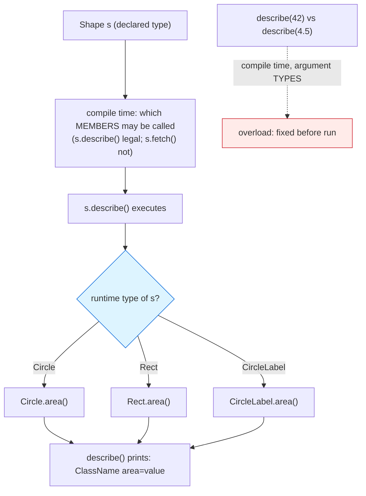

# Polymorphism

## 1. Learning Objectives

After this lesson you will be able to:

- [ ] State Java's dispatch rule precisely — *the runtime type picks the override; the declared
      type picks the overload* — and map each half to executed output.
- [ ] Predict what a `Shape[]` loop prints with mixed subclasses, then verify against the exact
      executed transcript in this lesson.
- [ ] Read dynamic dispatch through three channels: an overridden class method, an interface
      method, and a default method — each executed.
- [ ] Apply `instanceof` and pattern matching to recover the specific type safely, with the
      compiler narrowing the variable for you.
- [ ] Explain the Liskov Substitution Principle as a *test you can run*: substitute a subtype
      for its supertype and see whether anything downstream breaks — and connect its failure to
      an inherited-but-unfit override.
- [ ] Contrast overload (compile-time) with override (runtime) on the same program without
      notes.

## 2. Prerequisites

- [inheritance.md](inheritance.md) — subtypes, upcasts, and the `@Override` contract; this
  lesson is what those make *possible*.
- [methods.md](methods.md) § overload — compile-time selection, the half of the rule this
  lesson contrasts against.
- [interfaces-and-abstract-classes.md](interfaces-and-abstract-classes.md) *comes next* — the
  `Printable`/`Tagged` interfaces used below get their full treatment there; here they are
  dispatch channels.

**Environment used in this lesson:** every transcript executed on the author's machine —
JDK 25.0.4.1, `javac --release 21`.

## 3. Introduction

Polymorphism is one sentence with enormous reach: **a reference's declared type decides which
*members you may call*; the object's runtime type decides *which implementation runs*.** Everything
else — the `Shape[]` loop that treats circles and rectangles identically, the framework that
calls your `@Controller` without knowing its class, the collections that sort any `Comparable` —
is that sentence in context. This lesson makes each clause executable: same call site, different
object, different code, printed.

## 4. The Problem It Solves

Without polymorphism, "draw every shape" means a chain of type tests at every call site:
`if (s instanceof Circle) … else if (s instanceof Rect) …` — and a *fourth* shape means editing
every chain, in every file, forever. Worse, the call sites accumulate shape-specific knowledge,
so the abstraction leaks by construction. With polymorphism the call site holds one sentence —
`s.describe()` — and *the shape classes* hold the variation. New shapes add code in one place
(the new class) and zero places anywhere else. The architecture payoff is subject 16's whole
subject; the local payoff is a loop you can read without knowing what's in it.

## 5. Core Concepts

### The dispatch rule, both halves

- **Override selection is dynamic:** the JVM looks at the *object* and calls its most specific
  implementation. Executed in Example 1: three objects in one `Shape[]`, three different
  `area()` values through the same `describe()` line in the parent.
- **Overload selection is static:** the compiler fixes the *method* from the argument types at
  the call site ([methods.md](methods.md) `describe(42)` → `int` version — decided before the
  program runs). The same word (`describe`) doing double duty in both lessons is deliberate:
  overloads coexist; overrides replace.
- Declared type = *what you can say about* the reference (`Printable p` may call `render()`;
  it may not call `fetch()`); runtime type = *what happens* when you say it.

### Three executed dispatch channels

Example 1 exercises all three in one run: (1) `Shape.describe()` calls `area()` — dispatch
lands on `Circle`, `Rect`, and `CircleLabel` implementations from *one* loop line; (2)
`p.render()` through a `Printable` reference lands on `CircleLabel.render()`; (3)
`((Tagged) p).tag()` runs the interface's **default** method — inherited implementation with no
class-level override — also resolved through the interface type. All three consult the runtime
type; none consults the reference's declared type once the call is legal.

### Narrowing back: `instanceof` and pattern matching

`p instanceof Shape` printed `true` — a runtime check. The upgrade, pattern matching (Java 16+,
standard under `--release 21`): `if (p instanceof CircleLabel cl)` both checks *and* binds a
narrowed local `cl` in one statement — `cl.area()` compiled because the compiler proved the
type inside the branch. The old two-step (`instanceof` then cast) still works; the pattern form
removes the window where they disagree.

### Liskov Substitution Principle (LSP), stated as a test

A subtype must be substitutable for its supertype *without breaking callers*. The test is
operational: put the subtype where the supertype is promised and ask whether anything the
supertype promised still holds. `CircleLabel` passes — Example 1's loop treats it as a `Shape`
and gets a correct area. A subtype that *throws where the parent returned*, or *silently skips
the parent's postcondition*, fails the test — and the failure surfaces as a broken invariant in
code that never heard of your class. `@Override` guarantees you *are* overriding; **nothing
guarantees the override honors the parent's promises** — that one is on the designer, which is
why `final` ([inheritance.md](inheritance.md)) and interface contracts exist.

## 6. How It Works



The blue diamond is the entire mechanism: one branch, taken per object, at call time. The red
side-note is the contrast — overloads never reach that diamond; the compiler resolved them
before the class file existed.

## 7. Practical Examples

**Example 1 — one loop, three objects, three answers (executed)**

```java
abstract class Shape {
    abstract double area();                                  // subclasses MUST define this
    String describe() { return getClass().getSimpleName() + " area=" + area(); }
}
class Circle extends Shape {
    final double r;
    Circle(double r) { this.r = r; }
    double area() { return Math.PI * r * r; }
}
class Rect extends Shape {
    final double w, h;
    Rect(double w, double h) { this.w = w; this.h = h; }
    double area() { return w * h; }
}
interface Printable { String render(); }
interface Tagged {
    default String tag() { return "tagged:" + getClass().getSimpleName(); }  // default method
}
class CircleLabel extends Circle implements Printable, Tagged {
    CircleLabel(double r) { super(r); }
    public String render() { return String.format("circle r=%.1f area=%.2f", r, area()); }
}
public class Shapes {
    public static void main(String[] args) {
        Shape[] shapes = { new Circle(1), new Rect(2, 3), new CircleLabel(0.5) };
        for (Shape s : shapes) System.out.println(s.describe());      // dynamic dispatch
        Printable p = new CircleLabel(2);
        System.out.println(p.render());
        System.out.println(((Tagged) p).tag());
        System.out.println("p instanceof Shape: " + (p instanceof Shape));
        if (p instanceof CircleLabel cl) {                            // pattern matching (Java 16+)
            System.out.println("pattern matched, area=" + cl.area());
        }
    }
}
```

```console
$ javac --release 21 Shapes.java && java Shapes
Circle area=3.141592653589793
Rect area=6.0
CircleLabel area=0.7853981633974483
circle r=2.0 area=12.57
tagged:CircleLabel
p instanceof Shape: true
pattern matched, area=12.566370614359172
$ echo $?
0
```

- **Lines 1–3:** `describe()`'s source never names `Circle`/`Rect`/`CircleLabel` — yet each
  line's `getClass().getSimpleName()` *and* `area()` come from the runtime object. Line 3 is
  the strongest evidence: `CircleLabel` inherits `describe` untouched and still prints
  `CircleLabel` with `CircleLabel`'s area — dispatch through an inherited method into an
  overridden one, two levels.
- **Line 4:** `render()` through the `Printable` reference — the declared type made the call
  legal; the runtime type ran it (`%.1f`/`%.2f` formatting of `Circle`'s inherited `r` and
  `area()` — three inheritance layers cooperating: `CircleLabel` → `Circle` → `Shape`).
- **Line 5:** the *default* method — `CircleLabel` never wrote `tag()`, yet the interface's
  implementation ran and reported the runtime class name.
- **Lines 6–7:** `instanceof` true across the interface-to-class relationship (`CircleLabel` is
  a `Shape` via its superclass — interfaces don't erase class ancestry); the pattern then binds
  `cl` and prints full-precision `area()` through the narrowed type.
- **The precision difference** (line 4 `12.57` vs line 7 `12.566370614359172`) is `String.format`
  rounding, not dispatch — worth noticing so you don't read two values as two computations: both
  are `CircleLabel.area()`, one formatted.

**Example 2 — overloads vs overrides, one program (executed in two lessons)**

From [methods.md](methods.md) Example 1: `describe(42)` / `describe(4.5)` printed
`int: 42 | double: 4.5` — compiler-fixed, argument-typed, never overridden. From Example 1
above: `s.describe()` — object-fixed, runtime-resolved, never overloaded. Same verb, opposite
selection rules; the full contrast in four words: **arguments decide, object decides.**

**Example 3 — the claim, checked (executed)**

```console
$ javac --release 21 Ov.java
Ov.java:2: error: method does not override or implement a method from a supertype
    @Override
    ^
1 error
```

Dispatch silently falling back to a parent is exactly what `@Override` prevents you from
discovering the hard way — restated here because polymorphism *multiplies* the cost: every
call site in every loop would run the parent's version instead of yours.

## 8. Real-World Applications

- **Every framework callback you will ever write** (`doGet`, `handle(MessageEvent`,
  `@Test`-annotated methods invoked reflectively) is polymorphism: the framework holds supertype
  references and your subclass objects supply the behavior — subject 11's controllers are this
  exact loop.
- **Collections over heterogeneous data:** `List<Shape>` sorting by a `Comparator`, or
  `Comparable.compareTo` dispatching per element, are polymorphic calls inside library code you
  use daily — knowing the rule explains why `Collections.sort` needs nothing from *you* except
  an interface implementation.
- **Plugin/strategy architecture** — payment processors, exporters, authenticators: business
  code holds `PaymentProcessor` and never edits itself when a provider is added. That extensibility
  *is* the loop of Example 1 at production scale (subject 16 draws the full picture).

## 9. Common Mistakes

| Mistake | Why it happens | How to recognize it | How to prevent it |
|---|---|---|---|
| Expecting overloads to dispatch on runtime types | Override intuition applied everywhere | Parent-typed arguments selecting the "wrong" overload | Overload = static (arguments); override = dynamic (object) — [methods.md](methods.md) § limit |
| Shadowing instead of overriding | Signature drift (`static`, different params, private) | Parent's code runs; `@Override` would have caught it at compile time | Annotation on every intended override; check modifiers match |
| `if/else` chains over `instanceof` | Pre-polymorphic habit (or missing parent type) | Chain grows per new subtype; edits in N files | Push the variation into the class (Example 1) — chains only for *presentation* decisions |
| Unsafe downcasts everywhere | Wanting subtype behavior through supertype refs | CCEs scattered; cast noise | Pattern matching at the *one* place that narrows ([exceptions.md](exceptions.md) — treat CCE as skipped design) |
| Subtype that violates the parent's promise | Inherited override without reading docs | "Works for Circle, breaks for FancyCircle" | LSP test before adding a subtype; `final` when the contract must hold |
| Assuming interfaces erase `instanceof`-ability | Thinking `Printable p` is only an interface | `p instanceof Shape` surprises (it's `true` — line 6) | The object's full type chain is intact; only *member visibility* followed the declared type |
| Forgetting default methods are virtual too | Defaults feel "static" | Custom override ignored when called through one interface | Defaults dispatch like any override — override them or call `super.tag()` |
| Testing polymorphism with one subtype | Green suite, broken loop | The mixed-array case fails in production | Test with **mixed** containers — Example 1's array shape is the minimum |

## 10. Best Practices

- **Program to the supertype, vary in the subtype:** loop over `Shape`, not over subclasses —
  when you catch yourself enumerating types in client code, the variation is in the wrong place.
- **`@Override` always** — it's the only tool that makes silent shadowing impossible (Example 3).
- **Prefer pattern matching to cast chains** — one statement, one binding, no disagreeing
  second line; and *only* where the type actually matters — most call sites shouldn't narrow at
  all.
- **Design subtypes with the LSP sentence written down:** "a `CircleLabel` used as a `Shape`
  always returns a correct area" — postconditions the parent promised are the child's debt.
- **`final` methods on classes not designed for extension** — protects your own dispatch
  decisions (and the JDK does the same: `String.equals` is `final`, which the
  [arrays-and-strings.md](arrays-and-strings.md) `==`-habit lesson relies on).
- **One dispatch vocabulary per hierarchy** — don't mix "call `describe()`" and "switch on
  `getClass()`" for the same decision; two mechanisms disagree eventually.

## 11. Limitations and Trade-Offs

- **You cannot add virtual methods retroactively** — every un-overridable choice (private,
  static, final, missing) silently routes to one implementation; audit when inheriting.
- **The Java Memory Model's safe publication matters here:** in single-threaded code an object
  is fully built before reference publication; across threads, unsafe publication can expose a
  *partially initialized* subtype to dispatch (the classic final-field discussion — the safe
  rules are in [concurrency.md](concurrency.md), which executes the races you can actually
  reproduce). Stated here so the single-threaded simplification is explicit, not implied.
- **Default methods are a compromise:** they rescue interfaces from breaking changes but add a
  second inheritance channel (class vs interface overrides — the class wins; ties among
  interfaces are compile errors) — a complexity you accept, not enjoy.
- **Dispatch costs a pointer chase per call** — trivial next to I/O, not free in tight numeric
  loops; the escape hatch is `final` classes (JIT can devirtualize) or algorithms over
  primitives, which is why hot paths often look less polymorphic than the rest of the code.

## 12. Practical Exercises

### Introductory

1. **Reproduce Example 1**, then predict before running: what prints if `CircleLabel` is
   replaced in the array by `new Rect(1, 1)` while `p` keeps its object? **Completion criteria:**
   the original transcript reproduced, your predicted four lines (loop + three calls), then the
   actual run matching — with the one line that *changed* explained by runtime type.
2. **Overload/override same-named drill.** In one file: a parent `String what()` and child
   override; plus parent overloads `pick(int)`/`pick(String)`. Call each through a parent
   reference holding a child. **Completion criteria:** output showing the override following the
   child and the overloads following the *argument* types, each with a one-line annotation of
   which rule decided.

### Intermediate

3. **Break LSP on purpose.** Extend `Shape` with a subtype whose `area()` throws
   `UnsupportedOperationException("no area")`; run Example 1's loop. **Completion criteria:**
   the crash (trace + exit code) at the *loop's* line — then your fix using two different
   mechanisms (drop the subtype from the hierarchy vs have it return a legitimate value), with a
   sentence on which is right when the domain really has area-less shapes (hint: parent design —
   [abstraction.md](abstraction.md)).
4. **Dispatch through three channels, yourself.** Write `Soundable` (interface with `play()`,
   one default `describe()`), an abstract parent with one concrete method, and two children;
   drive all through parent and interface references. **Completion criteria:** a 4-line output
   table — channel × declared type × runtime type × implementation that ran — every entry
   predicted first.

### Independent problem-solving

5. **The plugin loop.** Design a log-processing pipeline: `LogFilter` interface (`accept`), a
   `Line` supertype, and at least three filters (severity, substring, rate-limit) plus two line
   renderers — with the driver holding only `List<LogFilter>` and a renderer *chosen
   polymorphically* (no `instanceof` anywhere in `main`). Then add a fourth filter without
   touching the driver. **Completion criteria:** the driver source shown with zero type tests
   (state this explicitly — grep `instanceof` and show the empty result); output from a mixed
   pipeline run; and the diff of your fourth filter (one new file/class, zero changed lines
   elsewhere) as the evidence that variation lives where it should.

*Solutions: attempt first; set practice in [exercises/README.md](exercises/README.md).*

## 13. Knowledge Check

1. Example 1, line 1 of output — trace from `s.describe()` to `Math.PI * r * r`: which frames
   exist, and which two dispatch decisions happened on the way?
2. Why did line 4 and line 7 print *different precisions* for the same area — and what would
   tell you they were still the same computation?
3. State the exact split between overload and override selection, and give the executed line
   from [methods.md](methods.md) that proves the overload half.
4. What does `instanceof` test that `getClass() ==` does not — and which one does Java's
   `equals`-idiom favor for subclasses?
5. Write the LSP sentence for `CircleLabel` as `Shape`, then describe a failing subtype in one
   sentence — and which part of Example 1's output it would break.

## 14. Completion Criteria

Observable evidence that you have understood this lesson:

- [ ] Example 1's seven output lines reproduced, with predictions written first
- [ ] You can point to one line proving class-method dispatch, one proving interface dispatch,
      and one proving default-method dispatch
- [ ] The overload-vs-override contrast is stated from memory and tied to one executed line in
      each lesson it lives in
- [ ] You produced a broken-LSP crash *and* named the right fix for a domain that permits it
- [ ] Your plugin-loop exercise runs with zero `instanceof` in the driver, verified by search

## 15. Summary

- **Declared type gates the call; runtime type runs it** — one sentence, both halves executed.
- The `Shape[]` loop is the payoff: variation inside classes, stability at the call site.
- Overloads are compile-time (arguments); overrides are runtime (object) — same word, opposite
  rules.
- `instanceof` + pattern matching recover specificity *safely*, in one statement.
- LSP is a runnable test — substitutable subtypes are the price of the loop's correctness, and
  `@Override` checks the form while you check the promises.

## 16. Next Steps

- Next lesson: [abstraction.md](abstraction.md) — why `Shape` is abstract in Example 1, how to
  decide what belongs in the parent, and when abstraction is the wrong move.
- Practice: [exercises/README.md](exercises/README.md) set 10.
- Where it is applied: [11-BACKEND-ENGINEERING](../11-BACKEND-ENGINEERING/README.md)'s
  interface-driven services, and every Spring bean you will ever write.
