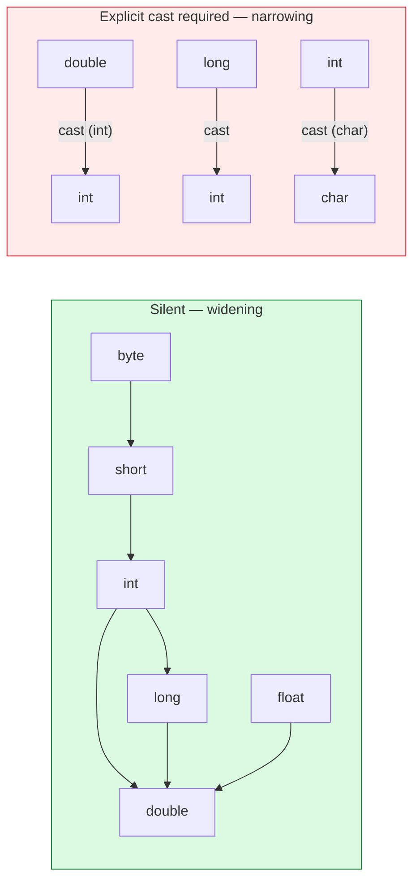

# Variables and Types

## 1. Learning Objectives

After this lesson you will be able to:

- [ ] Name Java's eight primitive types with their sizes, defaults, and the range each one implies.
- [ ] Predict what `int`, `long`, `double`, and `char` arithmetic *returns* — including the cases
      that surprise: wraparound, truncation, and `'A' + 1`.
- [ ] Explain widening vs narrowing conversion, and show the compiler enforcing the boundary
      (`possible lossy conversion`).
- [ ] State where defaults come from: fields get them, locals do not — with both behaviors demonstrated.
- [ ] Write literals deliberately: hex, binary, digit separators, and the `L`/`f` suffixes.
- [ ] Say what a reference type holds, what `null` means, and why the answer to "is Java
      pass-by-reference?" is no.

## 2. Prerequisites

- [java-environment-setup.md](java-environment-setup.md) — you can compile, run, and read a
  `javac` error (every example here was compiled with `--release 21`).
- [java-program-structure.md](java-program-structure.md) — variables live in fields and locals of
  the classes introduced there.
- [02-PROGRAMMING-FUNDAMENTALS/variables-and-data-types.md](../02-PROGRAMMING-FUNDAMENTALS/variables-and-data-types.md) —
  the language-agnostic model (binding, mutability); this lesson is that model with a **static
  type system arguing with you**.

**Environment used in this lesson:** every transcript executed on the author's machine —
JDK 25.0.4.1, `javac --release 21`, Git Bash. Outputs are verbatim, including the compile errors.

## 3. Introduction

In subject 02 a variable was a name bound to a value; types were the *shapes* those values had.
Java adds a hard rule: **the shape is declared, checked before anything runs, and never changes
for that variable.** That single addition converts whole categories of yesterday's runtime
surprises into compile-time errors — and introduces its own new category: the compiler *refusing*
conversions you did not intend. This lesson is about getting fluent in that negotiation.

## 4. The Problem It Solves

Dynamic languages discover type mismatches when a stranger calls your function with the wrong
shape, at the worst moment. Static typing moves the argument to build time, where the error
carries a file, a line, and a caret. The cost: you must *declare* intent (`int`, not `var
thing`), and you must learn where Java converts silently and where it demands a cast — otherwise
the compiler's refusals look like bureaucracy instead of protection.

## 5. Core Concepts

### The eight primitives

| Type | Size | Default (fields) | Range / note |
|---|---|---|---|
| `byte` | 8 bits | `0` | −128…127 — small counts, raw data |
| `short` | 16 bits | `0` | −32768…32767 — rare |
| `int` | 32 bits | `0` | ±2.1 billion — the default for whole numbers |
| `long` | 64 bits | `0L` | ±9.2×10¹⁸ — big IDs, timestamps, counts of things |
| `float` | 32 bits | `0.0f` | ~7 significant digits — sizes, ratios at scale |
| `double` | 64 bits | `0.0` | ~15 digits — **the default for decimals** |
| `char` | 16 bits | `'\u0000'` | 0…65535, Unicode code unit — `char` is *unsigned* |
| `boolean` | — (JVM-defined) | `false` | `true`/`false` only; never an integer |

Two defaults rules that matter more than the table: **fields** (class members) receive these
values automatically; **locals** (inside methods) receive nothing and the compiler *requires*
assignment before first use.

### Reference types — the other half

`String`, arrays, and every class you write are **reference types**: the variable holds a
*reference* (an address) to an object, not the object itself; the default is `null`. Primitives
are copied by value; references are *copied by value too* — but what they point at is shared,
which is why mutating an object through one reference is visible through another (see
[methods.md](methods.md) for the executed proof).

### Conversions: silent one way, explicit the other

**Widening** (smaller→larger: `int`→`long`→`double`) happens silently — no data-hiding surprises
by default. **Narrowing** requires an explicit cast because it *can* throw information away
(`(int) 3.99` → `3` — truncation, not rounding). The compiler draws that line with
`error: incompatible types: possible lossy conversion` — executed below.

### The arithmetic surprises (all four executed)

1. **Silent wraparound:** `Integer.MAX_VALUE + 1` is `int` arithmetic → `-2147483648`. No error,
   no exception — correct two's-complement semantics, wrong for your intent.
2. **Integer division truncates:** `7 / 3` is `2`; `7 / 3.0` is `2.3333333333333335`.
3. **`char` is a number:** `'A' + 1` is `int` `66`; cast it back to get `'B'`.
4. **Decimal equality lies:** `0.1 + 0.2 == 0.3` is `false` — binary floating point, exactly as
   in subject 02, and the fix is the same (compare with an epsilon, or use decimal types when
   money is involved).

## 6. How It Works



Left half: conversions the compiler performs for you (arithmetic *promotes* to the wider type
before operating — that is why `'A' + 1` is an `int`, not a `char`). Right half: every arrow
crosses a loss boundary, so Java demands you write the cast and own the loss.

## 7. Practical Examples

**Example 1 — ranges, division, modulo, char (executed)**

```java
int max = Integer.MAX_VALUE;
long big = max + 1L;            // widening happens silently when safe
int wrapped = max + 1;          // int + int stays int: silent wraparound
double d = 3.99;
int narrowed = (int) d;         // narrowing needs an explicit cast
char c = 'A';
System.out.println("max=" + max);
System.out.println("max + 1L = " + big);
System.out.println("max + 1  = " + wrapped);
System.out.println("(int) 3.99 = " + narrowed);
System.out.println("'A' + 1 = " + (c + 1) + "  (char) ('A' + 1) = " + (char) (c + 1));
System.out.println("7 / 3 = " + (7 / 3) + "   7 / 3.0 = " + (7 / 3.0));
System.out.println("10 % -3 = " + (10 % -3) + "   -10 % 3 = " + (-10 % 3));
System.out.println("0.1 + 0.2 == 0.3 ? " + (0.1 + 0.2 == 0.3));
```

```console
$ javac --release 21 Types.java && java Types
max=2147483647
max + 1L = 2147483648
max + 1  = -2147483648
(int) 3.99 = 3
'A' + 1 = 66  (char) ('A' + 1) = B
7 / 3 = 2   7 / 3.0 = 2.3333333333333335
10 % -3 = 1   -10 % 3 = -1
0.1 + 0.2 == 0.3 ? false
```

- Line 3 vs line 2 is the entire widening/wraparound lesson in two adjacent outputs: adding
  `1L` promotes to `long` first (2147483648), adding `1` does not (wraps to negative).
- Modulo keeps the **dividend's sign** (`10 % -3` = 1, `-10 % 3` = −1) — the same rule Python
  reversed in subject 02; both are "reasonable", neither is universal.
- **How to run it:** one file, the two-command cycle from the setup lesson.

**Example 2 — fields default, locals don't (executed)**

```java
static int counter;            // fields DO get defaults...
static String label;           // ...including null for references
static boolean flag;
static double ratio;
// in main:
int local;                 // locals get NO default...
local = 7;                 // ...but assignment before use is enforced
System.out.println("int field     = " + counter);
System.out.println("String field  = " + label);
System.out.println("boolean field = " + flag);
System.out.println("double field  = " + ratio);
System.out.println("local after assignment = " + local);
```

```console
$ javac --release 21 Defaults.java && java Defaults
int field     = 0
String field  = null
boolean field = false
double field  = 0.0
local after assignment = 7
```

- The `null` line is your first reference-type default — a declared `String` field that nobody
  assigned is *not* empty, it is **absent**; calling `.length()` on it throws (executed in
  [arrays-and-strings.md](arrays-and-strings.md)).
- Omit the local's assignment:

```console
$ javac --release 21 Uninit.java
Uninit.java:4: error: variable x might not have been initialized
        System.out.println(x);
                           ^
1 error
$ echo $?
1
```

- The caret points at *use*, not declaration — the compiler's message for "I cannot prove this
  was assigned on every path", the earliest member of the definite-assignment family you will
  meet again with loops and conditionals.

**Example 3 — literals, written deliberately (executed)**

```console
$ java Defaults.java   # after: int hex = 0x1F, bin = 0b1010, sep = 1_000_000;
                       #        long l = 9_000_000_000L; float f = 3.14f;
hex=31 bin=10 sep=1000000 long=9000000000 float=3.14
```

- `0x`/`0b` prefixes, `_` separators (read as typography: `1_000_000`), `L` for `long`
  (mandatory past `int`'s range), `f` for `float` (without it, `3.14` is a `double` and will not
  fit a `float` without a cast). Each suffix is a *type decision made at the literal*.

**Example 4 — the compiler enforcing the boundary (executed)**

```console
$ javac --release 21 Bad2.java
Bad2.java:3: error: incompatible types: possible lossy conversion from double to int
        int whole = 3.99;
                    ^
1 error
$ echo $?
1
```

- The single most important compile error of this lesson: Java will not *narrow* without being
  told, because the program would silently become `(int) 3.99 = 3`. The fix is the programmer's
  decision — `int whole = (int) 3.99;` — and the design question (truncation vs rounding) stays
  with you.

**Example 5 — two overflows, neither throws (executed)**

```console
$ java Methods        # int version: fact(25) computed in int arithmetic
2076180480
$ java BigFact        # long version: fact(25) computed in long arithmetic
7034535277573963776
```

- The true value is 15,511,210,043,330,985,984. **Neither run printed an error** — overflow in
  Java is *defined behavior*, not an exception. `int` and `long` disagree with reality, loudly
  wrong and silently happy. (Reaching for `BigInteger` when numbers must be exact is the
  antidote; knowing the sizes in the table is the prevention.)

## 8. Real-World Applications

- **Money:** `int` cents or `BigDecimal` — never `double` for values that must add up
  (Example 1's `false` is why); the type choice *is* the correctness decision.
- **IDs and timestamps:** database keys and epoch millis exceed `int` — `long` by default,
  because Example 5's class of bug ships to production otherwise.
- **Unicode text:** `char` is a UTF-16 *code unit*, not a "letter" — emoji and old scripts need
  `String`/code-point thinking (exercised in [arrays-and-strings.md](arrays-and-strings.md));
  knowing `char`'s actual range prevents off-by-one indexing of text.

## 9. Common Mistakes

| Mistake | Why it happens | How to recognize it | How to prevent it |
|---|---|---|---|
| `double` for money | It "works" for tests | Balances off by fractions that grow | `int`/`long` minor units, or `BigDecimal` |
| Silent overflow in counters/totals | `int` default; wrap looks like success | Total goes *negative*; results absurd, no error | `long` for anything that accumulates; sanity bounds in tests |
| `==` on `String`/objects | Primitive habit | `true` for literals, `false` otherwise | `.equals(...)` always for content (proof in [arrays-and-strings.md](arrays-and-strings.md)) |
| `char` arithmetic assumptions | `'A' + 1` "should" be a char | type error or wrong number | Remember: `char` promotes to `int` in arithmetic; cast back intentionally |
| Expecting division to produce decimals | Integer types divide first | `7/3` = 2 with a "correct" formula | Make *one* operand a `double` (`7.0/3`), or scale explicitly |
| "Java is pass-by-reference" folklore | Objects *feel* shared | Reassigning a parameter "does nothing" | References are copied by value; mutation-of-object ≠ reassignment (executed in [methods.md](methods.md)) |
| Ignoring `null` until the NPE | Default field feels "empty" | `NullPointerException` at the weirdest line | Defaults table above; `Optional`/early-return patterns in later lessons |

## 10. Best Practices

- **Declare intent, not just storage:** choose `long`/`int`/`double` by *what the number means*;
  the name plus the type is the contract (`long orderId`, `int retryCount`).
- **`final` for values that must not rebind** — the compiler enforces immutability intent
  (`static final String COURSE` in the structure lesson).
- **Name constants for magic numbers:** `MAX_RETRIES = 3` beats `3`, and `long` sizes in the
  table become unnecessary to remember when the name says `MILLIS_IN_DAY`.
- **Let widening happen; write narrowing out loud** — if you are casting, add the comment saying
  *why* truncation is acceptable there.
- **Test boundaries:** any loop-driven total deserves a test at `Integer.MAX_VALUE`-adjacent
  inputs — Example 5's outputs are what those tests catch.
- **Try `var` for locals where the type is obvious from the right-hand side** — Java's local
  inference (Java 10+) removes noise without giving up static checking; a good exercise in
  [exercises/README.md](exercises/README.md) set 1 is proving where it helps and where it hides
  intent.

## 11. Limitations and Trade-Offs

- Primitive vs object duplication (`int` vs `Integer`, generics needing wrappers) is a real cost
  of the design — autoboxing papers over it until performance or `null` shows the seam (met again
  in [collections-framework.md](collections-framework.md)).
- Wraparound is *defined*, so the compiler cannot warn you — correctness at the edges is a testing
  job ([14-TESTING-AND-QUALITY](../14-TESTING-AND-QUALITY/README.md)).
- `char`/UTF-16 predates the full Unicode range; the honest current model is code points via
  `String` — this lesson teaches `char` because the language still ships it, and teaches its
  limits in the same breath.
- Static typing adds declaration ceremony that dynamic languages skip — the trade this whole
  subject exists to let you evaluate firsthand.

## 12. Practical Exercises

### Introductory

1. **Reproduce Examples 1–4** in one file per example. **Completion criteria:** all four outputs
   (or errors) produced by you, predicted *before* running — including the two modulo signs and
   the `0.1 + 0.2` line.
2. **Fill the table from evidence.** For each of the eight primitives, write a program that prints
   `MAX_VALUE`-style bounds or its default (fields), and the actual `Class` name via
   `System.out.println((3).getClass())`… adjust: use reflection-free means — print sizes with the
   wrapper class (`Integer.BYTES`, `Long.SIZE`). **Completion criteria:** eight values produced by
   your runs, not copied from the lesson.

### Intermediate

3. **The overflow hunt.** Write a loop that adds `Integer.MAX_VALUE / 2` three times into an
   `int` and the same into a `long`; show the `int` result go wrong while the `long` holds, then
   show the `long` failing at a bigger count. **Completion criteria:** both failures produced
   with output, and one sentence naming what would have caught them (type choice? test?).
4. **Narrowing on purpose.** Demonstrate truncation, rounding, and a *dangerous* narrowing
   (`(int) 2_000_000_000L` vs `(int) 4_000_000_000L`) — then fix the dangerous one with rounding
   and bounds checking. **Completion criteria:** three casts with outputs, and the guard you would
   keep in real code.
5. **The definite-assignment riddle.** Write three methods where a local is (a) always assigned,
   (b) conditionally assigned, (c) assigned in one branch only — compile all three and record
   which the compiler rejects and *why its message is right*. **Completion criteria:** three
   compile results, with your explanation tied to "on every path".

### Independent problem-solving

6. **Design a ledger's numeric types.** Given: balances in a currency with 2 decimals, a rewards
   counter, millisecond timestamps, a percentage 0.0–100.0, and a sequence number that will reach
   10¹² — choose a type for each from the table, write the declaration line, and justify every
   choice against one of this lesson's executed surprises. **Completion criteria:** five
   declarations, five justifications, and a one-paragraph answer to "what breaks first if we use
   `double` for everything?" — the paragraph must cite a specific executed output.

*Solutions: attempt first; the set-based problems are in [exercises/README.md](exercises/README.md)
with solutions held back behind their warning headers.*

## 13. Knowledge Check

1. `int i = Integer.MAX_VALUE; i++;` — what prints, and why does nothing throw? What should you
   have declared instead if `i` counts events on a busy server?
2. Why does `(int) 3.99` compile while `int x = 3.99` does not? Name the error text the second
   one produces.
3. A field `String name;` and a local `String name;` — what does each hold before assignment, and
   which does the compiler police?
4. `System.out.println('A' + 1)` and `System.out.println((char)('A' + 1))` — outputs, and the
   single promotion rule that explains both.
5. `0.1 + 0.2 == 0.3` is false in Java. Was subject 02's explanation wrong? What is the fix for
   money?

## 14. Completion Criteria

Observable evidence that you have understood this lesson:

- [ ] You have executed Examples 1–5, including producing two compile errors and both overflows
      yourself
- [ ] You can recite the eight primitives with sizes and field defaults from memory, then verify
      against your own runs
- [ ] You can explain every line of Example 1's output *before* running it
- [ ] You have demonstrated field-vs-local initialization with the compiler's own refusal as evidence
- [ ] You can state where Java converts silently, where it refuses, and what a cast means morally
      (an ownership statement about lost data)

## 15. Summary

- **Eight primitives, defaults for fields only; locals must be assigned** — both halves executed.
- **Widening is silent, narrowing is typed** — `possible lossy conversion` is the boundary text.
- **Arithmetic surprises are defined behavior:** wraparound, integer division, `char` promotion,
  and floating-point inequality all print without errors.
- **References hold addresses; `null` is absence** — the default that becomes every NPE story.
- **The size you choose is a correctness decision** — `long` for IDs, `int`/`BigDecimal` for money.

## 16. Next Steps

- Next lesson: [operators-and-control-flow.md](operators-and-control-flow.md) — precedence traps,
  short-circuit evaluation (executed here already), and Java's `switch` expressions.
- Practice: [exercises/README.md](exercises/README.md) set 1.
- Where it is applied: every later subject's APIs choose these types for you — reading a
  signature (`long`, `double`, `char`) fluently is reading the contract.
